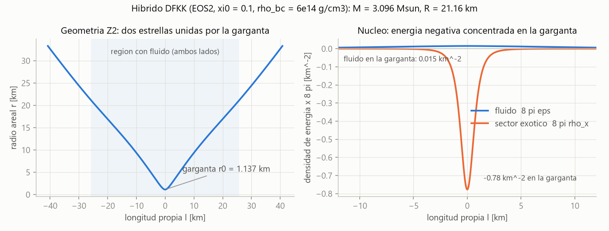
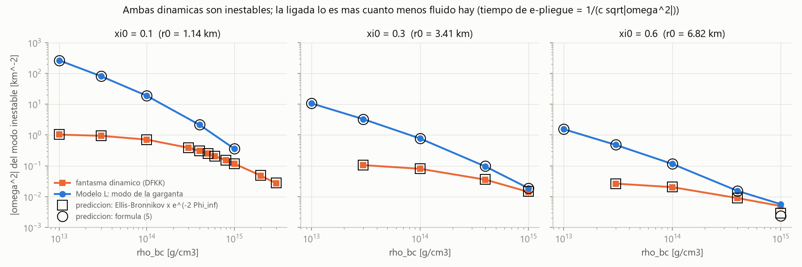
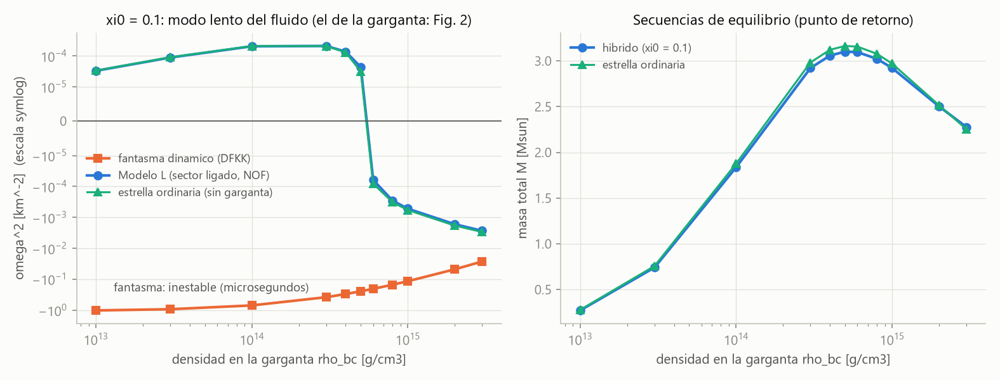
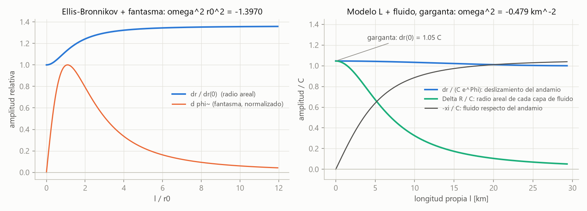

# Híbrido estrella–agujero de gusano — Fase 2: integrador en longitud propia, validación DFKK y test de H1

*Documento de trabajo v0.2 · 2026-10-20 · continúa [fase1/fase1_marco_teorico.md](../fase1/fase1_marco_teorico.md)*

## Resumen

1. **Integrador validado.**
   - Se integran en longitud propia (regular en la garganta) los fondos estáticos y sus perturbaciones radiales, con dos sectores exóticos: el fantasma dinámico de DFKK y el sector ligado de Nojiri–Odintsov–Folomeev (NOF).
   - Ecuaciones perturbadas verificadas con SymPy (6/6).
   - Tablas de DFKK: masas exactas a 4 cifras y radios a $10^{-4}$.
   - Autovalor de Ellis–Bronnikov a $2\times10^{-7}$ del de Torii–Shinkai; el de Kodama, a $2\times10^{-4}$ del de DFKK.
   - Teorema del punto de retorno reproducido a $10^{-5}$.
   - Principio del argumento: no hay autovalores complejos (sobreestabilidad) en ninguna de las cuatro configuraciones comprobadas.
2. **El fantasma dinámico es inestable en todas las configuraciones**, con $\tau\sim$ μs, como halló DFKK.
   - Medido con el reloj de la garganta, su autovalor es el de Ellis–Bronnikov aislado, $\omega^2r_0^2=-1.397$, con un error ≤ 4.5 % en 18 de 19 configuraciones.
   - La estrella no frena la garganta: solo desplaza al rojo su tasa de crecimiento.
3. **El sector de NOF se reduce, en fondos tipo DFKK, a un "andamio radial rígido"** (Modelo L). Un agujero de Ellis así sostenido **no tiene ningún modo radial**: la garganta queda anclada (resultado analítico, $u_\infty=\pi C/2a$).
4. **Pero H1 queda refutada.** La inestabilidad de la garganta no reside en la energía cinética del fantasma sino en la configuración estática:
   - Con un perfil exótico compacto, el autovalor inestable del sector ligado coincide con el del fantasma en un 0.04 %.
   - Con un perfil de largo alcance, cualquier materia que atraviese la garganta le da inercia y la desestabiliza con $\omega^2\simeq-c^4/(16Gr_0^3\Sigma)$ (reloj de la garganta), donde $\Sigma$ es la columna de masa.
   - Esta fórmula analítica reproduce los autovalores numéricos al 0–3 % en 14 de 15 configuraciones.
   - El modo es tanto más rápido cuanto menos materia hay y, con poca materia, más rápido que $r_0/c$, lo que delata además la acausalidad de la ligadura.
5. **Hay una tercera inestabilidad, en el sector impar:** el fluido pasa de una estrella a la otra a través de la garganta.
   - Aparece en todas las configuraciones, también en la rama estable.
   - Su tasa la fija la densidad local en la garganta, $|\omega^2|\approx4\pi G(\rho+3P/c^2)$, y no depende del tamaño de la garganta: $\tau\approx$ 0.04–0.3 ms en estrellas de neutrones.
   - Aparece tanto con el andamio libre como con el sujeto.
6. Los modos lentos pares del plasma sí se comportan como en una estrella ordinaria: esa parte de H1 se cumple.
7. **La condición en el infinito del Modelo L queda fijada por un criterio físico.** Solo la condición libre (andamio que puede deslizar) reproduce la estrella ordinaria cuando la garganta se encoge. Sujetar el andamio introduce un modo espurio: $\omega^2=-0.92$ km⁻² con $r_0=11$ m.
8. **Para una estrella G2V no hay híbrido radialmente estable** con un sector exótico de un solo escalar en RG.
   - Para $r_0=1$ km, $\tau\approx2.8\ \mu$s con el fantasma y $\approx53$ ps con el sector ligado.
   - En una configuración $\mathbb Z_2$ quedaría además el flujo impar, con $\tau\sim1$–2 min en el centro solar (extrapolación).
9. **Próximo paso:** cambiar la estática de la garganta, con escalar–Gauss–Bonnet o con un sector NOF anisótropo ($A\neq0$), y recomprobar en ella el sector impar.

---

## 1. Formulación numérica

### 1.1 Gauge, variables y unidades

Unidades geométricas $G=c=1$ con longitudes en km. Fondo estático con simetría $\mathbb Z_2$ (dos estrellas idénticas unidas por la garganta, $\ell\in(-\infty,\infty)$) y perturbaciones radiales $\propto e^{i\omega t}$, $w\equiv\omega^2$:

$$
ds^2=-e^{2(\Phi+\delta\Phi)}dt^2+d\ell^2+(r+\delta r)^2d\Omega^2 ,\qquad g_{\ell\ell}=1,\ g_{t\ell}=0 .
\tag{1}
$$

Este gauge (longitud propia, *shift* nulo) es regular en la garganta, donde el gauge areal falla ($r'=0$). El radio de la garganta perturbado $\delta r(0)$ es físico.

El sector exótico usa la normalización de DFKK: $\tilde\phi=\sqrt{8\pi}\,\phi$, $\tilde V=8\pi V$, de modo que

$$
8\pi T^{(\phi)}=\Big\{\rho:-\tfrac12\tilde\phi'^2+\tilde V,\quad p_r:-\tfrac12\tilde\phi'^2-\tilde V,\quad p_t:+\tfrac12\tilde\phi'^2-\tilde V\Big\}.
$$

El fluido usa la EoS de DFKK: $P=K\rho_b^{1+1/n}$, $\varepsilon=\rho_b+nP$, con $\rho_b=\rho_{bc}\theta^n$. Para EOS2 ($k=0.1$, $\gamma=2$) se obtiene $K=812.85\ \text{km}^2$. El equilibrio hidrostático se integra exactamente: $e^{\Phi}[1+\sigma(n+1)\theta]=$ cte, con $\sigma=K\rho_{bc}^{1/n}$.

### 1.2 Fondo (ec. 2.10 de la Fase 1)

$$
r''=\frac{1-r'^2}{2r}-\frac r2\left(8\pi\varepsilon+\tilde\rho_x\right),\qquad
\Phi''=8\pi P+\tilde p_{t,x}-\frac{r''}{r}-\Phi'^2-\frac{r'\Phi'}{r},\qquad
\tilde\phi''=-\tilde V'-\Big(\Phi'+\frac{2r'}{r}\Big)\tilde\phi' .
\tag{2}
$$

En la garganta: $r=r_0$, $r'=\Phi'=\tilde\phi=0$. La ligadura (2.4) fija $\tilde\phi'(0)^2=2\,(8\pi P_0-\tilde V(0)+r_0^{-2})$. La masa ADM se obtiene de $m=\tfrac r2(1-r'^2)$ más la cola analítica del fantasma, $-\tfrac14\tilde\phi'^2r^3$.

### 1.3 Ecuaciones perturbadas

Las ecuaciones se verificaron con SymPy ([verificar_lineal.py](verificar_lineal.py), 6/6). Se usan $\Psi\equiv\delta\Phi'$, el desplazamiento lagrangiano propio $\xi$ y $\Delta P$:

$$
\begin{aligned}
\textbf{E1 (momento):}\quad & \delta r'=\Phi'\delta r+4\pi r(\varepsilon+P)\,\xi\;\big[+\tfrac r2\tilde\phi'\,\delta\tilde\phi\big]_{\rm fantasma}\\
\textbf{Lapso }(R_{\ell\ell}):\quad & \Psi'=-2\Phi'\Psi-\frac{2\,\delta r''}{r}+\frac{2r''\delta r}{r^2}-\tfrac12\Big[8\pi(\delta\varepsilon-\delta P)+\delta\tilde S_x\Big]\\
\textbf{Fluido:}\quad & \xi'=-\frac{\Delta P}{\Gamma_1P}-\frac2r\,(r'\xi+\delta r)\\
& \Delta P'=w(\varepsilon+P)e^{-2\Phi}\xi-\Phi'\Delta P-(\varepsilon+P)\Big[\Psi+\Phi''\xi-\frac{2\Phi'}{r}(r'\xi+\delta r)\Big]
\end{aligned}
\tag{3}
$$

Las magnitudes eulerianas son $\delta P=\Delta P-P'\xi$ y $\delta\varepsilon=(\varepsilon+P)\Delta P/(\Gamma_1P)-\varepsilon'\xi$. La componente $R_{\ell\ell}$ de las ecuaciones de Einstein no contiene derivadas temporales de forma exacta, así que da una ecuación de lapso regular en la garganta. La identidad de Bianchi garantiza que, si la componente $\ell\ell$ de Einstein (E3) se cumple en $\ell=0$, se cumple en todo punto.

Los dos sectores exóticos comparten el mismo fondo y difieren en la dinámica:

| | Fantasma dinámico (DFKK) | Modelo L (sector ligado de NOF, §2) |
|---|---|---|
| Variable | $\delta\tilde\phi$ (2.º orden) | $\delta\tilde\Lambda\equiv16\pi\,\delta\lambda$ (1.er orden, sin $\partial_t$) |
| Ecuación | $\delta\tilde\phi''=-we^{-2\Phi}\delta\tilde\phi-(\Phi'+\tfrac{2r'}{r})\delta\tilde\phi'-\tilde\phi'\big(\Psi+2(\tfrac{\delta r}{r})'\big)-\tilde V''\delta\tilde\phi$ | $\delta\tilde\Lambda'=-(\Phi'+\tfrac{2r'}{r})\delta\tilde\Lambda+\tilde\phi'^2\big(\Psi+2(\tfrac{\delta r}{r})'\big)$ |
| $\delta\tilde S_x=8\pi\delta(\rho+p_r-2p_t)_x$ | $-4\tilde\phi'\delta\tilde\phi'+2\tilde V'\delta\tilde\phi$ | $\delta\tilde\Lambda$ |
| Grados de libertad propios | 1 (energía cinética negativa) | 0 |

**Condiciones de contorno.**

- **Garganta (modos pares):** $\xi=\Psi=\delta\tilde\phi=0$, con la ecuación de movimiento de la garganta (E3 en $\ell=0$):
  $$\frac{2\,\delta r_0}{r_0^3}\left(1+w\,r_0^2e^{-2\Phi_0}\right)=8\pi\,\Delta P_0+\delta\tilde p_{r,x}(0),\qquad \delta\tilde p_{r,x}=\begin{cases}-\tilde\phi'\delta\tilde\phi' & \text{fantasma}\\ \delta\tilde\Lambda & \text{Modelo L}\end{cases}\tag{4}$$
  Es equivalente a la condición (51) de DFKK en su gauge.
- **Modos impares (solo Modelo L):** $\delta r=\Delta P=\delta\tilde\Lambda=0$ en $\ell=0$, con $\xi(0)$ y $\Psi(0)$ libres.
- **Superficie:** $\Delta P(\ell_s)=0$.
- **Infinito:** para el fantasma, $\delta\tilde\phi\propto e^{-\kappa\ell}/r$. Para el Modelo L, $u_\infty\equiv\lim e^{\Phi}r^2\delta\tilde\Lambda=0$, con el deslizamiento del andamio $C=\lim e^{-\Phi}\delta r$ libre.
  - Una cola $\delta\tilde\Lambda\sim u_\infty/r^2$ produce $\delta\Phi\sim\ln r$: sería una fuerza radial aplicada desde el infinito, incompatible con un sistema aislado.
  - La alternativa, sujetar el andamio ($C=0$), no reproduce la estrella ordinaria cuando la garganta se encoge (§7, punto 6). La condición libre sí lo hace.

### 1.4 Método

- **Fondo:** DOP853 con `rtol` $=10^{-11}$, en tramos fluido | exterior | (campo cuártico congelado en su máximo), con salida densa.
- **Autovalores:** se integran dos soluciones fundamentales desde la garganta y se busca el cero de $D(w)=F_1^aF_2^b-F_1^bF_2^a$.
  - Para $w<0$ las perturbaciones del fluido son evanescentes, con tasa $\sqrt{|w|}/c_s$ y $c_s\to0$ en la superficie. La superposición directa desborda (por encima de $e^{300}$) y pierde la independencia lineal de las soluciones.
  - Por eso se evoluciona la 2-forma de Plücker $Y=ab^{\sf T}-ba^{\sf T}$, con $Y'=AY+YA^{\sf T}$, renormalizando por factores positivos. Este es el método de la **matriz compuesta**: $D=\sum_jc_jY_{1j}$.
  - Para que las componentes de $Y$ sean $O(1)$ se usan las variables reescaladas $u=e^\Phi r^2\delta\tilde\Lambda$ y $\Delta P/P_0$.
  - En el Modelo L se resta analíticamente la cola $u(\ell)=u_\infty+w\,C\tilde D^2e^{-2\Phi}/r+O(r^{-2})$, con $C=e^{-\Phi}\delta r$ y $\tilde D=\tilde\phi'e^{\Phi}r^2$. Solo es relevante para $|w|$ grande. Con ella, el autovalor del modo de la garganta varía menos de $10^{-5}$ entre $\ell_{\max}=2\times10^3$ y $5\times10^4$ km (§4.3).
  - Comprobación independiente del signo de $D$: ortonormalización QR de Godunov.
- **Autovalores complejos:** $D(w)$ es entera, y el reescalado del método compuesto es un factor real positivo que no altera $\arg D$. Por eso el **principio del argumento** cuenta todos los autovalores encerrados en un contorno, incluidos los complejos (sobreestabilidad). Para evitar el aliasing de fase junto al cúmulo de sobretonos del fluido, la región se divide en rectángulos, y el muestreo de cada lado sigue la fase del factor del fluido $\sinh(T\sqrt{-w})/(T\sqrt{-w})$ (§4.6).

---

## 2. El sector ligado de NOF se reduce, en fondos tipo DFKK, a un "andamio radial rígido"

**Acción de NOF** ([arXiv:2401.15868](https://arxiv.org/abs/2401.15868), ec. 6): dos escalares $\phi=t$ y $\chi=r$ con ligaduras impuestas por multiplicadores de Lagrange,

$$
S_\lambda=\int\!\sqrt{-g}\,\Big[\lambda_\phi\big(e^{2\nu(\phi,\chi)}\partial\phi\!\cdot\!\partial\phi+1\big)+\lambda_\chi\big(e^{2\lambda(\phi,\chi)}\partial\chi\!\cdot\!\partial\chi-1\big)\Big].
$$

Los exponentes llevan aquí el signo que hace la ligadura consistente con $\phi=t$, $\chi=r$; el texto de NOF escribe $e^{-2\nu}$ y $e^{-2\lambda}$.

1. **El sector temporal es inerte.** De la reconstrucción (ec. 12 de NOF), $\rho_x+p_{t,x}=Ae^{-2\nu}$. En los fondos de un solo escalar de DFKK, $p_t=-\rho$, de modo que $A=B=0$ y $\phi$ solo aparece en la ligadura. Linealizando su ecuación con $\lambda_\phi^{(0)}=0$ se obtiene $\partial_t\big(\sqrt{-g}\,e^{2\nu}g^{tt}\,\delta\lambda_\phi\big)=0$. Por tanto $\delta\lambda_\phi=0$ para todo $\omega\neq0$; solo sobreviven "modos cero" estáticos de polvo mimético.
2. **El sector radial es un andamio rígido.**
   - La ligadura con $\chi=r$ es singular en la garganta, porque $e^{2\lambda}\to\infty$. Se regulariza con $\chi\mapsto\ell$, una redefinición de campo válida a cada lado.
   - Sobre la capa de masas $(\partial\chi)^2=1$, el término cinético se absorbe en $\lambda$: $\mathcal L_\chi=-V(\chi)-\lambda[(\partial\chi)^2-1]$.
   - De ahí $T_{\mu\nu}=2\lambda\,\partial_\mu\chi\partial_\nu\chi-g_{\mu\nu}V$, es decir, $\rho_x=V$, $p_{r,x}=2\lambda-V$, $p_{t,x}=-V$.
   - El fondo DFKK se reproduce exactamente con $V=\tilde V_{\rm DFKK}-X$ y $16\pi\lambda=-\tilde\phi'^2$.
3. **El gauge unitario es el gauge (1).**
   - Con $\delta\chi=0$, la ligadura impone $\delta g_{\ell\ell}=0$: la distancia radial propia entre la garganta y cada elemento del andamio es rígida.
   - Consecuencias: $\delta\rho_x=\delta p_{t,x}=0$ y $\delta p_{r,x}=2\delta\lambda$.
   - La ecuación de $\chi$, $2\nabla_\mu(\lambda\nabla^\mu\chi)=V'(\chi)$, da la ecuación del Modelo L de la tabla. Es una EDO en $\ell$, sin derivadas temporales: $\delta\lambda$ se ajusta instantáneamente.

> **Observación.** NOF linealizan las ligaduras **con la métrica fija** (su ec. 9) y concluyen que "no aparece ninguna inestabilidad". Esa conclusión no contempla el acoplamiento gravedad–fluido–ligadura. El test de H1 es justamente ese cálculo.

> **Resultado analítico (Ellis–Bronnikov puro en el Modelo L).** Con $\Phi=0$, $r^2=\ell^2+a^2$ y $\xi\equiv0$, E1 da $\delta r=C$. La solución par de la ecuación de $\delta\tilde\Lambda$ es
> $$u(\ell)=2a^2C\left[\frac{\omega^2+a^{-2}}{r}-r'J(\ell)\right],\qquad J(\ell)=-\frac1{a^2}\int_0^\ell\frac{x^2dx}{(x^2+a^2)^2}
> \quad\Longrightarrow\quad u_\infty=\frac{\pi C}{2a}\ \ \forall\,\omega^2 .$$
> La condición asintótica exige $C=0$. **El agujero de gusano ligado no tiene ningún modo radial:** el andamio rígido, junto con la planitud asintótica, ancla la garganta. Numéricamente, $u(\ell_{\max})=\pi/2+2w/\ell_{\max}$ coincide con la fórmula, incluida la corrección de $\ell_{\max}$ finito.

---

## 3. Validación

| Prueba | Referencia | Este código | Discrepancia |
|---|---|---|---|
| EN sin agujero, EOS2, $\rho_{bc}=10^{14}$: $M,\ R,\ R_{\rm prop}$ | DFKK R2 Tabla 2: 1.8760, 30.9169, 32.8113 | 1.8760, 30.9174, 32.8119 | $<2\times10^{-5}$ |
| Ídem, $\rho_{bc}=3\times10^{15}$ | 2.2541, 14.1095, 19.7367 | 2.2541, 14.1105, 19.7381 | $<10^{-4}$ |
| Híbrido, fantasma sin masa, $\xi_0=0.1$, $10^{14}$: $M,M_{fl},M_{sf,int},M_{sf,ext}$ | 1.8360, 1.8276, −0.3669, −0.0103 | 1.8360, 1.8276, −0.3669, −0.0103 | 4 cifras exactas |
| Ídem, $R,\ R_{\rm prop}$ | 30.8813, 32.7260 | 30.8815, 32.7264 | $10^{-5}$ |
| Ídem, $\rho_{bc}=6\times10^{14},10^{15},3\times10^{15}$ (todas las columnas) | Tabla 2 | ver `validacion_estatica.py` | masas exactas; radios $\lesssim10^{-4}$ |
| Agujero cuártico (Kodama), $\Lambda=1$: $\Sigma_c,\ M$ | DFKK R3: 2.0075, 0.3823 | 2.007448, 0.3823 | redondeo |
| Ídem: $\omega_0^2L^2$ (fantasma) | DFKK R3: −0.11610638 | −0.116079101 (estable a 9 cifras) | $2.4\times10^{-4}$ |
| Ellis–Bronnikov: $\omega_0^2r_0^2$ | Torii–Shinkai, [arXiv:1309.2058](https://arxiv.org/abs/1309.2058), Tabla 1, $n=4$: −1.39705243371511 | −1.39705209 | $2.4\times10^{-7}$ |
| Teorema del punto de retorno (EN): $\rho_c(M_{\max})$ vs $\rho_c(\omega_0^2=0)$ | — | $5.2829\times10^{14}$ vs $5.2828\times10^{14}$ | $10^{-5}$ |
| Modelo L con garganta diminuta ($\xi_0=10^{-3}$) vs código EN independiente (Chanmugam / Kokkotas–Ruoff) | $2.080022\times10^{-4}$; $1.305192\times10^{-4}$ | $2.080015\times10^{-4}$; $1.305232\times10^{-4}$ | $3\times10^{-6}$; $3\times10^{-5}$ |
| Ídem, sector impar: segundo modo con $\xi_0=10^{-3}$ | EN: $2.080022\times10^{-4}$ | $2.08210\times10^{-4}$ (error $\propto r_0$) | $10^{-3}$ |
| Modelo L, modo de la garganta ($\xi_0=0.6$, $3\times10^{13}$), $\ell_{\max}=2\times10^3\to5\times10^4$ km | — | $-0.478832\to-0.478837$ | $10^{-5}$ |
| Ellis en el Modelo L: $u_\infty$ | $\pi/2$ (analítico) | $1.5707963$ ($w=0$) | exacto |
| Matriz compuesta vs superposición directa (raíces reales) | — | coinciden | $10^{-11}$ |

**Notas.**

- La Tabla 1 de R3 dice "$L=10$ km", pero $B=8\pi G\rho_{bc}L^2/c^2=0.0002$ a $10^{13}$ g/cm³ y la ligadura $1/\Sigma_c^2=\tfrac12-\tilde V(0)$ con $\tilde V(0)>0$ solo son consistentes con **$L=1$ km**. Con $L=1$ km se reproducen $\Sigma_c$ y $M$.
- Las constantes que reproducen exactamente las tablas de DFKK son $G=6.67\times10^{-8}$, $c=3\times10^{10}$ y $M_\odot=1.99\times10^{33}$ (cgs).
- La discrepancia del $2\times10^{-4}$ con su $\omega_0^2$ cuártico no se resuelve con nuestras tolerancias (resultado estable a 9 cifras) y es compatible con su precisión numérica. Lo apoya el acuerdo de $2\times10^{-7}$ con Torii–Shinkai, que usan un método completamente distinto.

---

## 4. Test de la hipótesis H1

**H1 (Fase 1, §5.3).** Si el sector exótico no tiene grados de libertad propios (fantasma ligado de NOF), la estabilidad radial se reduce a la del plasma y la garganta se comporta como un centro normal.

**Diseño.**

- **Fondos idénticos:** los de DFKK (EOS2, fantasma sin masa, $\mathbb Z_2$) con $\xi_0=0.1,0.3,0.6$, es decir $r_0=1.137,\ 3.412,\ 6.824$ km, y $\rho_{bc}\in[10^{13},3\times10^{15}]$ g/cm³.
- **Dos dinámicas sobre cada fondo:** fantasma dinámico y Modelo L.
- **Referencia:** la estrella ordinaria con la misma $\rho_{bc}$.

Todas las $\omega^2$ son físicas (medidas en el infinito), en km⁻². La excepción es el **reloj de la garganta** (tiempo propio en $\ell=0$, donde $\Phi(0)=0$), que da $w=e^{2\Phi_\infty}\omega^2$. El tiempo de e-pliegue es $\tau=1/(c\sqrt{|\omega^2|})=3.34\ \mu\text{s}/\sqrt{|\omega^2|\,[\text{km}^{-2}]}$.

### 4.1 Fantasma dinámico: inestable siempre (reproduce y extiende DFKK)

<!-- TABLA_FANTASMA -->
| $\xi_0$ | $r_0$ [km] | $\rho_{bc}$ [g/cm³] | $M$ [$M_\odot$] | $R/r_0$ | $\omega_0^2$ [km⁻²] | $\omega_0^2r_0^2e^{2\Phi_\infty}$ (reloj de la garganta) | $\tau$ [μs] |
|---|---|---|---|---|---|---|---|
| 0.1 | 1.137 | $10^{13}$ | 0.2717 | 30.8 | −1.030 | −1.397 | 3.28 |
| 0.1 | 1.137 | $3\times10^{13}$ | 0.7409 | 29.9 | −0.9411 | −1.397 | 3.44 |
| 0.1 | 1.137 | $10^{14}$ | 1.8360 | 27.2 | −0.7091 | −1.397 | 3.96 |
| 0.1 | 1.137 | $3\times10^{14}$ | 2.9217 | 22.3 | −0.3843 | −1.396 | 5.38 |
| 0.1 | 1.137 | $4\times10^{14}$ | 3.0584 | 20.8 | −0.3035 | −1.395 | 6.05 |
| 0.1 | 1.137 | $5\times10^{14}$ | 3.1011 | 19.6 | −0.2472 | −1.394 | 6.70 |
| 0.1 | 1.137 | $6\times10^{14}$ | 3.0959 | 18.6 | −0.2062 | −1.393 | 7.34 |
| 0.1 | 1.137 | $8\times10^{14}$ | 3.0229 | 17.2 | −0.1514 | −1.391 | 8.57 |
| 0.1 | 1.137 | $10^{15}$ | 2.9230 | 16.1 | −0.1170 | −1.388 | 9.74 |
| 0.1 | 1.137 | $2\times10^{15}$ | 2.5036 | 13.8 | −0.04819 | −1.365 | 15.19 |
| 0.1 | 1.137 | $3\times10^{15}$ | 2.2768 | 13.3 | −0.02691 | −1.335 | 20.32 |
| 0.3 | 3.412 | $3\times10^{13}$ | 0.6635 | 9.7 | −0.1051 | −1.396 | 10.28 |
| 0.3 | 3.412 | $10^{14}$ | 1.6377 | 8.9 | −0.08013 | −1.395 | 11.78 |
| 0.3 | 3.412 | $4\times10^{14}$ | 2.6723 | 6.8 | −0.03559 | −1.382 | 17.67 |
| 0.3 | 3.412 | $10^{15}$ | 2.4201 | 5.2 | −0.01422 | −1.352 | 27.96 |
| 0.6 | 6.824 | $3\times10^{13}$ | 0.5478 | 4.5 | −0.02641 | −1.395 | 20.51 |
| 0.6 | 6.824 | $10^{14}$ | 1.3430 | 4.0 | −0.02029 | −1.390 | 23.40 |
| 0.6 | 6.824 | $4\times10^{14}$ | 2.1859 | 2.8 | −0.008945 | −1.388 | 35.24 |
| 0.6 | 6.824 | $10^{15}$ | 2.1819 | 1.8 | −0.004936 | −2.361 | 47.45 |

- **El fluido no frena la garganta: solo la desplaza al rojo.**
  - Medido con el reloj de la garganta ($\Phi(0)=0$), el autovalor es el de Ellis–Bronnikov aislado, $\omega_0^2r_0^2=-1.397$, con un error ≤ 4.5 % en 18 de las 19 configuraciones.
  - Vista desde el infinito, la caída de $|\omega_0^2|$ con la densidad es casi entera corrimiento al rojo gravitatorio, $e^{-2\Phi_\infty}$.
- **Excepción:** la configuración más compacta ($\xi_0=0.6$, $10^{15}$, $R/r_0=1.8$), donde la garganta ya no es pequeña frente a la estrella. Ahí falla también la ley local del Modelo L (§4.3).
- En el límite de baja densidad se recupera directamente el modo de Ellis–Bronnikov: $-1.397/r_0^2=-1.080$ km⁻² para $\xi_0=0.1$, frente a −1.030 a $10^{13}$.

### 4.2 Modelo L, modos lentos pares (fluido): se comportan como en una estrella ordinaria

<!-- TABLA_LENTOS -->
| $\rho_{bc}$ [g/cm³] | $M$ híbrido [$M_\odot$] | $M$ EN [$M_\odot$] | $\omega^2_{\rm fluido}$ Modelo L [km⁻²] | $\omega_0^2$ EN [km⁻²] | $f$ Modelo L [Hz] |
|---|---|---|---|---|---|
| $10^{13}$ | 0.2717 | 0.2777 | $3.290\times10^{-5}$ | $3.352\times10^{-5}$ | 274 |
| $3\times10^{13}$ | 0.7409 | 0.7573 | $8.857\times10^{-5}$ | $9.020\times10^{-5}$ | 449 |
| $10^{14}$ | 1.8360 | 1.8760 | $2.048\times10^{-4}$ | $2.080\times10^{-4}$ | 683 |
| $3\times10^{14}$ | 2.9217 | 2.9832 | $2.097\times10^{-4}$ | $2.084\times10^{-4}$ | 691 |
| $4\times10^{14}$ | 3.0584 | 3.1213 | $1.368\times10^{-4}$ | $1.305\times10^{-4}$ | 558 |
| $5\times10^{14}$ | 3.1011 | 3.1634 | $4.333\times10^{-5}$ | $3.078\times10^{-5}$ | 314 |
| $6\times10^{14}$ | 3.0959 | 3.1564 | $-6.182\times10^{-5}$ | $-8.165\times10^{-5}$ | inestable |
| $8\times10^{14}$ | 3.0229 | 3.0779 | $-2.893\times10^{-4}$ | $-3.263\times10^{-4}$ | inestable |
| $10^{15}$ | 2.9230 | 2.9714 | $-5.255\times10^{-4}$ | $-5.826\times10^{-4}$ | inestable |
| $2\times10^{15}$ | 2.5036 | 2.5160 | −0.001673 | −0.001851 | inestable |
| $3\times10^{15}$ | 2.2768 | 2.2541 | −0.002733 | −0.002991 | inestable |

$\xi_0=0.1$. El modo fundamental del fluido sigue al de la estrella de neutrones ordinaria y cambia de signo, como ella, cerca del máximo de masa.

- **Diferencias:** menos de un 5 % en la rama estable y en torno a un 10 % en la inestable. Cerca del punto de retorno la diferencia relativa crece, porque ambos cruzan el cero en densidades algo distintas.
- **Punto de retorno:** interpolando la tabla, el cero de $\omega^2_{\rm fluido}$ está en $\rho_{bc}\approx5.4\times10^{14}$ y el máximo de $M$ de la secuencia híbrida también en $\approx5.4\times10^{14}$ (parábola por $4,5,6\times10^{14}$). En la estrella ordinaria ambos están en $5.28\times10^{14}$.

El sector lento par obedece, por tanto, al criterio del punto de retorno, también para el híbrido. Esta parte de H1 se cumple. El sector impar tiene su propia inestabilidad (§4.4).

### 4.3 Modelo L, modo de la garganta: inestable, y más rápido cuanto menos fluido hay

Un barrido de $\omega^2\in[-300,-10^{-3}]$ km⁻² encuentra un modo adicional, y solo uno, en las 15 configuraciones con perfil de Ellis (tres tamaños de garganta por cinco densidades):

<!-- TABLA_RAPIDO -->
| $\xi_0$ | $\rho_{bc}$ [g/cm³] | $\Sigma$ [km⁻¹] | $e^{2\Phi_\infty}$ | $\omega^2$ numérico [km⁻²] | fórmula (5) [km⁻²] | cociente | $\tau$ [μs] | $c\tau/r_0$ |
|---|---|---|---|---|---|---|---|---|
| 0.1 | $10^{13}$ | $1.53\times10^{-4}$ | 1.048 | −265.0 | −265.2 | 0.999 | 0.205 | 0.054 |
| 0.1 | $3\times10^{13}$ | $4.54\times10^{-4}$ | 1.147 | −81.27 | −81.45 | 0.998 | 0.370 | 0.098 |
| 0.1 | $10^{14}$ | 0.00148 | 1.523 | −18.78 | −18.90 | 0.994 | 0.769 | 0.203 |
| 0.1 | $4\times10^{14}$ | 0.00550 | 3.553 | −2.142 | −2.172 | 0.986 | 2.278 | 0.601 |
| 0.1 | $10^{15}$ | 0.0128 | 9.165 | −0.3574 | −0.3611 | 0.990 | 5.576 | 1.471 |
| 0.3 | $10^{13}$ | $1.41\times10^{-4}$ | 1.046 | −10.62 | −10.64 | 0.999 | 1.023 | 0.090 |
| 0.3 | $3\times10^{13}$ | $4.19\times10^{-4}$ | 1.141 | −3.277 | −3.291 | 0.996 | 1.841 | 0.162 |
| 0.3 | $10^{14}$ | 0.00135 | 1.495 | −0.7722 | −0.7822 | 0.987 | 3.793 | 0.333 |
| 0.3 | $4\times10^{14}$ | 0.00478 | 3.335 | −0.09543 | −0.09863 | 0.968 | 10.790 | 0.949 |
| 0.3 | $10^{15}$ | 0.0103 | 8.166 | −0.01875 | −0.01871 | 1.002 | 24.342 | 2.140 |
| 0.6 | $10^{13}$ | $1.22\times10^{-4}$ | 1.044 | −1.543 | −1.547 | 0.997 | 2.684 | 0.118 |
| 0.6 | $3\times10^{13}$ | $3.59\times10^{-4}$ | 1.134 | −0.4788 | −0.4829 | 0.992 | 4.817 | 0.212 |
| 0.6 | $10^{14}$ | 0.00113 | 1.471 | −0.1151 | −0.1179 | 0.976 | 9.825 | 0.432 |
| 0.6 | $4\times10^{14}$ | 0.00383 | 3.331 | −0.01531 | −0.01540 | 0.994 | 26.940 | 1.184 |
| 0.6 | $10^{15}$ | 0.00814 | 10.270 | −0.005674 | −0.002351 | 2.413 | 44.251 | 1.945 |

- **Fórmula (5):** es la predicción analítica del mecanismo descrito abajo, pasada al infinito con $e^{-2\Phi_\infty}$. El cociente numérico/fórmula está entre 0.97 y 1.00 en 14 de las 15 configuraciones.
- **Excepción:** otra vez la configuración más compacta ($\xi_0=0.6$, $10^{15}$, $R/r_0=1.8$), donde el modo del fantasma también se aparta de su ley local (§4.1).
- **Más rápido que la luz a través de la garganta:** $c\tau/r_0<1$ en todas las configuraciones con $\rho_{bc}\le10^{14}$ (§5).

**Comprobaciones de que no es un artefacto.**

1. **Dos métodos numéricos independientes** dan el mismo signo de $D(w)$ en todos los puntos: la 2-forma de Plücker y la ortonormalización QR de Godunov ([verificar_qr.py](verificar_qr.py)).
2. **Independencia del corte de superficie:** con $\theta_{\rm stop}=10^{-5}$ y $10^{-7}$ las raíces coinciden en $3\times10^{-8}$.
3. **Independencia de $\ell_{\max}$** ($\xi_0=0.6$, $3\times10^{13}$; [convergencia.py](convergencia.py)):
   - Sin corregir, la raíz deriva por la cola $u(\ell)=u_\infty+w\,C\tilde D^2e^{-2\Phi}/r$: −0.4376 con $\ell_{\max}=2\times10^3$ km y −0.4744 con $2\times10^4$ km. Extrapolando en $1/\ell_{\max}$ se obtiene −0.4785.
   - Restando la cola analíticamente: −0.478832, −0.478836, −0.478837 y −0.478837 para $\ell_{\max}=2\times10^3$, $5\times10^3$, $2\times10^4$ y $5\times10^4$ km.
4. **El modo está ausente en el agujero puro** (resultado analítico de §2) y aparece solo con fluido.
5. **Una fórmula analítica independiente lo reproduce** al 0–3 % (abajo).

**Mecanismo y fórmula** (fluido débil sobre el fondo de Ellis; [formula_rapida.py](formula_rapida.py)).

- Sea $C=e^{-\Phi}\delta r|_\infty$ el **deslizamiento del andamio** respecto de la geometría asintótica.
- Sin fluido, $u_\infty=\pi C/2a$ para todo $w$: deslizar el andamio exige una fuerza en el infinito, y la garganta queda anclada.
- Con fluido, este cae libremente: $\xi\simeq e^{2\Phi}\Psi/w\simeq-C\,r'$, es decir, queda en reposo mientras el andamio desliza. Su flujo de masa a través de las capas del andamio cambia $\delta r$ vía E1, $\delta r_1=-C\!\int4\pi r(\varepsilon+P)r'd\ell$, y eso entra en el término inercial $2w\,\delta r/r$ de E3:
$$
u_\infty\simeq C\Big[\frac{\pi}{2a}+8\pi a^2\,w\,\Sigma\Big]=0
\quad\Longrightarrow\quad
\boxed{\;\omega^2_{\rm garganta}\simeq-\frac{1}{16\,r_0^3\,\Sigma}=-\frac{c^4}{16\,G\,r_0^3\,\Sigma},\qquad \Sigma=\int_0^{\ell_s}\Big(\rho+\frac{P}{c^2}\Big)d\ell\;}
\tag{5}
$$
- (5) da la frecuencia en el tiempo propio de la garganta, donde $\Phi(0)=0$. Vista desde el infinito, $\omega^2_\infty=e^{-2\Phi_\infty}\,\omega^2_{\rm garganta}$.
- Con ese factor, la fórmula reproduce los autovalores numéricos al 0–3 %. Lo hace aunque se dedujo para fluido débil y aunque el corrimiento al rojo llega a $e^{2\Phi_\infty}\approx9$.

### 4.4 Sector impar: el flujo a través de la garganta es inestable

En el sector impar el fluido pasa de una estrella a la otra a través de la garganta: $\xi(0)\neq0$ y $\delta r(0)=\Delta P(0)=0$. El Modelo L tiene ahí un modo inestable **en todas las configuraciones**, también en la rama estable ([test_h1_impar.py](test_h1_impar.py), [impar_garganta.py](impar_garganta.py)):

<!-- TABLA_IMPAR -->
| $\xi_0$ | $\rho_{bc}$ [g/cm³] | $\omega_1^2$ impar [km⁻²] | $\tau_1$ [μs] | $\lvert w_1\rvert/4\pi(\varepsilon_0+3P_0)$ | $\omega_2^2$ impar [km⁻²] | $\omega^2$ par del fluido [km⁻²] |
|---|---|---|---|---|---|---|
| 0.1 | $10^{13}$ | $-1.088\times10^{-4}$ | 320 | 1.20 | $3.495\times10^{-5}$ | $3.290\times10^{-5}$ |
| 0.1 | $3\times10^{13}$ | $-3.053\times10^{-4}$ | 191 | 1.17 | $9.483\times10^{-5}$ | $8.857\times10^{-5}$ |
| 0.1 | $10^{14}$ | $-8.299\times10^{-4}$ | 116 | 1.09 | $2.267\times10^{-4}$ | $2.048\times10^{-4}$ |
| 0.1 | $3\times10^{14}$ | −0.001652 | 82 | 0.96 | $2.826\times10^{-4}$ | $2.097\times10^{-4}$ |
| 0.1 | $4\times10^{14}$ | −0.001906 | 76 | 0.93 | $2.380\times10^{-4}$ | $1.368\times10^{-4}$ |
| 0.1 | $5\times10^{14}$ | −0.002115 | 72 | 0.90 | $1.745\times10^{-4}$ | $4.333\times10^{-5}$ |
| 0.1 | $6\times10^{14}$ | −0.002298 | 70 | 0.88 | $1.009\times10^{-4}$ | $-6.182\times10^{-5}$ |
| 0.1 | $8\times10^{14}$ | −0.002621 | 65 | 0.85 | $-5.882\times10^{-5}$ | $-2.893\times10^{-4}$ |
| 0.1 | $10^{15}$ | −0.002916 | 62 | 0.84 | $-2.212\times10^{-4}$ | $-5.255\times10^{-4}$ |
| 0.1 | $2\times10^{15}$ | −0.004326 | 51 | 0.87 | $-9.210\times10^{-4}$ | −0.001673 |
| 0.1 | $3\times10^{15}$ | −0.005769 | 44 | 0.96 | −0.001405 | −0.002733 |
| 0.3 | $10^{14}$ | $-8.118\times10^{-4}$ | 117 | 1.05 | $2.694\times10^{-4}$ | $1.884\times10^{-4}$ |
| 0.3 | $10^{15}$ | −0.003955 | 53 | 1.02 | — | $-7.883\times10^{-4}$ |
| 0.6 | $10^{14}$ | $-7.721\times10^{-4}$ | 120 | 0.98 | $4.154\times10^{-4}$ | $1.710\times10^{-4}$ |
| 0.6 | $10^{15}$ | −0.004258 | 51 | 1.38 | — | — |

$w_1$ es $\omega_1^2$ medido con el reloj de la garganta, y "—" indica que no hay raíz en el intervalo barrido. Para $\xi_0=0.6$ y $10^{15}$ el barrido par tampoco encuentra el modo fundamental del fluido (§4.6).

- **Tasa local.** Con el reloj de la garganta, $|w_1|=(0.84\text{–}1.20)\times4\pi(\varepsilon_0+3P_0)$ en todas las configuraciones salvo la más compacta (1.38). Es la escala de caída libre de la materia que hay en la garganta.
- **No depende del tamaño de la garganta.** A $10^{14}$, $\omega_1^2=-8.42,\ -8.41,\ -8.40,\ -8.38$ y $-8.30\times10^{-4}$ km⁻² para $\xi_0=10^{-3},\ 3\times10^{-3},\ 10^{-2},\ 3\times10^{-2}$ y $0.1$, es decir, para $r_0$ entre 11 m y 1.1 km.
- **Autofunción: un flujo de masa a través de la garganta.**
  - $\xi\simeq\xi(0)\,(r_0/r)^2$ hasta unas pocas $r_0$: flujo de masa constante y sin compresión.
  - El andamio apenas desliza: $C/\xi(0)=4\times10^{-3}$ para $\xi_0=0.1$ y $6\times10^{-5}$ para $\xi_0=0.01$.
  - El campo gravitatorio del propio flujo en la garganta, $\Psi(0)=\delta\Phi'(0)=-1.48\times10^{-3}\,\xi(0)$ km⁻², supera la fuerza recuperadora del pozo de fondo, $\Phi''(0)=4\pi(\varepsilon_0+3P_0)=1.16\times10^{-3}$ km⁻² ($\xi_0=0.1$, $10^{14}$).
- **No depende del andamio:** con el andamio sujeto ($C=0$) el modo persiste, con −8.0×10⁻⁴ km⁻² para $\xi_0=10^{-3}$ ([condicion_infinito.py](condicion_infinito.py)).
- **Validación del sector:** el segundo modo impar tiende al fundamental de la estrella de neutrones cuando la garganta se encoge (2.082×10⁻⁴ km⁻² con $\xi_0=10^{-3}$, frente a 2.080×10⁻⁴). Además cambia de signo entre 6 y $8\times10^{14}$, cerca del punto de retorno.
- **Interpretación (provisional).**
  - En la garganta $r'=0$: la materia que la atraviesa no cambia la masa de Misner–Sharp ($\partial_tm\propto r'$). A frecuencia no nula tampoco cambia la masa de cada lado, porque el andamio no transporta energía en el exterior.
  - En gravedad newtoniana sobre la misma variedad de dos hojas, el teorema de Gauss compensa exactamente el campo del flujo en la garganta ($\delta\Phi'(0)=0$). En RG esa compensación no existe y el flujo se autoatrae.
- **Alcance:** calculado solo con el Modelo L. Con el fantasma dinámico, el gauge $g_{\ell\ell}=1$ contiene en el sector impar un modo de traslación espurio, y hace falta otro gauge.
- *Corrección respecto a la v0.1:* el barrido impar rápido se detenía en $-10^{-3}$ km⁻², justo por encima de este modo. Por eso la v0.1 concluyó, por error, que no había modos impares inestables en la rama estable.

### 4.5 Perfil compacto (Kodama): el Modelo L reproduce la inestabilidad del fantasma

Con el fantasma cuártico de Kodama ($\Lambda=1$, $L=1$ km), el sector exótico decae exponencialmente ([perfil_compacto.py](perfil_compacto.py), [kodama_equivalencia.py](kodama_equivalencia.py)):

| Configuración | $u_\infty/(\delta r_0/r_0)$ en el Modelo L | $\omega_0^2$ Modelo L | $\omega_0^2$ fantasma | Diferencia |
|---|---|---|---|---|
| Kodama puro | $1.7387+6.7906\,w$ (lineal exacto) | −0.116120551 | −0.116079101 | $3.6\times10^{-4}$ |
| Kodama + fluido, $\rho_{bc}=10^{14}$ | — | −0.115598 | −0.115557 | $3.6\times10^{-4}$ |
| Ellis puro (comparación) | $\pi/2$ (sin término en $w$) | ninguno (anclado) | −1.397 | — |

Ambos valores son estables a 9 cifras frente a la tolerancia de congelado de la cola. **Para un perfil compacto, quitar el grado de libertad del fantasma cambia el autovalor inestable en un 0.04 %.**

### 4.6 Autovalores complejos: no los hay (principio del argumento)

Como $D(w)$ es entera, el número de ceros que encierra un contorno es la variación de su fase dividida por $2\pi$. [contorno.py](contorno.py) lo calcula en la región ${\rm Re}\,w\in[-1.5|w_g|,\,B]$, $|{\rm Im}\,w|<\min(|w_g|,2)$ (reloj de la garganta). La región contiene el modo de la garganta $w_g$ y el fundamental del fluido, y se divide en tres rectángulos:

- garganta, $[-A,-d]\times[-C,C]$;
- región lenta, $[-d,B]\times[-d,d]$;
- franja superior, $[-d,B]\times[d,C]$. La franja inferior tiene los mismos ceros, porque $D(\bar w)=\overline{D(w)}$.

Cerca del origen la fase de $D$ gira muy deprisa, y sigue a la de

$$
f_m(w)=\frac{\sinh(T\sqrt{-w})}{T\sqrt{-w}},\qquad T=\int_0^{\ell_s}\frac{e^{-\Phi}}{c_s}\,d\ell .
$$

$T$ es el tiempo de cruce sónico de la estrella en el reloj de la garganta, y los ceros de $f_m$, $(n\pi/T)^2$, son el cúmulo de sobretonos. En el cuarto caso ($T=178$), $\arg D$ gira hasta 335 rad a lo largo de un lado y se aparta de $\arg f_m$ menos de 2.6 rad por lado. Por eso:

- cada lado empieza con la unión de 48 puntos uniformes y de los puntos que avanzan 0.3 rad en $\arg f_m$;
- después se biseca todo tramo en el que la fase de $D$ salte más de 0.4 rad;
- el cálculo se repite con el doble de puntos iniciales (96 por lado y 0.15 rad), y el recuento de cada rectángulo tiene que ser el mismo entero no negativo.

Las tres primeras filas de la tabla son de la v0.2, con 48 puntos uniformes por lado y bisección; la cuarta usa este muestreo.

<!-- TABLA_CONTORNO -->
| $\xi_0$ | $\rho_{bc}$ [g/cm³] | ${\rm Re}\,w$ (reloj de la garganta) | $\lvert{\rm Im}\,w\rvert<$ | $d$ | $N=N_{\rm garganta}+N_{\rm lenta}+2N_{\rm franja}$ | raíces reales | puntos |
|---|---|---|---|---|---|---|---|
| 0.6 | $10^{15}$ | $[-0.0874,\ 0.001]$ | 0.0583 | 0.0076 | 1 + 0 + 2·0 = **1.000** | 1 | 576 |
| 0.6 | $10^{14}$ | $[-0.254,\ 0.00062]$ | 0.169 | 0.016 | 1 + 1 + 2·0 = **2.000** | 2 | 1223 |
| 0.1 | $10^{15}$ | $[-4.91,\ 0.001]$ | 2 | 0.13 | 1 + 1 + 2·0 = **2.000** | 2 | 1028 |
| 0.1 | $10^{14}$ | $[-42.9,\ 0.00072]$ | 2 | 0.22 | 1 + 1 + 2·0 = **2.000** | 2 | 4500 |

- **Resultado.** En los cuatro casos el número de ceros coincide con el de raíces reales. Por tanto **no hay autovalores complejos** (sobreestabilidad) en esas regiones, y los barridos reales no han dejado modos sin ver.
- **El cuarto caso** ($\xi_0=0.1$, $10^{14}$) **necesitó el muestreo adaptado.**
  - Con 48 puntos uniformes por lado salía $N_{\rm garganta}=-5$, imposible para una función entera, que no tiene polos.
  - Era aliasing. La fase de $D$ gira −335 rad a lo largo del lado derecho del rectángulo de la garganta y +143 rad a lo largo de cada lado horizontal, tanto más deprisa cuanto más cerca del origen. Saltos de casi $2\pi$ entre dos muestras pasaban por pequeños.
  - El muestreo antiguo aplicado a $f_m(w)\,(w-w_g)$ reproduce el fallo con los mismos 1968 puntos: pierde 7 vueltas en cada lado horizontal y gana 8 en el derecho. En los otros tres casos reproduce los recuentos de la tabla y no pierde ninguna vuelta.
  - Con el muestreo adaptado, $N=1+1+2\cdot0=2$ con 4500 puntos, y el mismo recuento con el doble de puntos iniciales (8988). Los dos ceros son el modo de la garganta ($w=-28.6$) y el fundamental del fluido ($w=3.1\times10^{-4}$).
- **La configuración más compacta** ($\xi_0=0.6$, $10^{15}$) tiene un único modo par inestable, el de la garganta. Su modo fluido no se ha vuelto complejo: el modo par positivo más bajo está en $\omega^2=+6.98\times10^{-4}$ km⁻², por encima del intervalo del test H1 ([modo_fluido_compacto.py](modo_fluido_compacto.py)). A la misma densidad, $\xi_0=0.1$ y $0.3$ tienen dos modos pares inestables. Es la configuración en la que fallan también las leyes locales de la garganta.
- **Nota metodológica.**
  - Un único rectángulo grande, con el muestreo agrupado hacia el eje real, daba $N=4$ frente a 2 raíces reales en tres de los cuatro casos.
  - La causa era el aliasing de fase cerca de las esquinas, donde el cúmulo de sobretonos del eje real positivo hace girar la fase muy deprisa. El error sale por parejas, por la simetría.
  - La búsqueda directa de esos dos ceros "extra" con el método de la secante sobre la función entera ([ceros_complejos.py](ceros_complejos.py), en $\xi_0=0.6$, $10^{14}$ y $\xi_0=0.1$, $10^{15}$) no encontró ninguno.
  - La subdivisión los elimina en esos dos casos. En el tercero ($\xi_0=0.1$, $10^{14}$) hizo falta además el muestreo adaptado a $\arg f_m$.

### 4.7 Veredicto

> **H1 queda refutada.** El sector ligado de NOF elimina el grado de libertad fantasma, pero **no** la inestabilidad radial de la garganta. En la forma $u_\infty=C\,[K_0+wK_1]$, ambos perfiles tienen $K_0>0$ (rigidez desfavorable) y la inestabilidad aparece en cuanto la garganta tiene inercia, $K_1>0$:
> - **Perfil compacto:** el propio campo gravitatorio la aporta ($K_1\neq0$) y el autovalor es prácticamente el del fantasma.
> - **Perfil de largo alcance (Ellis/DFKK):** $K_1=0$ y el agujero puro queda "congelado". Cualquier materia aporta $K_1\simeq8\pi a^2\Sigma>0$, y la inestabilidad reaparece con $|\omega|\propto\Sigma^{-1/2}$: **cuanto menos materia, más rápida**.
>
> Además, en el sector impar el flujo de materia a través de la garganta es inestable, con la tasa de caída libre local y sea cual sea la condición sobre el andamio. La parte de H1 sobre los modos del plasma solo se cumple en el sector par.

---

## 5. Interpretación física

1. **La inestabilidad está en la estática, no en la cinética.**
   - La garganta sostenida por un sector exótico de un solo escalar ($p_t=-\rho$) tiene rigidez desfavorable frente a su "respiración".
   - El término cinético negativo del fantasma no es la causa: quitándolo, el autovalor cambia un 0.04 % (Kodama).
   - Esto precisa la conclusión de DFKK (R3: "*the star-plus-wormhole systems inherit their instability from the wormholes*"): la heredan de la **configuración estática** del agujero, sea cual sea la dinámica del sector exótico.
2. **La garganta es un sistema local.**
   - Con el reloj de la garganta, el modo del fantasma es el de Ellis–Bronnikov aislado (±4.5 %) y el del Modelo L sigue la fórmula analítica (5) (±3 %).
   - La estrella solo entra a través de la columna de masa $\Sigma$ y del corrimiento al rojo $e^{-2\Phi_\infty}$.
   - Por eso los resultados se trasladan a estrellas muy distintas, como el Sol (§6). La única excepción es la configuración más compacta ($R/r_0=1.8$).
3. **El anclaje del agujero de Ellis ligado es singular.**
   - Que el agujero puro no tenga modos no es estabilidad: es inercia nula.
   - El estado anclado es estructuralmente inestable. Cualquier materia que lo atraviese (plasma, radiación) le da inercia, y la tasa de crecimiento diverge cuando esa materia tiende a cero.
   - La rigidez del andamio ($\delta\lambda$ se ajusta instantáneamente a lo largo de toda la dirección radial) es la que permite este comportamiento, análogo al de un *cuscuton*.
4. **Qué hace falta para estabilizar.** Cambiar la **estructura estática**, no solo la dinámica del sector exótico. Dos vías:
   - **Gravedad modificada** con gargantas de rigidez favorable. *Corrección (2026-10-21):* las ramas "estables" de escalar–Gauss–Bonnet de Kanti–Kleihaus–Kunz 2011/2012 no lo son. Las refutaron Cuyubamba–Konoplya–Zhidenko 2018, y la Fase 2b lo confirma con la garganta libre y la cáscara dinámica, tanto para KKK como para las familias de Antoniou et al. 2019 ([fase2b_resultados.md](../fase2b/fase2b_resultados.md)).
   - **Sectores exóticos con $p_t\neq-\rho$.** En el modelo de NOF esto exige $A\neq0$, es decir, activar el sector temporal (polvo mimético), cuya estabilidad está por estudiar.
   - En configuraciones $\mathbb Z_2$ habrá que neutralizar además la inestabilidad impar (§4.4), que no depende del sector exótico.
5. **Sobre NOF (R8).** Su afirmación de que con las ligaduras "no aparece ninguna inestabilidad" se apoya en linealizar las ligaduras con la métrica fija. Incluido el acoplamiento gravitatorio, el modo de la garganta persiste.
6. **El modo rápido delata la acausalidad de la ligadura.**
   - Con poca materia, $c\tau$ es menor que el tamaño de la garganta: 1.4 km frente a $r_0=6.8$ km para $\xi_0=0.6$ y $3\times10^{13}$; 1.6 cm frente a 1 km en el Sol.
   - Sin embargo, el modo involucra el andamio a todas las distancias. Solo es posible porque $\delta\lambda$ se propaga instantáneamente.
   - En una completación causal (sector exótico rígido pero con velocidad finita) esa respuesta global no existiría a tiempos cortos. Cabe esperar entonces una dinámica tipo fantasma, con $\tau\sim r_0/c$ como en el perfil compacto.
   - Sea cual sea la completación, el modelo es **inestable o acausal**. En ningún caso proporciona un híbrido viable.
7. **El flujo a través de la garganta es inestable por sí mismo** (§4.4).
   - Es local, con la tasa de caída libre de la materia que hay en la garganta, y no depende de la dinámica del sector exótico.
   - Si la interpretación provisional de §4.4 es correcta, la causa es geométrica ($r'=0$ en la garganta). Podría afectar entonces a cualquier garganta atravesada por materia, y habrá que comprobarlo con la estática de la Fase 2b.

### Figuras

| | |
|---|---|
|  | **Fig. 1.** Fondo DFKK ($\xi_0=0.1$, $\rho_{bc}=6\times10^{14}$). Geometría $\mathbb Z_2$ y densidades de energía: la exótica, negativa, domina en la garganta (−0.78 km⁻² frente a 0.015 del fluido). |
|  | **Fig. 2.** $\lvert\omega^2\rvert$ del modo inestable más rápido frente a $\rho_{bc}$ para los tres tamaños de garganta: fantasma dinámico (naranja) y modo de la garganta del Modelo L (azul). Los aros son las leyes locales de la garganta, desplazadas al rojo: Ellis–Bronnikov para el fantasma y la fórmula (5) para el Modelo L. Solo fallan en la configuración más compacta ($\xi_0=0.6$, $10^{15}$). |
|  | **Fig. 3.** $\xi_0=0.1$. Izquierda: modo del fluido en el Modelo L (≈ estrella ordinaria) frente al modo del fantasma (escala symlog). Derecha: secuencias de equilibrio. |
|  | **Fig. 4.** Izquierda: modo inestable de Ellis–Bronnikov con fantasma. En el gauge (1), $\delta r$ tiende a una constante en el infinito: es una traslación de coordenadas del exterior. Derecha: modo de la garganta del Modelo L con fluido ($\xi_0=0.6$, $3\times10^{13}$). El andamio desliza casi uniformemente, $\delta r\simeq Ce^\Phi$, y la garganta respira con $\delta r(0)=1.05\,C$, mientras el fluido permanece en reposo respecto de la geometría ($\Delta R\to0$ lejos de la garganta). |

---

## 6. Implicaciones para el caso G2V (Sol)

**Fantasma dinámico: descartado.**

- La garganta solar tiene el modo inestable de Ellis–Bronnikov, $\omega^2r_0^2\simeq-1.397$, con un tiempo de crecimiento $\tau=0.846\,r_0/c\approx2.8\ \mu\text{s}\,(r_0/1\,\text{km})$.
  - §4.1 lo confirma: con el reloj de la garganta, el modo es el de Ellis–Bronnikov aislado en todas las estrellas de neutrones salvo la más compacta.
  - En el Sol el corrimiento al rojo es despreciable ($\Phi_\infty\sim2\times10^{-6}$).
- El plasma no puede estabilizarla: su efecto relativo sobre la dinámica de la garganta es $8\pi P_c r_0^2/c^4\sim5\times10^{-21}(r_0/1\,\text{km})^2$.
- La extrapolación de DFKK (estrellas de neutrones) al Sol con un fantasma dinámico queda excluida por un factor $\sim10^{20}$.

**Modelo L: también excluido, y peor.**

- **Perfil tipo Ellis:** se aplica (5), que en las estrellas de neutrones acierta al 0–3 %, con la columna solar $\Sigma_\odot=\int\rho\,d\ell\approx2.1\times10^{13}$ kg/m² (politropo $n=3$ escalado a $\rho_c=150$ g/cm³):
  $$\tau\simeq\frac{\sqrt{16\,G\,r_0^3\,\Sigma_\odot}}{c^2}\approx53\ \text{ps}\,\Big(\frac{r_0}{1\ \text{km}}\Big)^{3/2}.$$
  Es unas 50 000 veces más rápido que con el fantasma. La baja densidad del Sol en unidades geométricas, $G\Sigma_\odot/c^2\sim10^{-14}$ m⁻¹, deja a la garganta casi sin inercia.
- **Perfil compacto:** $\tau$ del orden del fantasma, es decir microsegundos.

**Sector impar (configuración $\mathbb Z_2$: dos soles unidos por la garganta).**

- Si la ley local de §4.4 se extrapola al centro solar ($\rho_c=150$ g/cm³), $\tau\approx(4\pi G\rho_c)^{-1/2}\approx1.5$ min.
- Es mucho más lenta que la inestabilidad de la garganta, pero no depende del sector exótico: seguiría ahí aunque la garganta se estabilizara.
- En una configuración asimétrica (la garganta del Sol abierta a una región sin estrella) este modo no tiene por qué existir en la misma forma. Queda por estudiar.

**Conclusión para G2V.** Dentro de la RG con un sector exótico de un solo escalar ($p_t=-\rho$), dinámico o ligado, **no existe un híbrido solar radialmente estable**.

Si la estabilidad se resolviera (§5, punto 4), los datos estáticos de la Fase 1 siguen marcando la observabilidad:

- **Perfil tipo Ellis:** $\varepsilon\approx0$, con masa efectiva encerrada $M_{\rm core}(r)=r_0^2/2r\to0$. La energía exótica, $|8\pi\rho_x|=r_0^2/r^4$, domina sobre la densidad solar central hasta
  $$r_\times=\Big(\frac{r_0^2}{8\pi\rho_c}\Big)^{1/4}\approx4.4\times10^{3}\,\text{km}\,\sqrt{r_0/1\,\text{km}}.$$
  Más allá, su efecto relativo cae como $(r_\times/r)^4$. Un efecto del 1 % a $0.1R_\odot$ requiere $r_0\approx25$ km.
- **Perfil compacto (tipo Kodama):** $\varepsilon\approx0.56$, que se comporta como una masa puntual $\varepsilon M_0$. Con la referencia conservadora de $\sim10^{-6}M_\odot$ de Bellinger *et al.* (2023), resulta $r_0\lesssim5\,\text{mm}/(\varepsilon/0.56)$.

---

## 7. Limitaciones

1. **Solo perturbaciones radiales ($l=0$).**
   - En el sector no radial, el andamio del Modelo L se comporta como "cuerdas" radiales independientes bajo tensión.
   - Su transporte de $\delta\lambda$ a lo largo de cada dirección admite modos de frecuencia cero y, en general, cáusticas, como en la gravedad mimética.
   - Sin analizar.
2. **Propagación instantánea.**
   - $\delta\lambda$ se determina por una EDO en $\ell$ a $t$ fijo, como en el *cuscuton*: el andamio transmite la condición del infinito sin retardo.
   - No propaga grados de libertad, pero la cuestión de causalidad debe examinarse.
3. **Modos cero estáticos.**
   - El sector temporal de NOF admite distribuciones estáticas de "polvo mimético" $\delta\lambda_\phi(\ell)$ con $\omega=0$.
   - Son estabilidad neutra lineal; su evolución no lineal no está estudiada.
4. **Las condiciones de energía siguen violadas.** $\rho_x<0$ en la garganta: el Modelo L elimina el grado de libertad fantasma, no la materia exótica.
5. **Parámetros de los fondos.** EOS2 de DFKK (politropo $n=1$) y simetría $\mathbb Z_2$. Los casos asimétricos ($L_{\rm th}\neq0$) y las EoS realistas quedan pendientes.
6. **Condición en el infinito del Modelo L** ([condicion_infinito.py](condicion_infinito.py)).
   - Se impone la condición libre: sin esfuerzo radial neto en el infinito ($u_\infty=0$) y con deslizamiento $C$ libre, que es lo propio de un objeto aislado.
   - Es la única de las dos condiciones posibles que deja intacta una estrella ordinaria cuando la garganta se encoge. Con $\xi_0=10^{-3}$ ($r_0=11$ m) da el modo fundamental $2.08001\times10^{-4}$ km⁻², frente a $2.08002\times10^{-4}$ de la EN.
   - Con el andamio sujeto ($C=0$), en cambio, ese modo no aparece: en $[-300,\,6\times10^{-4}]$ km⁻² solo hay uno espurio, con $\omega^2=-0.92$ km⁻².
   - Sujetar el andamio suprime el modo rápido, pero no la inestabilidad: quedan modos inestables más lentos, $-6.9\times10^{-3}$ km⁻² en el sector par y $-2.5\times10^{-4}$ en el impar ($\xi_0=0.1$, $10^{14}$). Además exige un agente externo que ejerza la fuerza $u_\infty\neq0$.
7. **Fórmula (5).** Se dedujo para fluido débil sobre el fondo de Ellis. Con el reloj de la garganta acierta al 0–3 %, salvo en la configuración más compacta ($R/r_0=1.8$), donde se queda corta en un factor 2.4.
8. **Sector impar.** La interpretación del mecanismo es provisional: falta un funcional de energía que la confirme. Además, solo se ha calculado con el Modelo L.

---

## 8. Próximos pasos

H1 ha caído, así que la Fase 2b debe cambiar la estática de la garganta y recomprobar en ella el sector impar:

1. **Escalar–Gauss–Bonnet:** añadir el sector (4.5) de la Fase 1 al integrador en $\ell$. Ya está preparado para nuevas fuentes en $T^{\rm eff}$ y para su ecuación del lapso. Primero hay que reproducir las ramas estables de Kanti–Kleihaus–Kunz y después rellenarlas con fluido. *Hecho en la Fase 2b:* esas ramas son inestables, como todas las familias EsGB con cáscara $\mathbb Z_2$ probadas ([fase2b_resultados.md](../fase2b/fase2b_resultados.md)).
2. **Sector NOF con $A\neq0$** (anisotropía $p_t\neq-\rho$): estudiar si una anisotropía adecuada invierte el signo de $K_0$. El criterio operativo ya existe: el signo de $u_\infty(w{=}0)/C$ en el agujero puro.
3. **Teoría:** obtener el funcional de energía cuadrático del Modelo L (inercia y rigidez de la garganta) para convertir $u_\infty=C[K_0+wK_1]$ en un criterio variacional.
4. **Sector impar:**
   - Obtener el funcional de energía del flujo a través de la garganta, para confirmar o descartar el mecanismo de §4.4.
   - Calcularlo con el fantasma dinámico, en un gauge sin modo de traslación espurio.
   - Estudiar configuraciones asimétricas, sin estrella al otro lado de la garganta, que son las relevantes para un Sol aislado.
5. **Pendiente de esta fase:** estabilidad no radial y causalidad del andamio rígido.

---

## 9. Reproducibilidad

Ejecutar en este orden desde `fase2/` (los scripts importan `hibrido.py` y leen `resultados/`):

```bash
python verificar_lineal.py        # 6/6 comprobaciones simbolicas
python validacion_estatica.py     # tablas DFKK (R2)
python validacion_estabilidad.py  # Kodama (R3) y Ellis-Bronnikov
python validacion_ns.py           # punto de retorno y limite de garganta diminuta
python test_h1.py                 # H1, sector par -> resultados/h1.json
python modo_rapido.py             # modo de la garganta hasta -300 km^-2 -> resultados/modo_rapido.json
python formula_rapida.py          # formula (5) frente a las raices -> resultados/formula_rapida.json
python convergencia.py            # tolerancias, theta_stop y l_max (cola restada)
python verificar_qr.py            # signo de D: Plucker frente a Godunov
python perfil_compacto.py         # Kodama con el Modelo L, puro y con fluido
python kodama_equivalencia.py     # Kodama: Modelo L frente a fantasma
python test_h1_impar.py           # H1, sector impar -> resultados/h1_impar.json
python impar_garganta.py          # modo impar: escala con r0, autofuncion -> resultados/impar_garganta.json
python condicion_infinito.py      # andamio libre frente a sujeto -> resultados/condicion_infinito.json
python contorno.py                # principio del argumento -> resultados/contorno.json (XI0 RHO: un caso; --cache F: reanudable)
python ceros_complejos.py         # secante en el plano complejo donde contorno y raices reales discrepen
python modo_fluido_compacto.py    # modos pares positivos de xi0 = 0.6, 1e15
python ver_modo_rapido.py         # autofuncion del modo de la garganta (Fig. 4)
python tablas.py                  # tablas del informe -> resultados/tablas.md
python figuras.py                 # figuras/
```

Requisitos: Python 3.11, numpy, scipy ≥ 1.17, sympy y matplotlib. Los cálculos largos tardan de 10 minutos a más de una hora: `test_h1.py`, `modo_rapido.py` y `contorno.py` (8 procesos) y `convergencia.py` (un proceso).
