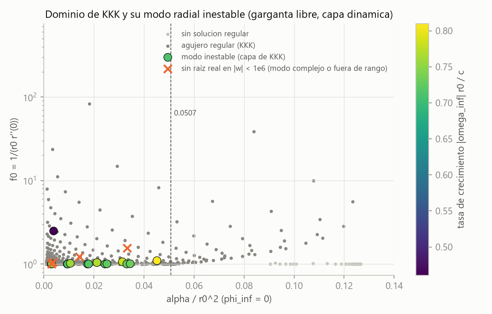
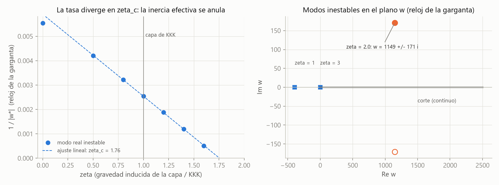
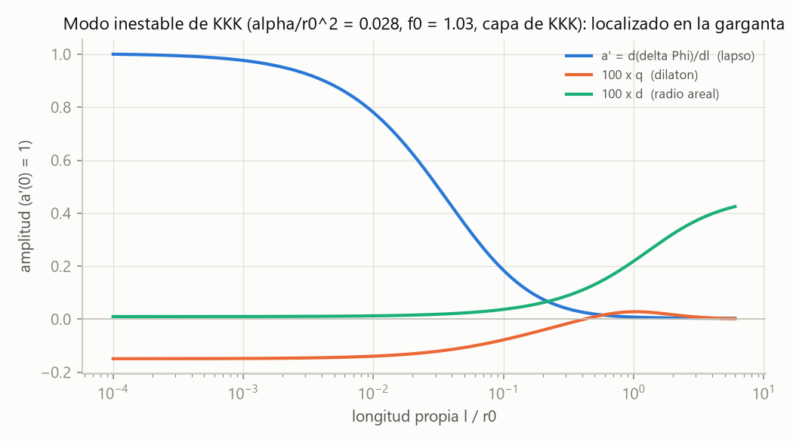
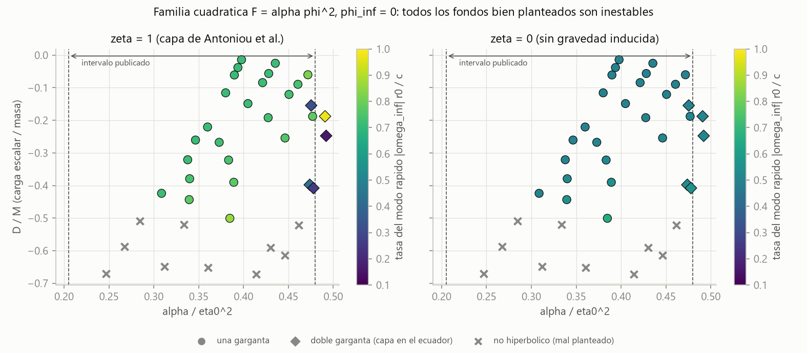
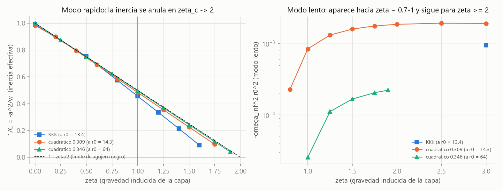
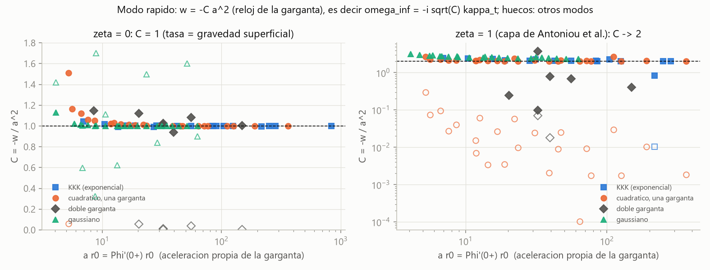
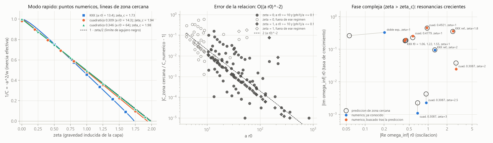
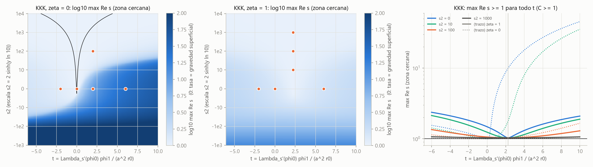

# Híbrido estrella–agujero de gusano — Fase 2b: escalar–Gauss–Bonnet y la estabilidad de los agujeros de Kanti–Kleihaus–Kunz y de Antoniou et al.

*Documento de trabajo v0.4 · 2026-10-21 · continúa [fase2/fase2_resultados.md](../fase2/fase2_resultados.md); el caso sin cáscara está en [fase2c/fase2c_resultados.md](../fase2c/fase2c_resultados.md)*

## Resumen

**Parte I — los agujeros de Kanti–Kleihaus–Kunz** (§1–§7)

1. **Punto de partida corregido por la literatura** (verificada en arXiv).
   - Kanti–Kleihaus–Kunz (KKK; [arXiv:1108.3003](https://arxiv.org/abs/1108.3003), PRL 107, 271101; [arXiv:1111.4049](https://arxiv.org/abs/1111.4049), PRD 85, 044007) construyeron agujeros de gusano en la teoría de Einstein–dilatón–Gauss–Bonnet (EdGB) sin materia exótica. Afirmaron que un subconjunto es linealmente estable.
   - Cuyubamba–Konoplya–Zhidenko (CKZ; [arXiv:1804.11170](https://arxiv.org/abs/1804.11170), PRD 98, 044040) lo refutan: son inestables para cualquier valor de los parámetros. La tesis de Cuyubamba ([arXiv:1912.08382](https://arxiv.org/abs/1912.08382)) lo confirma y no hemos encontrado trabajos posteriores en contra.
   - KKK fijaron $\delta r=0$ (la garganta no puede respirar). **Ninguno de los dos trabajos trata la dinámica de la cáscara de materia** que exigen las soluciones simétricas en la garganta.
2. **Integrador EdGB en longitud propia, verificado.**
   - Ecuaciones covariantes generadas con SymPy y comprobadas de tres formas: invariante de Gauss–Bonnet de Schwarzschild, identidad de Bianchi generalizada sobre jets aleatorios (residuo $10^{-139}$) y las tres EDO estáticas de KKK (diferencia relativa $\le10^{-140}$).
   - Las soluciones cumplen **automáticamente** la condición de regularidad de KKK en la garganta, que ellos deducen en otras coordenadas.
   - Se reproduce el dominio de existencia: $\alpha/r_0^2\le0.123$ (KKK: $\lesssim0.13$) y todas las $f_0>1$ por debajo de $0.0507$. La cáscara tiene $\rho>0$ en todo el dominio.
3. **Perturbaciones radiales con la garganta libre y la cáscara dinámica.**
   - Gauge de longitud propia: $\delta r(0)$ es físico y libre.
   - Las condiciones de empalme salen de la parte distribucional de las ecuaciones de campo. Para el fondo reproducen exactamente las de KKK.
   - La cáscara se describe con una acción (tensión, gravedad inducida acoplada al dilatón y polvo con masa $m(\phi)$) que contiene la de KKK como caso particular.
   - Bianchi aplicado a la cáscara hace redundante una de las cinco condiciones en la garganta. Se comprueba a $10^{-17}$ para todo $w$.
4. **Las ramas "estables" de KKK son inestables.** Para $\alpha/r_0^2=0.028$ y $f_0=1.03$ con la cáscara de KKK, **$\omega_\infty^2r_0^2=-0.557$**, convergido a 9 cifras. El modo vive en la garganta, con escala $\sim0.1\,r_0$, y lo domina la perturbación del lapso.
5. **El modelo de cáscara no lo arregla.** Con $\zeta$ = intensidad de la gravedad inducida respecto a la de KKK:
   - para $\zeta<\zeta_c=1.73$ hay un modo real inestable, cuya tasa diverge en $\zeta_c$ (la inercia efectiva se anula; $\zeta_c$ en forma cerrada en §13);
   - con $\zeta=2$ el modo vuelve como **resonancia compleja inestable** (sobreestabilidad), $w=1149\pm171\,i$;
   - con $\zeta=3$ aparece otro modo real, lento;
   - el acoplamiento del polvo al dilatón no influye.
6. **Sobre todo el dominio** ($\alpha/r_0^2\le0.05$, 19 fondos).
   - Con la cáscara de KKK, 16 tienen un modo real inestable con $\omega^2_\infty r_0^2$ entre −0.50 y −0.66, es decir, $\tau\sim1.3\,r_0/c$. En el más extremo hace falta barrer hasta $|w|=10^8$.
   - Los otros tres tienen $\phi_1r_0=-3$ y $\zeta_c\simeq0.61$: con la cáscara de KKK su modo está en la fase compleja. Son resonancias inestables con $\omega_\infty r_0$ entre $-0.427-0.184\,i$ y $-0.440-0.203\,i$, predichas en §13 y encontradas después numéricamente.
   - Sin gravedad inducida ($\zeta=0$), los 19 tienen el modo real en $\omega^2_\infty r_0^2\simeq-\kappa_{sg}^2$ (−0.250 a −0.275).
   - No hemos encontrado ningún fondo ni ninguna cáscara estables.
7. **Consecuencia para el proyecto.** La vía EdGB de KKK no proporciona una garganta estable para el híbrido. El sector impar no se ha recomprobado: exige el híbrido EdGB + fluido y la ecuación de movimiento de la cáscara (§7).

**Parte II — las familias de Antoniou et al. (2019)** (§8–§14)

8. **Sin estudio de estabilidad previo.** Antoniou–Bakopoulos–Kanti–Kleihaus–Kunz ([arXiv:1904.13091](https://arxiv.org/abs/1904.13091), PRD 101, 024033) generalizan KKK a un acoplamiento $F(\phi)$ arbitrario, con una o dos gargantas. Anuncian el estudio de estabilidad, y no hemos encontrado ninguno posterior (búsqueda con la API de arXiv).
9. **Código para $F$ general, validado** (§9).
   - Coincide con el de KKK a $\le2\times10^{-15}$ y supera el test de familia ($\le10^{-10}$).
   - Reproduce la familia cuadrática con $\phi_\infty=0$: 39 fondos con $\alpha/\eta_0^2\in[0.247,0.492]$, frente al intervalo publicado $0.205$–$0.480$.
   - Se añaden 24 fondos gaussianos y 6 dobles gargantas exponenciales.
10. **Una parte de las familias está mal planteada** (§10). En 10 de los 39 fondos cuadráticos, 4 de las 6 dobles gargantas exponenciales y 1 de los 24 gaussianos, las perturbaciones radiales tienen velocidades características imaginarias cerca del centro. El problema de valores iniciales está mal planteado.
11. **Todos los fondos bien planteados son inestables** (§11): los 54, con la cáscara de Antoniou et al. ($\zeta=1$) y sin gravedad inducida ($\zeta=0$). Son 24 + 5 cuadráticos, 2 dobles exponenciales y 23 gaussianos.
    - En las gargantas, el modo rápido tiene $\omega^2_\infty r_0^2$ entre −0.86 y −0.50 con $\zeta=1$. Con $\zeta=0$, el modo de la ley de §12 está entre −0.42 y −0.25.
    - La familia cuadrática tiene además un modo lento; la gaussiana, con $\zeta=0$, un segundo modo de hasta −1.58.
    - En tres casos el modo es complejo (oscilación creciente) y se localiza con el principio del argumento.
    - Al variar la cáscara, la inercia efectiva se anula en $\zeta_c\to2$ y el modo lento cubre $\zeta\ge0.8$: no hay ventana de estabilidad en $\zeta\in[0,3]$.
12. **Una ley local** (§12). Sin gravedad inducida, el modo crece con la gravedad superficial de la garganta: $\omega_\infty\simeq-i\kappa_t$, con $\kappa_t=e^{-\Phi_\infty}\Phi'(0^+)$.
    - Se cumple a $\le5\%$ en 61 de 71 fondos, y a $\le3.2\%$ en las gargantas con $a\,r_0\ge10$. Con la cáscara de Antoniou et al., la tasa es $\approx\sqrt2\,\kappa_t$ cerca del límite de agujero negro.
    - Es el análogo, para la garganta, de la universalidad de Hashimoto–Tanahashi: el exponente de Lyapunov de una partícula sostenida cerca de un horizonte es su gravedad superficial.
    - Todos los fondos son casi agujeros negros vistos desde fuera ($\kappa_t r_0\simeq1/2$, $r_0\simeq2M$).
13. **La ley, deducida** (§13). Con $a\,r_0\gg1$, las ecuaciones tienen solución cerrada en una zona de anchura $1/a$ junto a la cáscara, con lapso de Rindler, y la condición de contorno se vuelve local. Los empalmes dan una relación de dispersión polinómica $P(s)=0$, con $w=-a^2s^2$:
    - con $\zeta=0$, $C=1$ exactamente, para cualquier $F$. La cáscara conserva su aceleración propia y se separa de la hipérbola estática como $e^{a\tau}$, como un objeto sostenido cerca de un horizonte (también ocurre en las cáscaras finas de relatividad general);
    - $\zeta_c=2\,(1-F(\phi_0)/r_0^2)/(1+\phi_1^2r_0^2/4)$, y en el límite de agujero negro $C=1/(1-\zeta/2)$;
    - si $F''(\phi_0)<0$, una rama de escalarización con $C=64F''(\phi_0)^2/r_0^4$. Es el segundo modo de la familia gaussiana;
    - reproduce los 115 modos rápidos del régimen de validez con mediana 0.1–0.2 %. Además predijo seis resonancias complejas que la secante encontró después.
14. **Una tensión dependiente del escalar tampoco lo arregla** (§13.7). Se probó $\Lambda_s(\phi)$, la última vía de cáscara fina, con el polvo compensando su carga escalar.
    - A orden dominante, $u^2P(1)$ es un cuadrado perfecto más un término positivo: por debajo de $\zeta_c$ hay siempre una raíz $s\ge1$, es decir, $C\ge1$. **La gravedad superficial es una cota inferior de la tasa.**
    - La pendiente que frenaría el desplazamiento crea un modo acoplado mucho más rápido. Por encima de $\zeta_c$, la resonancia de energía negativa sigue creciendo.
    - Una búsqueda global, comprobada a 80 cifras, y 33 casos del cálculo completo no encuentran ningún punto estable.
15. **Corrección de método** (§11.5). El seguimiento de signo de la v0.1 perdía raíces y creaba otras espurias. El dato inicial por menores lo evita, y las 238 raíces se han comprobado una a una con la función entera $D_c$.
    - Cambia la columna $\zeta=0$ de §6, que ahora tiene modo real en los 19 fondos, y las raíces con $\zeta<0$ de §5.
    - No cambia nada con $\zeta=1$.
16. **Consecuencia para el proyecto.** Ninguna familia EsGB con cáscara $\mathbb Z_2$ da una garganta estable, ni siquiera con tensión dependiente del escalar. Para $r_0=1$ km, el tiempo de crecimiento es $\simeq2r_0/c\approx7\ \mu$s.
    - El caso sin cáscara está resuelto en la [Fase 2c](../fase2c/fase2c_resultados.md): en estas familias no existen agujeros EsGB lisos.
    - Según §13, la inestabilidad es la de cualquier cáscara mantenida a aceleración propia fija cerca de su horizonte frustrado, y su tasa no puede bajar de la gravedad superficial.

---

## 1. Literatura

| Trabajo | Gauge y condiciones en la garganta | Cáscara | Conclusión |
|---|---|---|---|
| KKK 2011–2012 | $\delta r=0$ (radio areal sin perturbar); Dirichlet $\psi(0)=0$ | ignorada ("no afecta") | subconjunto estable para $f_0<f_0^{\rm cr}(\alpha/r_0^2)$; indecidible si $q_\sigma<0$ ($\alpha/r_0^2\gtrsim0.05$) |
| CKZ 2018 | variable invariante gauge $\chi\propto r\,\delta\phi-\frac{r^2}{l}\phi'\delta r$; integración temporal | no analizada | inestable para todo parámetro; modo puramente imaginario, no perturbativo en $\alpha$ |
| Este trabajo | longitud propia, $\delta r(0)$ libre; empalmes distribucionales | dinámica, con modelo general | ver §4–§5 |

Las soluciones simétricas $\mathbb Z_2$ de KKK tienen un salto en $\phi'$ y $\Phi'$ en la garganta. En longitud propia se ve directamente: la ligadura $\ell\ell$ en la garganta exige $4a\,\Phi'_0\phi'_0=-(1+r_0^2\phi_0'^2/4)$, con $a=\alpha\gamma e^{-\gamma\phi}$, así que no puede haber $\phi'_0=\Phi'_0=0$. El salto lo sostiene una cáscara de materia en $\ell=0$.

---

## 2. Ecuaciones

Acción (KKK): $S=\frac1{16\pi}\int\sqrt{-g}\,[R-\tfrac12(\partial\phi)^2+\alpha e^{-\gamma\phi}\mathcal G]$, con $\gamma=1$. Ecuaciones de campo:

$$
E_{\mu\nu}\equiv G_{\mu\nu}+\Gamma_{\mu\nu}-\tfrac12\partial_\mu\phi\,\partial_\nu\phi+\tfrac14g_{\mu\nu}(\partial\phi)^2=8\pi T^{\rm m}_{\mu\nu},\qquad
E_\phi\equiv\Box\phi+\alpha F'(\phi)\,\mathcal G=\text{(fuente de la cáscara)},
$$

donde $\Gamma_{\mu\nu}$ es el tensor de Gauss–Bonnet con $\Psi_\mu=\alpha F'(\phi)\partial_\mu\phi$ ([egb_simbolico.py](egb_simbolico.py)). Los signos y factores quedan fijados por la identidad $\nabla^\mu E_{\mu\nu}=-\tfrac12E_\phi\,\partial_\nu\phi$, que se comprueba fuera de la capa de masas ([verificar_egb.py](verificar_egb.py)).

**Fondo** ($ds^2=-e^{2\Phi}dt^2+d\ell^2+r^2d\Omega^2$, [kkk.py](kkk.py)). Con $a=\alpha\gamma e^{-\gamma\phi}$:

$$
\begin{aligned}
tt:&\ (2r+8a\phi'r')\,r''+4a(r'^2-1)\,\phi''=-\big[\tfrac14r^2\phi'^2+r'^2-1+4a\gamma\phi'^2(1-r'^2)\big]\\
\theta\theta:&\ (1+4a\Phi'\phi')\,r''+4a\Phi'r'\,\phi''+(r+4a\phi'r')\,\Phi''=-\big[r\Phi'^2+\tfrac14r\phi'^2+\Phi'r'-4a\gamma\Phi'\phi'^2r'+4a\Phi'^2\phi'r'\big]\\
\phi:&\ -16a\Phi'r'\,r''+r^2\phi''+8a(1-r'^2)\,\Phi''=-\big[8a\Phi'^2(1-r'^2)+r^2\Phi'\phi'+2rr'\phi'\big]\\
\ell\ell:&\ \frac{r'^2-1}{r^2}+\frac{2\Phi'r'}{r}-\frac{\phi'^2}4+\frac{4a\,\Phi'\phi'(3r'^2-1)}{r^2}=0\quad\text{(ligadura)}
\end{aligned}
$$

En la garganta, el determinante de la parte principal vale $-2r_0^2(r_0^2+4a^2\phi_0'^2)\neq0$, así que el sistema es regular. El parámetro $f_0$ de KKK es $1/(r_0r''_0)$. La simetría $\phi\to\phi+c$, $\ell\to e^{-\gamma c/2}\ell$ permite integrar con $r_0=1$, $\phi_0=0$ y obtener después $\alpha/r_0^2|_{\rm KKK}=\alpha e^{-\gamma\phi_\infty}$.

**Perturbaciones** ([generar_lineal.py](generar_lineal.py) → [egb_lineal_gen.py](egb_lineal_gen.py)).
- Se toma $A=\Phi+a\,e^{i\omega t}$, $R=r+d\,e^{i\omega t}$, $\phi\to\phi+q\,e^{i\omega t}$, con $g_{\ell\ell}=1$ y *shift* nulo.
- Las ecuaciones $tt$, $\theta\theta$ y del dilatón dan $(d'',a'',q'')$ con la misma parte principal que el fondo.
- Las ligaduras $E^\ell{}_t$ y $E^\ell{}_\ell$ no tienen derivadas segundas y se propagan por Bianchi.
- El lapso solo entra derivado.
- Validación: la derivada de la familia de fondos respecto de $\phi'_0$ cumple el sistema lineal con $w=0$ a 9–10 cifras.

---

## 3. La cáscara de la garganta

**Empalmes.**
- Los coeficientes de las derivadas segundas son pares en $\ell$ en la garganta. Por eso la parte $\delta(\ell)$ de las ecuaciones está bien definida: $M(0)\,[y']+\partial_{\Phi''}(\ldots)[\Phi']+\partial_{\phi''}(\ldots)[\phi']$.
- Esa parte debe igualar las fuentes de la cáscara: $8\pi S^t{}_t$, $8\pi S^\theta{}_\theta$ y $\sigma_\phi$.
- Para el fondo, esto reproduce las tres condiciones de KKK ($\rho$, $\lambda_0=\lambda_1=2\Phi'_0$ y la carga dilatónica).

**Modelo de cáscara.** Acción en la garganta:

$$
L_s=\frac1{8\pi}\big[-\Lambda_s+\kappa\,e^{-\gamma\phi}\bar R\big]-n\,m(\phi).
$$

- **Tensión:** $\Lambda_s=-2\Phi'_0$.
- **Gravedad inducida acoplada al dilatón:** $\kappa=\zeta\cdot4\alpha\Phi'_0$. La cáscara de KKK es $\zeta=1$.
- **Polvo** con número conservado ($nr^2=$ cte) y masa $m(\phi)$. La densidad $\rho=8\pi nm$ y $\beta=m'/m$ los fijan los empalmes del fondo; $\mu=m''/m'$ es libre.

Perturbaciones a orden lineal (verificadas con SymPy para $h=-N^2dt^2+r^2d\Omega^2$): $\delta\bar R=-4d_0/r_0^3-4wd_0/r_0$, $\delta\bar G^t{}_t=2d_0/r_0^3$, $\delta\bar G^\theta{}_\theta=wd_0/r_0$ y $(\bar\Box-\bar\nabla^\theta\bar\nabla_\theta)F=wF'q_0$.

**Comprobación de consistencia.** En $\ell=0^+$ hay cinco incógnitas, $(a',d,d',q,q')$, y cinco condiciones: las dos ligaduras y tres empalmes.
- La matriz tiene **exactamente un valor singular nulo** ($10^{-18}$ relativo) para todo $w$. Es la identidad de Bianchi de la cáscara (conservación de su energía).
- Al imponer cuatro condiciones, la quinta (empalme $tt$) se cumple a $10^{-17}$.

**Problema de autovalores.**
- El espacio de soluciones admisibles en la garganta es unidimensional. Se normaliza con el vector nulo unitario, porque la normalización $d(0)=1$ tiene polos espurios.
- En el infinito se exige que decaiga el dilatón: $q\sim e^{-\kappa\ell}/r$, con $\kappa^2=-we^{-2\Phi_\infty}$.
- Con la rama principal de $\kappa$, **cada cero de $D(w)$ fuera del corte $w>0$ es un modo que crece en el tiempo**, sea real o complejo ([modos_complejos.py](modos_complejos.py)).

---

## 4. Resultado: el agujero de KKK es inestable con su propia cáscara

Fondo de referencia: $\alpha=0.03$ y $\phi'_0=-0.7$ (con $r_0=1$, $\phi_0=0$). En parámetros de KKK, $\alpha/r_0^2=0.028$, $f_0=1.030$ y $e^{2\Phi_\infty}=703.6$. Está en la región que KKK declaraban estable ([estabilidad_kkk.py](estabilidad_kkk.py)).

| Comprobación | $w^*$ (reloj de la garganta) |
|---|---|
| referencia (`rtol` $10^{-10}$, cola $30/\kappa$) | −391.88143094 |
| cola $60/\kappa$; `rtol` $10^{-12}$; fondo con `rtol` $10^{-13}$ | −391.88143094 (idéntico) |
| integración renormalizada por tramos | −391.88143094 |

**$\omega^2_\infty r_0^2=-0.55696$**, es decir, un tiempo de crecimiento $\tau=1.34\,r_0/c$.

**Autofunción.**
- El lapso domina, con $a'(0)\simeq-1$, y decae en $\sim0.05$–$0.2\,r_0$. Además $q(0)=1.5\times10^{-3}$ y $d(0)=-10^{-4}$.
- Lejos de la garganta, $d\to$ cte (traslación del exterior, permitida en este gauge).
- Las ligaduras se mantienen a $10^{-13}$ a lo largo de toda la integración.

---

## 5. Dependencia con el modelo de cáscara

<!-- TABLA_ZETA -->
Fondo de referencia ($\alpha/r_0^2=0.028$, $f_0=1.03$, $e^{2\Phi_\infty}=703.6$). Raíces de $D(w)$ en $[-10^6,-10^{-4}]$, con el buscador robusto de §11.5 ([trayectorias_robustas.py](trayectorias_robustas.py)), y raíz compleja por secante ([modos_complejos.py](modos_complejos.py)):

| $\zeta$ | $w^*$ (reloj de la garganta) | $\omega^2_\infty r_0^2$ |
|---|---|---|
| −1 | −101.51, −23.00 | −0.144, −0.033 |
| −0.5 | −121.85, −42.57 | −0.173, −0.061 |
| 0 | −180.46 | −0.256 |
| 0.5 | −237.58 | −0.338 |
| 0.8 | −310.54 | −0.441 |
| **1 (KKK)** | **−391.88** | **−0.557** |
| 1.2 | −532.14 | −0.756 |
| 1.4 | −832.49 | −1.18 |
| 1.6 | −1959.1 | −2.78 |
| 1.8 | sin raíz real | — |
| 2 | $1149.06\pm170.71\,i$ | $\omega_\infty r_0=-1.281-0.095\,i$ |
| 3 | −0.6705 | $-9.5\times10^{-4}$ |

- **Para $\zeta<\zeta_c$ hay un modo real inestable.** $1/|w^*|$ es lineal en $\zeta$, con pendiente $-3.4\times10^{-3}$, y se anula en **$\zeta_c\approx1.75$** (la relación de §13 da $\zeta_c=1.728$): ahí la tasa de crecimiento diverge. Es la firma de una **inercia efectiva** del sistema garganta–cáscara que se anula y cambia de signo. En §11.4 y §12 esta dependencia se escribe como $w^*=-C(\zeta)\,a^2$, con $a=\Phi'(0^+)$ la aceleración propia de la garganta.
- *Corrección respecto a la v0.1.* Con $\zeta<0$ la tabla daba tres raíces. Las intermedias (−83.15 y −114.2) eran espurias, del seguimiento de signo (§11.5).
- **Para $\zeta>\zeta_c$ el modo tiene energía negativa.** No aparece como raíz real, pero al radiar por el dilatón crece como resonancia compleja.
  - Con $\zeta=2$: $w=1149.06\pm170.71\,i$, que da $\omega_\infty r_0=-1.28-0.095\,i$ (oscilación creciente).
  - Lo confirman cuatro arranques distintos de la secante sobre la función entera $D(w)$, con $|D|\sim10^{-9}$ frente a $10^{4}$–$10^{6}$ en el resto.
- **Con $\zeta=3$ aparece además un modo real lento**, $w=-0.67$.
- **El acoplamiento del polvo al dilatón no influye:** $\mu=m''/m'$ entre $-10\beta$ y $10\beta$ no cambia las raíces.
- **Sin gravedad inducida** ($\zeta=0$), el modo está en $\omega^2_\infty r_0^2\simeq-0.25$, es decir, $-\kappa_{sg}^2$ con $\kappa_{sg}=1/2r_0$, la gravedad superficial del agujero negro límite.

**No hay ventana de estabilidad en $\zeta$.** El modo inestable solo cambia de carácter: es real para $\zeta<\zeta_c$ y complejo para $\zeta>\zeta_c$, y para $\zeta$ grande aparece otro modo lento.

---

## 6. Mapa sobre el dominio de KKK

<!-- TABLA_DOMINIO -->
Fondos con $\alpha/r_0^2\le0.05$, donde KKK y CKZ tienen la ecuación bien planteada ($q_\sigma>0$). Raíces reales en $|w|\le10^6$ (reloj de la garganta) para la cáscara de KKK ($\zeta=1$) y sin gravedad inducida ($\zeta=0$), con el buscador robusto de §11.5 ([estabilidad_robusta.py](estabilidad_robusta.py)). En todos los casos el residuo del empalme redundante es $\le2\times10^{-9}$ ([estabilidad_dominio.py](estabilidad_dominio.py)).

| $\alpha/r_0^2$ | $f_0$ | $e^{2\Phi_\infty}$ | $\omega^2_\infty r_0^2$, $\zeta=1$ (KKK) | $\omega^2_\infty r_0^2$, $\zeta=0$ |
|---|---|---|---|---|
| 0.0029 | 1.0001 | $2.8\times10^6$ | −0.502 ($\lvert w\rvert$ hasta $10^8$) | −0.250 |
| 0.0030 | 1.0005 | $3.2\times10^5$ | −0.505 | −0.250 |
| 0.0031 | 1.0060 | $4.3\times10^4$ | −0.564 | −0.250 |
| 0.0035 | 1.0571 | $3.3\times10^4$ | compleja: $\omega_\infty r_0=-0.434-0.182\,i$ | −0.250 |
| 0.0039 | 2.4866 | $1.9\times10^5$ | −0.212, −0.0026 | −0.250 |
| 0.0093 | 1.0002 | $2.5\times10^5$ | −0.506 | −0.250 |
| 0.0095 | 1.0018 | $2.9\times10^4$ | −0.509 | −0.250 |
| 0.0105 | 1.0204 | 3890 | −0.574 | −0.251 |
| 0.0141 | 1.2186 | 2860 | compleja: $\omega_\infty r_0=-0.427-0.184\,i$ (§13) | −0.254 |
| 0.0174 | 1.0004 | $6.3\times10^4$ | −0.511 | −0.250 |
| 0.0178 | 1.0036 | 7250 | −0.516 | −0.251 |
| 0.0212 | 1.0416 | 962 | −0.591 | −0.255 |
| 0.0244 | 1.0006 | $2.8\times10^4$ | −0.517 | −0.250 |
| 0.0252 | 1.0054 | 3220 | −0.523 | −0.251 |
| 0.0313 | 1.0636 | 422 | −0.614 | −0.261 |
| 0.0331 | 1.0009 | $1.2\times10^4$ | −0.525 | −0.250 |
| 0.0333 | 1.5501 | 679 | compleja: $\omega_\infty r_0=-0.440-0.203\,i$ (§13) | −0.267 |
| 0.0345 | 1.0082 | 1430 | −0.535 | −0.253 |
| 0.0452 | 1.0980 | 183 | −0.656 | −0.275 |

- **Con la cáscara de KKK, 16 de los 19 fondos tienen un modo real inestable,** con $\omega^2_\infty r_0^2$ entre −0.50 y −0.66: el tiempo de crecimiento es $\sim1.3\,r_0/c$. Cerca del límite de agujero negro, $-0.5$ equivale a $-2\kappa_{sg}^2$, con $\kappa_{sg}=1/2r_0$.
- **Sin gravedad inducida, los 19 fondos tienen el modo real,** entre $-0.250$ y $-0.275$, es decir, $-\kappa_{sg}^2$. Se acerca a $-\kappa_{sg}^2$ cuanto más cerca está el fondo del límite de agujero negro ($f_0\to1$). En §12 se ve que el valor exacto es $-\kappa_t^2$, con $\kappa_t$ la gravedad superficial de la propia garganta (a $\le4.6\%$ en los 19).
- **La ventana de $\zeta$ con raíz real se desplaza con el fondo,** pero siempre contiene $\zeta=0$.
- *Corrección respecto a la v0.1.* La primera versión de esta tabla daba "—" con $\zeta=0$ en diez fondos próximos al límite de agujero negro, y una segunda raíz, −1.227, en el de $f_0=2.49$. Las dos cosas eran artefactos del seguimiento de signo del vector nulo unitario (§11.5): en esos diez fondos el modo está entre −0.2500 y −0.2531. Los valores con $\zeta=1$ no cambian.
- **Los tres fondos sin raíz real con $\zeta=1$** ($f_0$ = 1.06, 1.22, 1.55) sí tienen un modo real con $\zeta=0$. En el comprobado ($f_0=1.057$), el modo real existe para $\zeta\le0.5$ y escapa a $-\infty$ antes de $\zeta=0.75$: con la cáscara de KKK está ya en la fase compleja.
  - Los tres tienen $\phi_1r_0=-3$. La fórmula de §13, $\zeta_c=2(1-F_0)/(1+\phi_1^2r_0^2/4)$, da $\zeta_c\simeq0.61$ en los tres.
  - Las resonancias de $f_0=1.22$ y 1.55 se han obtenido arrancando la secante desde la predicción de §13, y la de $f_0=1.057$ coincide con la continuación.
- **Continuación de la resonancia compleja** hasta ese fondo ([continuacion_compleja.py](continuacion_compleja.py)).
  - Se parte de la raíz de referencia ($\zeta=2$, $w=1149+171i$), se mueve el fondo con $\zeta=2$ y después se baja $\zeta$ hasta 1. Se usa la secante sobre la función entera $D(w)$, con paso adaptativo y predictor lineal; la raíz se sigue sin perderla en 13 pasos.
  - Con la cáscara de KKK resulta **$w=5049+5144\,i$, es decir, $\omega_\infty r_0=-0.434-0.182\,i$**: una oscilación creciente con $\tau=5.5\,r_0/c$.
  - A lo largo del camino, la tasa de crecimiento se mantiene entre 0.08 y $0.18\,c/r_0$.
- **En el fondo más extremo** ($f_0=1.0001$) el modo está en $w^*=-1.40\times10^6$, fuera del rango general. Un barrido hasta $|w|=10^8$ ([trayectorias_robustas.py](trayectorias_robustas.py)) da $\omega^2_\infty r_0^2=-0.502$, como en sus vecinos.

### Figuras

| | |
|---|---|
|  | **Fig. 1.** Dominio de existencia de KKK en su plano $(\alpha/r_0^2,f_0)$, con $\phi_\infty=0$. En color, la tasa del modo inestable con la cáscara de KKK; las cruces son fondos sin raíz real en el rango barrido (§6). |
|  | **Fig. 2.** Izquierda: $1/\lvert w^*\rvert$ frente a $\zeta$; la tasa diverge en $\zeta_c$ porque la inercia efectiva se anula. Derecha: modos inestables en el plano $w$ (reloj de la garganta). Son reales para $\zeta<\zeta_c$ y complejos (sobreestables) para $\zeta>\zeta_c$. |
|  | **Fig. 3.** Autofunción del modo inestable de KKK ($\alpha/r_0^2=0.028$, $f_0=1.03$, cáscara de KKK). Está localizada en la garganta y la domina el lapso. |

---

## 7. Interpretación y consecuencias

1. **La refutación de CKZ se mantiene y se extiende.** CKZ ignoraron la cáscara; aquí se incluye su dinámica con un modelo general, y la inestabilidad persiste para todos los modelos probados. El resultado estable de KKK es un artefacto de fijar $\delta r=0$: sin respiración de la garganta, el modo no existe.
2. **El papel de la cáscara.** El modo es local en la garganta y su tasa depende de la gravedad inducida de la cáscara. Esta controla la inercia efectiva de la garganta, pero no su rigidez, que es negativa. Es la misma conclusión que en la Fase 2: **la inestabilidad está en la estática de la garganta**. La Parte II precisa la escala (§12) y la deduce (§13): sin gravedad inducida, la tasa es la gravedad superficial de la garganta, porque la cáscara conserva su aceleración propia cerca de su horizonte frustrado.
3. **Para el proyecto G2V.** Con EdGB à la KKK no hay garganta estable que rellenar con fluido. Por eso no se ha construido el híbrido EdGB + fluido ni se ha recomprobado el sector impar.
   - El sector impar exige una pieza nueva: la ecuación de movimiento de la cáscara, que en los modos impares se desplaza y obedece al promedio de las tensiones normales, no a su salto.
   - Tendrá sentido si una garganta resulta estable en el sector par.

---

# Parte II — Las familias EsGB de Antoniou et al. (2019)

## 8. Planteamiento

**El trabajo.** Antoniou, Bakopoulos, Kanti, Kleihaus y Kunz ([arXiv:1904.13091](https://arxiv.org/abs/1904.13091), PRD 101, 024033 (2020)) generalizan KKK a un acoplamiento arbitrario,

$$
S=\frac1{16\pi}\int\sqrt{-g}\,\big[R-\tfrac12(\partial\phi)^2+F(\phi)\,\mathcal G\big],
$$

y construyen agujeros sin materia exótica para acoplamientos exponencial, gaussiano, potencias, potencias inversas y logarítmico.
- En el centro hay una garganta (agujero de una garganta) o un **ecuador**, un máximo del radio, con una garganta lisa a cada lado (doble garganta).
- La extensión simétrica $\mathbb Z_2$ exige una cáscara en el centro, con acción $\int[\lambda_1+2\lambda_0F(\phi)\bar R]\sqrt{-\bar h}$. Su ejemplo es polvo con $\lambda_0=\lambda_1$, que en nuestro modelo de cáscara (§3) es $\zeta=1$.
- Con $F=\alpha\phi^2$ y $\phi_\infty=0$, los agujeros sin nodos existen solo para $0.205<\alpha/\eta_0^2<0.480$. Una parte de la frontera es el agujero negro de Schwarzschild.
- El estudio de estabilidad (radial y cuasinormal) queda anunciado como trabajo futuro.

**Literatura posterior.** Búsquedas con la API de arXiv (2026-10-20):
- por autor: Antoniou y "wormhole"; Kleihaus, "wormhole" y "Gauss";
- por resumen: "wormhole" con "scalar-Gauss-Bonnet", y "wormhole" con "Gauss-Bonnet" y "radial perturbations".

Ningún trabajo estudia la estabilidad de estas familias. Los posteriores añaden un potencial escalar ([arXiv:2006.13008](https://arxiv.org/abs/2006.13008)), carga NUT o rotación lenta ([arXiv:2609.18475](https://arxiv.org/abs/2609.18475)), o son revisiones ([arXiv:2412.20296](https://arxiv.org/abs/2412.20296)). El único análisis dinámico en EsGB sigue siendo el de CKZ para $F\propto e^{-\phi}$.

**La prueba** es la de la Parte I sin cambios: gauge de longitud propia, $\delta r(0)$ libre, empalmes distribucionales y cáscara dinámica con intensidad $\zeta$ de la gravedad inducida. Con un ecuador, la cáscara está en el ecuador y las dos gargantas son lisas y no llevan materia.

---

## 9. Implementación y validación

**Ecuaciones para $F$ general** ([generar_F.py](generar_F.py) → [egb_F_gen.py](egb_F_gen.py)).
- Las ecuaciones de campo solo contienen $\chi=F'(\phi)$ y sus primeras derivadas. Se generan con $\chi$ como campo auxiliar y después se sustituye
  $$\chi\to F_1+\epsilon F_2\,q,\qquad \chi_{,\ell}\to F_2\phi'+\epsilon\,(F_3\phi'q+F_2q'),\qquad \chi_{,t}\to\epsilon F_2\,q_{,t},$$
  con $F_k=F^{(k)}(\phi)$ evaluadas en el fondo. Un único código sirve así para cualquier $F$.
- La parte principal del sistema lineal coincide con la del fondo (comprobado simbólicamente al generar).

**Fondo** ([fondo_F.py](fondo_F.py)). Se integra desde $\ell=0$ con $r_0=1$, $\Phi(0)=0$, $\phi(0)=\phi_0$ y $\phi'(0^+)=\phi_1$. La ligadura da $\Phi'_0=(1+r_0^2\phi_1^2/4)/(4F'(\phi_0)\phi_1)$.
- Si $r''(0)>0$ el centro es una garganta. Si $r''(0)<0$ es un ecuador, y la integración localiza la garganta lisa en $\ell_t>0$.
- El parámetro de Antoniou sale sin cambiar de coordenadas: $\eta_0=\lim_{\ell\to\infty}2r\,e^{-\int_0^\ell d\ell'/r}$. En su métrica, $e^{f_1}[d\eta^2+(\eta^2+\eta_0^2)d\Omega^2]$, se cumple exactamente $\int_0^\ell d\ell'/r=\operatorname{arcsinh}(\eta/\eta_0)$.

**Validación** ([verificar_F.py](verificar_F.py)):

| Prueba | Resultado |
|---|---|
| Código general con $F=\alpha e^{-\phi}$ frente al específico de KKK, en 200 puntos aleatorios | parte principal, resto y ligaduras lineales $\le2\times10^{-15}$; segundas derivadas del fondo $2\times10^{-14}$ |
| Fondo de referencia de KKK integrado por los dos caminos | $f_0$, $\Phi_\infty$ y $\phi_\infty$ coinciden a $\le2\times10^{-14}$ |
| Test de familia: la derivada de los fondos respecto de $\phi_1$ cumple el sistema lineal con $w=0$ (cuadrático, garganta y ecuador; gaussiano) | ecuaciones $\le1.1\times10^{-10}$; ligadura $\ell\ell$ $\le8\times10^{-8}$ |
| Identidad de Bianchi en $\ell=0$ (cuadrático y exponencial de doble garganta, $\zeta=0$ y 1) | un solo valor singular nulo: $s_5/s_1\le5\times10^{-17}$, con $s_4/s_1\ge3\times10^{-8}$ |

**Reproducción de la familia cuadrática** ([familia_cuadratica.py](familia_cuadratica.py)). Con $\alpha/r_0^2\in[0.05,0.16]$ y $\phi_0\in\{0.01,0.03,0.05,0.1,0.2,0.3,0.5\}$, se buscan por disparo los $\phi_1>0$ con $\phi_\infty=0$.
- Resultan 39 soluciones regulares, todas sin nodos y con $|\phi_\infty|\le3\times10^{-11}$:
  - 29 de una garganta, con $\alpha/\eta_0^2\in[0.247,\,0.477]$;
  - 10 de doble garganta, con $\alpha/\eta_0^2\in[0.360,\,0.492]$.
- Las de una garganta caen dentro del intervalo publicado, $0.205<\alpha/\eta_0^2<0.480$. Nuestra malla no llega a su extremo inferior, que exige $\phi_0>0.5$.
- Dos de doble garganta lo superan ligeramente (0.491 y 0.492). No lo hemos investigado: puede ser una diferencia de muestreo o de definición.
- La cáscara de polvo tiene $\rho>0$ en las 39, con $\zeta=1$ y con $\zeta=0$, como en la Fig. 6 de Antoniou et al.

---

## 10. Hiperbolicidad: una parte de las familias está mal planteada

**Criterio.** Antes de buscar modos hay que comprobar que el problema de valores iniciales de las perturbaciones radiales está bien planteado.
- En el límite de alta frecuencia ($w,k\to\infty$ con $w/k^2$ fijo) solo cuenta el símbolo principal. Los cuadrados de las velocidades características locales son los autovalores finitos $\lambda=w/k^2$ del problema generalizado $M\,x=\lambda N\,x$. Aquí $M$ es la parte principal en $\ell$ y $N$ los coeficientes de $w$ ([estabilidad_F.velocidades](estabilidad_F.py)).
- El lapso no tiene término en $w$ y da un autovalor infinito, que se descarta.
- Si $\lambda<0$ en algún intervalo, las perturbaciones de longitud de onda corta crecen como $e^{\sqrt{|\lambda|}\,k\,t}$ sin cota: el problema está mal planteado en el sentido de Hadamard. Es el análogo de la región $q_\sigma<0$ de KKK y CKZ, que ellos dejan sin decidir.

**Resultado** ([hiperbolicidad.py](hiperbolicidad.py)):
- **10 de los 39 fondos cuadráticos no son hiperbólicos.**
  - 5 de una garganta: los de $\phi_0$ grande, es decir, $\phi_0=0.5$ con $\alpha/\eta_0^2\le0.284$ y $\phi_0=0.3$ con $\phi_1\ge0.87$.
  - 5 de doble garganta: todos los de $\alpha/\eta_0^2\le0.462$.
  - La región elíptica es una capa cerca del centro, dentro de $\ell/r_0\in[10^{-3},\,0.53]$, con $\lambda_{\min}$ entre $-27$ y $-8400$.
- **De las 6 dobles gargantas exponenciales** construidas ($F=\alpha e^{-\phi}$, $\alpha/\eta_0^2=0.075$–0.139), solo 2 son hiperbólicas.
- **De los 24 fondos gaussianos (§11.3), uno no es hiperbólico:** el de garganta más curvada ($\alpha/\eta_0^2=0.371$, $\phi_0=0.3$, $f_0=0.687$), con $\lambda_{\min}=-126$ en $\ell/r_0\in[0,\,0.015]$ ([estabilidad_gauss.py](estabilidad_gauss.py)).
- **En los fondos hiperbólicos**, $\lambda>0$ en todo el dominio, con $\lambda_{\min}$ entre 0.94 y 4.3 (reloj de $\ell=0$, donde la luz tiene $\lambda=1$).
- **Los 19 fondos de KKK de §6 son hiperbólicos**, con $\lambda_{\min}$ entre 1.001 y 1.24 ([hiperbolicidad_kkk.py](hiperbolicidad_kkk.py)). Concuerda con el $q_\sigma>0$ de KKK y CKZ en $\alpha/r_0^2\le0.05$.

En los fondos no hiperbólicos no tiene sentido buscar modos, porque la tasa de crecimiento no está acotada. Se clasifican como **mal planteados**: inestables en el sentido más fuerte, o fuera del dominio de validez de la teoría efectiva. Pasan a la prueba de estabilidad los fondos hiperbólicos: 29 cuadráticos (24 de una garganta y 5 de doble), 2 dobles gargantas exponenciales y 23 gaussianos.

---

## 11. Estabilidad radial de los fondos bien planteados

Raíces reales de $D(w)$ en $[-10^6,-10^{-4}]$ (reloj de $\ell=0$) con el buscador robusto de §11.5 ([estabilidad_robusta.py](estabilidad_robusta.py), [estabilidad_gauss.py](estabilidad_gauss.py)), para la cáscara de Antoniou et al. ($\zeta=1$) y sin gravedad inducida ($\zeta=0$).
- Cada raíz es un modo que crece en el tiempo.
- Las 238 raíces de los barridos y trayectorias se han comprobado una a una con la función entera $D_c$: todas son ceros simples ([verificar_raices.py](verificar_raices.py)).

### 11.1 Familia cuadrática, una garganta

| $\alpha/\eta_0^2$ | $\phi_0$ | $f_0$ | $e^{2\Phi_\infty}$ | $\omega^2_\infty r_0^2$, $\zeta=1$ (Antoniou) | $\omega^2_\infty r_0^2$, $\zeta=0$ |
|---|---|---|---|---|---|
| 0.247 | 0.5 | 1.447 | 30.2 | mal planteado | mal planteado |
| 0.267 | 0.5 | 1.208 | 57.5 | mal planteado | mal planteado |
| 0.284 | 0.5 | 1.086 | 133 | mal planteado | mal planteado |
| 0.309 | 0.5 | 1.014 | 825 | −0.515, $-8.4\times10^{-4}$ | −0.254 |
| 0.312 | 0.3 | 3.830 | 38.3 | mal planteado | mal planteado |
| 0.333 | 0.3 | 1.627 | 69.7 | mal planteado | mal planteado |
| 0.338 | 0.3 | 1.056 | 556 | −0.520, $-1.8\times10^{-3}$ | −0.258 |
| 0.339 | 0.3 | 1.296 | 119 | −0.591, −0.020 | −0.308 |
| 0.340 | 0.3 | 1.143 | 224 | −0.546, $-7.1\times10^{-3}$ | −0.274 |
| 0.346 | 0.3 | 1.002 | $1.7\times10^{4}$ | −0.503, $-2.6\times10^{-5}$ | −0.249 |
| 0.360 | 0.2 | 1.048 | 1420 | −0.511, $-8.9\times10^{-4}$ | −0.253 |
| 0.373 | 0.2 | 1.130 | 550 | −0.526, $-3.9\times10^{-3}$ | −0.259 |
| 0.380 | 0.1 | 1.045 | 6050 | −0.506, $-5.1\times10^{-4}$ | −0.251 |
| 0.383 | 0.2 | 1.276 | 288 | −0.550, −0.010 | −0.271 |
| 0.385 | 0.2 | 3.451 | 97 | −0.737, −0.083 | −0.421, −0.016 |
| 0.389 | 0.2 | 1.599 | 168 | −0.594, −0.025 | −0.296 |
| 0.390 | 0.05 | 1.046 | $2.4\times10^{4}$ | −0.505, $-4.4\times10^{-4}$ | −0.250 |
| 0.394 | 0.03 | 1.048 | $6.4\times10^{4}$ | −0.505, $-4.4\times10^{-4}$ | −0.250 |
| 0.398 | 0.01 | 1.053 | $5.3\times10^{5}$ | −0.505, $-4.7\times10^{-4}$ | −0.250 |
| 0.405 | 0.1 | 1.132 | 2210 | −0.516, $-2.5\times10^{-3}$ | −0.253 |
| 0.421 | 0.05 | 1.148 | 8130 | −0.514, $-2.3\times10^{-3}$ | −0.251 |
| 0.427 | 0.1 | 1.307 | 1100 | −0.533, $-6.8\times10^{-3}$ | −0.256 |
| 0.428 | 0.03 | 1.167 | $2.1\times10^{4}$ | −0.515, $-2.3\times10^{-3}$ | −0.250 |
| 0.435 | 0.01 | 1.240 | $1.4\times10^{5}$ | −0.521, $-2.6\times10^{-3}$ | −0.250 |
| 0.446 | 0.1 | 1.814 | 617 | −0.569, −0.016 | −0.264 |
| 0.451 | 0.05 | 1.410 | 3780 | −0.535, $-6.2\times10^{-3}$ | −0.252 |
| 0.461 | 0.03 | 1.582 | 8910 | −0.544, $-6.3\times10^{-3}$ | −0.251 |
| 0.472 | 0.01 | 10.910 | $5.0\times10^{4}$ | −0.670, $-7.5\times10^{-3}$ | −0.251 |
| 0.477 | 0.05 | 3.312 | 1940 | −0.605, −0.015 | −0.257 |

- **Los 24 fondos hiperbólicos son inestables con las dos cáscaras.**
  - Con la cáscara de Antoniou et al. hay dos modos. El rápido tiene $\omega^2_\infty r_0^2\in[-0.737,\,-0.503]$, es decir, $\tau=1/|\omega_\infty|\simeq1.2$–$1.4\,r_0/c$. El lento tiene $\omega^2_\infty r_0^2\in[-0.083,\,-2.6\times10^{-5}]$.
  - Sin gravedad inducida hay un solo modo, con $\omega^2_\infty r_0^2\in[-0.421,\,-0.249]$. Hay dos en el fondo de $f_0=3.45$.
- **Es el mismo patrón que en KKK (§6).** En los fondos más desplazados al rojo, el modo rápido está en $\approx-2\kappa_{sg}^2$ con $\zeta=1$ y en $\approx-\kappa_{sg}^2$ con $\zeta=0$. La ley de §12 lo explica.
- **El modo lento es el único cuyo signo decide la cáscara.** En las trayectorias de §11.4 cruza $w=0$ entre $\zeta=0.6$ y 0.8 ($\alpha/\eta_0^2=0.309$) y entre 0.75 y 1 ($\alpha/\eta_0^2=0.346$).
- **Convergencia** ([convergencia_F.py](convergencia_F.py)). En dos fondos ($\alpha/\eta_0^2=0.309$ y 0.346), los modos rápido y lento no cambian en 10 cifras con ninguna de estas variaciones:
  - duplicar la cola de integración;
  - $\texttt{rtol}=10^{-12}$;
  - fondo con $\texttt{rtol}=10^{-13}$, o integrado hasta $\ell=4\times10^4$.

  Incluye el modo más lento de la familia ($-2.6\times10^{-5}$, longitud de decaimiento $\approx200\,r_0$).

### 11.2 Doble garganta

La cáscara está en el ecuador y las dos gargantas son lisas.

| $F$ | $\alpha/\eta_0^2$ | $f_0$ | $e^{2\Phi_\infty}$ | $\omega^2_\infty r_0^2$, $\zeta=1$ (Antoniou) | $\omega^2_\infty r_0^2$, $\zeta=0$ |
|---|---|---|---|---|---|
| $\alpha\phi^2$ | 0.360 | −2.662 | 67.6 | mal planteado | mal planteado |
| $\alpha\phi^2$ | 0.414 | −0.254 | 427 | mal planteado | mal planteado |
| $\alpha\phi^2$ | 0.430 | −0.470 | 325 | mal planteado | mal planteado |
| $\alpha\phi^2$ | 0.446 | −0.044 | 6860 | mal planteado | mal planteado |
| $\alpha\phi^2$ | 0.461 | −0.113 | 2820 | mal planteado | mal planteado |
| $\alpha\phi^2$ | 0.474 | −0.068 | $1.2\times10^{4}$ | −0.184 | −0.291, −0.010 |
| $\alpha\phi^2$ | 0.475 | −0.095 | $8.8\times10^{4}$ | −0.102 | −0.254, $-1.1\times10^{-3}$ |
| $\alpha\phi^2$ | 0.478 | −0.336 | 1520 | −0.066 | −0.303, −0.015 |
| $\alpha\phi^2$ | 0.491 | −2.009 | 4160 | −0.943, −0.018 | −0.257, $-1.0\times10^{-3}$ |
| $\alpha\phi^2$ | 0.492 | −0.551 | 4100 | −0.026 | −0.263, $-3.5\times10^{-3}$ |
| $\alpha e^{-\phi}$ | 0.075 | −0.257 | 5030 | −0.243, $-5.7\times10^{-3}$ | −0.293 |
| $\alpha e^{-\phi}$ | 0.084 | −0.053 | $6.2\times10^{4}$ | mal planteado | mal planteado |
| $\alpha e^{-\phi}$ | 0.116 | −2.206 | 193 | compleja: $-0.067+0.134\,i$ | −0.425 |
| $\alpha e^{-\phi}$ | 0.127 | −0.357 | 347 | mal planteado | mal planteado |
| $\alpha e^{-\phi}$ | 0.136 | −1.107 | 53.2 | mal planteado | mal planteado |
| $\alpha e^{-\phi}$ | 0.139 | −5.142 | 21.4 | mal planteado | mal planteado |

- **Las 7 dobles gargantas hiperbólicas (5 cuadráticas y 2 exponenciales) son inestables sin gravedad inducida.**
  - El modo rápido tiene $\omega^2_\infty r_0^2\in[-0.425,\,-0.254]$, otra vez $\approx-\kappa_{sg}^2$.
  - Las 5 cuadráticas tienen además un modo lento, en $[-0.015,\,-1.0\times10^{-3}]$.
- **Con la cáscara de Antoniou et al., 6 de las 7 tienen un modo real**, con $\omega^2_\infty r_0^2\in[-0.943,\,-0.026]$, en general más lento que en las gargantas.
  - Con la cáscara en el ecuador, donde $r$ es máximo, la gravedad inducida no reduce la inercia como en una garganta: $C$ va de 0.10 a 3.7 (§12), frente a $\approx2$.
  - La séptima (exponencial, $\alpha/\eta_0^2=0.116$) no tiene raíz real con $\zeta=1$, pero tiene un modo complejo ([complejos_F.py](complejos_F.py)). El principio del argumento cuenta un cero en el semiplano superior, y la secante lo sitúa en $\omega^2_\infty r_0^2=-0.067+0.134\,i$, es decir, $\omega_\infty r_0=-0.203-0.329\,i$: una oscilación creciente con $\tau=3.0\,r_0/c$.

### 11.3 Acoplamiento gaussiano

Muestra de 24 fondos con $F=\alpha e^{-\phi^2}$ y $\phi_\infty=0$ ([familia_gauss.py](familia_gauss.py)), todos de una garganta y sin nodos, con $\alpha/\eta_0^2\in[0.19,\,0.60]$ y $\rho>0$. En la región de interés, $F\simeq\alpha(1-\phi^2)$: es el acoplamiento cuadrático con el signo cambiado.

| $\alpha/\eta_0^2$ | $\phi_0$ | centro | $f_0$ | $e^{2\Phi_\infty}$ | $\omega^2_\infty r_0^2$, $\zeta=1$ | $\omega^2_\infty r_0^2$, $\zeta=0$ |
|---|---|---|---|---|---|---|
| 0.191 | 0.3 | garganta | 0.802 | 293 | −0.704 | −0.259, −0.084 |
| 0.207 | 0.2 | garganta | 0.819 | 706 | −0.639 | −0.254, −0.158 |
| 0.224 | 0.1 | garganta | 0.853 | 3340 | −0.596 | −0.251, −0.211 |
| 0.233 | 0.05 | garganta | 0.879 | $1.6\times10^{4}$ | −0.578 | −0.250, −0.225 |
| 0.240 | 0.3 | garganta | 0.782 | 177 | −0.715 | −0.263, −0.157 |
| 0.266 | 0.2 | garganta | 0.803 | 442 | −0.646 | −0.284, −0.256 |
| 0.282 | 0.3 | garganta | 0.760 | 118 | −0.747 | par complejo: $-0.254\pm0.003\,i$ |
| 0.294 | 0.1 | garganta | 0.843 | 2190 | −0.602 | −0.376, −0.251 |
| 0.308 | 0.05 | garganta | 0.872 | $1.1\times10^{4}$ | −0.586 | −0.401, −0.250 |
| 0.318 | 0.3 | garganta | 0.736 | 83.2 | −0.795 | par complejo: $-0.301\pm0.017\,i$ |
| 0.321 | 0.2 | garganta | 0.786 | 304 | −0.664 | −0.437, −0.258 |
| 0.348 | 0.3 | garganta | 0.712 | 61.1 | −0.860 | −0.388, −0.309 |
| 0.363 | 0.1 | garganta | 0.833 | 1560 | −0.616 | −0.585, −0.252 |
| 0.371 | 0.3 | garganta | 0.686 | 46.1 | mal planteado | mal planteado |
| 0.372 | 0.2 | garganta | 0.769 | 222 | −0.690 | −0.611, −0.260 |
| 0.383 | 0.05 | garganta | 0.866 | 7760 | −0.598 | −0.626, −0.250 |
| 0.418 | 0.2 | garganta | 0.751 | 168 | −0.722 | −0.802, −0.263 |
| 0.429 | 0.1 | garganta | 0.823 | 1180 | −0.633 | −0.834, −0.252 |
| 0.456 | 0.05 | garganta | 0.860 | 6000 | −0.614 | −0.899, −0.250 |
| 0.461 | 0.2 | garganta | 0.733 | 131 | −0.762 | −1.005, −0.267 |
| 0.493 | 0.1 | garganta | 0.813 | 929 | −0.654 | −1.120, −0.253 |
| 0.529 | 0.05 | garganta | 0.854 | 4810 | −0.633 | −1.219, −0.251 |
| 0.556 | 0.1 | garganta | 0.802 | 750 | −0.678 | −1.436, −0.253 |
| 0.601 | 0.05 | garganta | 0.848 | 3970 | −0.655 | −1.584, −0.251 |

- **Un régimen nuevo.** $f_0\in[0.69,\,0.88]$, es decir, $r''_0>1/r_0$: la garganta está más curvada que en KKK y en la familia cuadrática, donde $f_0>1$. El fondo de garganta más curvada es el único no hiperbólico (§10).
- **Con la cáscara de Antoniou et al.,** los 23 fondos hiperbólicos tienen un modo, con $\omega^2_\infty r_0^2\in[-0.860,\,-0.578]$.
- **Sin gravedad inducida, 21 tienen dos modos reales.**
  - Uno es el de la ley de §12: $\omega^2_\infty\simeq-\kappa_t^2$, con $C$ entre 0.9999 y 1.021, y 1.13 en el de $a\,r_0=4.1$.
  - El otro recorre $C\in[0.32,\,6.3]$ a lo largo de la familia y cruza al primero. Es la rama de escalarización de §13, $C=64F''(\phi_0)^2/r_0^4$: un modo escalar ligado a la cáscara, que solo existe si $F''(\phi_0)<0$. Entre las familias estudiadas, solo la gaussiana tiene ese signo.
  - Los otros dos fondos ($\alpha/\eta_0^2=0.282$ y 0.318, ambos con $\phi_0=0.3$) están justo donde los dos modos se cruzan. Allí chocan y forman un par complejo, inestable y casi real ([complejos_F.py](complejos_F.py), [complejos_control.py](complejos_control.py)).
    - El principio del argumento cuenta un cero en el semiplano superior, con $\operatorname{Re}w<0$.
    - La secante lo sitúa en $\omega^2_\infty r_0^2=-0.254+0.003\,i$ y $-0.301+0.017\,i$, es decir, tasas de 0.50 y $0.55\,c/r_0$ con una oscilación muy lenta.

### 11.4 Dependencia con la cáscara

Trayectorias del modo rápido en $\zeta$ para el fondo de referencia de KKK y dos cuadráticos ([trayectorias_robustas.py](trayectorias_robustas.py)), con $w^*=-C\,a^2$ (§12):

| Fondo | $a\,r_0$ | $e^{2\Phi_\infty}$ | $C(0)$ | $C(1)$ | $\zeta_c$ (ajuste lineal de $1/C$) | $\zeta_c$ (§13) | último $\zeta$ con modo rápido real |
|---|---|---|---|---|---|---|---|
| KKK, $\alpha/r_0^2=0.028$ | 13.4 | 704 | 1.011 | 2.195 | 1.76 | 1.728 | 1.6 |
| cuadrático, $\alpha/\eta_0^2=0.309$ | 14.3 | 825 | 1.018 | 2.068 | 1.94 | 1.937 | 1.75 |
| cuadrático, $\alpha/\eta_0^2=0.346$ | 64.1 | $1.7\times10^{4}$ | 1.001 | 2.018 | 1.98 | 1.981 | 1.9 |

- **En los tres fondos el modo rápido existe para todo $0\le\zeta<\zeta_c$, y $1/C$ decrece linealmente con $\zeta$.** La inercia efectiva del sistema garganta–cáscara se anula en $\zeta_c$.
- **$\zeta_c$ tiende a 2 en el límite de agujero negro.** En el fondo más desplazado al rojo ($a\,r_0=64$), $C(\zeta)(1-\zeta/2)=1.000$–$1.009$ para $\zeta\le1$ y $\le1.03$ para $\zeta\le1.5$. Es decir, $C(\zeta)\simeq1/(1-\zeta/2)$.
- **Por encima de $\zeta_c$.** En el fondo cuadrático de $a\,r_0=14.3$, el modo rápido sale del eje real entre $\zeta=1.75$ y 2.
  - Con $\zeta=2.5$ y 3, la secante sobre $D_c$ encuentra resonancias crecientes muy débiles, pegadas al continuo: $\omega_\infty r_0=-0.932-0.0023\,i$ y $-0.679-0.0011\,i$ ([modos_complejos_F.py](modos_complejos_F.py)).
  - Al cuadruplicar la cola de integración, su parte imaginaria cambia menos de un 6% y conserva el signo ([complejos_control.py](complejos_control.py)).
  - Con $\zeta=2$ la secante no convergía desde los arranques probados. Arrancada desde la predicción de §13, converge a $\omega_\infty r_0=-2.798-0.025\,i$.
  - El control con el fondo de KKK reproduce su resonancia de $\zeta=2$, $w=1149.06+170.71\,i$.
  - En cualquier caso, el modo lento real hace inestable el fondo para todo $\zeta\ge0.8$, así que **no hay ventana de estabilidad en $\zeta\in[0,3]$**.
- **El modo lento** aparece a partir de $\zeta\simeq0.7$–1. Tiene $C\simeq10^{-3}$–$10^{-2}$, crece despacio con $\zeta$ y no diverge en $\zeta_c$. Para $\zeta\ge2$ es el único modo real.


### 11.5 Nota de método: un buscador de raíces sin ambigüedad de signo

En $\ell=0$ el espacio de datos iniciales admisibles es la recta generada por el vector nulo $u(w)$ de las cuatro condiciones independientes (§3). La función $D(w)$ es el coeficiente de la solución creciente en el infinito, calculado a partir de $u(w)$. Su signo depende de cómo se fije el de $u$.

- **Método de la v0.1** ([estabilidad_kkk.py](estabilidad_kkk.py), `estabilidad_F.raices`). Se toma el vector nulo unitario de la SVD y su signo se sigue por continuidad a lo largo de la malla en $w$.
  - El seguimiento falla si $u$ gira más de $90^\circ$ entre dos puntos de la malla. Eso ocurre cerca de los mínimos de $|u|$, donde la dirección del núcleo cambia deprisa.
  - Un salto de signo no seguido crea un cambio de signo espurio de $D$, que `brentq` toma por raíz. Dos saltos dentro de un intervalo con raíz la ocultan.
  - Las dos cosas ocurrieron:
    - se perdieron los modos con $\zeta=0$ de diez fondos de KKK y el de la trayectoria cuadrática con $\zeta\le0.2$;
    - aparecieron raíces espurias, como la −1.227 del fondo de KKK con $f_0=2.49$ y la lenta $-3.7\times10^{-4}$ de la doble garganta cuadrática con $\alpha/\eta_0^2=0.475$. En una malla fina, el vector unitario cambia de signo justo en un mínimo de $|u|$, y la $D$ de menores no cambia de signo.
- **Método robusto** (`estabilidad_F.raices_menores`). Se toma como dato inicial el vector de los menores $4\times4$ con signo de la matriz de condiciones, que es su producto vectorial generalizado.
  - Es polinómico en los coeficientes, y por tanto analítico en $w$ y sin elección de signo.
  - La integración renormalizada solo multiplica por factores positivos, así que conserva el signo del coeficiente creciente. Conserva solo eso: el último paso normaliza la solución, de modo que el módulo de $D$ no tiene significado.
  - Un cambio de signo de $D$ es, pues, un cero de verdad, salvo que se anulen a la vez los cinco menores, lo que no es genérico.
- **Verificación independiente de cada raíz** ([verificar_raices.py](verificar_raices.py)). Se usa la función entera `Dc`, la misma que en los modos complejos: una sola integración sin renormalizar, que conserva el módulo. Un cero simple se ve como un cambio de signo de `Dc` con $|D_c(w^*)|\ll|D_c(w^*(1\pm10^{-4}))|$. Las 238 raíces de §6 y §11 (barridos y trayectorias) lo son, con $|D_c(w^*)|\le2\times10^{-5}\,|D_c(w^*(1\pm10^{-4}))|$.

Todas las tablas de raíces reales de este informe (§5, §6 y §11) proceden del método robusto. Los resultados con $\zeta=1$ de la Parte I no cambian.

---

## 12. Una ley local: el modo rápido crece con la gravedad superficial de la garganta

**Las magnitudes.** Sea $a=\Phi'(0^+)$ la aceleración propia de los observadores estáticos en $\ell=0$, donde está la cáscara: la garganta o, en las dobles gargantas, el ecuador.
- La fija la ligadura, $a=(1+r_0^2\phi_1^2/4)/(4F'(\phi_0)\phi_1)$, y con ella la tensión de la cáscara, $\Lambda_s=-2a$.
- Medida desde el infinito es $\kappa_t\equiv e^{-\Phi_\infty}a$, la "gravedad superficial" de la superficie $\ell=0$.
- Por la identidad de Komar para espacio-tiempos estáticos, $\kappa_t=M_K(0^+)/r_0^2$, donde $M_K(0^+)$ es la masa de Komar encerrada.

**Vistos desde fuera, todos los fondos son casi agujeros negros.**
- $M/r_0\in[0.48,\,0.52]$.
- $e^{-2\Phi_\infty}\le0.017$ en los fondos bien planteados.
- $\kappa_t r_0\in[0.499,\,0.528]$ en las gargantas, frente a $1/2$ para el horizonte de Schwarzschild de radio $r_0$; hasta 0.61 en las dobles gargantas.
- $a\,r_0\in[4.1,\,835]$.

La superficie $\ell=0$ está, pues, en la región casi de Rindler de un exterior casi de Schwarzschild, a una distancia propia $\sim1/a\ll r_0$ de su horizonte frustrado.

**La ley.** Con el reloj de $\ell=0$,

$$
w\simeq-C\,a^2\qquad\Longleftrightarrow\qquad \omega_\infty\simeq-i\sqrt C\,\kappa_t ,
$$

con los valores de $C=-w/a^2$ de la tabla ([ley_aceleracion.py](ley_aceleracion.py)). Con $\zeta=0$ se toma el modo con $C$ más próximo a 1; con $\zeta=1$, el más rápido.

| Familia | Fondos | $C$, $\zeta=0$ | $C$, $\zeta=1$ | $a\,r_0$ |
|---|---|---|---|---|
| KKK (exponencial, una garganta) | 19 | 0.990–1.046 | 0.84–2.49 (16 con modo real) | 6.9–835 |
| Cuadrática, una garganta | 24 | 1.000–1.51 | 2.02–2.68 | 5.2–363 |
| Gaussiana, una garganta | 23 | 0.9999–1.13 (21 con modo real) | 2.31–3.15 | 4.1–63 |
| Doble garganta (cuadrática y exponencial) | 7 | 0.94–1.15 | 0.10–3.7 (6 con modo real) | 8.5–149 |

- **Sin gravedad inducida ($\zeta=0$), $C=1$.** De los 71 fondos con el modo:
  - $|C-1|\le1\%$ en 48, $\le5\%$ en 61 y $\le10\%$ en 65;
  - en las gargantas con $a\,r_0\ge10$, $|C-1|\le3.2\%$.
  - Las desviaciones mayores aparecen en gargantas poco aceleradas ($C=1.51$ con $a\,r_0=5.2$; 1.17 con 5.6) y en dobles gargantas (hasta 15%). Crecen aproximadamente como $(a\,r_0)^{-2}$.
  - $C$ no depende de $F$, de $\alpha$, de $\phi_0$, del tipo de centro ni del acoplamiento del polvo al dilatón. **La tasa de crecimiento es la gravedad superficial de la superficie que sostiene la cáscara.**
- **Con la cáscara de Antoniou et al. ($\zeta=1$)** la gravedad inducida reduce la inercia efectiva.
  - En los fondos más desplazados al rojo y con $f_0\simeq1$, $C=2.02$–2.10, y la trayectoria en $\zeta$ sigue $C\simeq1/(1-\zeta/2)$ (§11.4).
  - Lejos de ese límite $C$ llega a 3.1. En las dobles gargantas, con la cáscara en el ecuador, el efecto es distinto ($C$ entre 0.10 y 3.7).
- **El modo vive a la escala $1/a$.** La perturbación del lapso domina ($|d(0)|,|q(0)|\lesssim0.1\,|a'(0)|$) y cae a $1/e$ en $\ell\simeq(0.66$–$0.80)/a$ ([autofuncion_F.py](autofuncion_F.py)).
- **No es un cero trivial de los menores** ([comprobar_ley.py](comprobar_ley.py), [verificar_raices.py](verificar_raices.py)).
  - En la raíz, el vector de menores no se anula, la matriz de condiciones conserva el rango 4 y $D_c$ pasa linealmente por cero.
  - En uno de los tres casos examinados (cuadrático, $\alpha/\eta_0^2=0.309$), $|u|$ y $s_4/s_1$ tienen cerca de la raíz un mínimo suave, de un factor $\approx8$. Las condiciones en $\ell=0$ se acercan a la degeneración cerca de $w=-a^2$, otra señal de que la ley es local.
  - El gauge no deja modos residuales: $g_{\ell\ell}=1$, *shift* nulo y la cáscara fija en $\ell=0$ por simetría solo admiten $t\to t+g(t)$, que no cambia $a'$.
- **Recupera los valores de §6.** En el límite de agujero negro, $\kappa_t\to\kappa_{sg}=1/2r_0$, y la ley da $-\kappa_{sg}^2$ ($\zeta=0$) y $-2\kappa_{sg}^2$ ($\zeta=1$).

**Interpretación.** Hashimoto y Tanahashi ([arXiv:1610.06070](https://arxiv.org/abs/1610.06070), PRD 95, 024007 (2017)) muestran que una partícula sostenida cerca de un horizonte por fuerzas externas está en un máximo inestable de su potencial. Su exponente de Lyapunov es la gravedad superficial, sean cuales sean la fuerza y la masa, y satura la cota de caos $\lambda\le2\pi T$ de Maldacena–Shenker–Stanford ([arXiv:1503.01409](https://arxiv.org/abs/1503.01409)).
- La garganta de estos agujeros es un objeto extenso y autogravitante, sostenido a una distancia $\sim1/a$ de su horizonte frustrado por la cáscara y el término de Gauss–Bonnet.
- Sin gravedad inducida, su modo crece exactamente con la gravedad superficial local. Es la misma universalidad, ahora para un sistema de campos.
- La gravedad inducida de la cáscara es una fuente adicional, ajena al argumento cinemático. Con $\zeta=1$ lleva el exponente a $\approx\sqrt2\,\kappa_t$. La cota de MSS se refiere a sistemas cuánticos térmicos y no se aplica a esta inestabilidad clásica.

En la v0.2 era una regularidad empírica en 71 fondos de cuatro familias. **§13 la deduce** en el límite $a\,r_0\gg1$:
- con $\zeta=0$, $C=1$ es exacto a orden dominante;
- $C(\zeta)$, $\zeta_c$ y la fase compleja salen de una relación de dispersión cerrada.

### Figuras de la Parte II

| | |
|---|---|
|  | **Fig. 4.** Familia cuadrática de Antoniou et al. ($F=\alpha\phi^2$, $\phi_\infty=0$) en el plano ($\alpha/\eta_0^2$, $D/M$), con la cáscara de Antoniou et al. (izquierda) y sin gravedad inducida (derecha). En color, la tasa del modo rápido; las cruces son fondos mal planteados. Todos los fondos bien planteados son inestables. |
|  | **Fig. 5.** Izquierda: inercia efectiva $1/C=-a^2/w$ del modo rápido frente a $\zeta$. Es lineal y se anula en $\zeta_c$, que tiende a 2 (recta $1-\zeta/2$) en el fondo más desplazado al rojo. Derecha: el modo lento, que aparece hacia $\zeta\simeq0.7$–1 y persiste más allá de $\zeta_c$. |
|  | **Fig. 6.** Ley de §12: $C=-w/a^2$ frente a $a\,r_0$ en las cuatro familias. Con $\zeta=0$, $C=1$: la tasa es la gravedad superficial de la garganta. Con $\zeta=1$, $C\approx2$ cerca del límite de agujero negro. Huecos: otros modos. |

---

## 13. Deducción de la ley: límite de zona cercana

**Idea.** Todos los fondos tienen $a\,r_0\gg1$ (§12). En una capa de anchura $\sim1/a$ junto a la cáscara, el radio apenas cambia y el lapso es el de Rindler.
- Se toma el límite $\epsilon=1/(a\,r_0)\to0$ de las ecuaciones de §2 con la cáscara de §3, en la variable $X=a\ell$ y con $Z\equiv1+X$.
- El cálculo es simbólico ([ley_analitica.py](ley_analitica.py)). Usa las funciones generadas de [egb_F_gen.py](egb_F_gen.py) y la construcción de empalmes de `estabilidad_F.matriz_garganta`, sin reescribir ninguna ecuación a mano.
- Notación, con $r_0=1$: $u=\phi_1r_0$, $\hat F_0=F(\phi_0)/r_0^2$, $\hat F_2=F''(\phi_0)/r_0^2$.

### 13.1 Fondo de zona cercana

A orden dominante en $\epsilon$, las cuatro ecuaciones de fondo tienen solución cerrada:

$$
N=e^{\Phi}=Z,\qquad \phi'=\frac{u}{Z},\qquad a\,F'(\phi)=\frac{1+u^2/4}{4u}+\hat F_2\,u\ln Z,\qquad
a\,r'=\frac12\Big[Z-\frac{1+4\hat F_2u^2\ln Z}{Z}\Big].
$$

- **El lapso es el de Rindler**, con el horizonte frustrado en $X=-1$, a una distancia propia $1/a$ de la cáscara. El flujo del escalar se conserva: $N\phi'$ es constante.
- **El término de Gauss–Bonnet sostiene la garganta.** En la ligadura vale $4F'\Phi'\phi'/r^2=(1+u^2/4+4\hat F_2u^2\ln Z)/Z^2$, y mantiene $r'=0$ en $X=0$ dentro de una capa de anchura $\sim1/a$.
- **Para $X\gg1$, $r'\to N/(2a\,r_0)$.** Es la relación $r'=\rho/(2r_h)$ de la región cercana al horizonte de Schwarzschild, con $\rho$ la distancia propia al horizonte. La zona cercana interpola así entre la garganta sostenida por Gauss–Bonnet y la región de Rindler del agujero negro que la garganta casi es.
- **Comprobación.** Las ecuaciones $tt$, $\phi$ y $\ell\ell$ se anulan hasta orden $a^0$. La $\theta\theta$ deja un resto de orden $a^0$, que es la corrección $O(1/a)$ de $\Phi'$ y no entra a orden dominante.

### 13.2 Perturbaciones: desplazamiento de la cáscara y onda escalar

Se escribe $a'=a^2A(X)$, $d=D(X)/a$, $q=Q(X)$ y $w=-a^2W$, con $W=C$ para un modo real. Las cinco ecuaciones lineales tienen orden dominante $a^1$ ($tt$), $a^3$ ($\theta\theta$), $a^2$ ($\phi$), $a^0$ y $a^1$ (ligaduras). Su solución general es

$$
A=\frac{A_0}{Z^2},\qquad Q=\frac{u\,A_0}{(W-1)\,Z}+c_+Z^{s}+c_-Z^{-s}\quad(s^2=W),
$$

$$
(4+u^2)\,Q+8u\,D=\frac{2u^2\,(Q+ZQ')-u\,A_0\,(4Z^2+u^2)/Z}{1-W}-16\hat F_2u^2\ln Z\;Q,
$$

con residuo nulo en las cinco ecuaciones (SymPy). Contiene dos objetos físicos.

- **El desplazamiento de la cáscara:** $A_0=f\,(W-1)$ y $c_\pm=0$. Da $(a',d,q)=f\,(\Phi''-we^{-2\Phi},\,r',\,\phi')$, el modo gauge de la Fase 2c ([fase2c §8](../fase2c/fase2c_resultados.md)).
  - Sin cáscara sería un cambio de coordenadas. Con la cáscara fija en $\ell=0$, es el desplazamiento físico de la cáscara, una distancia propia $f$, respecto del fondo estático.
  - Como $r'(0)=0$, no cambia el radio de la garganta a primer orden: $d(0)=0$.
- **La onda escalar:** $Z^{\pm s}=(1+a\ell)^{\pm s}=e^{\pm\gamma x}$, con $x=\int d\ell/N$ la coordenada tortuga y $\gamma=s\,a=\sqrt{-w}$. Es la onda s libre en Rindler.

### 13.3 La condición de contorno es local

La solución que decae en el infinito llega a la región cercana al horizonte frustrado como $\alpha\rho^{-s}+\beta\rho^{s}$, con $\rho=Z/a$ y $\alpha,\beta=O(1)$ en unidades de $r_0$.
- En la zona cercana eso es $c_+/c_-=(\beta/\alpha)(a\,r_0)^{-2s}$, así que a orden dominante $c_+=0$.
- El exterior entra solo con peso $(a\,r_0)^{-2s}$: **el problema de autovalores es local**. Por eso la ley no depende de $F$, del exterior ni del tipo de centro.
- Por la misma razón, el argumento no se aplica a los modos lentos, con $2s\ln(a\,r_0)\lesssim1$. Tampoco a los fondos en que el escalar cambia apreciablemente dentro de la zona, con $\lvert\phi_1\rvert/a$ no pequeño.

### 13.4 Empalmes y relación de dispersión

A orden dominante, la cáscara de §3 tiene $\kappa=4\zeta a$, $\Lambda_s=-2a$ y $\rho=2a(1+4\zeta\hat F_0)$. El polvo no contribuye, y con él desaparece su acoplamiento $\mu$.

Sobre $f\cdot$(desplazamiento)$\,+\,c\cdot$(onda $Z^{-s}$), las dos ligaduras y el empalme $tt$ se anulan idénticamente. Quedan el empalme $\theta\theta$ (orden $a^2$) y el del escalar (orden $a$), un sistema $2\times2$ en $(f,c)$:

$$
\theta\theta:\quad -2\Big[1-W+\zeta\big(1+\tfrac{u^2}{4}\big)W\Big]f+\frac{\zeta W}{2u}\Big[\frac{2\hat F_0\big((u^2+4)\,s-(u^2-4)\big)}{s+1}-(u^2+4)\Big]c=0,
$$

$$
\phi:\quad -\frac{(u^2+4)\,W+u^2-4+16\hat F_2u^2(1-\zeta)}{u}\,f-\frac{64\hat F_2u^2(1-\zeta)(1+s)+\zeta s^3(u^2+4)^2+s^2\big[\zeta(16-u^4)+8u^2\big]+8su^2}{4u^2\,(1+s)}\,c=0 .
$$

Su determinante es un polinomio de grado 5 en $s$, $P(s;\zeta,u,\hat F_0,\hat F_2)$ ([resultados/ley_analitica.json](resultados/ley_analitica.json)). Cada raíz con $\operatorname{Re}s>0$ es un modo que crece en el tiempo, con $w=-a^2s^2$. Sus consecuencias:

1. **Sin gravedad inducida, $C=1$ exactamente.**
   $$P(s;\zeta=0)\propto u^2\,(s-1)\,(s+8\hat F_2)\,(s+1)^2 .$$
   - La raíz $s=1$ es la ley de §12, $\omega_\infty=-i\kappa_t$. Vale para cualquier $F(\phi)$, $\phi_0$, $\phi_1$, masa del polvo y acoplamiento $\mu$.
   - **El mecanismo.** Con $\zeta=0$, el empalme $\theta\theta$ no ve la onda escalar y se reduce a $f\,(W-1)=0$.
     - En coordenadas gaussianas de la cáscara, $a'(0^+)=f(\Phi''(0)-w)=\ddot\delta-a^2\delta$ es la perturbación de $K^\tau{}_\tau$, la aceleración propia de la cáscara.
     - La tensión es fija y, sin gravedad inducida, la presión angular no cambia. La cáscara conserva su aceleración propia $a$.
     - En Rindler, las líneas de universo de aceleración propia $a$ son las hipérbolas de radio $1/a$. Desplazar su centro separa la cáscara de la hipérbola estática como $e^{\pm a\tau}$.
     - Es el mecanismo de Hashimoto–Tanahashi: un objeto sostenido por una fuerza fija cerca de un horizonte es inestable con exponente igual a la gravedad superficial.
   - **Comprobación independiente: el agujero de cáscara fina de relatividad general.** Para el agujero de cáscara fina de Schwarzschild, el potencial de Poisson–Visser ([arXiv:gr-qc/9506083](https://arxiv.org/abs/gr-qc/9506083), PRD 52, 7318 (1995)), definido por $\dot R^2+V(R)=0$, tiene
     $$V''(R_0)=f''-\frac{f'^2}{2f}+(1+2\beta^2)\Big(\frac{f'}{R_0}-\frac{2f}{R_0^2}\Big),\qquad f=1-\frac{2M}{R},\quad \beta^2=\frac{dp}{d\sigma}.$$
     Cerca del horizonte domina $-f'^2/2f=-2a^2$, y $\delta\ddot R=a^2\,\delta R$ para cualquier $\beta^2$ finita: también ahí $C=1$.
2. **Rama de escalarización.** Si $F''(\phi_0)<0$ hay una segunda raíz, $s=-8\hat F_2$, es decir, $C=64\,F''(\phi_0)^2/r_0^4$. Es un modo puramente escalar ($f=0$) ligado a la cáscara.
   - **El pozo.** El invariante de Gauss–Bonnet, $\mathcal G=8\,[N'(r'^2-1)]'/(Nr^2)$, tiene en la garganta una parte singular por el pliegue del lapso: $\mathcal G\supset-16a\,\delta(\ell)/r_0^2$. En la ecuación del escalar, $\Box q+F''\mathcal G\,q=0$, eso es un pozo $\delta$ de intensidad $16a\lvert F''\rvert/r_0^2$ cuando $F''<0$, con un estado ligado de tasa $\gamma=8a\lvert F''\rvert/r_0^2$.
   - Es la inestabilidad taquiónica de la escalarización espontánea, concentrada en la garganta (Doneva–Yazadjiev, [arXiv:1711.01187](https://arxiv.org/abs/1711.01187), PRL 120, 131103 (2018); Silva et al., [arXiv:1711.02080](https://arxiv.org/abs/1711.02080), PRL 120, 131104 (2018)).
   - Explica el segundo modo de la familia gaussiana (§11.3), la única con $F''<0$ en la muestra.
3. **$\zeta_c$ en forma cerrada.** El coeficiente principal es $\propto\zeta(u^2+4)^2[\zeta(u^2+4)-8(1-\hat F_0)]$. La raíz rápida diverge, y la inercia efectiva se anula, en
   $$\zeta_c=\frac{2\,\big(1-F(\phi_0)/r_0^2\big)}{1+\phi_1^2r_0^2/4}.$$
   Por encima, el modo rápido es un par complejo: la fase sobreestable de §5.
4. **Límite de agujero negro.** Con $u$, $\hat F_0$, $\hat F_2u^2\to0$ y $\zeta\neq0$, $P\propto\zeta s^2(s+1)\,(\zeta s^2-2s^2+2)$, así que
   $$C=\frac1{1-\zeta/2}.$$
   - Es la ley empírica de §11.4.
   - Si se ignora la onda escalar ($c=0$), el empalme $\theta\theta$ solo daría $C=1/[1-\zeta(1+u^2/4)]$, con $\zeta_c=1$.
   - La gravedad inducida añade a la presión de la cáscara un término $\propto\zeta F'(\phi)\,\ddot\phi_s$, porque la cáscara se desplaza a través del gradiente del escalar. Ese término reduce la inercia, y la reacción de la onda escalar compensa la mitad de la reducción.

### 13.5 Contraste con los modos numéricos

Raíces de $P(s)$ frente a todas las raíces numéricas de §6, §11 y §12 ([comparar_ley_analitica.py](comparar_ley_analitica.py), Fig. 7). Se cuentan los modos rápidos ($C>0.3$), con el error relativo $\lvert C_{\rm pred}/C_{\rm num}-1\rvert$:

| Conjunto | Modos | Mediana | $\le1\%$ | $\le3\%$ | Máximo |
|---|---|---|---|---|---|
| $\zeta=0$, todos los fondos | 92 | 0.69 % | 51 | 66 | 60 % |
| $\zeta=0$, con $a\,r_0\ge10$ y $\lvert\phi_1\rvert/a\le0.1$ | 66 | 0.21 % | 46 | 58 | 16 % |
| $\zeta=1$, todos los fondos | 66 | 0.29 % | 46 | 56 | 18 % |
| $\zeta=1$, con $a\,r_0\ge10$ y $\lvert\phi_1\rvert/a\le0.1$ | 49 | 0.10 % | 46 | 48 | 7.5 % |

- **El error es $O((a\,r_0)^{-2})$.** Los ajustes dan $2.1\,(a\,r_0)^{-1.9}$ con $\zeta=0$ y $0.7\,(a\,r_0)^{-1.7}$ con $\zeta=1$.
- **Trayectorias en $\zeta$** (§11.4). El modo rápido coincide a $\le1.1\%$ en KKK ($\zeta\in[-1,1.6]$), a $\le1.7\%$ en el cuadrático 0.309 y a $\le0.06\%$ en el cuadrático 0.346 ($a\,r_0=64$).
  - $\zeta_c$ = 1.728, 1.937 y 1.981, frente a los ajustes lineales 1.76, 1.94 y 1.98.
  - Con $\zeta<0$ también aparece la segunda raíz real de §5, pero solo de forma aproximada: 0.20 frente a 0.24 y 0.10 frente a 0.13.
- **Rama de escalarización.** $C=64F''(\phi_0)^2/r_0^4$ reproduce el segundo modo gaussiano cuando las dos ramas están separadas: 6.46 frente a 6.32, 4.94 frente a 4.87, 3.63 frente a 3.59, 2.52 frente a 2.50 y 1.61 frente a 1.60.
  - Cerca del cruce las ramas se mezclan, con errores de hasta un 60 % a $a\,r_0\simeq9$.
  - En $\alpha/\eta_0^2=0.282$ y 0.318 ($a\,r_0\simeq5$) la relación da dos raíces reales (1 y 1.44; 1 y 2.07). Allí el cálculo numérico encontraba un par complejo casi real: el mismo número de modos, ya colisionados.
- **Fase compleja: predicciones y verificación.**

| Fondo | $\zeta$ | $a\,r_0$ | $\zeta_c$ | $\omega_\infty r_0$ predicho | $\omega_\infty r_0$ numérico | origen del numérico |
|---|---|---|---|---|---|---|
| KKK referencia | 2 | 13.4 | 1.73 | $-1.274-0.096\,i$ | $-1.281-0.095\,i$ | §5 |
| cuadrático 0.309 | 2.5 | 14.3 | 1.94 | $-0.930-0.0043\,i$ | $-0.932-0.0023\,i$ | §11.4 |
| cuadrático 0.309 | 3 | 14.3 | 1.94 | $-0.678-0.0023\,i$ | $-0.679-0.0011\,i$ | §11.4 |
| KKK, $f_0=1.057$ | 1 | 90.3 | 0.61 | $-0.431-0.184\,i$ | $-0.434-0.182\,i$ | continuación (§6) |
| **KKK referencia** | **1.8** | 13.4 | 1.73 | $-2.458-0.355\,i$ | $-2.493-0.358\,i$ | **nuevo** |
| **cuadrático 0.309** | **2** | 14.3 | 1.94 | $-2.765-0.038\,i$ | $-2.798-0.025\,i$ | **nuevo** |
| **KKK, $f_0=1.219$** | **1** | 27.1 | 0.61 | $-0.433-0.185\,i$ | $-0.427-0.184\,i$ | **nuevo** |
| **KKK, $f_0=1.550$** | **1** | 13.5 | 0.60 | $-0.442-0.189\,i$ | $-0.440-0.203\,i$ | **nuevo** |
| **cuadrático 0.492** | **1** | 32.4 | 0.85 | $-0.960-0.449\,i$ | $-0.959-0.456\,i$ | **nuevo** |
| **cuadrático 0.478** | **1** | 20.3 | 0.68 | $-0.570-0.229\,i$ | $-0.573-0.255\,i$ | **nuevo** |

- **Las seis predicciones nuevas se confirman.** Esos modos no se habían buscado, o la secante no convergía. Arrancada desde la predicción, la secante sobre $D_c$ converge a ceros simples: $\lvert D_c\rvert=10^{-11}$–$10^{-6}$, frente a $8$–$2\times10^4$ en un punto vecino.
  - Así quedan comprobados los tres fondos de KKK en la fase compleja con $\zeta=1$.
  - Aparece además el modo rápido complejo de los cuadráticos 0.492 y 0.478, de los que con $\zeta=1$ solo constaba el modo lento.
- **Donde falla.**
  - En la doble garganta exponencial ($\lvert\phi_1\rvert/a=0.54$) el escalar cambia mucho dentro de la zona: la predicción da $-0.056-0.262\,i$ frente a $-0.203-0.329\,i$. Las dobles gargantas, con $\lvert\phi_1\rvert$ grande, son el caso peor (mediana 6 % con $\zeta=0$).
  - Los modos lentos ($C\lesssim10^{-2}$) quedan fuera, como se anticipó en §13.3. Las raíces pequeñas de $P(s)$ solo se acercan a ellos en el fondo de $a\,r_0=64$, con errores del 2 al 20 %, y allí falta la de $\zeta=1$.

| | |
|---|---|
|  | **Fig. 7.** Deducción de §13. Izquierda: inercia $1/C$ del modo rápido frente a $\zeta\ge0$. Los puntos son las raíces numéricas; las líneas, la relación de zona cercana $P(s)=0$, que se anula en $\zeta_c=2(1-F_0)/(1+\phi_1^2r_0^2/4)$. Centro: error relativo de la relación en los 158 modos rápidos de los 73 fondos, frente a $a\,r_0$; rellenos, el régimen $a\,r_0\ge10$ y $\lvert\phi_1\rvert/a\le0.1$. Derecha: resonancias de la fase compleja en el plano $(\lvert\operatorname{Re}\omega_\infty\rvert,\lvert\operatorname{Im}\omega_\infty\rvert)\,r_0$. Aros, predicción; puntos azules, modos ya conocidos; naranjas, modos buscados a partir de la predicción. |

### 13.6 Qué cambia

- **La ley de §12 deja de ser empírica.** A orden dominante en $1/(a\,r_0)$, $C=1$ con $\zeta=0$ para cualquier acoplamiento, y $C(\zeta)$, $\zeta_c$ y la fase compleja salen de $P(s)$. Su universalidad tiene una causa concreta: la condición de contorno es local (§13.3).
- **El modo inestable es mecánico.** La cáscara se acerca o se aleja de su horizonte frustrado conservando su aceleración propia. No es una propiedad del término de Gauss–Bonnet: cualquier cáscara mantenida a aceleración propia $a\gg1/r_0$ hace lo mismo, como muestra el agujero de cáscara fina de relatividad general.
- **Para estabilizarla**, la presión angular de la cáscara tendría que reaccionar al desplazamiento a orden $a^2$.
  - Una ecuación de estado barotrópica necesitaría $\beta^2=dp/d\sigma\sim(a\,r_0)^2\gg1$, es decir, sonido superlumínico en la cáscara. Con $r'(0)=0$ el área de la garganta solo cambia por la onda escalar, y en una cantidad de orden $a^0$.
  - Una gravedad inducida mayor ($\zeta>\zeta_c$) solo lleva el modo al plano complejo.
  - Dentro de los modelos de cáscara fina quedaba una sola posibilidad: una tensión que dependa del escalar, $\Lambda_s(\phi)$, con $\lvert\Lambda_s'(\phi_0)\,\phi_1\rvert$ del orden de $a^2$. §13.7 la descarta.

### 13.7 Tensión dependiente del escalar: la última vía de cáscara fina, cerrada

**Modelo.** Se añade a la cáscara de §3 una tensión $\Lambda_s(\phi)$. Su valor en la garganta, $\Lambda_s(\phi_0)=-2a$, lo fija el empalme $\theta\theta$ del fondo; su pendiente y su curvatura son libres.
- La tensión aporta $-\Lambda_s$ a $8\pi S^t{}_t$ y a $8\pi S^\theta{}_\theta$, y $+2\Lambda_s'$ a la carga escalar $\sigma_\phi=-16\pi\,\partial L_s/\partial\phi$.
- El empalme del escalar del fondo fija la carga total de la cáscara, que es $O(1)$. Con $\Lambda_s'\sim a^2$, el polvo tiene que compensar la carga de la tensión: $\rho\beta\simeq-\Lambda_s'$.
- En la perturbación, $\delta(8\pi S^t{}_t)$ y $\delta(8\pi S^\theta{}_\theta)$ ganan $-\Lambda_s'q_0$, y $\delta\sigma_\phi$ gana $2(\Lambda_s''+\rho\beta\mu)\,q_0$. Tensión y polvo entran solo en esa suma.
- El empalme $tt$ sigue siendo redundante (Bianchi): en la zona cercana se anula idénticamente.

**Zona cercana** ([tension_cercana.py](tension_cercana.py)). Hay dos parámetros nuevos, $t=\Lambda_s'(\phi_0)\,\phi_1/(a^2r_0)$ y $s_2=(\Lambda_s''+\rho\beta\mu)/a$. El polinomio pasa a ser $P(s;\zeta,u,\hat F_0,\hat F_2,t,s_2)$, de grado 5, y con $t=s_2=0$ coincide con el de §13.4.
- **Lo que haría la tensión sola.** En el empalme $\theta\theta$, el desplazamiento rígido cumple $W\,(1-\zeta\hat\beta)=1-t/2$, con $\hat\beta=1+u^2/4$. Con $t>2$ dejaría de crecer.
- **Lo que ocurre.** La misma pendiente acopla el desplazamiento con la onda escalar: el desplazamiento mueve el escalar en la cáscara, y la tensión responde a ese escalar. Con $\zeta=0$ y $s_2=0$ aparece una raíz $s\simeq t\hat\beta/u^2$, mucho más rápida que la que se quería eliminar.
- **Teorema, a orden dominante.**
  $$u^2P(1)=8u^2\Big[\big(2t-\zeta(u^2+4)\big)^2+16\hat F_0\,\zeta u^2\big(1+s_2+8\hat F_2(1-\zeta)\big)\Big],\qquad u^2\,\mathrm{LC}=u^2\zeta\,(u^2+4)^2\big[\zeta(u^2+4)-8(1-\hat F_0)\big],$$
  donde LC es el coeficiente principal (identidades comprobadas en SymPy, [ventanas_tension.py](ventanas_tension.py)).
  - Para $0\le\zeta<\zeta_c$, LC $<0$.
  - Si además $1+s_2+8\hat F_2(1-\zeta)\ge0$, es decir, si la cáscara no hace taquiónico al escalar, entonces $P(1)\ge0$. Por tanto $P$ tiene una raíz real $s\ge1$: **$C\ge1$ para cualquier pendiente de la tensión.**
  - Con $\zeta=0$, $u^2P(1)=32t^2u^2$ y $u^2\,\mathrm{LC}=-32u^4$: la cota vale para todo $s_2$.
- **Lectura.** La gravedad superficial de la garganta no es solo la tasa típica de la inestabilidad: es una **cota inferior**.
  - La tensión puede, como mucho, compensar el efecto de la gravedad inducida y devolver $C$ a 1. Eso ocurre con $t=2\zeta\hat\beta$ y con el escalar clavado en la cáscara ($s_2\to\infty$).
  - Nunca baja de 1.
- **Búsqueda global**, que incluye la región donde el teorema no se aplica ($s_2<0$ y $\zeta>\zeta_c$). Se minimiza max Re s sobre $\lvert t\rvert\le60$ y $s_2\in[-10^6,10^6]$ en cinco fondos, y cada mínimo se comprueba con las raíces calculadas a 80 cifras.
  - Con $\zeta<\zeta_c$, el mínimo es 1.000–1.105, alcanzado en $t=2\zeta\hat\beta$.
  - Con $\zeta>\zeta_c$ el modo rápido es complejo. El mínimo está en el borde $t=-60$ y vale 0.0004–0.24: crece despacio, pero crece. Sin acotar $t$, se estanca en valores positivos.
  - **No hay ningún punto estable.** Un mínimo aparentemente negativo en doble precisión (KKK, $\zeta=2$, $t\sim-10^7$) era un artefacto: a 80 cifras ese punto tiene raíces con $\operatorname{Re}s=0.29$ en $s\simeq\pm9\times10^6\,i$.

**Cálculo completo** ([tension_completa.py](tension_completa.py)). Se añaden `dLam` $=\Lambda_s'(\phi_0)$ y `d2Lam` $=\Lambda_s''(\phi_0)$ a `estabilidad_F.CapaF`; por defecto valen 0, y entonces no cambia ningún resultado anterior. Se toma $\mu=0$, de modo que $s_2=\Lambda_s''/a$.

- **Validación.** Con $\Lambda_s'$ y $\Lambda_s''$ distintos de cero, el empalme $tt$ sigue siendo redundante: su residuo relativo sobre el vector nulo de los otros cuatro es $\le4.6\times10^{-13}$, con $w$ reales y complejos. Con tensión constante se recupera la raíz de KKK.
- **Con $\zeta=0$ y $\zeta=1$.** Raíces reales con el método de menores en $\lvert w\rvert\le10^6$. Para $C>10$ se cuenta el signo del coeficiente creciente cerca de la garganta: a $\lvert w\rvert$ tan grande, $D(w)$ se anula numéricamente por el factor $e^{-\kappa\ell_1}$.
  - Este segundo método reproduce las raíces de KKK, $C=422.50$ y 62.17.
  - $C$ predicho cuenta las raíces con $\operatorname{Re}s>0$.

| Fondo | $\zeta$ | $t$ | $s_2$ | $C$ predicho | $C$ completo |
|---|---|---|---|---|---|
| KKK referencia | 0 | 0 | 0 | 1 | 1.0106 |
| KKK referencia | 0 | −2 | 0 | 1.426 | 1.4327 |
| KKK referencia | 0 | 2 | 100 | 1.0439 | 1.0549 |
| KKK referencia | 0 | 2 | 0 | 0.436; 77.0 | 0.4408; 62.17 |
| KKK referencia | 0 | 6 | 0 | 734 | 422.5 |
| KKK referencia | 1 | 0 | 0 | 2.1806 | 2.1947 |
| KKK referencia | 1 | −2 | 0 | 3.3146 | 3.327 |
| KKK referencia | 1 | 6 | 0 | 2.5925 | 2.591 |
| KKK referencia | 1 | 2.245 ($=2\zeta\hat\beta$) | 10, 100, 1000 | 1.064 | 1.0754, 1.0753, 1.0753 |
| cuadrático 0.346 | 1 | 2.003 ($=2\zeta\hat\beta$) | 100 | 0.7366; 1.0165 | 0.7366; 1.017 |
| cuadrático 0.346 | 1 | 2.003 | 1000 | 1.0165 | 1.017 |
| cuadrático 0.346 | 0 | 2 | 0 | 0.4986; $5.9\times10^{5}$ | 0.4989; $1.40\times10^{4}$ |
| cuadrático 0.346 | 0 | 6 | 0 | $5.3\times10^{6}$ | $4.50\times10^{4}$ |

  - **Donde la raíz tiene $s=O(1)$, el acuerdo es $\le1.1\%$** (once casos).
  - **El óptimo no baja de 1:** con $t=2\zeta\hat\beta$ y el escalar clavado en la cáscara, el cálculo completo da $C=1.075$ (KKK) y 1.017 (cuadrático), frente a 1.064 y 1.0165 predichos.
  - **La raíz muy rápida existe siempre, pero no donde la sitúa la zona cercana.** Es la raíz acoplada de $s\gg1$, y la zona cercana solo es cuantitativa para $s=O(1)$. En el cálculo completo aparece a tasas menores, aunque enormes.
  - **Barrido en $t$** con $\zeta=0$ y $s_2=0$, para $t$ = 3, 4, 10, 20 y 50 en los dos fondos, de $C=10^{-4}$ a $10^{9}$:
    - con $t=3$ quedan dos modos: el desplazamiento frenado ($C=0.206$ y 0.249) y el rápido;
    - con $t\ge4$ el desplazamiento ya no crece, como prevé el empalme rígido, pero el modo acoplado sigue ahí: $C=215$–8522 en KKK y $2.9\times10^{4}$–$4.0\times10^{5}$ en el cuadrático.
  - **Ningún caso es estable.**

**Por encima de $\zeta_c$** (casos con $\zeta=2.5$ y 3). Con la cáscara de §3 hay dos modos inestables, la resonancia rápida y el modo lento real. Con una pendiente de la tensión grande y negativa, en el punto óptimo de la zona cercana:
- **El modo lento desaparece** del barrido real ($\lvert w\rvert\ge10^{-4}$) en los seis casos con tensión. Por ejemplo, en KKK con $\zeta=2.5$ pasa de $C=0.0038$ (sin tensión) a ninguna raíz real ($t=-60$).
- **La resonancia rápida queda, más débil, donde la predice la zona cercana.** La secante sobre $D_c$, arrancada desde la predicción, encuentra un cero simple en cada caso:

| Fondo | $\zeta$ | $t$ | $s_2$ | $W$ predicho | $W$ numérico | $\operatorname{Re}s$ numérico |
|---|---|---|---|---|---|---|
| KKK referencia | 2.5 | 0 | 0 | $-2.274\pm0.210\,i$ | $-2.299\pm0.205\,i$ | 0.068 |
| KKK referencia | 2.5 | −60 | 82.5 | $-23.53\pm0.443\,i$ | $-23.58\pm0.438\,i$ | 0.045 |
| KKK referencia | 3 | −300 | 296 | $-74.62\pm0.394\,i$ | $-74.67\pm0.391\,i$ | 0.023 |
| cuadrático 0.346 | 2.5 | 0 | 0 | $-3.824\pm0.0050\,i$ | $-3.826\pm0.0050\,i$ | 0.0013 |
| cuadrático 0.346 | 2.5 | −60 | 8284 | $-36.65\pm0.0121\,i$ | $-36.65\pm0.0100\,i$ | $8.3\times10^{-4}$ |
| cuadrático 0.346 | 3 | −60 | 6318 | $-20.60\pm0.0039\,i$ | $-20.60\pm0.0045\,i$ | $4.9\times10^{-4}$ |
| cuadrático 0.346 | 3 | −300 | 29282 | $-99.07\pm0.0085\,i$ | $-99.08\pm0.0055\,i$ | $2.7\times10^{-4}$ |
| cuadrático 0.346 | 3 | −1000 | 96260 | $-327.95\pm0.0154\,i$ | $-327.97\pm0.0208\,i$ | $5.7\times10^{-4}$ |

  - Con $\operatorname{Re}s\approx\lvert\operatorname{Im}W\rvert/(2\sqrt{\lvert\operatorname{Re}W\rvert})$, la tasa de crecimiento es $a\operatorname{Re}s$ en el reloj de la garganta.
  - En cada cero, $\lvert D_c\rvert$ es como mucho $7\times10^{-12}$ veces su valor en un punto vecino: son ceros simples.
- **La resonancia no se amortigua.** Con pendientes de $-60$ a $-1000$, $\operatorname{Re}s$ se queda en $3$–$6\times10^{-4}$ en el fondo de $a\,r_0=64$. Para $r_0=1$ km es un tiempo de crecimiento de unos 13 ms vistos desde el infinito: lentísimo, pero positivo.
  - Es lo esperable de un modo de energía negativa, que es lo que es la resonancia por encima de $\zeta_c$ (§5). Al radiar energía positiva por el escalar, su amplitud crece. Solo dejaría de crecer si se desacoplara por completo de la radiación.
  - Además, en el fondo de $a\,r_0=64$ esas pendientes son $\Lambda_s'=3\times10^{6}$–$6\times10^{7}/r_0$, compensadas por un polvo con $m'/m\sim2\times10^{4}$–$4\times10^{5}$: una cáscara muy poco natural.

**Conclusión.** Las cáscaras finas de esta clase —tensión $\Lambda_s(\phi)$, polvo con masa $m(\phi)$ y gravedad inducida $\kappa F(\phi)\bar R$— no estabilizan la garganta:
- **Por debajo de $\zeta_c$,** la gravedad superficial es una cota inferior de la tasa, $C\ge1$. Un $\Lambda_s'$ con el signo que frenaría el desplazamiento crea un modo acoplado mucho más rápido.
- **Por encima de $\zeta_c$,** una pendiente grande elimina el modo lento, pero la resonancia de energía negativa sigue creciendo.

La vía de la cáscara fina queda cerrada.

| | |
|---|---|
|  | **Fig. 8.** Tensión dependiente del escalar (§13.7), fondo de KKK. Izquierda y centro: $\log_{10}$ de la tasa máxima, max Re $s$, de la relación de zona cercana en el plano $(t,s_2)$, con $\zeta=0$ y $\zeta=1$. El contorno negro es max Re $s=1.001$ y los puntos naranjas, los casos del cálculo completo. En ningún punto es menor que 1. Derecha: max Re $s$ frente a $t$ para cuatro valores de $s_2$ (trazo continuo, $\zeta=1$; punteado, $\zeta=0$). El mínimo, 1, se alcanza en $t=2\zeta\hat\beta$ (línea vertical, $\zeta=1$) con $s_2\to\infty$. |


---

## 14. Interpretación y consecuencias de la Parte II

1. **Ninguna de las familias de Antoniou et al. da una garganta estable.** Cada fondo bien planteado tiene al menos un modo inestable con cada una de las dos cáscaras. El resto está mal planteado, que es peor que inestable.

   | Familia | Construidos | Mal planteados | Inestables, $\zeta=0$ | Inestables, $\zeta=1$ |
   |---|---|---|---|---|
   | Exponencial, una garganta (KKK, Parte I) | 19 | 0 | 19 | 19 (16 reales; 3 en la fase compleja, los tres comprobados en §13) |
   | Exponencial, doble garganta | 6 | 4 | 2 | 2 (1 real; 1 compleja) |
   | Cuadrática, una garganta | 29 | 5 | 24 | 24 (en 2, el modo rápido es complejo; §13) |
   | Cuadrática, doble garganta | 10 | 5 | 5 | 5 |
   | Gaussiana, una garganta | 24 | 1 | 23 (21 reales; 2 pares complejos) | 23 |

2. **El mecanismo es universal y local (§12–§13).**
   - El modo es el desplazamiento de la cáscara respecto del fondo estático, acompañado de una onda escalar. Vive a una distancia $\sim1/a$ de la cáscara; con $\zeta=1$ lo domina el lapso.
   - Sin gravedad inducida, crece con la gravedad superficial de esa superficie, porque la cáscara conserva su aceleración propia. Es una deducción, no un ajuste (§13).
   - El acoplamiento $F$, el tipo de centro y el modelo de cáscara cambian solo la inercia efectiva ($C$ entre 0.1 y 3.7), nunca el signo.
   - Es la conclusión de la Fase 2 y de la Parte I llevada un paso más allá: la inestabilidad está en la estática de la garganta, y su escala la fija la gravedad superficial del agujero negro que la garganta casi es.
3. **Por qué cambiar $F$, o la cáscara, no ayuda.** Todos los fondos regulares encontrados son casi agujeros negros vistos desde fuera ($r_0\simeq2M$). La garganta está sostenida en la región casi de Rindler de su horizonte frustrado, y la ley de §12 no depende de cómo se la sostiene.
   - Con cáscaras finas, la tasa ni siquiera puede bajar de la gravedad superficial (§13.7).
   - Una tensión que dependa del escalar solo cambia qué modo crece: frena el desplazamiento a costa de un modo acoplado más rápido.
4. **Para el proyecto G2V.** Con $r_0=1$ km, una garganta EsGB con cáscara $\mathbb Z_2$ crece en $1/\kappa_t\simeq2r_0/c\approx6.7\ \mu$s sin gravedad inducida, o en $\approx4.7\ \mu$s con la cáscara de Antoniou et al. Es el mismo orden que el modo fantasma de la Fase 2 (2.8 μs).
5. **Gargantas sin cáscara.** La simetría $\mathbb Z_2$ obliga a poner materia en la garganta, y con ella un pliegue del lapso ($\Phi'$ salta de $-a$ a $+a$). Antoniou et al. mencionan los agujeros asimétricos como trabajo futuro.
   - Lo ha estudiado la [Fase 2c](../fase2c/fase2c_resultados.md): en estas cuatro familias de acoplamiento no existen agujeros EsGB lisos.
   - Sin cáscara, el lapso no puede plegarse. En la mitad repulsiva se anula a la distancia $1/a$: el horizonte frustrado de §13 aparece al otro lado de la garganta como un horizonte singular.

---

## 15. Próximos pasos

1. **Capa gruesa en lugar de cáscara fina.** Las cáscaras finas quedan descartadas (§13.7). La inestabilidad vive en la zona de anchura $1/a$ junto a la cáscara, así que una materia repartida en una anchura comparable o mayor cambia el problema.
   - Con esa materia, el pliegue del lapso deja de estar concentrado, y ni §13 ni la Fase 2c cubren ese caso.
   - La Fase 2c (§10) también lo propone: podría conectar el caso $\mathbb Z_2$ con el liso.
2. **Criterio de energía.** La forma $2\times2$ de §13.4 permite escribir la energía del modo de desplazamiento. Con ella se daría un criterio de signo de Krein para la transición a la fase compleja (§13.7: por encima de $\zeta_c$ el modo tiene energía negativa) en lugar de barridos.
3. **Híbrido EdGB + fluido y sector impar,** solo si aparece alguna garganta estable en el sector par.

---

## 16. Reproducibilidad

Ejecutar desde `fase2b/`. Cada script escribe su resultado en `resultados/` (o `figuras/`).

```bash
# Parte I: ecuaciones, verificacion y KKK
python verificar_egb.py          # 8/8: GB de Schwarzschild, Bianchi sobre jets, EDO estaticas de KKK (~20 min)
python generar_lineal.py         # egb_lineal_gen.py: ecuaciones linealizadas para F = alpha e^{-gamma phi}
python dominio_kkk.py            # dominio de existencia de KKK
python estabilidad_dominio.py    # residuo del empalme redundante sobre el dominio (metodo antiguo, v0.1)
python modos_complejos.py        # modos complejos (zeta = 2)
python continuacion_compleja.py  # resonancia compleja seguida hasta un fondo sin raiz real
# Parte II: acoplamiento general y familias de Antoniou et al.
python generar_F.py              # egb_F_gen.py: ecuaciones para F(phi) general
python verificar_F.py            # cruce con el codigo de KKK, test de familia, Bianchi en l = 0 (~3 min)
python familia_cuadratica.py     # F = alpha phi^2, phi_inf = 0: 39 fondos
python familia_gauss.py          # F = alpha e^{-phi^2}, phi_inf = 0: 24 fondos
python hiperbolicidad.py         # velocidades caracteristicas (cuadraticos y dobles exponenciales)
python hiperbolicidad_kkk.py     # lo mismo para los 19 fondos de KKK de §6
python estabilidad_robusta.py    # modos reales, metodo de menores: KKK, cuadraticos y dobles (~45 min)
python estabilidad_gauss.py      # hiperbolicidad y modos de la muestra gaussiana
python trayectorias_robustas.py  # trayectorias en zeta (KKK y dos cuadraticos) y fondo de KKK extremo
python convergencia_F.py         # convergencia de los modos de dos fondos cuadraticos
python verificar_raices.py       # cada raiz, comprobada con la funcion entera Dc
python complejos_F.py            # modos complejos de los tres fondos sin raiz real (principio del argumento y secante)
python modos_complejos_F.py 2 2.5 3  # resonancias por encima de zeta_c (cuadratico) y control con KKK (zeta = 2)
python complejos_control.py      # recuento refinado (gaussiano 0.282) y convergencia de las resonancias debiles
python ley_aceleracion.py        # ley de §12: C = -w/a^2 por familia y a lo largo de zeta
python autofuncion_F.py          # escala de la autofuncion del modo rapido frente a 1/a
python comprobar_ley.py          # diagnostico: rango, |u| y autofuncion en las raices con C ~ 1
python tablas_robustas.py        # tablas de §5, §6 y §11 -> resultados/tablas_robustas.md
python ley_analitica.py          # §13: zona cercana, empalmes y polinomio P(s) en SymPy (~3 min)
python comparar_ley_analitica.py # §13.5: P(s) frente a todas las raices; secante desde las predicciones complejas
python tension_cercana.py        # §13.7: empalmes de zona cercana con tension Lambda_s(phi) -> P(s; ..., t, s2)
python ventanas_tension.py       # §13.7: identidad de P(1), minimo global de max Re s (comprobado a 80 cifras)
python tension_completa.py       # §13.7: validacion y 15 casos del calculo completo (8 procesos)
python tension_completa.py sobre_zc   # zeta = 2.5 > zeta_c, con y sin tension
python tension_completa.py extremos   # zeta = 3, pendientes t = -60 a -1000
python tension_completa.py grande     # raices muy rapidas (C hasta 1e8) por el signo del coeficiente creciente
python tension_completa.py barrido_t  # zeta = 0, t = 3 a 50: todas las raices reales con C de 1e-4 a 1e9
python figuras.py                # figuras 1-3
python figuras_antoniou.py       # figuras 4-8 (con el argumento deduccion o tension: solo la 7 o la 8)
```

`barrido_zeta.py`, `estabilidad_cuadratica.py`, `estabilidad_doble.py` y `trayectoria_zeta_F.py` usan el método antiguo de seguimiento de signo. Se conservan por trazabilidad, pero los resultados del informe salen de los scripts de arriba.

Requisitos: Python 3.11, numpy, scipy ≥ 1.17, sympy y matplotlib.
