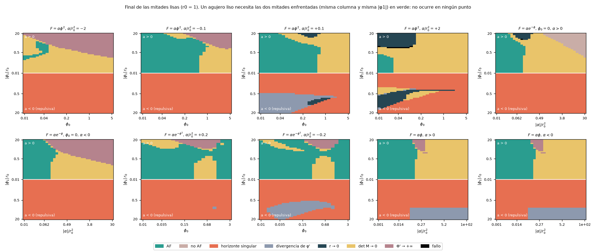
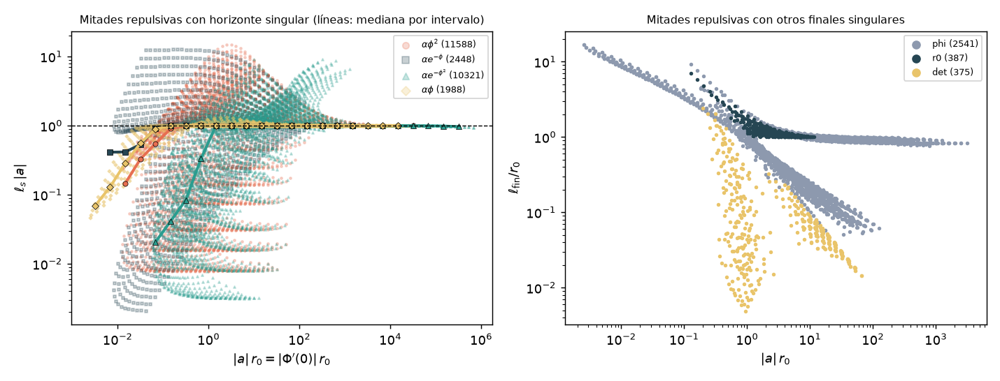
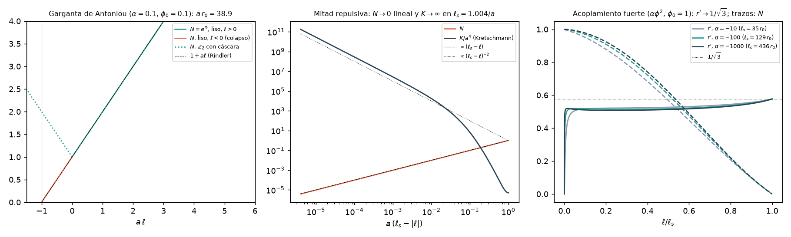

# Híbrido estrella–agujero de gusano — Fase 2c: agujeros EsGB lisos y asimétricos, sin cáscara

*Documento de trabajo v0.1 · 2026-10-21 · continúa [fase2b/fase2b_resultados.md](../fase2b/fase2b_resultados.md)*

## Resumen

1. **La pregunta.** En la Fase 2b todos los agujeros EsGB simétricos $\mathbb Z_2$ resultaron inestables con cualquier cáscara en la garganta. Sin gravedad inducida, el modo crece con la gravedad superficial de la garganta, $\omega_\infty\simeq-i\kappa_t$ (ley de §12 de la Fase 2b). Queda fuera de esa ley el agujero **liso y sin cáscara**, necesariamente asimétrico. Es además el caso relevante para un Sol aislado. Aquí se busca en la teoría $S=\frac1{16\pi}\int\sqrt{-g}\,[R-\frac12(\partial\phi)^2+F(\phi)\mathcal G]$ con $F=\alpha\phi^2$ y $F=\alpha e^{-\phi}$, y como extensión $F=\alpha e^{-\phi^2}$ y $F=\alpha\phi$.

2. **La garganta lisa nunca es un extremo del lapso** (§2–§3, analítico). La ligadura $\ell\ell$ en la garganta fija $a\equiv\Phi'(0)=(1+r_0^2\phi_1^2/4)/(4F'(\phi_0)\phi_1)\neq0$, con el mismo signo a los dos lados.
   - El lapso $N=e^\Phi$ es monótono a través de la garganta: una de las dos mitades, la **repulsiva**, ve $N$ decrecer hacia fuera.
   - En la construcción $\mathbb Z_2$ es la cáscara, con tensión $\Lambda_s=-2a$, la que pliega el lapso y hace atractivas las dos mitades.
   - Desarrollo exacto en la garganta: $N''/N\,(0)=-F''(\phi_0)\,\phi_1^4/[2(1+4F'^2\phi_1^2)]$ (con $r_0=1$), que solo frena el colapso si $F''(\phi_0)<0$.

3. **Resultado negativo: no hay agujeros lisos** (§4). Se han integrado **59 296 mitades** en cuatro acoplamientos, sobre mallas del espacio completo de gargantas lisas $(\alpha/r_0^2,\phi_0,\phi_1r_0)$ con los dos signos de $\alpha$.
   - **Ninguna de las 29 648 mitades repulsivas es asintóticamente plana; por tanto no hay ningún agujero liso.**
   - El 89 % acaba en un horizonte singular, y el resto en divergencias del escalar, $r\to0$ o degeneración de la parte principal.
   - En los acoplamientos cuadrático y gaussiano todos los finales están a $\ell\le22\,r_0$. Los más lejanos, hasta $292\,r_0$, son los de acoplamiento fuerte de §6.2, y tampoco son AF antes del final.
   - Las 13 398 mitades atractivas AF son las de Antoniou et al. sin la condición $\phi_\infty=0$. Todas tienen $a\,r_0\ge1.13$, así que su compañera repulsiva cae en el régimen de colapso.

4. **Mecanismo 1: colapso del lapso** (§5, analítico y numérico).
   - Las ecuaciones de campo dan $\Phi''=-\Phi'^2+O(\Phi')$ cuando $|\Phi'|\to\infty$, como en relatividad general: el determinante de la parte principal es afín en $\Phi'$ y el numerador de Cramer de $\Phi''$ es cúbico con el mismo coeficiente cambiado de signo (comprobado en SymPy).
   - En la mitad repulsiva, $\Psi=\Phi'$ obedece una ecuación de Riccati que lo lleva a $-\infty$ a distancia finita. $N$ se anula **linealmente**, $N\propto(\ell_s-\ell)^{1.00}$, en $\ell_s\simeq1/|a|$: la distancia de Rindler.
   - En las 26 345 mitades que acaban así, la mediana de $\ell_s|a|$ es $1.0000$ para $|a|r_0\ge100$ en los cuatro acoplamientos (percentiles 10–90: 0.999–1.10), y está entre 1.000 y 1.008 para $|a|r_0\ge10$.
   - En el punto final $r'(\ell_s)\neq0$, así que el Kretschmann diverge al menos como $(\ell_s-\ell)^{-2}$. Es un **horizonte de Killing singular**: el horizonte frustrado de la mitad atractiva, a distancia $1/a$ de la garganta, se realiza al otro lado como singularidad de curvatura.
   - La ligadura fija dónde: el coeficiente de $\Phi'$ debe anularse, lo que da la **relación de horizonte** $r_sr'_s=2F'\phi'(3r_s'^2-1)$. Se cumple a 6 cifras y acota $0<r'_s<1/\sqrt3$.
   - Explica la observación de Kanti–Kleihaus–Kunz, que vieron singularidades al prolongar una solución con derivadas continuas.

5. **Mecanismo 2: patada escalar** (§6.1). Con $F''(\phi_0)\ge0$ y $|\phi_1|$ grande (2 928 mitades, el 10 %), el escalar diverge antes de que el lapso se anule.
   - Aparece una región de masa de Misner–Sharp negativa ($|r'|$ hasta 1.54) y las esferas se cierran, $r\to0$, a $\ell\le17\,r_0$.
   - En el 57 % de esos casos el centro es de tipo ecuador, $r''(0)<0$.

6. **Mecanismo 3: acoplamiento fuerte y atractor cónico** (§6.2). Cuando $|F'(\phi_0)|\gg r_0^2$, $a\to0$ y el colapso inmediato no ocurre. Pero el término de Gauss–Bonnet domina la ligadura hamiltoniana, $4F'\Phi'\phi'(1-3r'^2)/r^2$, y la empuja a su cero, $r'^2=1/3$.
   - Geometría **cónica**: masa de Misner–Sharp $m=r/3$, con déficit de ángulo sólido de $2/3$ de $4\pi$. No es asintóticamente plana.
   - Después el lapso colapsa a $\ell_s\propto|\alpha|$.
   - Comprobado en 96 mitades repulsivas con $|\alpha|/r_0^2$ hasta $10^4$: ninguna es AF, $r'_{\max}\le0.5773$ y $m/r\to0.333$.

7. **Disparo dirigido y robustez** (§7).
   - Las 800 fronteras en $\phi_1$ entre tipos de final de la mitad repulsiva se han bisecado hasta $|\delta\phi_1|<10^{-10}$. Ninguna esconde una mitad AF: todas separan dos finales singulares a distancia acotada ($\ell_s\le18\,r_0$).
   - Una muestra de 1 489 mitades repulsivas reintegrada con $\texttt{rtol}=10^{-12}$, $\ell_{\max}=2000\,r_0$ y umbral $10^9$ no da ninguna AF. En los horizontes, $|\delta\ell_s|/\ell_s$ tiene mediana $9\times10^{-7}$ (máximo $2.5\times10^{-3}$).
   - **Hiperbolicidad de la continuación lisa** (el sustituto de la prueba pedida, que exige un fondo completo). En 32 de 41 gargantas, las perturbaciones radiales son hiperbólicas en todo el dominio $(-\ell_s,\infty)$.
   - Las otras 9 tienen todas $F''<0$, el signo que frena el colapso. En ellas el problema está mal planteado cerca del horizonte singular, y en 5 también cerca de la garganta.

8. **Estabilidad: no aplicable, infraestructura lista** (§8). Sin fondos lisos AF no hay problema de autovalores; la hiperbolicidad de la continuación lisa está en §7.
   - Se deja formulado y verificado el problema de autovalores sin empalmes. El gauge residual $\xi^\ell=f(t)$ genera una solución exacta para todo $w$, comprobada a $3\times10^{-13}$ con ligaduras a $2\times10^{-12}$.
   - Se fija con $d'(0)=0$ (la garganta perturbada sigue en $\ell=0$).
   - Determinante analítico de emparejamiento $\Delta(w)=\delta r_t^+\delta\phi_t^--\delta r_t^-\delta\phi_t^+$ entre las magnitudes invariantes de la garganta, $\delta r_t=d(0)$ y $\delta\phi_t=q(0)-\phi_1d'(0)/r''(0)$ ([estabilidad_lisa.py](estabilidad_lisa.py)).

9. **Literatura** (§1, verificada con la API de arXiv). Antoniou et al. dejan los asimétricos como trabajo futuro; KKK vieron singularidades en un ejemplo. Ningún trabajo posterior construye agujeros EsGB lisos sin campos adicionales.
   - Los lisos conocidos necesitan un campo de Maxwell (Cañate et al.).
   - Evseev–Melichev demuestran que Horndeski no admite agujeros estáticos, esféricos, AF y estables. EsGB es Horndeski con funciones $\propto\ln X$, singulares donde $\phi'=0$.

10. **Consecuencia para el proyecto.** En EsGB la cáscara $\mathbb Z_2$ no es una elección sino una necesidad. El mismo término de Gauss–Bonnet que abre la garganta le impone un gradiente del lapso, y sin cáscara el horizonte frustrado de la Fase 2b aparece al otro lado como singularidad.
    - La ley de la Fase 2b cubre, pues, todos los agujeros EsGB de estas familias, y con estos acoplamientos la vía EsGB pura queda cerrada para el híbrido: con cáscara la garganta crece en $\sim2r_0/c$, y sin cáscara no existe.
    - Una garganta lisa exige un ingrediente que permita $\Phi'(0)=0$: un campo de Maxwell (agujero de tipo Ellis de Cañate et al.) o un potencial con $V(\phi_0)=2/r_0^2$ (§10).

---

## 1. Planteamiento y literatura

**La pregunta.** En los agujeros simétricos de KKK y de Antoniou et al. la ligadura $\ell\ell$ impide que $\phi'$ y $\Phi'$ se anulen en la garganta. La reflexión $\ell\to-\ell$ produce entonces saltos de $\phi'$ y $\Phi'$, que sostiene una cáscara de materia en $\ell=0$ (Fase 2b, §1 y §3).
- Un agujero **liso** no tiene saltos: integra el mismo sistema a través de la garganta, con datos continuos, hasta dos infinitos asintóticamente planos (AF).
- Si existe es asimétrico: la reflexión cambia el signo de $\phi'(0)$ y $\Phi'(0)$, y la solución lisa no es par.
- Para el híbrido solar es el caso natural: al otro lado de la garganta no hay una estrella gemela que imponga la simetría.

**Literatura verificada** ([arxiv_busqueda.py](arxiv_busqueda.py), API de arXiv, 2026-10-21; textos leídos en la versión HTML de arXiv):

| Trabajo | Qué dice de los agujeros lisos o asimétricos |
|---|---|
| Kanti–Kleihaus–Kunz, [arXiv:1111.4049](https://arxiv.org/abs/1111.4049), PRD 85, 044007 (2012), §V y Fig. 11 | Al prolongar su solución a $\ell<0$ con derivadas continuas aparecen singularidades de curvatura. Muestran un ejemplo ($\alpha/r_0^2=0.02$, $f_0=1.1$, $F\propto e^{-\phi}$). La continuación simétrica obliga a poner materia en la garganta. |
| Antoniou, Bakopoulos, Kanti, Kleihaus, Kunz, [arXiv:1904.13091](https://arxiv.org/abs/1904.13091), PRD 101, 024033 (2020), §IV y nota 1 | Recuerdan que en la teoría exponencial "asymmetric wormholes were found but they were plagued by curvature singularities lurking behind the throat". Construir agujeros asimétricos es "a possibility that we plan to pursue in a future work". |
| Bronnikov, Baleevskikh, Skvortsova, [arXiv:1708.02324](https://arxiv.org/abs/1708.02324), PRD 96, 124039 (2017) | Citado en esa nota. En RG, teorema de imposibilidad para agujeros AF a los dos lados con materia isótropa. Da ejemplos asimétricos con materia anisótropa. |
| Ibadov, Kleihaus, Kunz, Murodov, [arXiv:2006.13008](https://arxiv.org/abs/2006.13008), PRD 102, 064010 (2020) | EsGB con potencial escalar: soluciones simétricas, con cáscara en la garganta. |
| Barton, Kiefer, Kleihaus, Kunz, [arXiv:2204.08232](https://arxiv.org/abs/2204.08232) (2022) | Einstein–vector–Gauss–Bonnet: también necesitan cáscara para la continuación simétrica. |
| Murodov et al., [arXiv:2609.18475](https://arxiv.org/abs/2609.18475) (2026) | Rotación lenta de los agujeros EsGB, con la fuente de la garganta en las condiciones de empalme. |
| Cañate, Sultana, Kazanas, [arXiv:1907.09463](https://arxiv.org/abs/1907.09463), PRD 100, 064007 (2019) | Agujero de tipo Ellis **liso** y exacto en EsGB **con campo de Maxwell** (electrovacío), sin escalar fantasma. |
| Evseev, Melichev, [arXiv:1711.04152](https://arxiv.org/abs/1711.04152), PRD 97, 124040 (2018) | La teoría de Horndeski en 4D no admite agujeros estáticos, esféricos, AF y estables (sin fantasmas ni inestabilidades de gradiente). |
| Rubakov, [arXiv:1509.08808](https://arxiv.org/abs/1509.08808); Mironov, Rubakov, Volkova, [arXiv:1812.07022](https://arxiv.org/abs/1812.07022) | En galileones y Horndeski aparecen siempre fantasmas o inestabilidades de gradiente. Más allá de Horndeski la demostración no se aplica, y hay candidatos con condiciones de estabilidad parciales. |

- Títulos, autores y revistas proceden de la API (campo `journal_ref`), con dos excepciones. KKK 2012 no tiene `journal_ref` en arXiv; PRD 85, 044007 es la referencia [40] de la bibliografía de Antoniou et al. Barton et al. y Murodov et al. no tienen revista en arXiv.
- Ningún trabajo construye agujeros EsGB lisos sin campos adicionales ni estudia el caso de forma sistemática. Las búsquedas por resumen ("wormhole" con "Gauss-Bonnet" y "asymmetric", "smooth", "thin shell", "scalar-Gauss-Bonnet") y por autor (Kanti, Kleihaus, Antoniou, Bakopoulos) no dan ninguno ([arxiv_busqueda_log.txt](arxiv_busqueda_log.txt)).
- El único resultado "asimétrico" en Gauss–Bonnet es de cáscaras finas en 4D-EGB ([arXiv:2607.03673](https://arxiv.org/abs/2607.03673)), otra teoría.
- **Sobre Evseev–Melichev.** EsGB es un subcaso de Horndeski, pero el término $F(\phi)\mathcal G$ corresponde a funciones de Horndeski con $\ln X$, $X=-\frac12(\partial\phi)^2$, singulares donde $\phi'=0$. Su teorema cubre los agujeros EsGB lisos con $\phi'\neq0$ en todo punto. Si existiesen, serían inestables (fantasmas o inestabilidades de gradiente). Nuestro resultado es complementario: en las familias estudiadas no existen.

---

## 2. Construcción: datos lisos y las dos mitades

Métrica estática en longitud propia, como en la Fase 2b: $ds^2=-N^2dt^2+d\ell^2+r^2d\Omega^2$ con $N=e^{\Phi}$. Se integra el sistema de [fondo_F.py](../fase2b/fondo_F.py) (función `segundas`, ecuaciones de [egb_F_gen.py](../fase2b/egb_F_gen.py)), importado sin modificarlo ([fondo_doble.py](fondo_doble.py)).

**Datos en la garganta** ($r_0=1$ salvo que se diga otra cosa): $r(0)=1$, $r'(0)=0$, $\Phi(0)=0$, $\phi(0)=\phi_0$, $\phi'(0)=\phi_1$. La ligadura $\ell\ell$ en $r'=0$,

$$
-\frac1{r_0^2}+\frac{4F'(\phi_0)\,\Phi'(0)\,\phi_1}{r_0^2}-\frac{\phi_1^2}{4}=0
\qquad\Longrightarrow\qquad
a\equiv\Phi'(0)=\frac{1+r_0^2\phi_1^2/4}{4F'(\phi_0)\,\phi_1},
$$

exige $\phi_1\neq0$ y $F'(\phi_0)\neq0$. El determinante de la parte principal en la garganta vale $\det M(0)=2(1+4F'^2\phi_1^2)>0$ ([garganta_simbolica.py](garganta_simbolica.py)): la garganta es siempre un punto regular del sistema y la solución se prolonga a los dos lados.

**Paridad.** Las ecuaciones estáticas son invariantes bajo $\ell\to-\ell$: todos sus términos tienen un número par de derivadas. Por tanto el lado $\ell<0$ de la solución lisa es la mitad "derecha" de los datos $(\phi_0,-\phi_1)$, leída con $\tilde\ell=-\ell$. Las dos mitades empalman con todas sus derivadas y la solución es analítica a través de la garganta.

**Proposición 1 (lapso monótono).** En todo agujero liso, $N'(0)=a\,N(0)\neq0$ con el mismo signo a los dos lados de la garganta. En la coordenada que se aleja de la garganta, una mitad tiene $\Phi'_{\rm fuera}(0)=+|a|$ (**atractiva**: $N$ crece hacia fuera) y la otra $-|a|$ (**repulsiva**).
- Un agujero liso existe si y solo si las mitades $(\phi_0,\phi_1)$ y $(\phi_0,-\phi_1)$ son ambas regulares y AF.
- Basta con estudiar las mitades repulsivas: si ninguna es AF, no hay agujeros lisos.
- **Comparación con $\mathbb Z_2$.** La construcción simétrica pega dos mitades atractivas, $\Phi'(0^\pm)=\pm a$ en $\ell$. El pliegue del lapso lo sostiene la tensión de la cáscara, $\Lambda_s=-2a$ (Fase 2b, §3). La Proposición 1 dice que sin cáscara ese pliegue es imposible.

**Parámetros.** La familia completa de gargantas lisas es $(\alpha/r_0^2,\phi_0,\phi_1r_0)$: cualquier agujero AF a los dos lados tiene un mínimo global de $r$, y en él los datos son de esta forma. Hay reducciones por simetría:
- $F=\alpha\phi^2$ y $F=\alpha e^{-\phi^2}$: $\phi\to-\phi$ junto con $\ell\to-\ell$ identifica $(\phi_0,\phi_1)$ con $(-\phi_0,\phi_1)$, así que basta $\phi_0>0$.
- $F=\alpha e^{-\phi}$: la traslación $\phi\to\phi+c$, $\alpha\to\alpha e^{c}$ permite fijar $\phi_0=0$.
- $F=\alpha\phi$: la traslación de $\phi$ cambia $F$ en una constante, que no contribuye en 4D; también $\phi_0=0$.

**Clasificación del final de cada mitad** ([fondo_doble.Lado](fondo_doble.py)). Se integra con DOP853 hasta $\ell=400\,r_0$ y se clasifica el final:
- **AF**: $r'>0$, masa de Misner–Sharp $m=r(1-r'^2)/2$ convergida, es decir $|m(\ell_{\max})-m(\ell_{\max}/2)|\le0.05\max(1,|m|)$, y $|m|<0.05\,r$. Este criterio excluye las geometrías cónicas de §6.2, con $r'\to$ cte $<1$ y $m\propto r$.
- **horizonte**: $N\to0$ a distancia finita, con $\Phi'\to-\infty$ (umbral $|\Phi'|=10^7$).
- **phi**: $|\phi'|\to\infty$.
- **r0**: $r\to0$.
- **det**: la parte principal degenera, $\det M\to0$; incluye los fallos del integrador con $|\det M|<10^{-4}|\det M(0)|$.
- **$\Phi$+**: $\Phi'\to+\infty$.
- **noAF**: llega a $\ell_{\max}$ sin cumplir el criterio AF.
- **fallo**: el integrador se detiene sin ninguna de las causas anteriores (25 de 59 296 mitades, todas atractivas).

---

## 3. La garganta lisa: desarrollo exacto

Resolviendo el sistema $3\times3$ en $\ell=0$ con la ligadura ([garganta_simbolica.py](garganta_simbolica.py), comprobado en SymPy con residuo 0), con $r_0=1$, $F_k=F^{(k)}(\phi_0)$ y $u=\phi_1$:

$$
r''(0)=1-\frac{2F_2u^2}{1+4F_1^2u^2},\qquad
\Phi''(0)=-a^2-\frac{u^2}{4}\big(1-r''(0)\big),\qquad
\frac{N''}{N}(0)=\Phi''+\Phi'^2=-\frac{F_2\,u^4}{2\,(1+4F_1^2u^2)} .
$$

Por tanto

$$
\frac{N''(0)}{a^2N(0)}=-\frac{128\,F_1^2F_2\,u^6}{(u^2+4)^2\,(1+4F_1^2u^2)} .
$$

- La curvatura del lapso en la garganta es pequeña frente a $a^2$, salvo con acoplamiento fuerte y $F''(\phi_0)<0$.
- Con $F''>0$ ($\alpha>0$ en los acoplamientos cuadrático y exponencial) $N''(0)<0$, y el lapso decrece aún más deprisa en la mitad repulsiva.
- Con $F''<0$ (cuadrático y exponencial con $\alpha<0$; gaussiano con $\alpha>0$ y $\phi_0^2<1/2$) $N''(0)>0$ frena el colapso. Pero $N''(0)\gtrsim a^2$ exige $|F''|\gtrsim(u^2+4)^2/(32u^4)\ge1/32$ y $|F'u|\gg1$ (en unidades de $r_0$): acoplamiento fuerte, el régimen de §6.2.

---

## 4. Mapa de existencia

Mallas en $(\alpha/r_0^2,\phi_0,\phi_1r_0)$, con $|\phi_1|r_0\in[0.01,20]$ (34 valores logarítmicos por signo) y los dos signos de $\alpha$ ([mapa_lados.py](mapa_lados.py), [analisis_mapa.py](analisis_mapa.py)):
- **cuadrático**, $F=\alpha\phi^2$: $|\alpha|/r_0^2\in\{0.02,0.05,0.1,0.2,0.5,1,2\}$, $\phi_0\in[0.01,5]$ (28 valores);
- **exponencial**, $F=\alpha e^{-\phi}$: $\phi_0=0$, $|\alpha|/r_0^2\in[0.01,30]$ (36 valores);
- **gaussiano**, $F=\alpha e^{-\phi^2}$: $|\alpha|/r_0^2\in\{0.05,0.1,0.2,0.5,1,2,5\}$, $\phi_0\in[0.01,3]$ (24 valores);
- **lineal**, $F=\alpha\phi$: $\phi_0=0$, $|\alpha|/r_0^2\in[0.001,100]$ (36 valores).

Cada punto de la malla da dos mitades, $\pm\phi_1$, una atractiva y una repulsiva.

| $F$ | mitades | atractivas AF | repulsivas: horizonte | phi | r0 | det | **repulsivas AF** | **agujeros lisos** |
|---|---|---|---|---|---|---|---|---|
| $\alpha\phi^2$ | 26 656 | 5 885 | 11 588 | 1 214 | 387 | 139 | **0** | **0** |
| $\alpha e^{-\phi}$ | 4 896 | 733 | 2 448 | 0 | 0 | 0 | **0** | **0** |
| $\alpha e^{-\phi^2}$ | 22 848 | 5 750 | 10 321 | 867 | 0 | 236 | **0** | **0** |
| $\alpha\phi$ | 4 896 | 1 030 | 1 988 | 460 | 0 | 0 | **0** | **0** |
| **total** | **59 296** | **13 398** | **26 345** | **2 541** | **387** | **375** | **0** | **0** |

- **Ninguna de las 29 648 mitades repulsivas es AF.** No hay ningún agujero liso en el dominio explorado.
- **Las mitades atractivas AF** son las mitades de Antoniou et al. sin la condición $\phi_\infty=0$.
  - El resto acaba en la degeneración de la parte principal ($\det M\to0$, análoga al "límite singular" de KKK, [arXiv:1111.4049](https://arxiv.org/abs/1111.4049) §III), en $\Phi'\to+\infty$ o en $r\to0$. En el exponencial quedan además 184 'noAF' con acoplamiento fuerte: tienen $r'=0.53$–$0.96$ y masa sin converger en $\ell=400\,r_0$.
  - Todas las AF tienen $a\,r_0\ge1.13$ (mediana entre 32 y 126 según el acoplamiento): la garganta está siempre al menos moderadamente desplazada al rojo. Su mitad compañera, con $\Phi'_{\rm fuera}(0)=-a$, cae en el régimen de colapso de §5.
- **Por signo de $F''(\phi_0)$.** Con $F''<0$, el signo que frena el colapso según §3, el resultado es el mismo:
  - las 6 664 mitades repulsivas cuadráticas con $\alpha<0$ y las 1 224 exponenciales con $\alpha<0$ acaban todas en horizonte singular;
  - de las 5 712 gaussianas con $F''<0$, 5 661 acaban en horizonte, 47 en phi y 4 en det.
- **Distancia máxima al final singular**: $22\,r_0$ (cuadrático), $292\,r_0$ (exponencial, acoplamiento fuerte, §6.2), $4.7\,r_0$ (gaussiano) y $44\,r_0$ (lineal).
- **$r'$ al final de las mitades repulsivas**: su máximo en las cuatro familias es $0.5770$–$0.5773$, es decir $1/\sqrt3$. Ninguna se acerca a $r'\to1$. La cota se explica en §5 (relación de horizonte) y §6.2 (atractor cónico).

La Fig. 1 (al final de §7) muestra los finales en cortes de la malla. En cada panel, la mitad atractiva de un punto está enfrentada a su compañera repulsiva; un agujero liso exigiría verde en las dos, y no ocurre nunca.

---

## 5. El colapso del lapso

**Lema (estructura de las ecuaciones para $|\Phi'|$ grande).** En un punto genérico $(r,r',\phi,\phi')$ con $\Phi'=P$, el determinante de la parte principal es afín en $P$,

$$
\det M=d_0+d_1P,\qquad d_1=\frac{128\,F'^2\,(1-r'^2)\,\big[F'\phi'(1+3r'^2)-r\,r'\big]}{r^5},
$$

y el numerador de Cramer de $\Phi''$ es $-d_1P^3+O(P^2)$. Si $d_1\neq0$,

$$
\Phi''=-\Phi'^2+O(\Phi')\qquad(|\Phi'|\to\infty),
$$

como en relatividad general, donde $\Phi''=-\Phi'^2-\Phi'r'/r+O(1)$. Está comprobado simbólicamente ([garganta_simbolica.py](garganta_simbolica.py)) y numéricamente en estados aleatorios: $(\Phi''+\Phi'^2)/\Phi'$ tiende a una constante para $|\Phi'|=10^2$–$10^5$.

**Consecuencia (Riccati).** En la mitad repulsiva, $\Psi\equiv\Phi'_{\rm fuera}$ cumple $\Psi'=N''/N-\Psi^2$, con $\Psi(0)=-|a|$.
- Si $N''/N\le K$ en $[0,\ell]$ y $|a|>\sqrt K$, la comparación con $\Psi'=K-\Psi^2$ lleva $\Psi\to-\infty$ antes de
  $$\ell_*=\frac1{2\sqrt K}\ln\frac{|a|+\sqrt K}{|a|-\sqrt K}=\frac1{|a|}\Big(1+\frac{K}{3a^2}+\dots\Big).$$
- Por el lema, $N''/N=O(\Psi)$ crece más despacio que $\Psi^2$. Mientras los coeficientes de ese término sigan acotados, el colapso no se detiene una vez iniciado. Los cuantifica la Fig. 2; la excepción es la patada escalar de §6.1.
- Cerca del final, $\Psi\simeq-1/(\ell_s-\ell)$: $N$ se anula linealmente.

**Naturaleza del final** ([singularidad.py](singularidad.py)). En la cola, $1/\Phi'$ se ajusta a una recta en $\ell$: la pendiente es $1/p$ con $N\propto(\ell_s-\ell)^p$, y la abscisa en el origen da $\ell_s$.

| $F$, $\alpha/r_0^2$, $\phi_0$, $\phi_1r_0$ | $a\,r_0$ | $\ell_s\lvert a\rvert$ | $p$ | $r'(\ell_s)$ | $r'_s$ de la relación (\*) | $F'\phi'$ en $\ell_s$ | $K\,(\ell_s-\ell)^2$ |
|---|---|---|---|---|---|---|---|
| $\alpha\phi^2$, 0.1, 0.1, −0.330 (Antoniou) | −38.9 | 1.004 | 1.009 | 0.149513 | 0.149514 | −0.080 | $\sim5\times10^3$ |
| $\alpha\phi^2$, 0.1, 0.01, −0.355 | −363 | 1.000 | 1.009 | 0.20879 | 0.20903 | −0.120 | $\sim4\times10^8$ |
| $\alpha\phi^2$, 0.09, 0.3, −0.0723 | −64.2 | 1.000 | 1.000 | 0.029556 | 0.029556 | −0.015 | 0.75 |
| $\alpha\phi^2$, −0.5, 1, +1 | −0.31 | 1.067 | 1.002 | 0.363677 | 0.363677 | −0.61 | 0.28 |
| $\alpha\phi^2$, −2, 0.3, +3 | −0.23 | 1.796 | 1.003 | 0.484630 | 0.484630 | −3.7 | 0.10 |
| $\alpha e^{-\phi}$, −1, 0, −1 | −0.31 | 1.080 | 1.001 | 0.342679 | 0.342679 | −0.53 | 0.24 |
| $\alpha e^{-\phi}$, 0.03, 0, +0.7 | −13.4 | 1.023 | 1.027 | 0.285065 | 0.285065 | −0.19 | $\sim5\times10^3$ |
| $\alpha e^{-\phi}$, −30, 0, −20 | −0.042 | 12.3 | 1.000 | 0.560769 | 0.560769 | −813 | $9.3\times10^{-5}$ |
| $\alpha e^{-\phi^2}$, 0.2, 0.1, +0.5 | −13.4 | 1.016 | 1.002 | 0.166217 | 0.166217 | −0.091 | 15 |
| $\alpha\phi$, 0.3, —, −1 | −1.04 | 1.119 | 1.013 | 0.391111 | 0.391111 | −0.45 | 5 |
| $\alpha\phi$, 0.01, —, −0.5 | −53.1 | 1.005 | 1.020 | 0.198057 | 0.198058 | −0.11 | $\sim6\times10^4$ |
| $\alpha\phi^2$, 0.5, 1, −1 | −0.31 | 0.159 | 0.033 | −0.168 | — | −1.5 | $\to\infty$ (crece) |
| $\alpha e^{-\phi}$, 0.5, 0, +1 | −0.63 | 0.572 | 0.439 | $-4\times10^{-5}$ | — | $-6\times10^3$ | $\to\infty$ (crece) |
| $\alpha e^{-\phi^2}$, 1, 0.5, +2 | −0.32 | 0.151 | 0.121 | $-3\times10^{-4}$ | — | −770 | $\to\infty$ (crece) |

- **Tipo Rindler** (la mayoría). $N\propto(\ell_s-\ell)^{1.00}$ y $r'(\ell_s)\neq0$. Como el Kretschmann es una suma de cuadrados en la base estática, $K\ge8\,r'^2\Phi'^2/r^2\to\infty$: el vector de Killing se hace nulo sobre una esfera que no es extrema. Es un horizonte de Killing singular, no un horizonte regular, que exigiría $r'=0$.
- **Tipo extremo** (algunos fondos con $|a|r_0\lesssim1$, con $F''$ de cualquier signo). $r'\to0$, $\phi'\to\infty$ y $N\propto(\ell_s-\ell)^p$ con $p=0.03$–$0.44$. Es un horizonte de agujero negro EsGB que viola la condición de regularidad del escalar.

(\*) **Relación de horizonte.** Si $\Phi'\to-\infty$ con $r$, $r'$, $\phi$ y $\phi'$ finitos, la ligadura $\ell\ell$,
$$\frac{r'^2-1}{r^2}+\frac{2\Phi'r'}{r}-\frac{\phi'^2}{4}+\frac{4F'\Phi'\phi'(1-3r'^2)}{r^2}=0 ,$$
es lineal en $\Phi'$ y obliga a que se anule el coeficiente de $\Phi'$:
$$r_s\,r'_s=2F'(\phi_s)\,\phi'_s\,\big(3r_s'^2-1\big).$$
- Se cumple a 6 cifras en todos los finales de tipo Rindler de la tabla (a $10^{-3}$ en el de $a\,r_0=-363$, donde $\phi'$ aún evoluciona). En los 14 casos la ligadura se mantiene a $\le1.2\times10^{-11}$ relativo hasta $|\Phi'|=10^7$.
- $F'\phi'<0$ es el signo de la mitad repulsiva en la garganta, y se conserva hasta $\ell_s$ en todos los casos de la tabla. Con ese signo la relación da $0<r'_s<1/\sqrt3$. Que ningún $r'$ final de los mapas supere $1/\sqrt3$ indica lo mismo para las demás mitades.
- Un horizonte regular exigiría $r'_s=0$, es decir $F'\phi'=0$ en el horizonte, lo que no es genérico.
- En el límite $|F'\phi'|/r_s\to\infty$, $r'_s\to1/\sqrt3$: es el atractor cónico de §6.2. Esto explica que el máximo de $r'$ final en los mapas sea $1/\sqrt3$.
- En los finales de tipo extremo $\phi'$ también diverge y la relación no se aplica.

**La ley $\ell_s=1/|a|$** ([analisis_mapa.py](analisis_mapa.py), Fig. 2). Mediana de $\ell_s|a|$ en las 26 345 mitades repulsivas que acaban en horizonte, con los percentiles 10–90 entre paréntesis:

| $\lvert a\rvert r_0$ | $\alpha\phi^2$ | $\alpha e^{-\phi}$ | $\alpha e^{-\phi^2}$ | $\alpha\phi$ |
|---|---|---|---|---|
| $<1$ | 0.961 (0.017–1.61) | 0.993 (0.013–3.03) | 0.086 (0.009–1.02) | 0.971 (0.18–1.01) |
| 1–10 | 1.007 (0.14–2.75) | 1.002 (0.38–2.02) | 1.003 (0.05–1.36) | 1.005 (1.000–1.15) |
| 10–30 | 1.003 (1.000–2.02) | 1.002 (0.89–1.37) | 1.003 (0.79–1.55) | 1.008 (1.000–1.07) |
| 30–100 | 1.0005 (1.000–1.18) | 1.0005 (0.94–1.33) | 1.001 (1.000–1.93) | 1.004 (1.000–1.03) |
| $\ge100$ | **1.0000** (1.000–1.007) | **1.0000** (1.000–1.000) | **1.0000** (0.999–1.10) | **1.0001** (1.000–1.006) |

- Para $|a|r_0\ge100$ el colapso ocurre a la distancia de Rindler con una precisión de $10^{-4}$ en la mediana, en los cuatro acoplamientos.
- Las gargantas $\mathbb Z_2$ de la Fase 2b tienen $a\,r_0=4$–835. Sus continuaciones lisas caen en las cuatro últimas filas, con medianas entre 1.000 y 1.008.
- Para $|a|r_0\lesssim10$ la dispersión crece:
  - por arriba ($\ell_s|a|$ hasta 3, y hasta 12 con acoplamiento fuerte), porque $N''>0$ retrasa el colapso cuando $F''<0$;
  - por abajo ($\ell_s|a|\ll1$), en los finales de tipo extremo, donde el escalar diverge antes.

  Las medianas por intervalo de la Fig. 2 convergen a 1 en los cuatro acoplamientos para $|a|r_0\gtrsim1$.

**Interpretación.** En la Fase 2b (§12) la garganta $\mathbb Z_2$ está a una distancia propia $\sim1/a$ de su horizonte frustrado, en la región casi de Rindler de un exterior casi de Schwarzschild. En la continuación lisa, ese horizonte aparece al otro lado de la garganta, a la misma distancia $1/a$, y aparece singular.
- La cáscara $\mathbb Z_2$ no es un artificio de la construcción: es lo que impide que el horizonte frustrado se realice.
- La escala $1/a$ es la misma que fija la tasa del modo inestable de la Fase 2b, $\omega_\infty\simeq-i\kappa_t$ con $\kappa_t=e^{-\Phi_\infty}a$.

---

## 6. Otros finales de la mitad repulsiva

### 6.1 Patada escalar

Los finales **phi** y **r0** son 2 928 de las 29 648 mitades repulsivas. Aparecen casi solo con $F''(\phi_0)\ge0$ y $|\phi_1|$ grande: 1 601 cuadráticas con $\alpha>0$, 820 gaussianas con $F''>0$ y 460 lineales, frente a solo 47 con $F''<0$.
- En 1 665 de ellas (57 %) el centro es de tipo ecuador, $r''(0)=1-2F''\phi_1^2/(1+4F'^2\phi_1^2)<0$, lo que exige $F''\phi_1^2$ grande. En la mitad repulsiva $r$ decrece entonces desde $\ell=0$.
- Las 375 mitades que acaban en det también tienen $F''>0$ (371 de 375; 164 con centro de tipo ecuador). Terminan a $\ell\le2.4\,r_0$.
- Las phi/r0 terminan a $\ell\le17\,r_0$.

Ejemplos ([singularidad.py](singularidad.py)):

| $F$, $\alpha/r_0^2$, $\phi_0$, $\phi_1r_0$ | $a\,r_0$ | final | $\ell_{\rm fin}/r_0$ | $m_{\min}/r_0$ | $\lvert r'\rvert_{\max}$ | $N_{\min}$ |
|---|---|---|---|---|---|---|
| $\alpha\phi^2$, 0.02, 0.01, −20 | −3156 | phi ($r\to0.02$, $\phi\to-2\times10^5$) | 0.823 | −0.68 | 1.54 | $1.2\times10^{-3}$ |
| $\alpha\phi^2$, 0.02, 0.1, −5 | −90.6 | phi ($r\to0.007$) | 0.851 | −0.62 | 1.51 | $5.6\times10^{-3}$ |
| $\alpha\phi^2$, 0.5, 0.03, −5 | −12.1 | phi ($r\to0.001$) | 1.004 | −0.013 | 1.016 | 0.74 |
| $\alpha\phi^2$, 0.5, 0.1, −2 | −2.5 | r0 | 1.064 | −0.0036 | 1.006 | 0.74 |
| $\alpha\phi^2$, 2, 0.02, −1 | −3.9 | r0 | 1.037 | −0.0012 | 1.002 | 0.82 |
| $\alpha\phi$, 10, —, −5 | −0.036 | phi (con $N\to5\times10^{-8}$) | 5.39 | +0.49 | 0.42 | $5\times10^{-8}$ |

- **Con $|a|r_0\gg1$** el lapso empieza a colapsar, hasta $N\sim10^{-3}$. Una patada del escalar lo detiene: $\phi'$ crece sin límite, aparece una región de **masa de Misner–Sharp negativa** ($|r'|>1$, $m_{\min}\simeq-0.6\,r_0$) y las esferas se cierran ($r\to0$) a $\ell\simeq0.8\,r_0$, con $\phi\to-\infty$.
- **Con $|a|r_0\sim1$–10** el lapso apenas cambia ($N_{\min}\simeq0.75$): la mitad se cierra en $r\to0$ a $\ell\simeq r_0$, con $r'\simeq-1$ y el escalar divergente.
- En el lineal, la divergencia de $\phi'$ llega justo antes de que $N$ se anule: es un horizonte singular con el escalar divergente.

Ninguno de estos finales se acerca a la planitud asintótica: la mitad se cierra o se hace singular a $\ell\le17\,r_0$.

### 6.2 Acoplamiento fuerte: el atractor cónico $r'^2=1/3$

Fuera de la malla ([acoplamiento_fuerte.py](acoplamiento_fuerte.py)): $F=\alpha e^{-\phi}$ y $F=\alpha\phi$ con $|\alpha|/r_0^2=10$–$10^4$, y $F=\alpha\phi^2$ con $|\alpha|/r_0^2=10$–$10^3$ y $\phi_0\in\{0.1,1\}$. Son 96 mitades repulsivas en total.

- **Ninguna es AF, y ninguna alcanza $r'>0.9$.**
- Cuando el término de Gauss–Bonnet domina la ligadura hamiltoniana,
  $$\frac{r'^2-1}{r^2}+\frac{2\Phi'r'}{r}-\frac{\phi'^2}{4}+\frac{4F'\Phi'\phi'\,(1-3r'^2)}{r^2}=0 ,$$
  la solución es atraída al cero de ese término, $r'^2=1/3$. Allí la masa de Misner–Sharp vale $m=r(1-r'^2)/2=r/3$. Es el mismo límite que el de la relación de horizonte de §5 cuando $|F'\phi'|/r\to\infty$.
- Numéricamente, $r'_{\max}=0.5772$–$0.5773$ y $m/r=0.333$–$0.334$ en los casos cuadráticos y lineales más fuertes, frente a $1/\sqrt3=0.57735$. En el exponencial con $\alpha<0$ el valor se acerca despacio: $r'_{\max}=0.5605$–$0.5625$ para $|\alpha|=10$–$10^4$ con $\phi_1=-20$.
- La geometría es cónica: el área de las esferas crece como $\frac{4\pi}{3}\ell^2$, con un déficit de ángulo sólido de $2/3$ de $4\pi$, y la masa de Misner–Sharp crece sin límite. No es AF. Después el lapso colapsa, a $\ell_s\propto|\alpha|$: por ejemplo $\ell_s/|\alpha|\simeq9$ en el exponencial con $\phi_1=-20$.
- Para ser AF la solución tendría que salir del régimen dominado por Gauss–Bonnet, con $F'\Phi'\phi'/r^2\to0$ y $r'\to1$. En ningún caso ocurre.
- Con $\alpha>0$ (exponencial y cuadrático) y acoplamiento fuerte, la mitad repulsiva acaba en un horizonte singular a $\ell_s\le11\,r_0$, sin alejarse de la garganta.
- El lineal con $\alpha>0$ se comporta como el exponencial con $\alpha<0$: tiende al atractor cónico, con $r'_{\max}=0.5772$ y $\ell_s$ hasta $260\,r_0$ para $\alpha=10^4$.

---

## 7. Disparo dirigido y robustez

**Disparo por bisección** ([disparo_lisos.py](disparo_lisos.py)). Si existiese una región AF de mitades repulsivas, su frontera con la región singular aparecería en la malla como un cambio de tipo de final, con $\ell_s\to\infty$ al acercarse.
- Se han bisecado en $\phi_1$ (con $\alpha$ y $\phi_0$ fijos) los 800 pares de puntos vecinos de la malla con distinto final de la mitad repulsiva, hasta $|\delta\phi_1|<10^{-10}\max(1,|\phi_1|)$.

| frontera | casos | $\ell_s$ máximo en la frontera |
|---|---|---|
| det / horizonte | 269 | $5.9\,r_0$ |
| det / phi | 112 | $9.7\,r_0$ |
| det / r0 | 27 | $2.9\,r_0$ |
| horizonte / phi | 303 | $18.4\,r_0$ |
| phi / r0 | 89 | $8.2\,r_0$ |

- **Ninguna traza de bisección contiene una mitad AF**, y $\ell_s$ queda acotado a los dos lados de todas las fronteras: separan dos finales singulares sin pasar por soluciones regulares.
- Entre horizonte y AF no hay ninguna frontera: el horizonte singular no se aleja hacia el infinito en ninguna dirección de la malla.
- La mayor distancia, $292\,r_0$ (percentil 99: $18.6\,r_0$), corresponde al acoplamiento fuerte de §6.2, donde la mitad es cónica antes del final.

**Robustez de la clasificación** ([robustez.py](robustez.py)). Se ha reintegrado una muestra estratificada de 1 489 mitades repulsivas: hasta 150 por acoplamiento y tipo de final, y todas las de los grupos pequeños. Se ha usado $\texttt{rtol}=10^{-12}$ (frente a $10^{-9}$), $\ell_{\max}=2000\,r_0$ (frente a 400) y umbral $|\Phi'|,|\phi'|<10^9$ (frente a $10^7$).
- **Ninguna resulta AF.** 1 353 mantienen el final.
- Las 136 restantes pasan de phi a r0: con el umbral más alto la divergencia del escalar va seguida de $r\to0$, el mismo final de patada escalar (§6.1).
- En los 600 horizontes muestreados, la posición del final cambia en una mediana de $|\delta\ell_s|/\ell_s=8.6\times10^{-7}$, con un máximo de $2.5\times10^{-3}$.

**Hiperbolicidad de la continuación lisa** ([hiperbolicidad_lisa.py](hiperbolicidad_lisa.py)). La prueba pedida (hiperbolicidad a lo largo de toda la línea de un agujero liso) no puede hacerse sin fondo. Se hace sobre lo que sí existe: la continuación lisa de 41 gargantas con mitad atractiva AF (40 al azar del mapa y la de Antoniou de la Fig. 3), en $(-\ell_s,\infty)$.
- Se usa `estabilidad_F.velocidades` sobre `Doble`. La luz tiene $\lambda=N^2$, así que $c^2\equiv\lambda_{\min}/N^2$ es el cuadrado de la velocidad característica relativa a la luz local.
- **32 de 41 son hiperbólicas en todo el dominio**, con $c^2_{\min}$ entre 0.82 y 43: velocidades entre 0.9 y 6.6 veces la de la luz, superlumínicas como es habitual en Horndeski.
- **En 9** la mitad repulsiva pierde la hiperbolicidad antes del horizonte singular, con $\lambda<0$ y $\lambda/N^2\to-\infty$. En 5 de ellas también hay puntos con $\lambda<0$ cerca de la garganta en la mitad atractiva, como en las regiones mal planteadas de la Fase 2b (§10).
- Las 9 tienen $F''(\phi_0)<0$ y $|a|r_0=1.6$–69. Las 20 gargantas de la muestra con $F''>0$ son hiperbólicas en todo el dominio; de las 21 con $F''<0$, lo son 12.
- El signo de $F''$ que frena el colapso del lapso (§3) es, pues, el que lleva al problema de valores iniciales mal planteado.
- Cuando el problema está bien planteado, el final es puramente geométrico (horizonte singular). En los demás casos, el colapso va precedido de una región mal planteada.

### Figuras

| | |
|---|---|
|  | **Fig. 1.** Final de las mitades lisas en cortes de las mallas ($r_0=1$): cuadrático con $\alpha/r_0^2=\pm0.1,\pm2$; exponencial y lineal con los dos signos de $\alpha$; gaussiano con $\alpha/r_0^2=\pm0.2$. Arriba de la línea blanca, la mitad con $a>0$; abajo, su compañera repulsiva, a la misma distancia de la línea. Un agujero liso exige verde en las dos: no ocurre nunca. Los dos paneles del lineal coinciden por la simetría $\phi\to-\phi$, $\alpha\to-\alpha$. |
|  | **Fig. 2.** Izquierda: $\ell_s|a|$ frente a $|a|r_0$ en las 26 345 mitades repulsivas que acaban en horizonte singular; las líneas son la mediana por intervalo. Converge a 1 (distancia de Rindler) en los cuatro acoplamientos. Derecha: distancia al final en las mitades con patada escalar ($\phi$, $r\to0$) o con la parte principal degenerada. |
|  | **Fig. 3.** Izquierda: continuación lisa de una garganta de Antoniou ($F=\alpha\phi^2$, $\alpha/r_0^2=0.1$, $\phi_0=0.1$, $a\,r_0=38.9$). El lapso es lineal de Rindler a los dos lados y se anula en $a\ell=-1$; con cáscara $\mathbb Z_2$ (punteado) se pliega. Centro: cerca del final, $N\propto(\ell_s-\ell)$ y $K\propto(\ell_s-\ell)^{-2}$ durante cinco décadas, con $\ell_s=1.004/a$. Derecha: acoplamiento fuerte ($\phi_0=1$, $\alpha/r_0^2=-10,-100,-1000$). $r'$ se queda en el atractor cónico, cerca de $1/\sqrt3$, y el lapso (trazos) colapsa a $\ell_s\propto|\alpha|$. |

---

## 8. Hiperbolicidad y perturbaciones radiales: formulación sin empalmes

Sin fondos lisos AF no hay problema de autovalores que resolver. La hiperbolicidad de la continuación lisa se ha estudiado en §7. Se deja el problema de autovalores formulado y sus piezas verificadas, para cualquier extensión de la teoría que sí tenga gargantas lisas (§10).

**Variables.** Las de la Fase 2b: estado $y=(a',d,d',q,q')$ con $\Phi\to\Phi+a\,e^{i\omega t}$, $r\to r+d\,e^{i\omega t}$ y $\phi\to\phi+q\,e^{i\omega t}$; $w=\omega^2$ con el reloj de la garganta. Se usan `estabilidad_F.derivadas` y `ligaduras` sin cambios. La clase `Doble` de [fondo_doble.py](fondo_doble.py) da el fondo para $\ell$ de cualquier signo, así que `velocidades`, `derivadas` y `ligaduras` funcionan a lo largo de toda la línea.

**Gauge residual.** $\xi^\ell=f(t)$, $\xi^t=\dot f\int_0^\ell e^{-2\Phi}d\ell'$ conserva $g_{\ell\ell}=1$ y $g_{t\ell}=0$, y genera para cada $w$ la solución exacta

$$
g(\ell)=\big(\Phi''-w\,e^{-2\Phi},\ r',\ r'',\ \phi',\ \phi''\big).
$$

- Comprobado en [verificar_gauge.py](verificar_gauge.py): integrada desde $\ell_1$, reproduce la expresión analítica en $\ell_2$ con error relativo $\le3.5\times10^{-13}$ y cumple las dos ligaduras a $\le1.8\times10^{-12}$, con $w$ real y complejo y en tres intervalos.
- Su escalar es $q=f\phi'\sim1/r^2$, sin parte exponencial, así que cumple el decaimiento en los dos infinitos para **todo** $w$. Hay que eliminarlo.
- En la Fase 2b lo impedía la cáscara, fija en $\ell=0$ por simetría. Sin cáscara, desplaza la garganta.

**Fijación: $d'(0)=0$.** La garganta perturbada es el mínimo de $R=r+d$, en $\ell_t=-d'(0)/r''(0)$; la condición la mantiene en $\ell=0$.
- Es una fijación completa: $g$ tiene $d'(0)=r''(0)\neq0$ en una garganta no degenerada, así que cada órbita gauge tiene un único representante con $d'(0)=0$.
- Las dos magnitudes invariantes en la garganta son
  $$\delta r_t=d(0),\qquad \delta\phi_t=q(0)-\phi_1\,\frac{d'(0)}{r''(0)},$$
  es decir, el radio de la garganta ($d=fr'$ se anula en $\ell=0$) y el escalar en la garganta desplazada.
- El espacio de datos admisibles en $\ell=0$ tiene dimensión 3 (cinco componentes menos dos ligaduras independientes; $E^\ell{}_\ell$ despeja $a'(0)$ y $E^\ell{}_t$ despeja $d'(0)$). Módulo gauge es el plano $(\delta r_t,\delta\phi_t)$.

**Condiciones en los infinitos.** En vacío esférico y con $w\neq0$ las perturbaciones métricas son gauge puro (Birkhoff), así que en cada extremo solo cuenta el escalar.
- Se impone que no haya exponencial creciente: $q\sim e^{-k_\pm|\ell|}/r$, con $k=\sqrt{-w}\,e^{-\Phi}$ en la rama principal ($\operatorname{Re}k>0$), que tiende a $\kappa_\pm=\sqrt{-w}\,e^{-\Phi_{\pm\infty}}$.
- El contenido gauge de cada extremo queda libre. La combinación $X=r'q-\phi'd$ es invariante y tiene el mismo comportamiento exponencial que $q$, así que la condición no depende del gauge.

**Determinante analítico.** Sean $U_\pm$ las soluciones decrecientes integradas desde $\pm L$ hasta la garganta.

$$
\Delta(w)=\delta r_t^{+}\,\delta\phi_t^{-}-\delta r_t^{-}\,\delta\phi_t^{+}
=\frac{\det\,[U_+,U_-,g]}{r''(0)}\quad\text{(en coordenadas }(d,\delta\phi_t,d')\text{ del espacio admisible)} .
$$

- Es analítica en $w$ fuera del corte $w>0$, porque los datos asintóticos son analíticos y las ecuaciones lineales tienen coeficientes polinómicos en $w$.
- No requiere elegir el signo de ningún vector: $g$ entra como columna explícita y cualquier contenido gauge de $U_\pm$ se cancela.
- Cada cero con $w\notin[0,\infty)$ es un modo que crece en el tiempo ($\operatorname{Re}k>0\Leftrightarrow\operatorname{Im}\omega<0$).
- La renormalización por factores positivos y el factor $e^{-\int k}$ conservan los ceros y la fase, que es lo que necesita el principio del argumento.
- Están implementados en [estabilidad_lisa.py](estabilidad_lisa.py) $\Delta(w)$, su versión sin renormalizar (para comprobar cada raíz) y la búsqueda de raíces reales. El recuento de raíces complejas por el principio del argumento no se ha implementado: sin fondo no hay contra qué validarlo.
- **Pruebas** ([verificar_lisa.py](verificar_lisa.py), sobre una mitad AF, con $w$ real y complejo):
  - el dato asintótico cumple las ligaduras y la solución integrada las conserva hasta la garganta a $\le8\times10^{-13}$;
  - al añadir $c\,g(L)$ al dato asintótico, $y(0)$ cambia en $\sim3\times10^{-6}$ relativo, pero $(\delta r_t,\delta\phi_t)$ cambian solo $\le1.4\times10^{-12}$: las magnitudes de la garganta son invariantes gauge, como deben;
  - prueba de humo sobre un fondo ficticio, sin significado físico (la misma mitad AF a los dos lados): el cálculo completo de $\Delta$, la búsqueda de raíces y la hiperbolicidad se ejecutan de punta a punta. La versión renormalizada y la sin renormalizar tienen la misma fase a $6\times10^{-15}$ rad.

**Qué cabría esperar.** La ley de la Fase 2b se dedujo para gargantas sostenidas por una cáscara. En una garganta lisa la región a distancia $1/a$ de la garganta es la que colapsa (§5), así que la ley no tiene dónde aplicarse en esta teoría.

---

## 9. Interpretación y consecuencias

1. **En EsGB la cáscara no es opcional.** En los cuatro acoplamientos estudiados no hay agujeros lisos en el dominio explorado. Toda garganta EsGB AF a los dos lados necesita la cáscara $\mathbb Z_2$ que pliega el lapso. Fuera de la malla, los límites de acoplamiento débil (§5) y fuerte (§6.2) se entienden analíticamente y tampoco dan soluciones.

2. **Por qué: la garganta exige un gradiente del lapso.**
   - En relatividad general con un escalar fantasma, la ligadura en la garganta fija $\phi'(0)=2/r_0$ y deja $\Phi'(0)$ libre. El agujero de Ellis simétrico tiene $\Phi'(0)=0$, y los asimétricos de Bronnikov tienen una mitad de masa negativa, regular.
   - En EsGB la violación de la condición nula de energía la aporta el término de Gauss–Bonnet. Entra en la ligadura como $4F'\Phi'\phi'/r^2$, así que solo puede abrir la garganta si $\Phi'(0)\neq0$.
   - El mismo término que sostiene la garganta impone un gradiente del lapso. Ese gradiente no puede ser atractivo a los dos lados sin cáscara.
   - En la mitad repulsiva, el lema de §5 lleva el lapso a cero a distancia $1/|a|$: el horizonte frustrado aparece al otro lado como singularidad.

3. **Unificación con la ley de la Fase 2b.** La escala $a=\Phi'(0^+)$ controla las dos cosas:
   - la tasa del modo inestable de la garganta con cáscara, $\omega_\infty\simeq-i\kappa_t$ con $\kappa_t=e^{-\Phi_\infty}a$ ($\zeta=0$);
   - la distancia a la que colapsa el lapso en la continuación lisa, $\ell_s=1/a$.

   Las dos proceden del horizonte frustrado a distancia $\sim1/a$ de la garganta. El caso liso, que la ley no cubría, no existe. La ley de la Fase 2b vale, pues, para todo agujero EsGB AF de estas familias.

4. **Relación con Evseev–Melichev.** En Horndeski con funciones regulares no hay agujeros estáticos, esféricos, AF y estables. En EsGB las funciones de Horndeski contienen $\ln X$ y el teorema no se aplica donde $\phi'=0$.
   - Nuestro resultado es más fuerte en un sentido y más débil en otro. Más fuerte, porque es de existencia: en estas familias no hay soluciones lisas, sean o no estables. Más débil, porque es numérico y está limitado al dominio explorado, aunque los dos extremos de acoplamiento tienen explicación analítica.
   - Los dos apuntan a lo mismo: en Horndeski sin materia, y en particular en EsGB, no hay gargantas estáticas estables. Para encontrarlas hay que ir más allá de Horndeski (Mironov–Rubakov–Volkova) o añadir campos o materia.

5. **Para el proyecto G2V.** La vía EsGB queda cerrada para estos acoplamientos. Con cáscara $\mathbb Z_2$ la garganta crece en $\sim2r_0/c$ (Fase 2b); sin cáscara no existe. Un Sol aislado, sin estrella gemela, no puede alojar una garganta EsGB sin materia en ella.

---

## 10. Próximos pasos

1. **Ingredientes que permitan $\Phi'(0)=0$ en la garganta.** La Proposición 1 depende de que en la ligadura $\ell\ell$ solo intervengan el término de Gauss–Bonnet y el escalar.
   - **Campo de Maxwell.** El agujero de tipo Ellis de Cañate–Sultana–Kazanas (EsGB en electrovacío) es liso y simétrico, sin fantasma. En simetría esférica el campo electromagnético no es dinámico (carga conservada), así que su estabilidad radial es exactamente el problema de §8, con las ecuaciones modificadas por los términos en $Q^2$. Es la prueba natural de la maquinaria sin empalmes. Hay que comprobar antes si el teorema de Evseev–Melichev se extiende a Horndeski más Maxwell. **Hecho en la [Fase 2d](../fase2d/fase2d_resultados.md):** su problema radial está mal planteado. El coeficiente cinético del escalar cambia de signo en una capa alrededor de la garganta, y hay una torre infinita de modos inestables.
   - **Potencial escalar.** Con acción $R-\frac12(\partial\phi)^2-V(\phi)+F(\phi)\mathcal G$, la ligadura en una garganta con $\phi'(0)=\Phi'(0)=0$ exige $V(\phi_0)=2/r_0^2$. Ibadov et al. usan cáscaras; queda por ver si existen gargantas lisas y simétricas con un potencial positivo en el centro que se anule en los infinitos.
2. **Deducción analítica de la ley de la Fase 2b: hecha** ([fase2b §13](../fase2b/fase2b_resultados.md), v0.3).
   - En la zona de anchura $1/a$, el fondo es el de §5 y §3 de este informe: lapso de Rindler, con el término de Gauss–Bonnet concentrado en la garganta.
   - Con la cáscara $\mathbb Z_2$, la condición de contorno se vuelve local y los empalmes dan $C=1$ exactamente con $\zeta=0$, $\zeta_c$ en forma cerrada y la fase compleja.
   - El modo de desplazamiento de la cáscara es el modo gauge de §8.
3. **Agujeros lisos con materia ordinaria no concentrada** (por ejemplo, una capa gruesa en lugar de la cáscara fina). Cambian la Proposición 1 por una condición integral y podrían conectar el caso $\mathbb Z_2$ con el liso.

---

## 11. Reproducibilidad

Ejecutar desde `fase2c/`. Los módulos de `fase2b/` (`fondo_F`, `egb_F_gen`, `estabilidad_F`) se importan por `sys.path` sin modificarlos. Cada script escribe en `resultados/` (o `figuras/`) y su salida por pantalla está en `*_log.txt`.

```bash
python arxiv_busqueda.py        # metadatos de los trabajos citados y busquedas en la API de arXiv
python garganta_simbolica.py    # desarrollo exacto de la garganta lisa y lema del colapso del lapso (SymPy)
python mapa_lados.py            # mapa de mitades lisas, F = alpha phi^2 y alpha e^{-phi} (8 procesos, ~20 min)
python mapa_lados.py gauss      # lo mismo para F = alpha e^{-phi^2} (~15 min)
python mapa_lados.py lineal     # lo mismo para F = alpha phi (~3 min)
python analisis_mapa.py         # recuentos, agujeros lisos, ley l_s = 1/|a|
python singularidad.py          # naturaleza de los finales: exponente de N, r'(l_s), Kretschmann, patada escalar
python acoplamiento_fuerte.py   # limite |F'| >> r0^2: atractor conico r'^2 = 1/3
python disparo_lisos.py         # biseccion entre tipos de final de la mitad repulsiva (8 procesos)
python robustez.py              # reclasificacion con rtol 1e-12, l_max 2000 y umbral 1e9 (8 procesos)
python hiperbolicidad_lisa.py   # velocidades caracteristicas a lo largo de 41 continuaciones lisas (8 procesos)
python verificar_gauge.py       # el modo gauge residual es solucion exacta y cumple las ligaduras
python verificar_lisa.py        # pruebas de la maquinaria sin empalmes (ligaduras, invariancia gauge)
python figuras_fase2c.py        # figuras 1-3
```

Módulos: [fondo_doble.py](fondo_doble.py) (mitades lisas, clasificación del final y fondo completo `Doble`, compatible con `estabilidad_F`) y [estabilidad_lisa.py](estabilidad_lisa.py) (modo gauge, magnitudes invariantes de la garganta, determinante $\Delta(w)$, raíces reales e hiperbolicidad a lo largo de la línea). La Fase 2d le ha añadido dos cosas: un gancho `f.ecuaciones` para fondos con otras ecuaciones, y `Delta3`, el emparejamiento general para gargantas donde $E^\ell{}_\ell$ no contiene $a'(0)$. Las pruebas de esta fase dan salidas idénticas.

Requisitos: Python 3.11, numpy, scipy ≥ 1.17, sympy y matplotlib. En Windows, los scripts con `ProcessPoolExecutor` (8 procesos como máximo) deben ejecutarse como ficheros, no con `python -c`.
