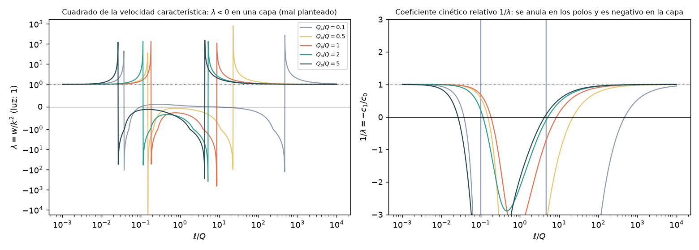
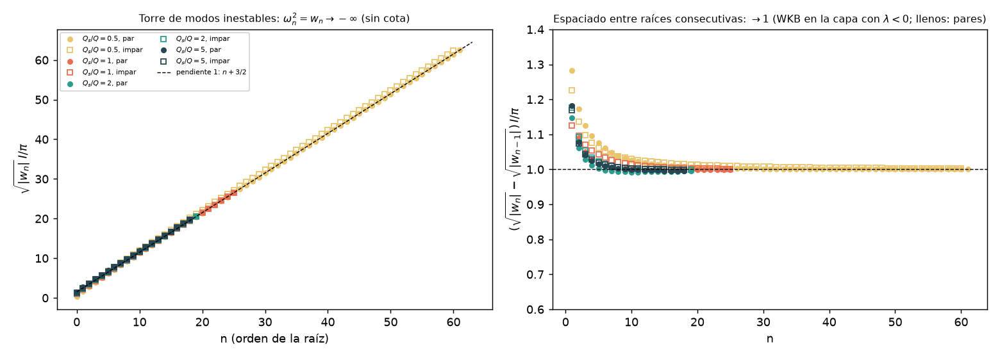
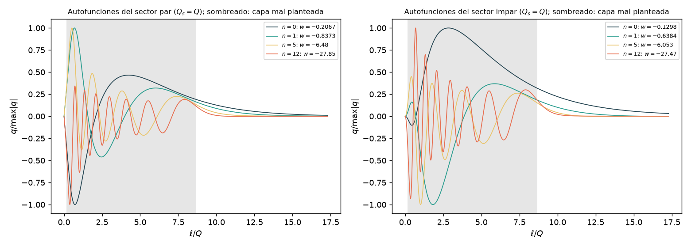
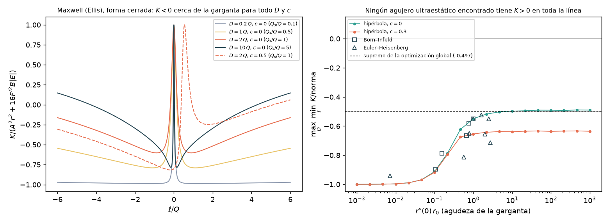
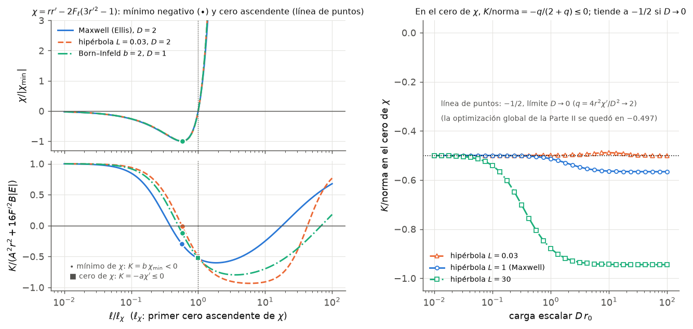

# Híbrido estrella–agujero de gusano — Fase 2d: estabilidad radial del agujero liso de tipo Ellis en EsGB + Maxwell

*Documento de trabajo v0.3 · 2026-10-21 · continúa [fase2c/fase2c_resultados.md](../fase2c/fase2c_resultados.md) · v0.2: Parte II (§8–§11), el coeficiente cinético de los agujeros ultraestáticos · v0.3: Parte III (§12–§15), demostración general para cualquier carga escalar*

## Resumen

1. **El objeto.** El único agujero de gusano EsGB liso conocido es el de Cañate, Sultana y Kazanas ([arXiv:1907.09463](https://arxiv.org/abs/1907.09463), PRD 100, 064007; verificado con la API de arXiv).
   - Es la métrica de Ellis sin masa, ultraestática ($N\equiv1$), sostenida por un escalar **normal** con un acoplamiento de Gauss–Bonnet "de diseño" $f(\phi)$ y un campo eléctrico de carga $Q_e^2=Q^2+Q_s^2$.
   - Los autores dejan su estabilidad como trabajo futuro, y no hemos encontrado ningún estudio posterior.
   - Prolongado a $\ell<0$ es liso y simétrico bajo $\ell\to-\ell$, $\phi\to-\phi$. En la garganta $F'(\phi_0)=0$ y $\Phi'=0$: la carga, no el término de Gauss–Bonnet, equilibra la ligadura. Así escapa a la Proposición 1 de la Fase 2c.

2. **Implementación verificada** (§2). En simetría esférica, con la carga conservada, Maxwell añade exactamente $\pm Q_e^2/r^4$ a las ecuaciones y $\mp4Q_e^2d/r^5$ a las perturbadas.
   - La solución exacta cumple nuestro sistema a $10^{-10}$ a los dos lados de la garganta, y la ligadura fija $Q_e^2=Q^2+Q_s^2$ a $10^{-10}$.
   - Pasa el control de Reissner–Nordström ($10^{-13}$), el modo gauge es solución exacta ($10^{-13}$) y las ligaduras se propagan.

3. **Resultado principal: el problema radial está mal planteado** (§3). En los 15 fondos de la familia, $Q_s/Q=0.01$–100, el cuadrado de la velocidad característica de las perturbaciones radiales es **negativo en una capa** $\ell_1<|\ell|<\ell_2$ alrededor de la garganta. Por ejemplo, $(0.18,\,8.6)\,Q$ con $Q_s=Q$, y $\ell_2\to4.1\,Q$ cuando $Q_s\gg Q$.
   - En la capa el coeficiente cinético del escalar ha cambiado de signo y el de gradiente no: el escalar de las perturbaciones es un fantasma atrapado.
   - Las perturbaciones de longitud de onda corta crecen sin cota. En la garganta y en el infinito $\lambda=1$.

4. **Confirmación espectral: una torre infinita de modos inestables** (§4–§5).
   - La garganta es degenerada ($F'=\Phi'=0$): la ligadura $\ell\ell$ no contiene $a'(0)$ y las magnitudes de garganta de la Fase 2c no sirven.
   - Se ha generalizado el emparejamiento, con `Delta3`, el determinante $[U_+,U_-,g]$ en coordenadas válidas, y se ha factorizado por paridad. Los sectores par e impar dan funciones analíticas e invariantes gauge, comprobadas contra `Delta3` a 9–10 cifras.
   - Resultado: **253 modos reales inestables** en los intervalos barridos de cuatro fondos, todos ceros simples y convergidos a $2\times10^{-10}$.
   - Se suceden sin cota con el espaciado WKB de la capa, $\sqrt{|w_n|}-\sqrt{|w_{n-1}|}=\pi/I$ con $I=\int d\ell/\sqrt{|\lambda|}$ (a $\le0.7\,\%$).
   - El principio del argumento no encuentra modos complejos ($Q_s=Q$, $|\operatorname{Im}w|\le3$).

5. **Comparación** (§6).
   - La ley de la Fase 2b ($\omega_\infty\simeq-i\kappa_t$) no se aplica: aquí $\kappa_t=0$ (no hay horizonte frustrado), y la inestabilidad no está en la garganta sino en la capa.
   - El Ellis de relatividad general con escalar fantasma tiene **un** modo inestable ($\omega_0^2r_0^2=-1.397$) y un problema bien planteado. Eliminar el fantasma con Gauss–Bonnet y Maxwell lo cambia por un problema mal planteado.
   - El cambio de signo del coeficiente cinético es el que prevén para Horndeski los teoremas de Rubakov y de Evseev–Melichev; aquí $\phi'\neq0$ en todo punto.

6. **Consecuencia para el proyecto.** La salida que dejaba la Fase 2c, un ingrediente que permita $\Phi'(0)=0$, existe con Maxwell, pero la garganta resultante está mal planteada. Con $r_0=1$ km, la capa patológica va de $\sim0.2$ a $\sim9$ km.
   - Con las Fases 2b y 2c: en EsGB, con cáscara la garganta es inestable, sin cáscara no existe, y con Maxwell está mal planteada.
   - Ningún agujero EsGB conocido da una garganta utilizable para el híbrido.

7. **Parte II: el cambio de signo del coeficiente cinético es inevitable** (§8–§11). Para agujeros ultraestáticos de EsGB con un campo electromagnético esférico (Maxwell o no lineal, $T^t{}_t=T^\ell{}_\ell$):
   - **Fórmulas cerradas** (SymPy, verificadas a $10^{-13}$–$10^{-16}$): $\lambda=G/K$, con
     $$K=A^2r^2-16F'^2B(4Ar''+BC),\qquad G=(Ar-4F'B)(Ar+4F'B),$$
     donde $A=r-4F_\ell r'$, $B=1-r'^2$, $C=1-4F_\ell'$.
   - **El fondo se reduce a** $\phi'=D/r^2$, $B=r^2\varepsilon-D^2/4r^2$ y $(BF_\ell)'=-r^2P/2$: la presión tangencial de la materia fija el acoplamiento.
   - **Maxwell: teorema.** La geometría es forzosamente la de Ellis, y para toda carga escalar y toda asimetría $K<0$ en $|\ell|<0.55\,r_0$. Todo agujero ultraestático EsGB–Maxwell está mal planteado.
   - **NLED, demostrado** en la Parte II solo para cargas escalares pequeñas o grandes, con cualquier forma. Además, la garganta simétrica es un máximo local de $K$.
   - **NLED, numérico** para cargas intermedias. En 1456 configuraciones de formas, en una optimización global con unas $10^5$ evaluaciones y en 153 agujeros de Born–Infeld y Euler–Heisenberg, ninguno tiene $K>0$ en toda la línea; el mejor caso es $\min K/\text{norma}=-0.497$.
   - La Parte III sustituye estos dos puntos por un teorema válido para toda carga escalar.
   - Es la versión explícita, para EsGB con materia electromagnética, del mecanismo de Rubakov y Evseev–Melichev.

8. **Parte III: demostración general** (§12–§15).
   - **Identidad exacta.** En la capa de masas, $K=-a\,\chi'+b\,\chi$, con
     $$\chi\equiv rr'-2F_\ell\,(3r'^2-1)$$
     y $a$, $b$ explícitas (SymPy, residuo 0). En el lado de la garganta donde $F_\ell r'<0$, se cumple $a>0$ y $b>0$.
   - **Qué es $\chi$.** Es $r^2/2$ por el coeficiente de $\Phi'$ en la ligadura $\ell\ell$. Los horizontes singulares de la Fase 2c están sobre sus ceros.
   - **Teorema.** Se aplica a todo agujero de EsGB ultraestático, regular y asintóticamente plano, con campo electromagnético (Maxwell o NLED), $r$ monótono a cada lado de la garganta y presión tangencial $P>0$. Vale para toda carga escalar $D>0$ y toda asimetría $c$.
     - En la garganta, $\chi(0)=2c$ y $\chi'(0)=-D^2/4$ (con $r_0=1$). En el infinito, $\chi\to+\infty$.
     - Luego $\chi$ tiene un mínimo negativo, y allí $K=b\,\chi<0$.
     - En gargantas convexas, además, $G>0$ en los ceros de $K$. Por tanto hay una región con $\lambda<0$ y el problema está mal planteado.
   - **Comprobación** en 210 configuraciones (Maxwell, hipérbolas, superelipses, Born–Infeld y Euler–Heisenberg):
     - la identidad se cumple a $7\times10^{-11}$;
     - $K<0$ en el mínimo de $\chi$ en todas;
     - $G>0$ en todos los ceros de $K$.
   - **Corolarios.**
     - En el primer cero de $\chi$, $K/\text{norma}=-q/(2+q)\le0$ con $q=4r^2\chi'/D^2$.
     - Cuando $D\to0$, $q\to2$ y $K/\text{norma}\to-1/2$: explica el $-0.497$ de la optimización global.
     - En el límite $D\to\infty$, la única trayectoria que mantiene $K=0$ desde la garganta es una solución exacta con $\chi\equiv0$. Exige curvatura infinita en la garganta y tiende al cono $r'^2=1/3$ de la Fase 2c.

---

## 1. El agujero de Cañate, Sultana y Kazanas

**El artículo.** Cañate, Sultana y Kazanas, *Ellis wormhole without a phantom scalar field*, [arXiv:1907.09463](https://arxiv.org/abs/1907.09463), PRD 100, 064007 (2019); metadatos verificados con la API de arXiv y texto leído en su versión HTML.
- Su acción (ec. 1) es la de las Fases 2b–2c más un campo de Maxwell mínimamente acoplado:
  $$S=\int\sqrt{-g}\,\Big\{\tfrac1{16\pi}\big[R-\tfrac12(\partial\phi)^2+f(\phi)\,\mathcal G\big]+\tfrac{\tilde\kappa}{4\pi}\,\tfrac14F_{ab}F^{ab}\Big\},\qquad \tilde\kappa=-(4\pi\epsilon)^2<0 .$$
  Las normalizaciones del escalar y del término de Gauss–Bonnet coinciden con las nuestras: $F\equiv f$.
- **La solución** (ecs. 29–35, 43) es la métrica de Ellis sin masa, ultraestática, con $\ell=\rho=\sqrt{r^2-Q^2}$ la longitud propia:
  $$ds^2=-dt^2+d\ell^2+(\ell^2+Q^2)\,d\Omega^2,\qquad \phi(\ell)=\frac{2Q_s}{Q}\arctan\frac{\ell}{Q},$$
  con un campo eléctrico radial de carga efectiva $Q_e^2=Q^2+Q_s^2$ y el acoplamiento "de diseño" de su ec. (33):
  $$f(\phi)=\frac{(Q^2+Q_s^2)\big\{\cos\theta-\cos^3\theta\,\ln\cos^4\theta-(1+2\cos^2\theta)\frac{Q}{Q_s}\phi\,\sin\theta\big\}}{12\cos^3\theta},\qquad \theta=\frac{Q\phi}{2Q_s}.$$
- **Garganta** en $\ell=0$, $r_0=Q$. Los autores solo consideran $\ell\ge0$, citan la inestabilidad del Ellis original y dejan la estabilidad de su solución como trabajo futuro (§IV). No hemos encontrado estudios posteriores con la API de arXiv: autor Cañate; "Ellis wormhole" con "Gauss-Bonnet"; "wormhole", "Gauss-Bonnet", "Maxwell" y "stability".

**La prolongación lisa a los dos lados.** $f$ es par en $\phi$ ($\cos\theta$ par, $\phi\sin\theta$ par) y $\phi(\ell)$ es impar. Las ecuaciones son invariantes bajo $\ell\to-\ell$ y, por ser $f$ par, bajo $\phi\to-\phi$; por tanto la prolongación analítica de $\phi$ a $\ell<0$ es solución.
- Es el agujero liso y simétrico bajo $S:\ \ell\to-\ell,\ \phi\to-\phi$.
- En $\ell\to\pm\infty$, $\phi\to\pm\pi Q_s/Q$.

**Por qué escapa a la Proposición 1 de la Fase 2c.** En la garganta $f'(\phi_0)=f'(0)=0$ y $\Phi'=0$: el lapso es constante y la gravedad superficial de la garganta, nula. La ligadura $\ell\ell$ en $r'=0$ queda
$$-\frac1{r_0^2}-\frac{\phi_1^2}{4}+\frac{Q_e^2}{r_0^4}=0\quad\Longrightarrow\quad Q_e^2=Q^2+Q_s^2\quad(\phi_1=2Q_s/Q^2,\ r_0=Q).$$
Es la carga eléctrica, y no el término $4F'\Phi'\phi'/r^2$, la que equilibra la ligadura. Es el ingrediente que la Fase 2c (§10) señalaba como necesario.

**El acoplamiento crece sin límite.** $\theta\to\pm\pi/2$ cuando $\ell\to\pm\infty$, y $\cos\theta=Q/r$. Así $f'(\phi)\propto\phi\sec^4\theta$ crece como $r^4$, $f''$ como $r^5$ y $f'''$ como $r^6$: el acoplamiento de Gauss–Bonnet diverge en el valor asintótico del escalar.

---

## 2. Maxwell en las ecuaciones radiales y verificación

**Maxwell en simetría esférica.** Las ecuaciones de Maxwell conservan la carga en el tiempo y en $r$, y $F_{tr}F^{tr}=-Q_e^2/r^4$ para cualquier métrica esférica. Las componentes mixtas del tensor de energía dependen, pues, solo del radio areal:
$$8\pi T^\mu{}_\nu=\frac{Q_e^2}{r^4}\,\mathrm{diag}(-1,-1,1,1),\qquad 8\pi\,\delta T^\mu{}_\nu=-\frac{4Q_e^2}{r^5}\,d\;\mathrm{diag}(-1,-1,1,1)\quad(\delta r=d),$$
- Es exacto: no hay grados de libertad electromagnéticos radiales, y $\delta Q_e=0$ para $w\neq0$.
- Las ecuaciones de [egb_F_gen.py](../fase2b/egb_F_gen.py) reciben $\pm Q_e^2/r^4$ en las filas $tt$ y $\theta\theta$ y en la ligadura $\ell\ell$, y las perturbadas $\mp4Q_e^2d/r^5$.
- La ligadura $\ell t$ y la ecuación del escalar no cambian.
- Implementación: [canate.py](canate.py), sin modificar `fase2b/`.

**Verificación** ([verificar_canate.py](verificar_canate.py)):

| Prueba | Resultado |
|---|---|
| $f'$ y $f''$ publicados (ec. 34) frente a las derivadas simbólicas de $f$ (ec. 33) | diferencia simbólica 0 |
| La solución exacta cumple el sistema estático + Maxwell, $Q_s/Q=0.1$–3, $\ell\in[-10^3,10^3]$ (51 puntos, los dos lados) | $(r'',\Phi'',\phi'')$ del sistema frente a las exactas: $\le1.9\times10^{-10}$ relativo; ligadura $\ell\ell$: $\le1.1\times10^{-10}$ |
| $Q_e^2$ que exige la ligadura en cada punto | $Q^2+Q_s^2$ a $10^{-10}$ (fija la normalización de Maxwell) |
| Control: Reissner–Nordström ($F=0$, $\phi=0$) integrado con el sistema + Maxwell | $r'=\sqrt{1-2M/r+Q_e^2/r^2}$ y $N$ a $1.7\times10^{-13}$ |
| Modo gauge $g=(\Phi''-w e^{-2\Phi},r',r'',\phi',\phi'')$ con Maxwell, $w$ real y complejo, $\ell$ de los dos signos | solución exacta a $\le10^{-13}$ (salvo $1.7\times10^{-8}$ con $w>0$ en el tramo largo), ligaduras $\le2\times10^{-14}$ |
| Propagación de las ligaduras (Bianchi con Maxwell) en una solución lineal genérica | $\le3\times10^{-12}$ relativo |

---

## 3. Hiperbolicidad: el problema está mal planteado

**Método** ([hiperbolicidad_canate.py](hiperbolicidad_canate.py)). En el límite de alta frecuencia el sistema lineal da $k^2Mx=wNx$ (Fase 2b, §10), con $M$ la parte principal y $N$ los coeficientes de $w$. Para localizar sin ambigüedad los cambios de signo se usa el polinomio de dispersión
$$P(\lambda)=\det(M-\lambda N)=c_0+c_1\lambda\qquad(c_2\equiv0\ \text{a}\ 10^{-14}:\ \text{un solo modo físico, el escalar}),\qquad \lambda=-c_0/c_1 .$$
- $c_0=\det M$ es el coeficiente de gradiente. Es también el determinante del sistema estático; donde se anula, la EDO radial tiene un punto singular.
- $c_1$ es el coeficiente cinético. Sus ceros son polos de $\lambda$.
- La luz tiene $\lambda=N^2=1$ en este fondo ultraestático.
- El fondo es simétrico bajo $S$ ($\lambda(-\ell)=\lambda(\ell)$ exactamente), así que basta $\ell\ge0$.

**Resultado.** En los 15 fondos, $Q_s/Q\in\{0.01,\dots,100\}$, **$\lambda<0$ en una capa alrededor de la garganta**. En la garganta $\lambda=1$, y en el infinito $\lambda\to1$ (por ejemplo $1.000009$ en $\ell=10^6Q$ con $Q_s=Q$).

| $Q_s/Q$ | cambios de signo de $\lambda$ en $\ell>0$ (en unidades de $Q$) | capa con $\lambda<0$ |
|---|---|---|
| 0.01 | polo 0.00378, cero 0.0100, cero 49.68, polo 47 128 | $(0.0038,0.0100)\cup(49.7,\,4.7\times10^4)$ |
| 0.03 | polo 0.0113, cero 0.0300, cero 16.34, polo 5 240 | $(0.011,0.030)\cup(16.3,\,5240)$ |
| 0.1 | polo 0.0374, cero 0.1014, cero 4.636, polo 475.1 | $(0.037,0.101)\cup(4.64,\,475)$ |
| 0.2 | polo 0.0729, cero 0.2134, cero 2.071, polo 121.6 | $(0.073,0.213)\cup(2.07,\,122)$ |
| 0.3 | polo 0.1045, cero 0.3690, cero 1.123, polo 56.19 | $(0.105,0.369)\cup(1.12,\,56.2)$ |
| 0.5 | polo 0.1522, polo 22.705 | $(0.152,\,22.71)$ |
| 0.7 | polo 0.1776, polo 13.505 | $(0.178,\,13.50)$ |
| 1 | polo 0.1829, polo 8.647 | $(0.183,\,8.647)$ |
| 1.5 | polo 0.1517, polo 6.091 | $(0.152,\,6.091)$ |
| 2 | polo 0.1143, polo 5.214 | $(0.114,\,5.214)$ |
| 3 | polo 0.0644, polo 4.599 | $(0.064,\,4.599)$ |
| 5 | polo 0.0263, polo 4.291 | $(0.026,\,4.291)$ |
| 10 | polo 0.00695, polo 4.162 | $(0.0069,\,4.162)$ |
| 30 | polo 0.00078, polo 4.124 | $(0.0008,\,4.124)$ |
| 100 | polo $7\times10^{-5}$, polo 4.120 | $(0.0001,\,4.120)$ |

- **Para $Q_s/Q\ge0.5$** hay dos polos, $\ell_1<\ell_2$. Entre ellos el coeficiente cinético del escalar ha cambiado de signo y el de gradiente no: el escalar es un fantasma en esa capa y $\lambda<0$, con $\lambda\to-\infty$ en los polos. Cuando $Q_s/Q\to\infty$, $\ell_1\to0$ y $\ell_2\to4.12\,Q$.
- **Para $Q_s/Q\le0.3$** se añaden dos ceros de $\det M$. $\lambda$ es negativa en dos subcapas y la EDO radial tiene además puntos singulares en esos ceros.
- **Consecuencia.** En la capa, las perturbaciones de número de onda $k$ crecen como $e^{\sqrt{|\lambda|}\,k\,t}$ sin cota en $k$: el problema de valores iniciales está mal planteado en el sentido de Hadamard (Fig. 1). Es la clasificación de la Fase 2b (§10), en la que estos fondos no pasarían a la prueba de estabilidad.

---

## 4. El problema de autovalores con la maquinaria sin empalmes

**Maquinaria.** Se usa la de la Fase 2c ([estabilidad_lisa.py](../fase2c/estabilidad_lisa.py)): solución decreciente desde los infinitos, modo gauge explícito y determinante analítico.
- Se le ha añadido un gancho compatible hacia atrás: si el fondo trae `f.ecuaciones` (aquí, las de Maxwell de [canate.py](canate.py)), las usa en lugar de las de `estabilidad_F`.
- Las pruebas de la Fase 2c dan salidas idénticas antes y después del cambio.

**La garganta es degenerada.** En $\ell=0$, $F'(\phi_0)=0$, $\Phi'=0$ y $r'=0$. El coeficiente de $a'(0)$ en la ligadura $E^\ell{}_\ell$ es $4F'\phi'(1-3r'^2)/r^2+2r'/r=0$, y la ligadura queda
$$\Big(\frac{2w}{r_0}+\frac{2}{r_0^3}-\frac{4Q_e^2}{r_0^5}\Big)d(0)-\frac{\phi_1}{2}\,q'(0)=0 ,\qquad -\Big(\frac{4F''\phi_1}{r_0^2}+\frac{\phi_1}{2}\Big)q(0)-\frac{2}{r_0}d'(0)=0\ \ (E^\ell{}_t).$$
- El espacio de datos admisibles sigue teniendo dimensión 3, pero $a'(0)$ queda libre y $d(0)$ y $q'(0)$ quedan ligados.
- Las magnitudes $(\delta r_t,\delta\phi_t)$ de la Fase 2c ya no son coordenadas del cociente por el gauge: la función `Delta` de la Fase 2c no sirve aquí.
- Se ha añadido `Delta3`: el determinante de $[U_+(0),U_-(0),g(0)]$ en tres componentes que sean coordenadas del espacio admisible, aquí $(a',q,q')$.

**Paridad.** El fondo es invariante bajo $S$: $(a,d,q)(\ell)\mapsto(a,d,-q)(-\ell)$. En la garganta:
- **sector par**: $a'(0)=d'(0)=q(0)=0$, con $d(0)$ y $q'(0)$ ligados por $E^\ell{}_\ell$ (un grado de libertad);
- **sector impar**: $d(0)=q'(0)=0$, con $a'(0)$ y $q(0)$ libres y $d'(0)$ de $E^\ell{}_t$ (dos: uno físico y el gauge).

El modo gauge $g(0)=(-w,0,1/Q,\phi_1,0)$ es impar: es la traslación de la garganta. Sea $U_+$ la solución que decae en $+\infty$, definida módulo gauge. Las condiciones de autovalor son:
$$\Delta_{\rm par}(w)=\phi_1\,a'_+(0)+w\,q_+(0)\quad(U_++c\,g\ \text{par para algún } c),\qquad \Delta_{\rm impar}(w)=d_+(0)\quad(U_++c\,g\ \text{impar}).$$
- Las dos son invariantes gauge, porque $g$ contribuye $-\phi_1w+w\phi_1=0$ y $0$, y analíticas en $w$ fuera del corte $w>0$.
- No requieren ningún signo de vectores unitarios.

**Comprobación cruzada** ([modos_canate.py](modos_canate.py)). Integrando $U_-$ desde $-L$ por separado se obtiene $U_-=SU_+$ exactamente, y la forma general cumple
$$\texttt{Delta3}=-2\,q'_+(0)\,\Delta_{\rm par}=-2\,\frac{2w-2-4Q_s^2}{Q_s}\,\Delta_{\rm impar}\,\Delta_{\rm par}\qquad(Q=1),$$
comprobado en $w=-0.5,-7,-40$ para los cuatro fondos: concordancia de 9–10 cifras; $U_-=SU_+$ exactamente; la ligadura $q'(0)=\mathrm{fac}\,d(0)$ a $\le5\times10^{-9}$.

**Condición en el infinito.** $\lambda\to1$ y $N=1$, así que la solución decreciente es $q\sim e^{-\sqrt{-w}\,\ell}/r$, con la rama principal. La cola empieza en $L=\ell_2+15\,Q$, fuera de la capa, de modo que el dato asintótico está en la región hiperbólica. La integración hacia dentro suprime cualquier mezcla de la solución creciente.

**Predicción WKB.** Para $w<0$, en la capa $k^2=w/\lambda>0$ y la solución oscila; fuera decae. En los polos $\lambda\approx C/(\ell-\ell_p)$, así que $k^2$ se anula linealmente y la solución pasa de oscilar a decaer. Cada capa atrapa, pues, una torre
$$\sqrt{|w_n|}\;I\simeq(n+c)\,\pi,\qquad I=\int_{\ell_1}^{\ell_2}\frac{d\ell}{\sqrt{|\lambda(\ell)|}},\qquad n=0,1,2,\dots$$
- El espaciado $\pi/I$ es la predicción robusta: solo depende de $\lambda(\ell)$.
- La constante $c$ depende de cómo se conecta la solución en los polos. Valdría $\tfrac12$ si la ecuación reducida fuese de tipo Schrödinger con puntos de retorno de Airy.
- Las dos capas, $\ell>0$ y $\ell<0$, se acoplan a través de la región hiperbólica $|\ell|<\ell_1$, lo que separa los sectores par e impar.
- La torre no tiene cota inferior: es la traducción espectral del mal planteamiento.

---

## 5. Modos inestables

**Barrido** ([modos_canate.py](modos_canate.py)).
- Malla en $s=\sqrt{|w|}$ con ~40 puntos por semiperiodo WKB, de $|w|=4\times10^{-4}$ hasta la duodécima raíz WKB más seis unidades de $s$. Los cambios de signo se refinan con `brentq` ($10^{-12}$).
- Cada raíz se comprueba con la escala completa (sin renormalizar, llevando el logaritmo de los factores): $|\Delta(w^*)|\le e^{-12.6}\,|\Delta(w^*(1\pm10^{-4}))|$ en todas, es decir, son ceros simples.
- Los cuatro fondos con $Q_s/Q\ge0.5$ son aquellos en que la EDO radial es regular en toda la línea ($\min|\det M|/\text{escala}\ge0.07$).

| $Q_s/Q$ | capa $(\ell_1,\ell_2)/Q$ | $I$ | raíces reales par / impar | más lenta: $w$ par / impar | más rápida barrida | espaciado asintótico de $\sqrt{\lvert w_n\rvert}I/\pi$ (pendiente) | ordenada (par / impar) |
|---|---|---|---|---|---|---|---|
| 0.5 | (0.152, 22.71) | 26.75 | 62 / 61 | $-1.58\times10^{-3}$ / $-1.96\times10^{-2}$ | $-53.8$ | 1.0002 / 1.0028 | 1.45 / 2.23 |
| 1 | (0.183, 8.647) | 8.062 | 26 / 26 | $-0.207$ / $-0.130$ | $-106.8$ | 0.9983 / 1.0030 | 1.56 / 1.43 |
| 2 | (0.114, 5.214) | 4.521 | 20 / 20 | $-1.008$ / $-0.662$ | $-205.1$ | 0.9934 / 1.0001 | 1.73 / 1.59 |
| 5 | (0.026, 4.291) | 4.235 | 19 / 19 | $-1.331$ / $-1.020$ | $-217.7$ | 0.9975 / 1.0013 | 1.94 / 1.72 |

(Pendiente y ordenada: ajuste lineal de $\sqrt{|w_n|}\,I/\pi$ frente a $n$ en las doce últimas raíces de cada sector.)

- **253 modos inestables reales en el intervalo barrido, y la torre sigue.** No hay ningún indicio de cota inferior: las raíces se suceden con el espaciado WKB hasta el final de cada barrido. En unidades de la garganta ($r_0=Q$, $N=1$: $\omega^2r_0^2=w$), la tasa $|\omega_n|$ crece como $(n+c)\pi/I$ sin límite.
- **El espaciado confirma la capa.** El espaciado entre raíces consecutivas en $\sqrt{|w|}\,I/\pi$ tiende a 1 con una precisión de $\le0.7\,\%$ en los ocho sectores (Fig. 2).
  - $I$ se calcula solo con $\lambda(\ell)$, a partir del símbolo principal.
  - El espaciado sale de la EDO completa, con sus ligaduras.
  - Que coincidan confirma de forma independiente que $\lambda<0$ en la capa y que los modos viven en ella.
- **La ordenada no es ½.** Vale entre 1.4 y 2.2, y difiere entre los dos sectores (de 0.13 a 0.78).
  - Los polos no se comportan, pues, como puntos de retorno de Airy en una ecuación de tipo Schrödinger. Una explicación plausible, no comprobada, es que la reducción del sistema con ligaduras añade términos singulares donde se anula el coeficiente cinético y cambia la fase de conexión.
  - La diferencia entre sectores refleja el acoplamiento de las dos capas a través de la región central. No hemos estudiado su dependencia con $Q_s$.
  - Nada de esto afecta al espaciado, que es la predicción que se contrasta.
- **Autofunciones** (Fig. 3, $Q_s=Q$, gauge $d'(0)=0$): están localizadas en la capa sombreada, con $n$ oscilaciones en ella, y decaen exponencialmente fuera.

**Convergencia** ([convergencia_canate.py](convergencia_canate.py), $Q_s=Q$, tres primeras raíces y la última de cada sector). Alargar la cola de $\ell_2+15\,Q$ a $\ell_2+40\,Q$ o bajar $\texttt{rtol}$ de $10^{-10}$ a $10^{-12}$ cambia las raíces en $\le2.4\times10^{-10}$ relativo.

**Modos complejos** ([complejos_canate.py](complejos_canate.py)). Se ha aplicado el principio del argumento con cola fija y muestreo adaptativo (674 puntos, salto de fase $<0.35$ rad) en $\operatorname{Re}w\in[-7,-0.02]$, $|\operatorname{Im}w|\le3$, con $Q_s=Q$.
- Da $N_{\rm par}=6.0000$ y $N_{\rm impar}=6.0000$: exactamente las seis raíces reales de cada sector en ese intervalo.
- No hay modos complejos en esa región: la inestabilidad es puramente exponencial.

---

## 6. Comparación con la ley de la Fase 2b y con el Ellis de relatividad general

**La ley de la Fase 2b no se aplica.** Esa ley ($\omega_\infty\simeq-i\kappa_t$ con $\kappa_t=e^{-\Phi_\infty}\Phi'(0^+)$, sin gravedad inducida) describe gargantas sostenidas por una cáscara a distancia $\sim1/a$ de un horizonte frustrado.
- Aquí el lapso es constante ($N\equiv1$), $a=\Phi'(0)=0$ y $\kappa_t=0$. No hay ningún horizonte cerca: la garganta no está desplazada al rojo.
- Leída literalmente, la ley predeciría tasa nula. La tasa real no está acotada.
- El mecanismo es otro y está fuera de la garganta: el cambio de signo del coeficiente cinético del escalar en una capa $\ell_1<|\ell|<\ell_2$. La garganta misma ($|\ell|<\ell_1$) es la región hiperbólica.
- Las dos inestabilidades comparten algo: ambas proceden de lo que el término de Gauss–Bonnet tiene que hacer para abrir la garganta. Con la cáscara, impone un gradiente del lapso (Fase 2c). Sin ella, un acoplamiento que crece como $r^4$ y vuelve fantasma al escalar.

**Ellis en relatividad general.** La misma métrica, sostenida por un escalar fantasma, tiene **un único** modo radial inestable: $\omega_0^2r_0^2=-1.39705$ (Torii–Shinkai, [arXiv:1309.2058](https://arxiv.org/abs/1309.2058); reproducido a $2\times10^{-7}$ en la Fase 2; González, Guzmán y Sarbach, [arXiv:0806.0608](https://arxiv.org/abs/0806.0608), CQG 26, 015010 (2009)).
- El problema de valores iniciales del fantasma está bien planteado: su término cinético y su gradiente cambian de signo a la vez, y $\lambda=1$.
- Eliminar el fantasma con Gauss–Bonnet y Maxwell cambia, pues, un modo inestable por un problema mal planteado: es peor.
- En la terminología de Bronnikov y Sushkov ([arXiv:1001.3511](https://arxiv.org/abs/1001.3511), CQG 27, 095022 (2010)), las perturbaciones tienen aquí un fantasma "atrapado" en una capa, aunque el escalar del fondo sea normal en todas partes.

**Relación con Rubakov y Evseev–Melichev.** En este fondo $\phi'=2Q_s/r^2\neq0$ en todo punto. Las funciones de Horndeski equivalentes a $F(\phi)\mathcal G$ (con $\ln X$) son, pues, regulares a lo largo de la solución.
- Los teoremas de Rubakov ([arXiv:1509.08808](https://arxiv.org/abs/1509.08808)) y de Evseev–Melichev ([arXiv:1711.04152](https://arxiv.org/abs/1711.04152)) prevén, para agujeros estáticos en Horndeski, que el coeficiente cinético (o el de gradiente) del modo radial cambie de signo en algún punto.
- No hemos comprobado que su demostración siga valiendo con un campo de Maxwell mínimamente acoplado. Los ceros de $c_1$ encontrados son exactamente ese cambio de signo, y aparecen en todos los fondos de la familia.

---

### Figuras

| | |
|---|---|
|  | **Fig. 1.** Izquierda: cuadrado de la velocidad característica de las perturbaciones radiales, $\lambda(\ell)$, para cinco valores de $Q_s/Q$. Vale 1 en la garganta y en el infinito y es negativo en una capa. Derecha: coeficiente cinético relativo $1/\lambda=-c_1/c_0$, que se anula en los polos y es negativo en la capa: el escalar es un fantasma "atrapado". |
|  | **Fig. 2.** Izquierda: $\sqrt{|w_n|}\,I/\pi$ de las 253 raíces reales (llenos: sector par; huecos: impar). Crecen con pendiente 1 y sin cota. Derecha: espaciado entre raíces consecutivas, que tiende a 1, el valor WKB de la capa con $\lambda<0$. |
|  | **Fig. 3.** Autofunciones $q(\ell)$ de los sectores par e impar ($Q_s=Q$, gauge $d'(0)=0$) para $n=0,1,5,12$. Están localizadas en la capa mal planteada (sombreada) y decaen fuera. |

---

## 7. Interpretación y consecuencias

1. **El agujero liso de Cañate et al. no es un fondo físicamente aceptable.** Sus perturbaciones radiales no tienen un problema de valores iniciales bien planteado.
   - En una capa $\ell_1<|\ell|<\ell_2$ alrededor de la garganta, el coeficiente cinético del escalar cambia de signo y el de gradiente no.
   - Las perturbaciones de longitud de onda corta crecen con una tasa proporcional a $k$, sin cota.
   - El espectro lo confirma: una torre infinita de modos reales inestables, con el espaciado WKB de esa capa.
   - Pasa en toda la familia, $Q_s/Q=0.01$–100. Para $Q_s/Q\le0.3$ hay además puntos singulares de la EDO radial.

2. **Origen.** Para que la métrica de Ellis resuelva las ecuaciones con un escalar normal, el término de Gauss–Bonnet tiene que aportar en la garganta la violación de la condición nula de energía: Cañate et al., ec. (41), $8\pi E^{\rm (SGB)}_{\alpha\beta}n^\alpha n^\beta=-2Q^2/r^4$.
   - Con la curvatura de Ellis ($\sim Q^2/r^4$), eso exige un acoplamiento "de diseño" cuya derivada crece como $r^4$.
   - El mismo término es el que, en las perturbaciones, vuelve fantasma al escalar en la capa.
   - Es la versión dinámica de lo que la Fase 2c encontró en la estática: lo que el término de Gauss–Bonnet tiene que hacer para abrir una garganta sin materia se paga con una patología.

3. **Para el proyecto G2V.**
   - La Fase 2c dejaba como única salida para una garganta lisa en EsGB un ingrediente que permitiera $\Phi'(0)=0$. El campo de Maxwell lo permite, y es el ingrediente de esta solución.
   - Pero la garganta resultante está mal planteada: con $r_0=1$ km, la capa patológica ocupa de $\sim0.2$ a $\sim9$ km alrededor de la garganta ($Q_s=Q$), y en ella cualquier perturbación de longitud de onda corta crece sin límite.
   - El dual magnético con electrodinámica lineal tiene el mismo tensor de energía, $T^\mu{}_\nu\propto\mathrm{diag}(-1,-1,1,1)/r^4$, y por tanto exactamente las mismas ecuaciones radiales. El resultado se le aplica sin cambios.
   - Con las Fases 2b y 2c, ningún agujero EsGB conocido da una garganta utilizable: con cáscara es inestable, sin cáscara no existe, y con Maxwell está mal planteado.

4. **Lección de método.** La prueba de hiperbolicidad decide antes que los modos y es barata (segundos frente a una hora). El espectro sirve aquí de comprobación independiente: el espaciado de la torre reproduce la integral WKB calculada solo con el símbolo principal.

---

# Parte II — El coeficiente cinético de los agujeros ultraestáticos

## 8. Fórmula cerrada y fondo general

**La clase.** Agujeros de EsGB ultraestáticos ($N\equiv1$) sostenidos por un campo electromagnético esférico, Maxwell o no lineal (NLED), eléctrico o magnético, mínimamente acoplado.
- Su tensor de energía cumple $T^t{}_t=T^\ell{}_\ell$: $8\pi T^\mu{}_\nu=\mathrm{diag}(-\varepsilon,-\varepsilon,P,P)$, con $P=-\varepsilon-r\varepsilon_r/2$ por conservación.
- Incluye el agujero de Cañate et al. y sus versiones magnéticas, de Born–Infeld y de Euler–Heisenberg ([arXiv:2310.08758](https://arxiv.org/abs/2310.08758)).

**El fondo se reduce a cuatro ecuaciones** ([cinetico_simbolico.py](cinetico_simbolico.py), SymPy sobre [egb_F_gen.py](../fase2b/egb_F_gen.py)). Con $\Phi'=0$ todos los términos de Gauss–Bonnet de las ecuaciones del escalar, $\ell\ell$ y $\theta\theta$ desaparecen:
$$\phi'=\frac{D}{r^2},\qquad B\equiv1-r'^2=r^2\varepsilon-\frac{D^2}{4r^2},\qquad \frac{r''}{r}=P-\frac{D^2}{4r^4},\qquad \big(B\,F_\ell\big)'=-\frac{r^2P}{2},$$
con $F_\ell\equiv dF/d\ell=F'(\phi)\,\phi'$ y $D$ la carga escalar. La fila $tt$ es la única que contiene $F$, y se reduce exactamente a la última (residuo simbólico 0).
- **Consecuencia.** Dada una forma $r(\ell)$ y una carga $D$, la materia ($\varepsilon$, $P$) y el perfil del acoplamiento quedan fijados salvo una constante, $c\equiv F_\ell(0)$:
  $$B\,F_\ell=c-\tfrac12\int_0^\ell r^2P\,d\ell' .$$
- **Con Maxwell** ($\varepsilon=Q_e^2/r^4$), $r'^2=1-(Q_e^2-D^2/4)/r^2$: la geometría es necesariamente la de Ellis, con $Q^2=Q_e^2-D^2/4$. La familia es exactamente la de Cañate et al. ($c=0$, que reproduce su $f'(\phi)$) más su extensión asimétrica $c\neq0$.

**El polinomio de dispersión** (§3) es
$$\det(M-\lambda N)=\frac{2}{r^5}\,(G-\lambda K),\qquad \lambda=\frac GK,$$
$$G=A^2r^2-16F'^2B^2=(Ar-4F'B)(Ar+4F'B),\qquad K=A^2r^2-16F'^2B\,\big(4Ar''+BC\big),$$
$$A=r-4F_\ell\,r',\qquad C=1-4F_\ell',\qquad F'=\frac{F_\ell\,r^2}{D}.$$
- $K$ es el coeficiente cinético (con el signo del de la luz) y $G$ el de gradiente.
- **Comprobaciones:**
  - identidad simbólica ($c_2\equiv0$, residuos 0);
  - forma cerrada de Maxwell frente a los $c_0$, $c_1$ numéricos de §3, a $1.5\times10^{-13}$;
  - un fondo NLED no-Ellis (hipérbola $L=3$, $D=1.7$, $c=0.2$): cumple el sistema completo a $4\times10^{-16}$, y $K$ y $G$ coinciden con los coeficientes de las ecuaciones generadas a $5\times10^{-16}$.

**Los extremos tienen $K>0$** (la garganta, salvo asimetría grande).
- En la garganta ($r'=0$, $B=1$): $K(0)=r_0^4\big[1-16c^2E_0/D^2\big]$, con $E_0=6r_0r_0''+1+D^2/(2r_0^2)$. Con $c=0$ (simétrico), $K(0)=r_0^4>0$. Si $16c^2E_0>D^2$, ya $K(0)<0$ y el cambio de signo es inmediato.
- En los infinitos: $B\approx\beta/r^2$ y $B F_\ell\to\sigma\neq0$, así que $K\simeq16\sigma^2r^6/\beta^2>0$. Si $\sigma=0$ por ajuste, también $K>0$.
- Por tanto, si $K(0)>0$ y $K$ cambia de signo, lo hace a distancia finita y un número par de veces por lado.
- En cualquier cero de $K$ con $G\neq0$, $\lambda$ pasa por infinito y cambia de signo: **un cambio de signo de $K$ implica una región con $\lambda<0$**, es decir, un problema mal planteado. Con Maxwell, y en general en el lado donde $|BF_\ell|$ crece con $r''\ge0$, se cumple $G>K$, así que $G>0$ en los ceros de $K$.

## 9. Maxwell: el cambio de signo es inevitable (teorema)

**Forma cerrada** (Ellis, $Q=1$, $Q_e^2=1+D^2/4$, $g(\ell)=c-\tfrac{Q_e^2}{2}\arctan\ell$, $F_\ell=r^2g$):
$$\frac{K}{r^4}=k(\ell)=(1-4\ell g)^2-\frac{16g^2}{D^2}\big(5+2Q_e^2-24\ell g\big),\qquad \frac{G}{r^4}=(1-4\ell g)^2-\frac{16g^2}{D^2}.$$

**Teorema.** Para toda carga escalar $D>0$ y toda asimetría $c\in\mathbb R$, existe $\ell_*$ con $|\ell_*|<0.55\,Q$ tal que $K(\ell_*)<0$. En consecuencia, todo agujero ultraestático de EsGB + Maxwell tiene una región con $\lambda<0$: está mal planteado. Esto incluye la familia de Cañate et al. completa y sus extensiones asimétricas.

*Demostración.*
1. Sin pérdida de generalidad $c\ge0$: $k(\ell;c)=k(-\ell;-c)$.
2. Sea $\ell=-t$, con $t>0$. Entonces $g=c+\tfrac{Q_e^2}{2}\arctan t\ge\tfrac{Q_e^2}{2}\arctan t>0$. Definimos $v\equiv2tg>0$, de modo que $1-4\ell g=1+2v$ y $-24\ell g=12v$:
   $$k=(1+2v)^2-\frac{16g^2}{D^2}\,(5+2Q_e^2+12v).$$
3. Como $16g^2=8gv/t$ y $4Q_e^2/D^2=1+4/D^2\ge1$:
   $$\frac{16g^2}{D^2}=\frac{8g}{tD^2}v\ge\frac{4Q_e^2}{D^2}\,\frac{\arctan t}{t}\,v\ge0.914\,v\qquad(t\le0.55;\ \arctan(0.55)/0.55=0.9143).$$
4. Con $Q_e^2\ge1$:
   $$k\le(1+2v)^2-0.914\,v\,(7+12v),$$
   que vale $-0.036$ en $v=\tfrac14$.
5. Ese punto existe: $v(t)$ es continua, $v(0)=0$ y $v(0.55)\ge0.55\arctan(0.55)=0.277>\tfrac14$.
6. Por último, $G/r^4-k=(16g^2/D^2)(4+2Q_e^2+12v)>0$ en ese lado. Así $G>0$ en el cero de $K$ entre $\ell_*$ y $-\infty$, y $\lambda$ cambia de signo allí. $\square$

La cota es conservadora. Con $Q_s=Q$ el punto es $t_*=0.361$, donde $K/r^4=-3.51$ ($K$/norma $=-0.44$), y la capa numérica de §3 empieza en $\ell_1=0.18\,Q$.

## 10. Electrodinámica no lineal

Con NLED la forma $r(\ell)$ es libre: cualquier perfil par con una garganta y cola de tipo Maxwell define, con la ligadura, una densidad $\varepsilon(r)>0$ (realizable con una $L(F)$ magnética) y un acoplamiento $F(\phi)$.

**Resultados analíticos para formas generales.** En el lado donde $U\equiv|BF_\ell|$ crece desde la garganta ($c\ge0$: $\ell<0$; $c\le0$: $\ell>0$), y donde $r''\ge0$:
$$\frac{K}{r^4}=(1+\alpha U)^2-\frac{16U^2}{D^2B}\,(e_0+e_1U),\qquad \alpha=\frac{4|r'|}{rB},\quad e_0=6rr''+B+\frac{D^2}{2r^2},\quad e_1=\frac{24|r'|r''}{B}\ge0 .$$

1. **Lema (umbral independiente de $D$).** En cualquier punto con $r''\ge0$ y $r'^2<1/3$,
   $$K<0\quad\text{si}\quad U>\frac{rB}{2\big(\sqrt{2B}-2|r'|\big)} .$$
   Basta usar $e_0\ge D^2/(2r^2)$. En la garganta el umbral es $r_0/(2\sqrt2)$.
2. **Límites de la carga escalar.** Para cualquier forma y cualquier $c$, $K<0$ en algún punto si $D$ es suficientemente pequeña o suficientemente grande.
   - Si $D\to0$: $U$ queda acotada mientras el término negativo crece como $16U^2/D^2$.
   - Si $D\to\infty$: $U\ge(D^2/8)\int d\ell/r^2-|c|\to\infty$ y se aplica el lema en cualquier punto cercano a la garganta con $r'^2<1/3$.
3. **La garganta simétrica es un máximo local de $K$.** Con $c=0$,
   $$K=r_0^4\big[1-\Gamma\ell^2+O(\ell^4)\big],\qquad \Gamma=\kappa\Big(\frac{16\kappa m}{D^2}+\frac{8\kappa}{r_0^2}-\frac{8r_0''}{r_0}\Big)\ge\kappa\Big(\frac{8r_0''}{r_0}+\frac2{r_0^2}\Big)>0,$$
   con $\kappa=r_0^2P_0/2$ y $m=6r_0r_0''+1$. La estimación del primer cero, $\ell_c\simeq1/\sqrt\Gamma$, reproduce la $\ell_1$ numérica de §3 a menos del 4 %:

   | $Q_s/Q$ | $\ell_c$ | $\ell_1$ |
   |---|---|---|
   | 0.5 | 0.155 | 0.152 |
   | 1 | 0.189 | 0.183 |
   | 2 | 0.116 | 0.114 |
   | 5 | 0.0264 | 0.0263 |

**Exploración numérica** (con la forma cerrada, y por tanto sin integrar perturbaciones):

| Barrido | Configuraciones | Con $K>0$ en toda la línea | $\max\min_\ell K/(A^2r^2+16F'^2B|E|)$ |
|---|---|---|---|
| Hipérbolas $r=1+\sqrt{\ell^2+L^2}-L$, $L=0.1$–1000 (garganta afilada → gorda), $D=10^{-3}$–$10^2$, $c\in\{0,0.1,0.3,1\}$ ([cinetico_nled.py](cinetico_nled.py)) | 936 | 0 | $-0.50$ |
| Superelipses $r=(1+|\ell|^{2n})^{1/2n}$, $n=1$–10 (gargantas planas, $r''(0)=0$), mismas $D$ y $c$ | 520 | 0 | $-0.56$ |
| Optimización global (evolución diferencial, 4 semillas, ~$10^5$ evaluaciones): forma con 6 parámetros libres ($r'$ no necesariamente monótona), $D$ y $c$ ([busqueda_cinetico.py](busqueda_cinetico.py)) | — | 0 | $-0.497$ (las 4 semillas) |
| Born–Infeld ($b=0.5$–1000) y Euler–Heisenberg débil ($\eta=-0.2$–1), modelos de Cañate (arXiv:2310.08758), con garganta regular ([nled_concretas.py](nled_concretas.py)) | 153 | 0 | $-0.52$ |

- En las 1456 configuraciones de los barridos de formas, $K$ cambia de signo y hay $\lambda<0$.
  - En 45 casos extremos ($D\le0.025$, $L\ge30$), $K$ y $G$ se anulan casi a la vez. Queda una franja con $\lambda<0$ de anchura $10^{-3}$–$10^{-2}$, localizada con `brentq` porque es más fina que la malla.
  - Más allá, $K$ y $G$ son negativos los dos hasta $r\sim\beta/D$: un fantasma completo.
- **Límite de garganta afilada** ($r''(0)\to\infty$, que tiende a una cáscara fina): el máximo se satura en $-0.49$ (de $r''(0)=3$ a $1000$) y no se acerca a 0.
- *Nota (v0.3).* Ese $\simeq-1/2$ no es un margen garantizado. Es el valor que toma $K/\text{norma}$ en el primer cero de $\chi$ cuando ese cero cae cerca de la garganta (§14, Fig. 5). El teorema de §13 hace innecesario el argumento numérico.
- **Gargantas gordas**: tiende a $-1$.
- **Asimetría**: $c\neq0$ siempre empeora el máximo (Fig. 4). La optimización converge a $c=0$.



**Fig. 4.** Izquierda: forma cerrada de Maxwell para varias cargas y una asimetría. $K$ solo es positivo en la garganta y lejos de ella. Derecha: mejor valor posible de $\min_\ell K$ normalizado frente a la agudeza de la garganta, para hipérbolas ($c=0$ y $0.3$), Born–Infeld y Euler–Heisenberg. La línea a trazos es el mejor valor de la optimización global, $\simeq-1/2$. No es un margen garantizado sino el valor de $K/\text{norma}$ en el cero de $\chi$ cerca de la garganta (§14).

## 11. Decisión e interpretación

**Sí: el cambio de signo del coeficiente cinético es inevitable** en los agujeros ultraestáticos de EsGB con campo electromagnético. Con el alcance preciso:
- **Maxwell**: teorema (§9). Toda la familia, incluidas las extensiones asimétricas, tiene $K<0$ en $|\ell|<0.55\,r_0$ y está mal planteada.
- **NLED, demostrado**: para cualquier forma de garganta, cuando la carga escalar es pequeña o grande. Además, la garganta simétrica es siempre un máximo local de $K$, y hay un umbral explícito independiente de $D$ (lema).
- **NLED, numérico**: para cargas intermedias, en todas las formas exploradas, incluida una búsqueda global que intenta maximizar $K$. Ninguna configuración tiene $K>0$ en toda la línea, y el mejor caso se queda en $\min K/\text{norma}=-0.497$.
- **Actualización (v0.3).** La Parte III demuestra el resultado para toda carga escalar y toda forma monótona con $P>0$ (§13), sin argumentos numéricos.

**Interpretación.** La ecuación $(BF_\ell)'=-r^2P/2$ es el corazón del resultado.
- Para abrir una garganta ultraestática, la presión tangencial de la materia obliga al acoplamiento a crecer como $\int r^2P/B$. Es la violación de la condición nula de energía que aporta el término de Gauss–Bonnet.
- El coeficiente cinético cambia de signo en cuanto $4|F'|\sqrt{B(4Ar''+BC)}\gtrsim rA$: el acoplamiento de Gauss–Bonnet, medido en unidades de la geometría, se hace de orden uno.
- Es el mecanismo de los teoremas de Rubakov y Evseev–Melichev para Horndeski: violar la condición nula de energía con derivadas de orden superior cuesta un fantasma o una inestabilidad de gradiente. Aquí aparece en forma explícita para EsGB y con materia electromagnética, que esos teoremas, formulados para Horndeski sin materia, no cubren directamente.

**Para el proyecto.** La Fase 2c mostró que en EsGB puro una garganta lisa no existe; esta parte cierra también la salida con campos electromagnéticos lineales o no lineales: si es ultraestática, la garganta está mal planteada. Quedan fuera de este resultado las gargantas lisas con lapso no constante sostenidas por materia de otro tipo (por ejemplo, un potencial escalar).

---

# Parte III — Demostración general

## 12. Una identidad exacta para el coeficiente cinético

**La función $\chi$.**
$$\chi\equiv rr'-2F_\ell\,(3r'^2-1).$$
- Es $r^2/2$ por el coeficiente de $\Phi'$ en la ligadura $\ell\ell$ de EsGB (Fase 2c §5), $\tfrac{2}{r^2}\big[rr'+2F_\ell(1-3r'^2)\big]\Phi'$. Donde $\chi=0$, la ligadura deja de fijar el gradiente del lapso.
- Los horizontes singulares de la Fase 2c están sobre sus ceros: allí se cumplía la relación $rr'=2F'\phi'(3r'^2-1)$, es decir, $\chi=0$.
- En la garganta, $\chi(0)=2c$, con $c=F_\ell(0)$.

**La identidad** ([teorema_chi.py](teorema_chi.py), SymPy). Se elimina $F_\ell'$ con la ecuación de fondo $(BF_\ell)'=-r^2P/2$, donde $r^2P=rr''+D^2/(4r^2)$ (§8). Entonces
$$K=-a\,\chi'+b\,\chi,$$
$$a=\frac{48\,F_\ell^2\,r^4B^2A}{D^2\,r'\,(rr'-4F_\ell)},\qquad
b=\frac{r^2\Big[D^2\big(r^2r'-2F_\ell r\,(r'^2+3)+8F_\ell^2r'(5-3r'^2)\big)+32F_\ell^2r^2r'B^2\Big]}{D^2\,r'\,(rr'-4F_\ell)},$$
y en la capa de masas
$$\chi'=r'^2+\frac{(3r'^2-1)\,D^2}{4r^2B}+\frac{2r'r''}{B}\,(rr'-4F_\ell).$$
- **Cómo se obtiene.** $K$ y $\chi'$ son lineales en $r''$, y $a$ es el cociente de sus coeficientes. El resto $K+a\chi'$ ya no contiene $r''$, se anula donde $\chi=0$ y es divisible por $\chi$: el cociente es $b$. El residuo simbólico de la identidad es 0.
- **En un cero de $\chi$**, $K=-a\chi'$, con $a=4A^2r^4/D^2$.

**Signos.** Tómese un lado de la garganta con $r'>0$ y $F_\ell<0$, es decir, $F_\ell r'<0$. Es el lado en que $|BF_\ell|$ crece desde la garganta (§10).
- $A=r-4F_\ell r'>0$ y $rr'-4F_\ell>0$, así que $a>0$.
- Con $0<r'<1$, los cuatro términos del numerador de $b$ son positivos, así que **$b>0$**.
- En ese lado, $\chi=0$ exige $3r'^2-1<0$: es la cota $0<r'_s<1/\sqrt3$ de los horizontes de la Fase 2c.

## 13. Teorema

**Teorema.** Sea un agujero de gusano de EsGB ultraestático ($N\equiv1$), regular ($0<B\le1$) y asintóticamente plano, sostenido por un campo electromagnético esférico (Maxwell o NLED) con carga escalar $D>0$. Sea un lado de la garganta, orientado como $\ell>0$, en el que $r'>0$ y $F_\ell<0$ para todo $\ell>0$. Entonces $\chi$ alcanza en ese lado un mínimo negativo en algún $\ell_m>0$, y
$$K(\ell_m)=b(\ell_m)\,\chi(\ell_m)<0 .$$

*Cuándo se cumple la hipótesis.* Con $c=F_\ell(0)$, $BF_\ell=c-\tfrac12\int_0^\ell r^2P$:
- Si $c=0$, en los dos lados, siempre que $\int_0^\ell r^2P>0$. Basta $P>0$, que vale para Maxwell, Born–Infeld y toda garganta convexa ($r''\ge0$).
- Si $c\neq0$, en el lado hacia el que $|BF_\ell|$ crece (el lado creciente de §10).

*Demostración.*
1. **Garganta.** En ese lado $\chi(0)=2c\le0$, y $\chi'(0)=-D^2/(4r_0^2)<0$ para cualquier $r''(0)$ y cualquier $c$. Luego $\chi<0$ justo después de la garganta.
2. **Infinito.** Con planitud asintótica, $r'\to1$. Como $F_\ell<0$, el término $-2F_\ell(3r'^2-1)$ es positivo en cuanto $r'^2>1/3$, así que $\chi\ge rr'\to+\infty$. Con la cola de Maxwell, $B\simeq\beta/r^2$ y $BF_\ell\to-\sigma$, se tiene además $\chi\simeq4\sigma r^2/\beta$.
3. $\chi$ es $C^1$, negativa cerca de la garganta y tiende a $+\infty$. Alcanza por tanto su mínimo en algún $\ell_m>0$, con $\chi(\ell_m)<0$ y $\chi'(\ell_m)=0$.
4. Por la identidad, $K(\ell_m)=b(\ell_m)\,\chi(\ell_m)$, y $b>0$. $\square$

**Observaciones.**
- La demostración solo usa un lado. No necesita convexidad, ni simetría $\mathbb Z_2$, ni un modelo concreto de NLED: solo la estructura ultraestática del fondo (§8) y una garganta regular ($r''(0)$ finito).
- **Versión más fuerte.** $K<0$ en todo punto del lado con $\chi<0$ y $\chi'\ge0$, porque allí $-a\chi'\le0$ y $b\chi<0$.
  - Por tanto $K<0$ en todo el tramo en que $\chi$ sube desde su mínimo hasta su primer cero ascendente, $\ell_\chi$.
  - En ese cero, $K(\ell_\chi)=-a\chi'(\ell_\chi)\le0$.
- **Mal planteamiento.** $K>0$ en el infinito (§8), así que $K$ se anula más allá de $\ell_m$. Por una identidad de SymPy,
  $$G-K=64F'^2B\,\big[r''(r-6F_\ell r')+r^2P/2\big],$$
  que es positivo en ese lado si la garganta es convexa.
  - Así $G>0$ en los ceros de $K$: $\lambda=G/K$ cambia de signo pasando por $\infty$, y hay una región con $\lambda<0$.
  - Sin convexidad, solo un cero simultáneo de $K$ y $G$ lo evitaría.
- El teorema de Maxwell (§9) y los resultados parciales para NLED (§10) son casos particulares. El de Maxwell añade una cota explícita de la posición, $|\ell_*|<0.55\,r_0$.

## 14. Corolarios: el valor de $K$ y la frontera $\chi\equiv0$

**En el cero de $\chi$.** Sea $q\equiv4r^2\chi'/D^2\ge0$ en el primer cero ascendente $\ell_\chi$. Si $E=4Ar''+BC>0$ (siempre en gargantas convexas),
$$\frac{K}{A^2r^2+16F'^2B|E|}\bigg|_{\ell_\chi}=-\frac{q}{2+q}.$$

**Límite $D\to0$.** Para una garganta par con $c=0$ y $r_0=1$,
$$\chi=-\frac{D^2}{4}\,\ell+\frac{r_0''\,(D^2+4r_0'')(6r_0''+1)}{12}\,\ell^3+O(\ell^5).$$
- En su cero, $\chi'=D^2/2$ y $q=2+O(D^2)$, así que $K/\text{norma}\to-1/2$.
- Es el $-0.497$ de la optimización global y el $\simeq-0.49$ de las gargantas afiladas (§10). No es un margen de seguridad: es el valor de $K$ en ese punto.
- El término cúbico explica también que las curvas de $\chi$ de la Fig. 5 (izquierda) casi coincidan una vez reescaladas.

**Límite $D\to\infty$: la frontera $\chi\equiv0$.** En variables interiores ($x=D^2\ell$, $r''=D^2\kappa$, $r\simeq1$), con $U=|BF_\ell|$ y $Z=1+4r'U/B$, la condición $K\ge0$ y la ecuación de fondo son
$$BZ^2-8U^2-96\kappa U^2Z\ge0,\qquad \frac{dU}{dr'}=\frac12+\frac1{8\kappa}.$$
La trayectoria que mantiene $K=0$ con curvatura máxima es exacta:
$$U=\frac{r'(1-r'^2)}{2(1-3r'^2)},\qquad \kappa=\frac{(1-3r'^2)^2}{24\,r'^2(1-r'^2)} .$$
- A lo largo de ella $K\equiv0$ y $\chi\equiv0$ (SymPy): está contenida en la superficie $\chi=0$.
- Exige $\kappa\to\infty$ en la garganta. No es una garganta regular, y no contradice el punto 1 de la demostración.
- Tiende al cono $r'^2=1/3$, con $U\to\infty$, a distancia interior infinita. Es el atractor cónico de la Fase 2c (§6.2), que aparece aquí como frontera de la región con $K\ge0$.
- Las familias de la Parte II tienen curvatura finita en la garganta y no siguen esta curvatura $\propto1/r'^2$. Su mejor valor lo fija el cero de $\chi$ cerca de la garganta, $-1/2$.



**Fig. 5.** Izquierda: $\chi/|\chi_{\min}|$ (arriba) y $K$ normalizado (abajo) frente a $\ell/\ell_\chi$, para Maxwell (Ellis, $D=2$), una hipérbola afilada ($L=0.03$, $D=2$) y Born–Infeld ($b=2$, $D=1$). Los círculos marcan el mínimo de $\chi$, donde $K=b\chi_{\min}<0$; los cuadrados, el cero de $\chi$, donde $K=-a\chi'\le0$. Derecha: $K$ normalizado en el cero de $\chi$ frente a $D$, para tres hipérbolas; tiende a $-1/2$ cuando $D\to0$.

**Comprobación numérica** ([teorema_chi.py](teorema_chi.py)). Son 210 lados con $F_\ell r'<0$: hipérbolas $L=0.03$–300 (con $L=1$, que es Maxwell), superelipses $n=2$ y $5$, $D=0.01$–100, $c=0$ y $0.3$, y Born–Infeld y Euler–Heisenberg.

| Comprobación | Resultado |
|---|---|
| identidad $K=-a\chi'+b\chi$ | $7\times10^{-11}$ (relativo a $|a\chi'|+|b\chi|+|K|$) |
| $\chi$ integrada desde $\chi'$ de la capa de masas | $2.5\times10^{-4}$ (relativo a $\max|\chi|$) |
| $\chi'(0)=-D^2/4$ y $\chi(0)=2c$ | $4\times10^{-16}$ y exacto |
| $a>0$ y $b>0$ en todo el lado (puntos con $r'>10^{-6}$) | 210/210 |
| mínimo interior con $\chi<0$ y $K=b\chi<0$ | 210/210 (diferencia $5\times10^{-6}$) |
| $K\le0$ en el primer cero de $\chi$ | 210/210 |
| $G>0$ en todos los ceros de $K$, luego $\lambda<0$ en algún punto | 210/210 |

## 15. Interpretación y consecuencias

- **La misma superficie en las Fases 2c y 2d.** $\chi=0$ es donde la ligadura hamiltoniana deja de fijar el gradiente del lapso.
  - Con lapso libre (Fase 2c), las gargantas lisas de EsGB terminan en horizontes singulares sobre $\chi=0$.
  - Con lapso constante y materia electromagnética (esta fase), $\chi$ empieza con pendiente $-D^2/(4r_0^2)$ y termina en $+\infty$. Tiene que cruzar $\chi=0$, y en el tramo en que sube el coeficiente cinético es negativo.
- **El mecanismo.** La carga escalar es imprescindible para que el término de Gauss–Bonnet actúe ($F'=F_\ell r^2/D$), y es ella la que hunde $\chi$ en la garganta. La planitud asintótica la levanta. La identidad convierte ese recorrido en un fantasma.
- **Qué queda fuera del teorema.**
  - Gargantas con $r$ no monótono (varios cuellos y vientres) o con $P<0$ en algún punto.
  - Gargantas lisas con lapso variable sostenidas por otra materia, por ejemplo la vía del potencial escalar de la Fase 2c.
  - Materia cuyas perturbaciones entren en la parte principal, como un fluido con velocidad del sonido.
- **Para el proyecto.** Con materia electromagnética de cualquier tipo (y $r$ monótono, $P>0$), la garganta lisa ultraestática de EsGB queda cerrada. El coeficiente cinético cambia de signo siempre, y en gargantas convexas el problema está mal planteado.

---

## 16. Próximos pasos

1. **Generalizar la identidad a lapso variable.** Si existe una relación del tipo $K=-a\chi'+b\chi+\dots$ con $\Phi'\neq0$, cubriría la vía del potencial escalar y unificaría las Fases 2c y 2d.
2. **Gargantas lisas con lapso variable y potencial escalar** ($V(\phi_0)=2/r_0^2$, Fase 2c §10). Es la única vía EsGB lisa no cubierta por este resultado.
3. **Volver a la cáscara.** Las Fases 2b–2d indican que en EsGB la cáscara $\mathbb Z_2$ es el mal menor: inestable, pero con un modo de tasa acotada y conocida ($\kappa_t$). Para el híbrido, la pregunta que queda es si algún modelo de cáscara (o el propio Sol a su alrededor) puede estabilizar ese modo.

---

## 17. Reproducibilidad

Ejecutar desde `fase2d/`. Los módulos de `fase2b/` se importan sin modificarlos. De `fase2c/` se usa `estabilidad_lisa.py`, al que se ha añadido un gancho compatible hacia atrás (`f.ecuaciones`) y la función `Delta3`; las pruebas de la Fase 2c dan salidas idénticas.

```bash
# Parte I: el agujero de Canate et al.
python verificar_canate.py       # f(phi) publicado, solucion exacta con Maxwell, Reissner-Nordstrom, gauge, ligaduras
python hiperbolicidad_canate.py  # lambda(l) por el polinomio de dispersion, Qs/Q = 0.01-100 (8 procesos)
python modos_canate.py           # raices reales de Delta_par y Delta_impar, comprobacion Delta3, WKB (4 procesos, ~1 h)
python complejos_canate.py       # principio del argumento en un rectangulo complejo (Qs = Q, 4 procesos)
python convergencia_canate.py    # convergencia de las raices con la cola y la tolerancia (8 procesos)
python figuras_fase2d.py         # figuras 1-3
# Parte II: coeficiente cinetico de los agujeros ultraestaticos
python cinetico_simbolico.py     # K y G en forma cerrada y reduccion del fondo ultraestatico (SymPy)
python cinetico_nled.py          # barrido de formas (hiperbolas, superelipses) x carga D x asimetria c (8 procesos)
python busqueda_cinetico.py      # optimizacion global: maximizar min K sobre forma, D y c (8 procesos, ~8 min)
python nled_concretas.py         # Born-Infeld y Euler-Heisenberg (modelos de arXiv:2310.08758)
python figuras_cinetico.py       # figura 4
# Parte III: demostracion general
python teorema_chi.py            # identidad K = -a chi' + b chi (SymPy), limites, y comprobacion en 210 configuraciones
python figuras_chi.py            # figura 5
```

Módulos: [canate.py](canate.py) (acoplamiento de Cañate et al. en SymPy, ecuaciones de fondo y lineales con Maxwell, fondo exacto `FondoCanate` con el gancho `ecuaciones`).

Requisitos: Python 3.11, numpy, scipy ≥ 1.17, sympy y matplotlib.
