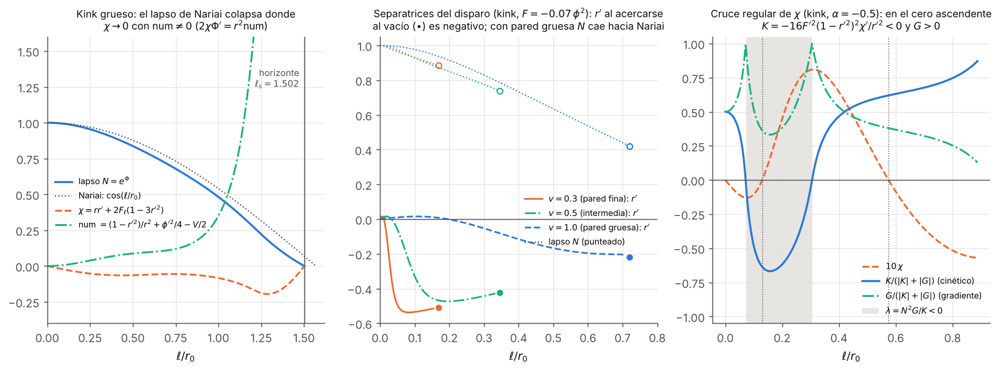
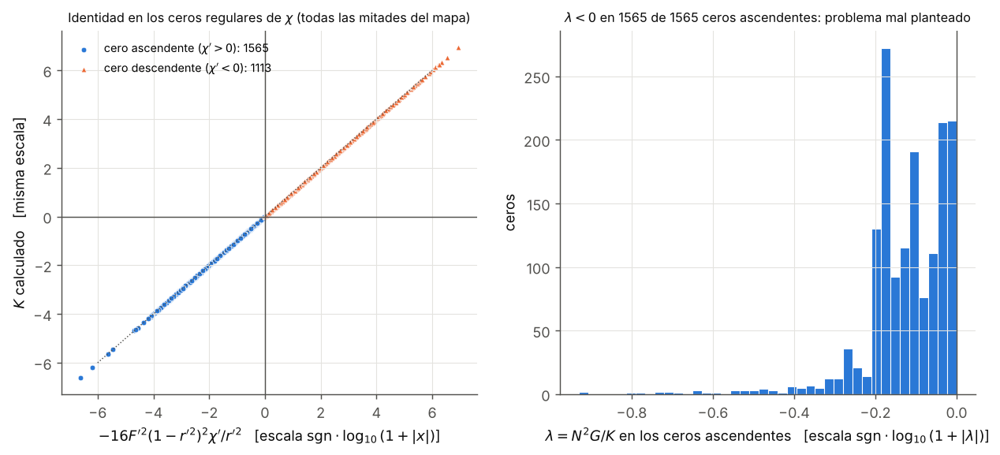
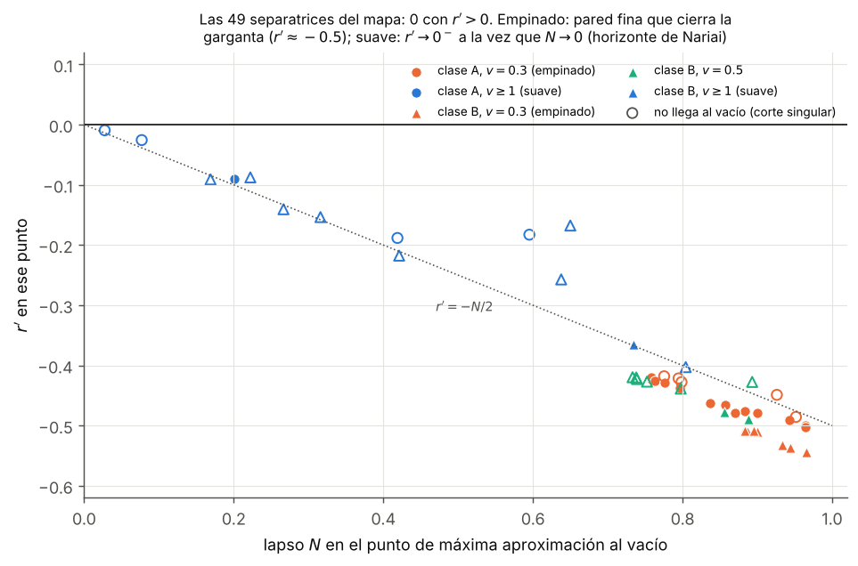

# Híbrido estrella–agujero de gusano — Fase 2e: gargantas lisas de EsGB con potencial escalar

*Documento de trabajo v0.1 · 2026-10-21 · continúa [fase2c/fase2c_resultados.md](../fase2c/fase2c_resultados.md) (§10) y [fase2d/fase2d_resultados.md](../fase2d/fase2d_resultados.md) (§16)*

## Resumen

1. **La pregunta.** Tras las Fases 2b–2d, la única vía lisa no explorada dentro de EsGB era un potencial escalar:
   $$S=\frac1{16\pi}\int\sqrt{-g}\,\Big[R-\tfrac12(\partial\phi)^2-V(\phi)+F(\phi)\,\mathcal G\Big].$$
   - Con $V$ la ligadura $\ell\ell$ en una garganta lisa pasa a ser $V(\phi_0)/2=1/r_0^2+\phi_1^2/4-4F'(\phi_0)\,a\,\phi_1/r_0^2$, con $a=\Phi'(0)$ y $\phi_1=\phi'(0)$.
   - Por tanto se puede elegir $a=0$: ya no hay gradiente del lapso ni horizonte frustrado a distancia $1/a$. Era la vía que atacaba directamente el punto 1 ($a\,r_0\lesssim1$).
   - Hay dos clases simétricas naturales: **A**, escalar par ($\phi_1=0$, $V(\phi_0)=2/r_0^2$), y **B**, *kink* impar con $F$ y $V$ pares ($\phi_0=0$, $V(0)=2/r_0^2+\phi_1^2/2$).

2. **Implementación verificada** (§2). El potencial suma $+V/2$ a $E^t{}_t$, $E^\theta{}_\theta$ y $E^\ell{}_\ell$, y $-V'$ a la ecuación del escalar.
   - Identidad de Bianchi con $V$ (SymPy, jets aleatorios): residuo $\le2\times10^{-165}$. Con el signo de $V'$ cambiado falla, con residuo de orden 1.
   - Las ecuaciones covariantes con $V$ coinciden con el módulo a $10^{-12}$, y Schwarzschild–de Sitter se reproduce a $10^{-13}$.
   - Las ligaduras se propagan a $10^{-12}$, el modo gauge es solución exacta a $3.5\times10^{-12}$ y la derivada de la familia de fondos cumple el sistema lineal a $3\times10^{-10}$.

3. **La garganta lisa con $a=0$ es un núcleo de Nariai** (§3, analítico). La fila $\theta\theta$ en la garganta no tiene términos de Gauss–Bonnet, y con la ligadura da
   $$\frac{N''}{N}(0)=-\big(1-4F'a\phi_1\big)\Big(\frac1{r_0^2}+\frac{r''(0)}{r_0}\Big)-\frac{\phi_1^2}2\ \xrightarrow{a=0}\ -\frac1{r_0^2}-\frac{r''(0)}{r_0}-\frac{\phi_1^2}2<-\frac1{r_0^2}.$$
   - El lapso tiene un **máximo** en la garganta, que es repulsiva para cualquier $F$ y $V$. Localmente es $dS_2\times S^2$ (Nariai) con $\Lambda_{\rm ef}=V/2=1/r_0^2$.
   - Su horizonte cosmológico está a $\pi r_0/2$. El horizonte frustrado no desaparece: pasa de la distancia de Rindler $1/a$ (Fases 2b–2c) a la de Nariai.
   - Numéricamente, los 2 128 finales de tipo horizonte del mapa tienen una mediana de $\ell_s=1.568\,r_0$; con $V$ constante y $F\to0$, $\ell_s\to\pi/2$ a 7 cifras.
   - El escalar estático se comporta como una partícula en el potencial $-V$, con energía $E=\phi'^2/2-V$ y $E(0)=-2/r_0^2+8F'a\phi_1/r_0^2$. Para llegar al vacío ($E=0$), Gauss–Bonnet o el colapso del lapso tienen que bombearle exactamente $2/r_0^2$.

4. **Las paredes finas no abren gargantas** (§4, analítico). La fila $tt$ se integra exactamente:
   $$rr'+2F_\ell\,(1-r'^2)=\frac12\int_0^\ell\big(1+r'^2-r^2\rho_\phi\big)\,d\ell',\qquad \rho_\phi=\tfrac14\phi'^2+\tfrac12V .$$
   - Gauss–Bonnet solo entra como término de frontera, y este se anula en la garganta simétrica y en el vacío.
   - En el límite de pared fina queda $r'_+=-r_0\sigma/2<0$, con $\sigma=\int\rho_\phi\,d\ell>0$: la pared cierra la garganta en lugar de abrirla.

5. **Teorema: ningún agujero liso de EsGB con potencial está bien planteado** (§5). Es la generalización a lapso variable que pedía la Fase 2d (§16.1).
   - **Forma general.** El coeficiente cinético de las perturbaciones radiales mantiene la forma de la Fase 2d con cualquier lapso y cualquier $V$: $K=A^2r^2-16F'^2B\,(4Ar''+BC)$.
   - **Identidad.** Con $\chi=rr'+2F_\ell(1-3r'^2)$ se cumple $K=-a\chi'+b\chi+c\,\mathrm{num}$, con el mismo $b$ de la Fase 2d. Aquí $\mathrm{num}=2\chi\Phi'/r^2$ es la ligadura $\ell\ell$.
   - **En un cero regular de $\chi$** (con $\Phi'$ finito, y entonces num $=0$) el lapso desaparece:
     $$K=-\frac{16\,F'(\phi)^2\,(1-r'^2)^2}{r'^2}\,\chi'.$$
   - **Cerca de la garganta, $\chi<0$** en al menos un lado:
     - $\chi(0)=2F'(\phi_0)\phi_1$, negativa en un lado si $F'\phi_1\neq0$;
     - $\chi'(0)=2F'a\phi_1-\phi_1^2/4<0$ en los dos lados si $F'(\phi_0)=0$;
     - si $\phi_1=0$, para cualquier $a$, $\chi\simeq c_3\ell^3$ con $c_3=-\dfrac{(8F_1-V_1)^2D}{12(1-16F_1^2)^3}$. Aquí $D$ es el denominador de $\lambda(0)=(1-16F_1^2)^2/D$, así que $c_3<0$ exactamente cuando la garganta está bien planteada.
   - **Conclusión.** En la planitud asintótica $\chi\to+\infty$, así que $\chi$ tiene un último cero ascendente. Allí $K<0$, mientras que $G\propto\det M>0$ si las ecuaciones estáticas son regulares. Hay por tanto una región con $\lambda=N^2G/K<0$: el problema de valores iniciales está mal planteado.
   - Las únicas salidas son un punto singular de las ecuaciones estáticas ($\det M=0$) o coincidencias no genéricas.
   - **Extensión.** Con materia adicional sin grados de libertad radiales (Maxwell, NLED), el cero de $\chi$ da $K=-16F'^2B^2\chi'/r'^2-8F'^2B^2r^2(\rho_m+p_{r,m})/r'^2$. La identidad de la Fase 2d es el caso $\rho_m+p_{r,m}=0$, comprobado a 10 cifras sobre el agujero de Cañate et al.

6. **Mapa de existencia: ninguna solución asintóticamente plana** (§6). Se han integrado 5 032 mitades de gargantas simétricas en 150 barridos y 8 familias: kinks con $F=\alpha\phi^2$ y $\alpha e^{-\phi^2}$, y clase A con $F$ lineal, exponencial o cuadrático y potencial de doble pozo o masivo.
   - Se han bisecado las 49 separatrices del disparo. **Ninguna mitad es AF**: todas llegan a su máxima aproximación al vacío con $r'<0$ y $\chi<0$.
   - Con potencial empinado, la pared fina cierra la garganta ($r'\approx-0.5$). Con potencial suave, $r'\to0^-$ a la vez que el lapso se anula en el horizonte de Nariai. Todas siguen $r'\approx-N/2$ (Fig. 3).
   - En los 1 565 ceros ascendentes y regulares de $\chi$ del mapa se cumple $K<0$, $G>0$ y $\lambda<0$, como predice el teorema.

7. **Unificación de las Fases 2c–2e** (§7). $\chi=0$ es donde la ligadura hamiltoniana deja de fijar el gradiente del lapso, y todo agujero liso tiene que cruzarla.
   - Si la cruza con num $\neq0$, aparece un horizonte: el de Rindler de la Fase 2c o el de Nariai de esta fase.
   - Si la cruza de forma regular, aparece un fantasma, $K<0$: con Maxwell en la Fase 2d, con potencial aquí.

8. **Consecuencia para el proyecto.** La vía del potencial no da una garganta utilizable.
   - Permite $a=0$, pero a cambio la garganta queda a $\sim\pi r_0/2$ de un horizonte de Nariai.
   - No hemos encontrado ninguna solución asintóticamente plana, y el teorema implica que, si existiera alguna con ecuaciones estáticas regulares, estaría mal planteada.
   - Con las Fases 2b–2d, EsGB queda cerrada en todas sus variantes: con cáscara es inestable, sin cáscara no existe, con Maxwell está mal planteada y con potencial también. Lo que queda es salir de Horndeski (Mironov–Rubakov–Volkova) o redactar los resultados.

---

## 1. Planteamiento y literatura

**Por qué el potencial.** En EsGB sin potencial, la ligadura $\ell\ell$ en una garganta lisa obliga a $\Phi'(0)=(1+r_0^2\phi_1^2/4)/(4F'\phi_1)\neq0$ (Fase 2c, Proposición 1). Ese gradiente del lapso pone un horizonte frustrado a distancia $1/a$, que fija la tasa de inestabilidad de las gargantas con cáscara (Fase 2b, §12–13) y es donde colapsan las continuaciones lisas (Fase 2c, §5). Un potencial añade $V/2$ a la ligadura y permite $a=0$.

**Literatura** (búsqueda web, 2026-10-21; la API de arXiv y los textos de arXiv no son accesibles desde este entorno, así que solo se han leído resúmenes):
- Ibadov, Kleihaus, Kunz, Murodov, *Wormholes in Einstein-scalar-Gauss-Bonnet theories with a scalar self-interaction potential*, [arXiv:2006.13008](https://arxiv.org/abs/2006.13008), PRD 102, 064010 (2020).
  - Potencial con término de masa y autointeracción; gargantas simples y dobles (con ecuador).
  - Según el resumen, el potencial interviene en las condiciones de empalme de una cáscara en la garganta; ya la Fase 2c lo clasificó como "soluciones simétricas, con cáscara".
- No hemos encontrado ningún trabajo con gargantas EsGB lisas, sin cáscara, sostenidas por un potencial, ni con un kink del escalar a través de la garganta. Las búsquedas fueron "smooth wormhole Einstein-scalar-Gauss-Bonnet scalar potential without thin shell" y "wormhole scalar kink domain wall Gauss-Bonnet double-well potential".
- Bakopoulos, Charmousis, Kanti, *Traversable wormholes in beyond Horndeski theories*, [arXiv:2111.09857](https://arxiv.org/abs/2111.09857), JCAP (2022): agujeros regulares y asintóticamente planos sin materia, más allá de Horndeski. Es la otra vía abierta del punto 1 y no se ha estudiado aquí.
- [arXiv:2609.28456](https://arxiv.org/abs/2609.28456) (2026), *Scalar Gauss-Bonnet wormholes and the imaginary distance bound*, trata sillas complejas euclídeas. No afecta a las gargantas lorentzianas atravesables.

---

## 2. Ecuaciones y verificación

**Ecuaciones** ([potencial.py](potencial.py)). El potencial forma parte del sector escalar: $T_{\mu\nu}\to T_{\mu\nu}-\tfrac12g_{\mu\nu}V$ y $\Box\phi+F'\mathcal G\to\Box\phi-V'+F'\mathcal G$. En componentes mixtas, sobre las ecuaciones de [egb_F_gen.py](../fase2b/egb_F_gen.py):
- $E^t{}_t$, $E^\theta{}_\theta$ y $E^\ell{}_\ell$ reciben $+V/2$; la ecuación del escalar, $-V'(\phi)$; $E^\ell{}_t$ no cambia.
- Las perturbadas ($\phi\to\phi+q$) reciben $+V'q/2$ en $tt$, $\theta\theta$ y $\ell\ell$, y $-V''q$ en la del escalar.
- $V$ no añade derivadas segundas ni términos en $w$: la parte principal y la matriz de $w$ tienen la forma de siempre, con el fondo nuevo.
- `LadoV` integra una mitad desde una garganta lisa con datos $(\phi_0,\phi_1,a)$, con la amplitud del potencial fijada por la ligadura. `DobleV` las pega y se conecta a [estabilidad_lisa.py](../fase2c/estabilidad_lisa.py) mediante el gancho `f.ecuaciones` de la Fase 2d.

**Verificación** ([verificar_potencial.py](verificar_potencial.py)):

| Prueba | Resultado |
|---|---|
| Bianchi generalizada con $V=m^2\phi^2/2+\lambda\phi^4$ (SymPy, 2 jets × 2 componentes) | residuo $\le2.2\times10^{-165}$ |
| Control: el mismo cálculo con $+V'$ en la ecuación del escalar | residuo 0.16–3.7: la prueba fija el signo relativo |
| Ecuaciones estáticas covariantes con $V$ (acoplamiento exponencial, potencial cuártico) frente a `segundas_V` y `est_ligadura_V`, 20 estados aleatorios | $1.3\times10^{-12}$ |
| Schwarzschild–de Sitter ($V=2\Lambda$, $\phi\equiv0$, $F=\alpha\phi^2$) | $r'$ y $N$ a $1.0\times10^{-13}$; ligadura $4\times10^{-15}$ |
| Propagación de la ligadura $\ell\ell$ con escalar y potencial no triviales (3 familias) | $\le1.2\times10^{-12}$ relativo |
| Modo gauge $(\Phi''-we^{-2\Phi},r',r'',\phi',\phi'')$ sobre una mitad lisa con $V$, $w$ real y complejo, $\ell$ de los dos signos | $\le3.5\times10^{-12}$; ligaduras $\le8\times10^{-11}$ |
| Solución lineal genérica | ligaduras propagadas $\le5.6\times10^{-12}$ |
| Derivada de la familia de fondos (gaussiano + cuártico) frente al sistema lineal con $w=0$ | $3.3\times10^{-10}$; $E^\ell{}_\ell$ a $8.5\times10^{-11}$ |

---

## 3. La garganta lisa con potencial

Desarrollo exacto en $\ell=0$ ([garganta_potencial.py](garganta_potencial.py), SymPy; comprobado frente a `segundas_V` en 30 gargantas aleatorias a $9\times10^{-16}$). Con $r_0=1$, $F_k=F^{(k)}(\phi_0)$ y $V_k=V^{(k)}(\phi_0)$:

**Datos generales $(\phi_1,a)$.**
- Ligadura: $V_0/2=1+\phi_1^2/4-4F_1a\phi_1$.
- Fila $\theta\theta$: $N''/N(0)=\Phi''+a^2=-(1-4F_1a\phi_1)(1+r''(0))-\phi_1^2/2$.
- Energía mecánica del escalar: $E(0)=\phi_1^2/2-V_0=-2+8F_1a\phi_1$, con $E'=-(\Phi'+2r'/r)\phi'^2-F_\ell\,\mathcal G$.
- Gauss–Bonnet es una derivada total: $\mathcal G=-\dfrac{8}{r^2N}\big[N'(1-r'^2)\big]'$.

**Proposición 1 (núcleo de Nariai).** En toda garganta lisa con $a=0$,
$$\frac{N''}{N}(0)=-\frac1{r_0^2}-\frac{r''(0)}{r_0}-\frac{\phi_1^2}{2}<-\frac1{r_0^2}\quad(r''(0)>0),$$
para cualquier $F$ y $V$.
- El lapso tiene un máximo estricto en la garganta, que es por tanto repulsiva.
- Con $r''(0)\to0$ es exactamente Nariai, $dS_2\times S^2$ con $\Lambda=1/r_0^2$: $N=\cos(\ell/r_0)$, con horizonte en $\pi r_0/2$.
  - Comprobado numéricamente con $V=2$ constante y $F=\varepsilon\phi$: $\ell_s=1.571533$, $1.570804$ y $1.570796$ para $\varepsilon=10^{-2}$, $10^{-3}$ y $10^{-4}$, con $|N-\cos\ell|=1.7\,\varepsilon^2$.
- La comparación de Riccati de la Fase 2c ($\Psi'=N''/N-\Psi^2$, $\Psi(0)=0$) lleva el lapso a cero antes de $\pi r_0/2$, salvo que el escalar baje el potencial y Gauss–Bonnet abra la garganta antes.

**Proposición 2 (Gauss–Bonnet tiene un máximo en la garganta).** La fila $tt$ en la garganta con $a=0$ da
$$r''(0)=-\frac{2F_{\ell\ell}(0)}{r_0}-\frac{r_0\phi_1^2}{4},\qquad F_{\ell\ell}=F''\phi'^2+F'\phi'' .$$
Abrir la garganta exige $F_{\ell\ell}(0)<0$: a lo largo de $\ell$, el acoplamiento $F(\phi(\ell))$ decrece hacia fuera.

**Clase A** (escalar par, $\phi_1=0$, $a=0$, $V_0=2$):
$$\phi''(0)=\frac{V_1-8F_1}{1-16F_1^2},\quad r''(0)=-2F_1\phi''(0),\quad \Phi''(0)=-1-r''(0),\quad \det M(0)=2(1-16F_1^2),$$
$$\lambda(0)=\frac{(1-16F_1^2)^2}{D},\qquad D=1-32F_1^2+192F_1^3V_1-1280F_1^4 .$$
- **El escalar estático sube por el potencial.** Con fricción nula en la garganta, $\phi''\simeq V'$. Para que baje hacia el vacío hace falta $8F_1V_1>V_1^2$ (con $|F_1|<1/4$): que Gauss–Bonnet supere el tirón del potencial.
- Con la garganta en la cima del potencial ($V_1=0$), el problema radial está bien planteado en la garganta solo si $|F'(\phi_0)|<0.1346\,r_0^2$. Eso limita $r''(0)<0.41/r_0$.

**Clase B** (kink: $F$ y $V$ pares, $\phi_0=0$, $F_1=V_1=0$, $a=0$, $V_0=2+u^2/2$, $u=\phi_1$):
$$r''(0)=-\frac{u^2(8F_2+1)}4,\qquad \Phi''(0)=2F_2u^2-\frac{u^2}{4}-1,\qquad \phi''(0)=0,\qquad \det M(0)=2,\qquad \lambda(0)=1 .$$
- La garganta exige $F''(0)<-r_0^2/8$.
- Como en el agujero de Cañate et al., la velocidad radial en la garganta es exactamente la de la luz. Aquí el potencial del kink sustituye a la carga eléctrica.

---

## 4. Identidades globales

Comprobadas simbólicamente en [garganta_potencial.py](garganta_potencial.py) (§6 del script), con $X\equiv F_\ell(1-r'^2)$.

**Fila $tt$ integrada.** La fila $tt$ es exactamente $rr''+2X'=(1-r'^2)/2-r^2\rho_\phi/2$. Integrada desde una garganta simétrica ($r'=X=0$):
$$rr'+2F_\ell\,(1-r'^2)=\frac12\int_0^\ell\big(1+r'^2-r^2\rho_\phi\big)\,d\ell' .$$
- Gauss–Bonnet solo aparece en el término de frontera $2X$.
- Cuando el escalar llega al vacío ($\phi'\to0$, luego $X\to0$), el signo de $r'$ lo decide la integral: el "volumen" $\int(1+r'^2)$ frente a la energía del escalar $\int r^2\rho_\phi$.
- En la garganta $r^2\rho_\phi=1+\phi_1^2/2>1$: el integrando empieza negativo.

**Corolario (paredes finas).** Si el escalar va de la garganta al vacío en una pared de anchura $\delta\ll r_0$, el término $\int(1+r'^2)=O(\delta)$ desaparece y
$$r'_+=-\frac{r_0\,\sigma}{2}<0,\qquad \sigma=\int\rho_\phi\,d\ell>0 .$$
- Ninguna pared fina, con cualquier $F$, abre la garganta: el límite de cáscara fina de una garganta lisa la cierra.
- Las separatrices con potencial empinado de §6 lo confirman: llegan al vacío con $r'\simeq-0.4$ a $-0.5$.

**Masa de Komar.** La combinación $E^t{}_t-E^\ell{}_\ell-2E^\theta{}_\theta$ da
$$\big(r^2N'-2NX-4rr'F_\ell N'\big)'=-4N'X-\tfrac12\,r^2NV .$$
Integrada entre una garganta simétrica y el infinito,
$$N_\infty M=-\tfrac12\int r^2NV\,d\ell-4\int N'F_\ell(1-r'^2)\,d\ell .$$
- El potencial positivo contribuye con masa negativa.
- El término de Gauss–Bonnet no tiene signo definido: no hay un teorema de masa.
- Cerca de la garganta $N'<0$ y $F_\ell<0$ (Proposiciones 1 y 2), así que los dos términos restan. Una masa positiva exige que el lapso se dé la vuelta ($N'>0$) mientras $F_\ell$ sigue siendo apreciable.

---

## 5. El coeficiente cinético con lapso variable: teorema

**Polinomio de dispersión** ([teorema_chi_lapso.py](teorema_chi_lapso.py), SymPy, residuos 0). En cualquier punto de cualquier fondo estático, con o sin potencial,
$$\det(M-\lambda N)=\frac2{r^5}\big(G-\lambda e^{-2\Phi}K\big),\qquad \lambda=N^2\frac GK,$$
$$K=A^2r^2-16F'^2B\,(4Ar''+BC),\qquad G=A^2r^2-16F'^2B\big[4A\Phi'r'+B(1-4F_\ell\Phi')\big],$$
con $A=r-4F_\ell r'$, $B=1-r'^2$ y $C=1-4F_{\ell\ell}$.
- $K$ es la forma de la Fase 2d (§8), ahora sin suponer $\Phi'=0$.
- $G=\tfrac{r^5}{2}\det M$ es el coeficiente de gradiente; donde se anula, las ecuaciones estáticas tienen un punto singular.

**Identidad.** Eliminando $F_{\ell\ell}$ con la fila $tt$ (§4), $K=A^2r^2-16F'^2B(6Ar''+r^2\rho_\phi)$, y con $\chi=rr'+2F_\ell(1-3r'^2)$ (comprobado simbólicamente):
$$K=-a\,\chi'+b\,\chi+c\;\mathrm{num},\qquad a=\frac{48F'^2AB^2}{r'(rr'-4F_\ell)},\qquad \mathrm{num}=\frac{1-r'^2}{r^2}+\frac{\phi'^2}{4}-\frac V2 .$$
- $b$ es exactamente el de la Fase 2d (§12) y no depende de $V$.
- $c$ es explícito. El término nuevo es proporcional a la ligadura $\ell\ell$, $2\chi\Phi'=r^2\,\mathrm{num}$, que en la Fase 2d se anulaba idénticamente porque $\Phi'\equiv0$.

**Lema (cero regular de $\chi$).** Si $\chi(\ell_*)=0$ y $\Phi'$ es finito en $\ell_*$, entonces num$(\ell_*)=0$, $a(\ell_*)=16F'^2B^2/r'^2$ y
$$\boxed{\;K(\ell_*)=-\frac{16\,F'(\phi)^2\,(1-r'^2)^2}{r'^2}\;\chi'(\ell_*)\;}$$
- El lapso y el potencial desaparecen de la expresión.
- $\chi=0$ no es un punto singular de las ecuaciones de evolución ($\det M\neq0$): si $\Phi'$ no diverge, num sigue a $\chi$ y el cruce es automáticamente regular. Si $\Phi'$ diverge, es el horizonte de la Fase 2c.

**Lema (signo de $\chi$ cerca de la garganta).** Con $r_0=1$:
$$\chi(0)=2F_1\phi_1,\qquad \chi'(0)=2F_1a\phi_1-\frac{\phi_1^2}4,\qquad \phi_1=0:\ \ \chi=c_3\ell^3+O(\ell^4),\quad c_3=-\frac{(8F_1-V_1)^2\,D}{12\,(1-16F_1^2)^3}$$
($c_3$ no depende de $a$; comprobado a cuarto orden). Bajo la reflexión $\ell\to-\ell$, $\chi$ cambia de signo, así que en la coordenada hacia fuera de cada lado:
- si $F_1\phi_1\neq0$, un lado tiene $\chi(0)<0$;
- si $F_1=0$ y $\phi_1\neq0$ (clase B), los dos lados tienen $\chi<0$ cerca de la garganta;
- si $\phi_1=0$ (clase A, con cualquier $a$) y $\det M(0)>0$ ($|F_1|<1/4$): $c_3<0\iff D>0\iff\lambda(0)>0$. **O la garganta está mal planteada, o $\chi<0$ a los dos lados.**

**Teorema.** Sea un agujero de gusano liso, estático y esférico de EsGB con potencial (cualquier $F$, cualquier $V$), asintóticamente plano a los dos lados, con las ecuaciones estáticas regulares ($\det M>0$) a lo largo de la solución. Entonces su problema radial de valores iniciales está mal planteado.

*Demostración.*
1. Por el lema anterior, o $\lambda(0)<0$ o hay un lado con $\chi<0$ cerca de la garganta.
2. En ese lado la planitud asintótica da $\chi\simeq r-4F_\ell\to+\infty$. Sea $\ell_*$ el último cero de $\chi$, donde $\chi'\ge0$.
3. Si $\chi'(\ell_*)>0$, el primer lema da $K(\ell_*)<0$. Si $\chi'(\ell_*)=0$, el cero es de orden impar, $\chi\simeq c(\ell-\ell_*)^{2k+1}$, y $K\simeq-a\chi'<0$ en un entorno pinchado.
4. $G>0$ en todo el dominio, porque $\det M>0$. Por tanto $\lambda=N^2G/K<0$ junto a $\ell_*$. $\square$

**Excepciones** (todas no genéricas):
- $F'(\phi)=0$ o $r'=0$ en $\ell_*$. Entonces $F_\ell=r'=0$ allí: un segundo punto crítico de la geometría, que en una familia de un parámetro es de codimensión 2.
- $r'^2=1$ en $\ell_*$.
- $D=0$ o $8F_1=V_1$ en una garganta con $\phi_1=0$.
- $\det M=0$ en algún punto. Las ecuaciones estáticas tienen entonces un punto singular, que una solución regular solo cruza con una condición de compatibilidad. Además, para que $\lambda\ge0$, $K$ y $G$ tendrían que anularse en los mismos puntos.
- Con $\det M(0)<0$ (clase A con $|F_1|>1/4$), $G$ cambia de signo antes del infinito y se cae en este último caso.

**Extensión con materia.** Con materia adicional cuyas perturbaciones no entran en la parte principal (Maxwell, NLED), con densidad $\rho_m$ y presión radial $p_{r,m}$, el cero regular de $\chi$ da (SymPy, residuo 0)
$$K=-\frac{16F'^2B^2}{r'^2}\chi'-\frac{8F'^2B^2r^2}{r'^2}\,(\rho_m+p_{r,m}).$$
- Para campos electromagnéticos $\rho_m+p_{r,m}=0$, y queda la identidad de la Fase 2d: $a=4A^2r^4/D^2$ coincide con $16F'^2B^2/r'^2$ en los ceros de $\chi$.
- Comprobado sobre el agujero exacto de Cañate et al. ($Q_s/Q=0.5$, 1, 2, 5) a 10 cifras ([verificar_teorema.py](verificar_teorema.py)).
- Con materia que cumple la condición nula radial, $K$ es aún más negativo.
- Un fluido con velocidad del sonido entra en la parte principal de las perturbaciones; no lo hemos comprobado.

**Comprobación numérica** ([verificar_teorema.py](verificar_teorema.py)), sobre cuatro kinks ($F=\alpha\phi^2$, doble pozo):
- $K$ y $G$ de las fórmulas cerradas coinciden con los coeficientes del polinomio de dispersión de las ecuaciones generadas a $\le9\times10^{-14}$.
- En los 6 ceros de $\chi$, num $\le4\times10^{-13}$ (cruce regular) y $K$ coincide con la fórmula del lema en todas las cifras impresas.
- En los ceros ascendentes, $K<0$ y $G>0$, con $\lambda=-0.51$ a $-3.1$.
- La región con $\lambda<0$ ocupa, por ejemplo, $0.072<\ell/r_0<0.305$ ($\alpha=-0.5$, $v=1$, $u=1$).
- En todo el mapa de §6 la comprobación se repite sin excepciones: 2 678 ceros regulares, y $\lambda<0$ en los 1 565 ascendentes.

---

## 6. Mapa de existencia

**Método** ([mapa_potencial.py](mapa_potencial.py), [analisis_mapa.py](analisis_mapa.py)). Gargantas simétricas con $a=0$ ($r_0=1$); la amplitud del potencial la fija la ligadura.

| Familia | Potencial y acoplamiento | Barrido |
|---|---|---|
| B, cuadrático | $V=\lambda(\phi^2-v^2)^2$, $F=\alpha\phi^2$ | $v\in\{0.3,0.5,1,2\}$; $\alpha\in\{-5,\dots,-0.07,\ 0.05,0.2,1\}$ (10); $u=\phi'(0)\in[0.02,20]$ (40) |
| B, gaussiano | ídem, $F=\alpha e^{-\phi^2}$ | $v$ ídem; $\alpha\in\{0.07,\dots,5,\ -0.1,-0.5\}$ (9); $u$ ídem |
| A, lineal | doble pozo, $F=\alpha\phi$ | $v\in\{0.3,1\}$; $\alpha\in\pm\{0.02,0.05,0.1,0.13\},0.3,1$; $\phi_0\in(0,3v)$ (50) |
| A, exponencial | doble pozo, $F=\alpha e^{-\phi}$ | $v\in\{0.3,1\}$; $\alpha\in\pm\{0.03,0.1,0.3,1\}$; $\phi_0$ ídem |
| A, cuadrático | doble pozo, $F=\alpha\phi^2$ | ídem |
| A, masivo | $V=m^2\phi^2/2$; $F=\alpha\phi^2$, $\alpha e^{-\phi}$, $\alpha\phi$ | 22 valores de $\alpha$; $\phi_0\in[0.05,20]$ (40) |

- En cada mitad se clasifica el primer suceso del escalar: cruza el vacío (se pasa), se da la vuelta antes de llegar (no llega), o un final singular antes de decidir.
- Por la simetría, el agujero existe si y solo si la mitad es AF. Con un vacío masivo eso es un disparo: la única candidata es la frontera entre "se pasa" y "no llega".
- Cada cambio entre vecinos se biseca hasta $|\delta x|<3\times10^{-15}x$, y se registra el estado en el punto de máxima aproximación al vacío.
- En 1 488 mitades más el escalar arranca alejándose de todos los vacíos: el tirón del potencial hacia arriba (§3) gana a Gauss–Bonnet. No se integran.

**Resultados.**

| Familia | mitades | horizonte | det | se escapa | otros | separatrices | llegan al vacío | $r'$ al llegar (mín., mediana, máx.) | AF |
|---|---|---|---|---|---|---|---|---|---|
| B, cuadrático | 1 600 | 736 | 320 | 544 | — | 13 | 6 | $-0.544,\,-0.510,\,-0.477$ | 0 |
| B, gaussiano | 1 440 | 983 | 276 | — | 181 ($\phi'\to\infty$) | 13 | 6 | $-0.536,\,-0.508,\,-0.365$ | 0 |
| A, lineal (doble pozo) | 666 | 171 | 223 | 189 | 83 | 11 | 7 | $-0.499,\,-0.465,\,-0.091$ | 0 |
| A, exponencial (doble pozo) | 528 | 93 | 238 | 162 | 35 | 5 | 3 | $-0.503,\,-0.476,\,-0.426$ | 0 |
| A, cuadrático (doble pozo) | 624 | 108 | 302 | 214 | — | 7 | 4 | $-0.479,\,-0.450,\,-0.428$ | 0 |
| A, masivo (tres $F$) | 174 | 37 | 137 | — | — | 0 | 0 | — | 0 |
| **total** | **5 032** | **2 128** | **1 496** | **1 109** | **299** | **49** | **26** | | **0** |

("Se escapa": el escalar se pasa del vacío o se da la vuelta y se aleja sin cota. "Otros": $\phi'\to\infty$, $r\to0$ y un fallo del integrador.)

1. **Ninguna mitad es asintóticamente plana, y ninguna separatriz es sana.** Las 49 separatrices llegan a su máxima aproximación al vacío con $r'<0$ y $\chi<0$ (Fig. 3).
   - **Potencial empinado** ($v=0.3$): $r'\approx-0.42$ a $-0.54$, con el lapso todavía en $N\simeq0.75$–$0.97$. Es el corolario de §4: la pared fina cierra la garganta.
   - **Potencial suave** ($v\ge1$): $r'\to0^-$ a la vez que $N\to0$, y la mitad termina en el horizonte de Nariai. Muchas ni siquiera llegan al vacío: la bisección se encuentra con finales singulares intercalados.
   - Todos los puntos están cerca de $r'\approx-N/2$, y no hay hueco entre los dos mecanismos.
2. **El horizonte es el de Nariai.** Los 2 128 finales de tipo horizonte tienen una mediana de $\ell_s=1.568\,r_0$ ($\pi/2=1.571$), y el 61 % están a menos de $0.15\,r_0$ de $\pi r_0/2$. En las familias masivas, $\ell_s\in[1.57,1.65]\,r_0$.
   - Los finales "det" son la degeneración de la parte principal estática, el punto singular de las ecuaciones que excluye el teorema.
3. **Los potenciales masivos no producen ni una separatriz.** O el escalar sube por el potencial y se aleja del vacío (706 de 880 mitades), o la mitad acaba en det u horizonte antes de decidir.
4. **Comprobación del teorema en todo el mapa.** Hay 2 678 ceros regulares de $\chi$ (1 565 ascendentes), con num $\le4\times10^{-5}$.
   - La identidad $K=-16F'^2B^2\chi'/r'^2$ se cumple a $1.1\times10^{-8}$ relativo (Fig. 2).
   - En **los 1 565** ceros ascendentes $K<0$, $G>0$ y $\lambda<0$.
   - Además, 743 de las 5 032 mitades tienen $\lambda(0)<0$: están mal planteadas en la propia garganta.

**Alcance.** Es un resultado numérico, limitado a gargantas simétricas y a estas familias; no hemos estudiado las asimétricas. El teorema de §5 no depende de él: cubre cualquier $V$ y cualquier dato liso, simétrico o no.

### Figuras

| | |
|---|---|
|  | **Fig. 1.** Izquierda: kink grueso ($F=-0.07\phi^2$, $v=1$, $u=1$). El lapso sigue al de Nariai, $\cos(\ell/r_0)$, y se anula en $\ell_s=1.502\,r_0$, donde $\chi\to0^-$ con num $\simeq2.9\neq0$: es el horizonte singular. Centro: separatrices del disparo del kink con $F=-0.07\phi^2$ y tres pendientes. Al llegar al vacío ($\bullet$), $r'<0$: con pared fina, $r'\approx-0.5$; con pared gruesa, $N$ (punteado, $\circ$) cae hacia el horizonte de Nariai. Derecha: kink con $F=-0.5\phi^2$. $\chi$ cruza cero de forma regular dos veces; en el cruce ascendente $K<0$ y $G>0$, y alrededor (sombreado) $\lambda<0$. |
|  | **Fig. 2.** Izquierda: $K$ calculado frente a $-16F'^2(1-r'^2)^2\chi'/r'^2$ en los 2 678 ceros regulares de $\chi$ del mapa, en escala $\mathrm{sgn}\cdot\log_{10}(1+\lvert x\rvert)$. Están sobre la diagonal; los ascendentes, todos con $K<0$. Derecha: $\lambda=N^2G/K$ en los 1 565 ceros ascendentes, todos negativos. |
|  | **Fig. 3.** Las 49 separatrices del mapa en su punto de máxima aproximación al vacío: lapso $N$ y $r'$. Ninguna tiene $r'>0$. Los potenciales empinados dan paredes finas que cierran la garganta ($r'\approx-0.5$); los suaves, $r'\to0^-$ con $N\to0$ (horizonte de Nariai). Huecos: separatrices cortadas por un final singular antes de llegar al vacío. |

---

## 7. Interpretación

1. **El potencial cambia de sitio el horizonte frustrado, no lo elimina.** Con $a\neq0$, la garganta está a $1/a$ de un horizonte de Rindler (Fases 2b–2c). Con $a=0$, es un máximo del lapso dentro de un núcleo de Nariai cuyo horizonte está a $\pi r_0/2$ (Proposición 1).
   - En los dos casos la garganta queda a una distancia del orden de $r_0$ de un horizonte.
   - El punto 1 ($a\,r_0\lesssim1$) se cumple literalmente, pero no en el sentido físico que se buscaba: una garganta lejos de cualquier horizonte.

2. **$\chi=0$ unifica las Fases 2c–2e.** $\chi$ es $r^2/2$ por el coeficiente de $\Phi'$ en la ligadura hamiltoniana, $2\chi\Phi'=r^2\,$num.
   - Todo agujero liso tiene $\chi<0$ junto a la garganta (o una garganta mal planteada) y $\chi\to+\infty$ en el infinito, así que tiene que cruzar $\chi=0$.
   - **Cruce singular** (num $\neq0$, $\Phi'\to-\infty$): horizonte. Es el de Rindler en la Fase 2c y el de Nariai en los kinks gruesos de esta fase (Fig. 1, izquierda).
   - **Cruce regular** (num $=0$): $K=-16F'^2B^2\chi'/r'^2<0$, un fantasma atrapado. Es la capa de la Fase 2d con Maxwell y la de esta fase con potencial.
   - No hay una tercera posibilidad salvo un punto singular de las ecuaciones estáticas.

3. **Relación con Rubakov y Evseev–Melichev.** Sus teoremas no cubren EsGB donde $\phi'=0$ (funciones de Horndeski con $\ln X$), y las gargantas simétricas de clase A tienen justo $\phi'(0)=0$.
   - El teorema de §5 cierra ese hueco para EsGB con cualquier potencial y con materia electromagnética, sin pasar por la formulación de Horndeski.
   - Es la versión concreta, para gargantas lisas de EsGB, de la idea de esos trabajos: violar la condición nula con derivadas de orden superior cuesta un fantasma o una inestabilidad de gradiente.

4. **Para el proyecto G2V.** Ninguna variante de EsGB da una garganta utilizable:

   | Variante | Resultado | Fase |
   |---|---|---|
   | Cáscara $\mathbb Z_2$ | inestable, tasa $\ge\kappa_t$ ($\sim2r_0/c$) | 2b |
   | Lisa, $V=0$ | no existe: horizonte singular en $\chi=0$ | 2c |
   | Lisa con Maxwell/NLED | mal planteada: $K<0$ en el cero de $\chi$ | 2d |
   | Lisa con potencial | sin soluciones AF en las familias estudiadas; si existen, mal planteadas | 2e |

---

## 8. Próximos pasos

1. **Más allá de Horndeski** (Mironov–Rubakov–Volkova; Bakopoulos–Charmousis–Kanti). Es la única vía del punto 1 que queda. La estructura de §5 depende de la forma de las ecuaciones de EsGB ($\chi$, $K$), y no se traslada directamente.
2. **Redactar el artículo de resultados negativos.** El material de esta fase se suma al de las anteriores:
   - el núcleo de Nariai;
   - el corolario de la pared fina;
   - el teorema de §5, que unifica las Fases 2c–2e en la superficie $\chi=0$.
3. **Pendiente de este teorema:** materia con grados de libertad radiales (el fluido de la estrella), donde la parte principal cambia.

---

## 9. Reproducibilidad

Ejecutar desde `fase2e/`. Los módulos de `fase2b/` (`egb_F_gen`, `egb_simbolico`) y `fase2c/` (`fondo_doble`) se importan sin modificarlos; `verificar_teorema.py` usa además `fase2d/canate.py`. Cada script escribe en `resultados/` (o `figuras/`) y su salida por pantalla está en `*_log.txt`.

```bash
python verificar_potencial.py    # Bianchi con V (~9 min), covariante, SdS, ligaduras, modo gauge, derivada de familia
                                 # ("python verificar_potencial.py rapido" omite Bianchi y no escribe el JSON)
python garganta_potencial.py     # garganta lisa con V: clases A y B, lambda(0), identidades tt y Komar, limite de Nariai
python teorema_chi_lapso.py      # K, G con lapso variable; K = -a chi' + b chi + c num; cero de chi; garganta; materia
python verificar_teorema.py      # el teorema sobre kinks con V y sobre el agujero de Canate et al.
python mapa_potencial.py         # mapa de existencia y disparo (4 procesos, ~10 min)
python analisis_mapa.py          # recuentos, horizontes, separatrices y ceros de chi del mapa
python figuras_fase2e.py         # figuras 1-3 (necesita resultados/mapa_potencial.json)
```

Módulo: [potencial.py](potencial.py) (potenciales, fondo y perturbaciones con $V$, `LadoV`, `DobleV` con el gancho `ecuaciones` para [estabilidad_lisa.py](../fase2c/estabilidad_lisa.py)).

Requisitos: Python ≥ 3.11, numpy, scipy ≥ 1.17, sympy y matplotlib. Los scripts con `ProcessPoolExecutor` deben ejecutarse como ficheros.
