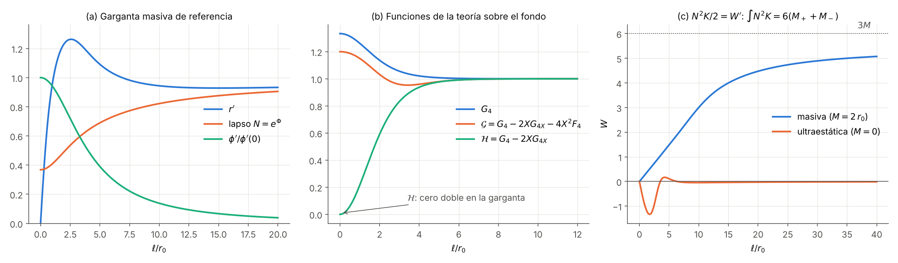
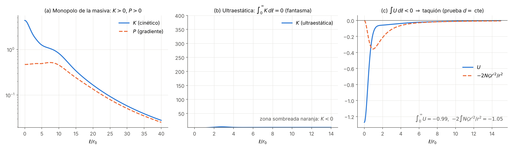
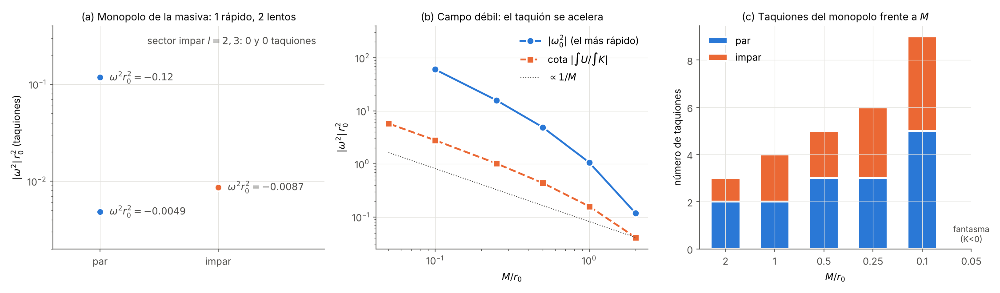

# Híbrido estrella–agujero de gusano — Fase 2f: gargantas más allá de Horndeski (GLPV cuártica)

*Documento de trabajo v0.1 · 2026-10-22 · continúa [fase2e/fase2e_resultados.md](../fase2e/fase2e_resultados.md) (§8: "salir de Horndeski")*

## Resumen

1. **La pregunta.** Con EsGB cerrada en todas sus variantes (Fases 2b–2e), quedaba la vía de Mironov–Rubakov–Volkova (MRV): la teoría cuártica más allá de Horndeski (GLPV),
   $$\mathcal L=G_2-G_3\Box\phi+G_4R+G_{4X}\big[(\Box\phi)^2-\phi_{\mu\nu}^2\big]+F_4\,\mathcal E_4,\qquad X=-\tfrac12(\partial\phi)^2 .$$
   - Se busca una garganta estática que cumpla el punto 1 (lejos de cualquier horizonte), esté bien planteada y sea estable.
   - La estabilidad debe incluir los **taquiones lentos**, que MRV dejaron sin acotar ([arXiv:1812.07022](https://arxiv.org/abs/1812.07022), [arXiv:2212.05969](https://arxiv.org/abs/2212.05969)).

2. **Maquinaria verificada** (§2). Hemos obtenido en SymPy la acción reducida esférica con $G_2,G_3,G_4,F_4$ como funciones generales de $(\phi,X)$, las ecuaciones del fondo, las cinco ecuaciones lineales $l=0$ y el sector impar ($l=1,2,3$). Comprobaciones:
   - identidades de Noether linealizadas, exactas en aritmética racional fuera de la capa de masas;
   - modos gauge exactos sobre chorros en la capa de masas;
   - límite de relatividad general (RG) con escalar y potencial frente a las Fases 2b/2e, a $2.3\times10^{-15}$;
   - Kerr lineal, rotación rígida y la solución estática impar $l=2$ en Schwarzschild;
   - el modo gauge impar $l=1$ en la teoría completa, exacto.

3. **Acción reducida exacta del monopolo** (§3). En el gauge unitario ($\delta\phi=0$):
   - el lapso y el *shift* entran solo a través de un multiplicador $F$ que impone la ligadura de momento $W=0$;
   - la perturbación $\delta g_{\ell\ell}$ es auxiliar;
   - queda una única variable, $d=\delta r$, con
   $$S_{\rm red}=\int dt\,d\ell\,\big[K\dot d^{\,2}-P\,d'^2-U\,d^2\big],$$
   cuya ecuación de Euler–Lagrange es exactamente de segundo orden.
   - Comprobación de extremo a extremo: las soluciones del sistema lineal completo (5 ecuaciones, gauge $\beta=c=0$) cumplen la ecuación reducida para $\Psi=d-(r'/\phi')q$ con un residuo relativo de $10^{-11}$.

4. **Identidades exactas** (§4, comprobadas simbólicamente en `teoremas_bH.py`). Notación: $N=e^\Phi$, $\mathcal G=G_4-2XG_{4X}-4X^2F_4$, $\mathcal H=G_4-2XG_{4X}$.
   - **T1.** La combinación $-N^2E_A+\tfrac{r^2}2E_C$ de las ecuaciones del fondo es una derivada total:
     $$\big[N\,r\,\mathcal G\,(r'-r\Phi')\big]'=N\,G_4 .$$
   - **T2.** El coeficiente cinético del monopolo es, en la capa de masas, una derivada total:
     $$N^2K/2=W',\qquad W=N\big[\xi-r\mathcal G(r'-r\Phi')\big],\qquad \xi=\frac{4r\mathcal G\mathcal H}{4r'\Gamma_1+r\Gamma_2}.$$
   - **T3.** El potencial $U$ se descompone en una parte fija por el fondo, $-\tfrac2r(Nr'\mathcal G)'$, términos proporcionales a $\Phi'$ y una derivada total.
   - **T4.** En el sector impar, $\alpha=N_l\mathcal G/N$, $\beta=N_l\lambda_lG_4/(Nr^2)$ y $\gamma=-N_l\lambda_lN\mathcal G/r^2$, con $\lambda_l=(l-1)(l+2)$.

5. **Teoremas** (§5). Valen para fondos regulares con asintótica de RG a los dos lados (la misma masa en $g_{tt}$ y $g_{rr}$) y un escalar sin masa, que no necesita ser exactamente canónico.
   - **(a) Fantasma.** $\int N^2K\,d\ell=6(M_++M_-)$. Sin masa total positiva (en particular en toda garganta **ultraestática**), $K$ cambia de signo y el monopolo tiene un fantasma.
     - Con $F_4=0$ (Horndeski) $\mathcal G=\mathcal H$ y $\xi$ no puede ser regular: se recupera el teorema de Evseev–Melichev.
   - **(b) Taquión.** La función de prueba $d=$ cte es normalizable, porque $K$ es integrable ($K\sim D^2/2r^2$ con un escalar canónico). Su cociente de Rayleigh es
     $$\int U\,d\ell=-2\!\int\! N\mathcal G\,\frac{r'^2}{r^2}\,d\ell+O(\Phi'),$$
     estrictamente negativo en el caso ultraestático. Las gargantas ultraestáticas tienen por tanto, además, un taquión.
   - **(c) Campo débil.** Si $|\Phi'|r\ll1$, la corrección es pequeña y $\int K\,d\ell=O(M)$, así que $\omega_0^2\lesssim-O(1)/(Mr_0)$: hay un taquión **rápido**.
     - Solo una velocidad radial superlumínica por un factor $(r_0/M)^{3/2}$ podría compensarlo.
   - **(d) Sector impar.** T1 con $G_4>0$ y un único mínimo del radio óptico $r/N$ obliga a $\mathcal G>0$ en todas partes. El sector impar queda así sin fantasmas ni inestabilidad de gradiente, con velocidad radial $c^2=\mathcal G/G_4$.

6. **Reconstrucción** (§6). Por el método inverso construimos gargantas simétricas con masa: se elige la geometría, el lapso y el escalar, y se despejan las funciones de la teoría sobre la curva $X=X_b(\phi)$, con derivadas exactas por aritmética de chorros. Las cuatro ecuaciones del fondo se cumplen a $3\times10^{-15}$.
   - Lejos, la normalización efectiva del escalar reconstruido corre con $\ln\ell$, y $K$ puede cambiar de signo muy lejos de la garganta. Por eso $K,P>0$ se comprueba hasta $\ell=4000\,r_0$ y, con su desarrollo asintótico, más allá.
   - Con masa $M=2r_0$ y $N(0)=0.37$, el monopolo es **bien planteado y sin fantasmas** ($K,P>0$ en todo $\ell$), con velocidad radial $c^2\le1.0001$.
   - El sector impar ($l=2,3$) es **estable y subluminal**.
   - Pero el monopolo tiene **tres taquiones**: uno rápido, $\omega^2r_0^2=-0.117$, y dos **lentos**, $-0.0049$ (par) y $-0.0087$ (impar).

7. **Búsqueda y campo débil** (§7).
   - **Búsqueda aleatoria.** De 160 configuraciones, 19 están bien planteadas y sin fantasmas, y ninguna está libre de taquiones. El mínimo es 2 (3 entre las subluminales), y todas tienen al menos uno lento.
   - **Vías de escape.** Ni el campo fuerte ($N(0)\sim0.13$) ni la superluminalidad ($c^2$ hasta 30, y hasta 2400 en la búsqueda) eliminan el último taquión, que suele ser lento.
   - **Campo débil.** Al bajar la masa el taquión se acelera: $\omega_0^2r_0^2=-0.12,-1.07,-4.9,-15.9,-61$ para $M/r_0=2,1,0.5,0.25,0.1$. Con $M=0.05\,r_0$ ya no se puede evitar el fantasma.

8. **Consecuencia para el proyecto.** La GLPV cuártica resuelve lo que EsGB no podía: hay gargantas sin fantasmas ni inestabilidades de gradiente, con masa positiva y lejos de horizontes. Pero no da una garganta estable para el híbrido.
   - La garganta solar es de campo extremadamente débil ($M/r_0\sim10^{-6}$). Por (a)–(c), si la región de la garganta es de vacío, o tiene un fantasma en el monopolo o tiene un taquión con tiempo de crecimiento $\sim\sqrt{Mr_0}/c$, de unos milisegundos.
   - Queda abierto incluir el fluido de la estrella en el sector $l=0$ (§9).
   - Los taquiones lentos que MRV dejaron abiertos aparecen en todas las gargantas reconstruidas.

---

## 1. Planteamiento y literatura

**Por qué GLPV.** En Horndeski no hay gargantas estáticas, simétricas y asintóticamente planas libres de fantasmas e inestabilidades de gradiente (Rubakov, [arXiv:1509.08808](https://arxiv.org/abs/1509.08808); Evseev–Melichev, [arXiv:1711.04152](https://arxiv.org/abs/1711.04152), PRD 97, 124040 (2018)). La Fase 2c lo confirmó en EsGB. Más allá de Horndeski, la demostración no se aplica.

**Literatura** (búsqueda web, 2026-10-21; solo resúmenes, porque los textos de arXiv no son accesibles desde este entorno):
- Franciolini, Hui, Penco, Santoni, Trincherini, *Stable wormholes in scalar-tensor theories*, [arXiv:1811.05481](https://arxiv.org/abs/1811.05481), JHEP 01 (2019) 221: con la teoría efectiva de perturbaciones sobre fondos esféricos, más allá de Horndeski se pueden evitar fantasmas e inestabilidades de gradiente.
- Mironov, Rubakov, Volkova, *Towards wormhole beyond Horndeski*, [arXiv:1811.05832](https://arxiv.org/abs/1811.05832). El ejemplo tiene **masa nula**, su gravedad no es la de RG lejos de la garganta y el escalar es no convencional en todo el espacio.
- Mironov, Rubakov, Volkova, [arXiv:1812.07022](https://arxiv.org/abs/1812.07022). El teorema de Horndeski no se extiende más allá de Horndeski. Dan un ejemplo que cumple un conjunto *incompleto* de condiciones, que deja fuera parte del sector par y los taquiones lentos.
- Mironov, Rubakov, Volkova, *In hot pursuit of a stable wormhole in beyond Horndeski theory*, [arXiv:2212.05969](https://arxiv.org/abs/2212.05969). Condiciones sin fantasmas ni inestabilidades de gradiente radiales y angulares en los dos sectores (alta energía). Los taquiones "lentos" quedan sin acotar.
- Mironov, Volkova, *Complete stability for spherically symmetric backgrounds in beyond Horndeski theory*, [arXiv:2404.06297](https://arxiv.org/abs/2404.06297). Según el resumen, da un conjunto completo de condiciones que excluyen fantasmas, inestabilidades de gradiente, taquiones y modos superlumínicos. No hemos podido leer cómo trata los taquiones.
- Bakopoulos, Charmousis, Kanti, *Traversable wormholes in beyond Horndeski theories*, [arXiv:2111.09857](https://arxiv.org/abs/2111.09857), JCAP 05 (2022) 022. Gargantas exactas de vacío con masa ADM, obtenidas por transformación disforme. Usan todos los galileones extendidos (incluido el término quíntico), así que quedan fuera de la teoría cuártica estudiada aquí.
- Kobayashi, Motohashi, Suyama, [arXiv:1202.4893](https://arxiv.org/abs/1202.4893) (sector impar) y [arXiv:1402.6740](https://arxiv.org/abs/1402.6740) (sector par): perturbaciones de fondos estáticos en Horndeski, con la acción del sector impar reducida a una sola variable. Nuestro sector impar con $F_4=0$ es el caso cuártico de su análisis (no hemos podido cotejar sus fórmulas).

**Qué aporta esta fase.**
- Un análisis espectral completo del monopolo: el número de taquiones, lentos o rápidos, sale del teorema de oscilación de Sturm sobre la acción reducida exacta.
- Tres identidades globales que convierten la estabilidad del monopolo en restricciones sobre la masa y la intensidad del campo.

## 2. Teoría, ecuaciones y verificación

**Convenios.** $S=\frac1{16\pi}\int\sqrt{-g}\,\mathcal L$, signatura $(-,+,+,+)$, $X=-\tfrac12g^{\mu\nu}\phi_\mu\phi_\nu$ y
$$\mathcal E_4=\epsilon^{\mu\nu\rho}{}_\sigma\epsilon^{\mu'\nu'\rho'\sigma}\phi_\mu\phi_{\mu'}\phi_{\nu\nu'}\phi_{\rho\rho'}=2X\big[(\Box\phi)^2-\phi_{\mu\nu}^2\big]+2\Box\phi\,\phi^\mu\phi_{\mu\nu}\phi^\nu-2\phi^\mu\phi_{\mu\nu}\phi^{\nu\lambda}\phi_\lambda$$
(la segunda forma se comprueba contra la suma de Levi-Civita en tres chorros aleatorios). RG con escalar canónico: $G_4=1$, $G_2=X-V$, $G_3=F_4=0$, como en las Fases 2b–2e.

**Acción reducida** (`bH_simbolico.py`, `generar_bH.py`). Sector $l=0$ con métrica $-A\,dt^2+2b\,dt\,d\ell+B\,d\ell^2+C\,d\Omega^2$ y $\phi(t,\ell)$; la integral angular es un factor constante y, por criticidad simétrica, las ecuaciones de Euler–Lagrange son las de campo.
- $G_i$ son funciones generales de $(\phi,X)$. $X$ se trata como símbolo, y su dependencia se recupera con la regla de la cadena en las primeras y segundas variaciones.
- En el fondo ($A=e^{2\Phi}$, $B=1$, $C=r^2$) pasan a símbolos $G_{i,j}=\partial_\phi^i\partial_X^jG$ evaluados en $(\phi_b,X_b)$.
- La derivada total en $\ell$ actúa como $G_{ij}\to G_{(i+1)j}\phi'-G_{i(j+1)}\phi'\phi''$.

**Perturbaciones $l=0$.** $\delta A=2e^{2\Phi}a$, $\delta b=\beta$, $\delta B=2c$, $\delta C=2rd$, $\delta\phi=q$, modos $e^{i\omega t}$, $w=\omega^2$. La acción cuadrática se obtiene del hessiano, con 104 entradas no nulas y 699 términos.
- En el gauge $\beta=c=0$, $E_a$ es la ligadura hamiltoniana (sin $\omega$ y sin $a$ en la capa de masas) y $E_\beta$ la de momento (impar en $\omega$).
- $E_c$ es de primer orden, y $E_d$ y $E_q$ de segundo. No aparece ninguna derivada temporal de orden mayor: la teoría es degenerada, como debe ser en GLPV.

**Sector impar** (`impar_simbolico.py`, `impar_ecuaciones.py`). Gauge de Regge–Wheeler: $g_{t\varphi}=h_0W$, $g_{\ell\varphi}=h_1W$, con $W=\sin\theta\,\partial_\theta P_l$. La inversa se toma en serie exacta, $\sqrt{-g}$ hasta segundo orden, se integra en $\theta$ para $l=1,2,3$ y se usa $h_1\to i\omega H_1$.

**Comprobaciones** (`verificar_bH.py`, `verificar_bH_log.txt`):

| Comprobación | Resultado |
|---|---|
| `bH_gen.py` (código numérico exportado) frente a las expresiones simbólicas | $2.8\times10^{-15}$ |
| Identidades de Noether linealizadas (reparametrizaciones $\zeta(t,\ell)$ de $\ell$ y $\tau(t,\ell)$ de $t$), fuera de la capa de masas | exactas (racionales), 3 chorros |
| Modos gauge $\zeta$ ($a=\Phi'-w\!\int e^{-2\Phi}$, $d=r'$, $q=\phi'$) y $\tau$ ($a=$ cte) sobre chorros en la capa de masas, $G_{ij}$ aleatorios | exactos, 5 ecuaciones, todo $\omega$ |
| Límite RG + escalar + $V$: las 5 ecuaciones sobre datos de las Fases 2b/2e | $2.3\times10^{-15}$ |
| Ecuaciones del fondo: identidad de Noether; límite RG frente a la Fase 2e | idénticamente 0; $1.0\times10^{-16}$ |
| Impar, RG: Kerr lineal y rotación rígida ($l=1$, $w=0$ y $3/7$); $h_0=r^2(r-2M)$ estática ($l=2$); controles | exactos; los controles no son solución |
| Impar, teoría completa: modo gauge de $l=1$ (rotación diferencial, $\Lambda(\ell)$ y $\omega$ arbitrarios) | exacto, 3 chorros en la capa de masas |
| Dependencia en $l$: $L_2(l)=N_l[\alpha+(l-1)(l+2)\beta]$ con $l=1,2,3$ | exacta |

## 3. Acción reducida del monopolo

**Gauge unitario** (`monopolo_reduccion.py`). Con $q=0$ quedan $(a,\beta,c,d)$, y el gauge residual $\tau$ solo mueve $(a,\beta)$. En la capa de masas (comprobado en chorros exactos):
- el coeficiente de $\beta$ en $E_\beta$ se anula, igual que el de $a$ en $E_a$ y $E_c$;
- $E_c$ contiene $a'$ y $\beta$ solo en la combinación $F=e^{2\Phi}a'+\dot\beta$.

Por la invariancia gauge, $L_2=-F\,W+L_{\rm rest}(c,d)+$ (derivadas totales). Aquí $W=\gamma c+\alpha_1d'+\alpha_0d$ es la ligadura de momento y $L_{\rm rest}=L_2(a=\beta=q=0)$.
- $F$ es un multiplicador: $W=0$ da $c=-(\alpha_1d'+\alpha_0d)/\gamma$.
- La ecuación de $c$ en $L_{\rm rest}$ no contiene derivadas de $c$ (ni siquiera fuera de la capa de masas), así que $c$ es auxiliar.
- Sustituyendo queda $S_{\rm red}[d]$. Su ecuación de Euler–Lagrange solo contiene $d,\,d',\,d'',\,\ddot d$, y el coeficiente de $d'$ es exactamente $2P'$ (forma de Sturm–Liouville).

**Coeficientes** (con $\Gamma_1=G_4-4XG_{4X}-4X^2G_{4XX}-20X^2F_4-8X^3F_{4X}$ y $\Gamma_2=\phi'(\phi'^2G_{3X}+2G_{4\phi}-2\phi'^2G_{4\phi X})$):
$$\gamma=\frac rN(4r'\Gamma_1+r\Gamma_2),\quad \alpha_1=-\frac{4r\mathcal G}N,\quad \alpha_0=-\Phi'\alpha_1,\quad K=\frac2{N^2}\big[(N\xi)'-NG_4\big],\quad \xi=-\frac{\alpha_1r\mathcal H}\gamma .$$
- $P$ y $U$ (24 y 48 símbolos) se dan en §4 (T3).
- En RG: $K=P=r^2\phi'^2/(2r'^2)$ y velocidad 1. En una garganta ($r'=0$) es singular, y con $\mathcal H=1$ no hay forma de regularizarlo: por eso las gargantas de RG necesitan un escalar fantasma.

**Regularidad en la garganta.** $\gamma\propto r'\Gamma_1$ cambia de signo entre los dos infinitos ($\gamma\to\pm4r$), así que se anula en algún punto.
- Para que $K$ sea finito, $\mathcal H$ debe anularse allí con el mismo orden. Es el análogo para gargantas del "cruce de $\gamma$" cosmológico.
- En Horndeski ($F_4=0$) $\mathcal H=\mathcal G>0$ (T4 y §5d), así que es imposible: es el teorema de Horndeski en una línea.
- Más allá de Horndeski, $F_4$ desacopla $\mathcal G$ de $\mathcal H$. $\mathcal H$ puede tener un cero doble en la garganta mientras $\mathcal G>0$. Con eso y $k_c(0)=0$, los polos $1/\gamma^3$ de $U$ se cancelan (§6).

**Comprobación de extremo a extremo** (`verificar_reduccion.py`). Sobre la garganta masiva de referencia se integra el sistema completo (5 ecuaciones, gauge $\beta=c=0$, ligaduras en el dato inicial) para $w=-0.3,\,0,\,0.7$.
- $\Psi=d-(r'/\phi')q$ cumple $-(P\Psi')'+U\Psi=wK\Psi$ con un residuo relativo $\le1.5\times10^{-11}$.
- Las ligaduras $E_\beta$, $E_c$ se propagan a $\le6\times10^{-10}$.

## 4. Identidades exactas

Todas se comprueban en `teoremas_bH.py` (SymPy, exactas):

| | Identidad | Validez |
|---|---|---|
| T1 | $-N^2E_A+\tfrac{r^2}2E_C=\big[Nr\mathcal G(r'-r\Phi')\big]'-NG_4$ | idéntica (fuera de la capa de masas) |
| T2 | $\gamma$, $\alpha_1$, $\alpha_0$ y $K$ como en §3 | idéntica |
| T2' | $N^2K/2=W'$, $W=N\big[\xi-r\mathcal G(r'-r\Phi')\big]$ | en la capa de masas (por T1) |
| T3 | $U=u_d-\tfrac{k_c}2A_0^2+A_0e_0+\tfrac12(k_cA_1A_0-A_1e_0-A_0e_1)'$, $P=p_d+A_1e_1-\tfrac{k_c}2A_1^2$, $u_d=-\tfrac2r(Nr'\mathcal G)'$ | idéntica |
| T4 | $\alpha=N_l\mathcal G/N$, $\beta=N_l[\lambda_lG_4/N+2E_A]/r^2$, $\gamma=N_l[-\lambda_lN\mathcal G-2E_B]/r^2$ ($l=2,3$) | idéntica |

- En T3, $A_1=\alpha_1/\gamma$, $A_0=\alpha_0/\gamma=-\Phi'A_1$. Los coeficientes de $L_{\rm rest}$ son $E_c^{\rm rest}=k_cc+e_0d+e_1d'+e_{tt}\ddot d$ y $L_d=L_{\rm rest}(c=0)=k_d\dot d^2-p_dd'^2-u_dd^2$.
- La lectura de T1 es geométrica: $(r/N)'=(r'-r\Phi')/N$, de modo que T1 dice $\big[N^2r\mathcal G\,(r/N)'\big]'=NG_4$. El radio óptico $r/N$ hace el papel que $r$ tiene en el caso ultraestático.
- Sector impar reducido (con T4 en la capa de masas, $L=\alpha Q^2+\beta h_0^2+\gamma h_1^2$, $Q=\dot h_1-h_0'+2r'h_0/r$ y un auxiliar $\chi$):
  $$K_o=\frac{N_lr^2\mathcal G}{\lambda_lN^3},\qquad P_o=\frac{N_lr^2\mathcal G^2}{\lambda_lNG_4},\qquad c_{\rm impar}^2=\frac{P_o}{K_oN^2}=\frac{\mathcal G}{G_4}.$$

## 5. Teoremas de imposibilidad

Hipótesis comunes:
- fondo estático, esférico y regular;
- una sola garganta;
- asintótica de RG a los dos lados: $N,r'\to1$ con la misma masa $M_\pm$ en $g_{tt}$ y $g_{rr}$ (Komar y Misner–Sharp), y $G_4,\mathcal G,\mathcal H,\Gamma_1\to1$, $\Gamma_2\to0$;
- un escalar sin masa, $\phi'\simeq D/r^2$, con $K$ integrable. No hace falta que sea exactamente canónico (en las reconstrucciones de §6 su normalización corre con $\ln\ell$);
- $G_4>0$ (sin él hay inestabilidad de gradiente impar).

**(a) Teorema del término cinético.** Por T2', $\int_{-\infty}^\infty N^2K\,d\ell=2[W]_{-\infty}^{+\infty}$. En la asintótica, $\xi-rr'\mathcal G\to\pm2m_\pm$ (con $m$ la masa de Misner–Sharp) y $r^2N\Phi'\to\pm M_\pm$ (la de Komar), así que $W(\pm\infty)=\pm(2m_\pm+M_\pm)$ y
$$\boxed{\int_{-\infty}^{\infty}N^2K\,d\ell=6\,(M_++M_-)}$$
- Numéricamente, sobre la referencia masiva, $W(L=3000\,r_0)=5.8758$ frente a $2m_{MS}+M_K=5.8759$.
- **Corolario.** Si $M_++M_-\le0$ (en particular en toda garganta ultraestática, $M=0$), $K$ cambia de signo: el monopolo tiene un **fantasma**.
- Las tres reconstrucciones ultraestáticas lo confirman: $K\in[-2.4,+2.2]$ y $\int_0^LK=O(10^{-3})$ frente a $\int|K|=3$–$9$.
- El ejemplo sin masa de MRV ([arXiv:1811.05832](https://arxiv.org/abs/1811.05832)) no contradice el teorema: su gravedad no es la de RG lejos de la garganta, así que $W(\pm\infty)$ no está fijado.

**(b) Teorema del potencial.** Con $A_0=-\Phi'A_1$, T3 da
$$\int U\,d\ell=-2\!\int N\mathcal G\frac{r'^2}{r^2}\,d\ell+\int\Phi'^2\big(P-p_d-A_1e_1\big)\,d\ell-\int\Phi'A_1e_0\,d\ell .$$
- Las derivadas totales no contribuyen: $\tfrac12(\dots)$ es continua e impar a través de la garganta y se anula en los dos infinitos.
- Si el monopolo está bien planteado y sin fantasmas ($K,P>0$), el problema es de Sturm–Liouville autoadjunto. Como $K$ es integrable ($K\propto D^2/r^2$ con un escalar canónico), $d=$ cte está en el dominio de la forma cuadrática ($\int K<\infty$, $\int U$ converge), y por el principio variacional
  $$\omega_0^2\le\frac{\int U\,d\ell}{\int K\,d\ell}.$$
- **Corolario (ultraestático).** $\int U=-2\int\mathcal G r'^2/r^2<0$ porque $\mathcal G>0$: hay al menos un **taquión**. Las reconstrucciones lo confirman: $\int_0^LU=-1.862,-1.785,-2.201$ frente a $-2\int\mathcal Gr'^2/r^2=-1.865,-1.784,-2.201$.

**(c) Campo débil.** Si $|\Phi'|\,r\lesssim\varepsilon\ll1$ (con $M\sim\varepsilon r_0$ y forma de la garganta fija), el primer término de (b) es $-O(1)/r_0$ e independiente de las funciones libres.
- Los términos $\propto\Phi'$ son $O(\varepsilon^2)$ salvo el de $P$, que es positivo y está acotado por la velocidad radial: $\int\Phi'^2P\le c_{\max}^2\max(\Phi'^2)\,6(M_++M_-)=O(c_{\max}^2\varepsilon^3/r_0)$.
- Además $\int K=\int N^2K/N^2=O(M)$. Por tanto
  $$\omega_0^2\lesssim-\frac{O(1)}{M\,r_0}\qquad\text{salvo que }c_{\max}^2\gtrsim(r_0/M)^{3}.$$
  Hay un taquión **rápido**, que empeora al bajar la masa.
- Si además $M$ es pequeño frente a $D^2/r_0$, la cola de RG ($\int_{\ell}^\infty N^2K/2\propto D^2/\ell$, positiva) agota la integral $6M$ y $K>0$ deja de ser posible: vuelve el fantasma (§7, $M=0.05\,r_0$).

**(d) Sector impar.** T1 se integra como $N^2r\mathcal G\,(r/N)'=\int_{\ell_*}^{\ell}NG_4\,d\ell'$, con $\ell_*$ el mínimo del radio óptico.
- Si $r/N$ tiene un único mínimo, $(r/N)'$ y la integral tienen el mismo signo, así que $\mathcal G>0$ en todas partes.
- Por T4, el sector impar no tiene fantasmas ni inestabilidades de gradiente, y su velocidad radial es $c^2=\mathcal G/G_4$.
- La positividad de $\mathcal G$ es lo que hace negativo el término dominante de (b).

## 6. Reconstrucción por el método inverso

`reconstruccion.py`. Unidades $r_0=1$; fondo y teoría simétricos bajo $\ell\to-\ell$, $\phi\to-\phi$; $G_3=0$.

**Fondo:**
- $\Phi=-M/\sqrt{\ell^2+a^2}$, con $N\ge e^{-M/a}>0$: ningún horizonte;
- $\phi'=\phi_1 b^2/(\ell^2+b^2)$: *kink* con cola de escalar sin masa.

**Teoría (los objetivos y sus despejes):**

| Objeto | Elección o despeje |
|---|---|
| $G_4(X)$ | $1+x^n/(2n-1)$, con $x=X/X_0=\phi'^2/\phi_1^2$. Así $\mathcal H=1-x^n$ tiene el cero doble en la garganta que exige la regularidad de $K$, y $G_{4\phi}=0$ ($\Gamma_2=0$) |
| $\mathcal G$ | $\mathcal H+\delta_0e^{-\ell^2/w_\delta^2}$; fija $f_0=F_4$ sobre la curva. Con $\delta_0=0.9\,G_4(0)$ y $w_\delta\le b/\sqrt{2n}$, el sector impar es subluminal |
| $r(\ell)$ | de T1: $r^2=N^2\big[r_0^2/N_0^2+2\int_0^\ell I_N/(N^3\mathcal G)\big]$, $I_N=\int_0^\ell NG_4$ |
| $G_2$, $G_{2X}$ sobre la curva | de $E_A=E_B=0$, que son algebraicas en ellas; $E_C$ y $E_p$ se cumplen entonces por T1 y Noether, y se comprueba |
| $K$ objetivo | $f_1=F_{4X}$ sobre la curva, con la ligadura integral de §5a respetada (ventana $e^{-(\ell/w_K)^4}$) |
| $P$ objetivo | $g_{22}=G_{2XX}$ sobre la curva ($P$ es lineal en $G_{2XX}$), con velocidad física $c^2=c_m^2$ dentro de la ventana |

- Las derivadas a lo largo de la curva se obtienen con el operador $(Tg)_m=g_m'/\phi'+\phi''g_{m+1}$, $G_{ij}=(T^ig)_j$, en aritmética de chorros de orden 12 (`jets.py`). Son exactas salvo redondeo.
- $G_{2XXX}$ y $F_{4XXX}$ se cancelan exactamente en $U$: entran solo en la combinación de la derivada a lo largo de la curva. $F_{4XX}$ entra con peso $\propto\Phi'$.

**Asintótica y cola de $K$.** Lejos, $G_4-1=O(X^n)$ y $F_4\to0$: el sector tensorial tiende a RG. El escalar, en cambio, no es exactamente canónico.
- El lapso elegido no tiene el término $-M^2\ln\ell/\ell^2$ del de Schwarzschild en distancia propia. Desarrollando T1 ($I_N$ y $u=r^2/N^2$) se obtiene
  $$y\equiv(r'\Phi'-r'')\,\ell^3=4M^2L^2-(30M^2+8MC_1)\,L+\beta+O(L^2/\ell),\qquad L=\ln\ell,\quad C_1=\lim\,(I_N-\ell+M\ln\ell).$$
- Como lejos $K\simeq2r(r'\Phi'-r'')/(Nr'^2)$, la normalización efectiva del escalar, $K/K_{\rm RG}=4y/(Nr\ell^3\phi'^2)$, corre con $\ln\ell$: en la referencia pasa de 0.32 en $\ell\approx50$ a 4.1 en $\ell=3900$.
- Las masas convergen ($m_{MS},M_K\to M$) y $K$ es integrable, así que §5 se aplica; se comprueba $W(L)=2m_{MS}+M_K$.
- Pero $y$ puede hacerse negativa en un intervalo de $\ln\ell$: un **fantasma lejano**. En la búsqueda aparece, por ejemplo, con $M=0.30$ y carga escalar $D=20.7$: $K<0$ para $\ell$ entre 470 y $3\times10^{11}$.
- Por eso se exige $K,P>0$ en la malla ($\ell\le400$), en la zona lejana hasta $\ell=4000$ y, más allá, $y(L)>0$ para todo $L\ge\ln4000$ (`Garganta.cola_K`; $P\simeq N^2K$ lejos).
  - $\beta$ se ajusta en $\ell=2000$–4000, con una dispersión $\lesssim0.1\%$ que se toma como margen.
  - El desarrollo reproduce $y(\ell)$ con un error de $\sim1\%$ desde $\ell=1000$.
  - Lejos, $K\simeq2y/\ell^2$ y $K/K_{\rm RG}\simeq4y/D^2$.

**Garganta masiva de referencia** ($M=2$, $a=2$, $b=4$, $n=2$, $w_K=10$, $w_P=15$, $c_m^2=0.8$):

| Magnitud | Valor |
|---|---|
| Ecuaciones del fondo (`bH_gen.fondo`, código independiente) | $\le2.7\times10^{-15}$ |
| Lapso en la garganta $N(0)$ | 0.368 |
| $\min K$, $\min P$ ($\ell\le3000$) | $+5.1\times10^{-5}$, $+5.1\times10^{-5}$ (en $\ell=3000$: decaen como $2y/\ell^2$) |
| Cola ($\ell>4000$) | $y=16L^2-145.3L+368.1$, creciente desde $\ell\approx94$: $K>0$ para todo $\ell$ |
| Máxima velocidad radial del monopolo, $P/(KN^2)$ | 1.0001 |
| Sector impar $l=2,3$: $\min K_o$, $\min P_o$, $\max c^2$ | positivos; $c^2\le1$ |
| $\int_0^LN^2K$ frente a $2W(L)$ | 11.7510 frente a 11.7516 |
| $\int_0^LU=I_1+\int\Phi'^2P+$ resto | $-0.992=-1.054+0.047+0.015$ |

## 7. Espectros: taquiones rápidos y lentos

**Método** (`espectro.py`). Con $K,P>0$ (problema bien planteado y sin fantasmas; en la malla, hasta $\ell=4000$ y en la cola, §6), $-(P\Psi')'+U\Psi=wK\Psi$ es un problema de Sturm–Liouville autoadjunto en $(0,\infty)$, con paridad en la garganta.
- El espectro es real y el continuo empieza en $w=0$. Los modos inestables son exactamente los autovalores $w<0$.
- Su número, lentos incluidos, es el de ceros de la solución con $w=0$ regular en la garganta (oscilación de Sturm). Se cuentan con el ángulo de Prüfer y se localizan por bisección en el conteo.
- Más allá de la malla se comprueba la forma de Liouville $Y\simeq A+Bx$.
- Es lo que faltaba en el análisis de alta energía de MRV: una cota completa del espectro, no solo de los límites de alta frecuencia.

**Garganta de referencia:**

| Sector | Taquiones ($\omega^2r_0^2$) |
|---|---|
| Monopolo, paridad par | $-0.1175$ (rápido), $-0.00485$ (lento) |
| Monopolo, paridad impar | $-0.00866$ (lento) |
| Impar $l=2$, $l=3$ | ninguno (0 ceros en ambas paridades) |

- El taquión rápido es la "respiración" de la garganta: está concentrado donde $U<0$ ($U(0)=-1.27$).
- Los lentos se extienden por la zona intermedia ($\ell\sim2$–15), donde la parte del potencial que rompe la simetría de desplazamiento de $\phi$ es negativa (§7.1).

**7.1 Estructura de los taquiones.**
- Si la teoría fuera invariante bajo $\phi\to\phi+$ cte, $\Psi_s=r'/\phi'$ sería una solución exacta con $w=0$, impar y sin ceros en $(0,\infty)$. Eso daría ningún taquión impar y como mucho uno par.
- En las reconstrucciones $U$ se parece a $U_s=(P\Psi_s')'/\Psi_s$ cerca de la garganta ($U-U_s\simeq+0.11$). Más lejos, $U-U_s<0$ ($\simeq-0.05$ en $\ell\sim3$–7), y eso añade los taquiones lentos.

**7.2 Búsqueda aleatoria** (`busqueda_aleatoria.py`). Las distribuciones de los 12 parámetros están en el encabezado del script: masa, anchuras, ventanas, velocidades y $F_{4XX}$.
- De 160 muestras, 19 están bien planteadas y sin fantasmas ($K,P>0$ en la malla, hasta $\ell=4000$ y en la cola), y 12 de ellas son además subluminales.
- **Ninguna está libre de taquiones.** El mínimo es 2, en una sola configuración, con $c^2\approx2400$. Entre las subluminales el mínimo es 3. La mediana es 4.
- Todas tienen al menos un taquión lento, con $|\omega^2|r_0^2$ entre $1.1\times10^{-4}$ y $9\times10^{-3}$.
- Las de menor tasa de crecimiento son de campo fuerte ($M\approx6$–9, $N(0)\approx0.2$–0.3). Todas las de $M<r_0$ tienen $|\omega_0^2|r_0^2>6$, como predice §5c.

| $M/r_0$ | $a/r_0$ | $b/r_0$ | $n$ | $N(0)$ | Máx. $c^2$ | Taquiones (par, impar) | $\omega_0^2r_0^2$ (el más rápido) | El más lento |
|---|---|---|---|---|---|---|---|---|
| 5.74 | 4.07 | 2.80 | 2 | 0.24 | 1.00 | (2, 1) | $-0.031$ | $-1.0\times10^{-3}$ |
| 8.74 | 5.42 | 1.88 | 1 | 0.20 | 1.00 | (2, 1) | $-0.073$ | $-6.4\times10^{-4}$ |
| 9.06 | 6.90 | 6.59 | 2 | 0.27 | 1.08 | (2, 1) | $-0.051$ | $-4.5\times10^{-4}$ |
| 8.84 | 8.03 | 1.61 | 1 | 0.33 | 1.02 | (2, 1) | $-0.33$ | $-6.7\times10^{-4}$ |
| 1.36 | 16.8 | 5.63 | 1 | 0.92 | $2.4\times10^3$ | (1, 1) | $-0.13$ | $-5.6\times10^{-3}$ |

- Las cuatro primeras son las mejores según el objetivo $\sum\sqrt{|w|}+5\max(0,c^2-1)$; la última es la única con 2 taquiones.
- **Fantasmas lejanos.** Otras dos configuraciones cumplen $K,P>0$ en la malla ($\ell\le400$), pero no más lejos:
  - una casi con horizonte ($N(0)=3.4\times10^{-4}$; $m_{MS}(4000)=924$ frente a $M=4.8$). En ella $W$ rebasa $3M$ dentro de la malla y $K\approx-20$ en $\ell\approx600$–1000 (T2');
  - la de $M=0.30$ y $D=20.7$ de §6, con $K<0$ entre $\ell\approx470$ y $3\times10^{11}$.
- En la malla la primera no tenía ningún taquión: una versión anterior del evaluador, que solo miraba la malla, la tomó por una garganta estable.

**7.3 Campo débil** (`gargantas_bH.py`). Misma garganta con $M\to0$ y carga escalar $\phi_1\propto\sqrt M$, para que $K>0$ siga siendo posible:

| $M/r_0$ | $N(0)$ | Taquiones (par, impar) | $\omega_0^2r_0^2$ (el más rápido) | El más lento | $\int_0^\infty U$ | $\int_0^\infty K$ | Cota $\int U/\int K$ |
|---|---|---|---|---|---|---|---|
| 2 | 0.368 | (2, 1) | $-0.117$ | $-4.9\times10^{-3}$ | $-0.99$ | 24.3 | $-0.041$ |
| 1 | 0.607 | (2, 2) | $-1.07$ | $-7.4\times10^{-4}$ | $-1.33$ | 8.36 | $-0.158$ |
| 0.5 | 0.779 | (3, 2) | $-4.91$ | $-4.5\times10^{-5}$ | $-1.54$ | 3.53 | $-0.436$ |
| 0.25 | 0.882 | (3, 3) | $-15.9$ | $-2.6\times10^{-3}$ | $-1.66$ | 1.63 | $-1.02$ |
| 0.1 | 0.951 | (5, 4) | $-60.7$ | $-3.5\times10^{-4}$ | $-1.73$ | 0.62 | $-2.80$ |
| 0.05 | 0.975 | fantasma: $\min K<0$ | — | — | $-1.76$ | 0.30 | — |

- $\int U$ tiende al valor ultraestático ($-1.784$ para la misma forma, §5b), mientras $\int K\propto M$: la cota variacional crece como $1/M$ y el taquión real, todavía más deprisa ($|\omega_0^2|\propto M^{-1.75}$ entre $M=1$ y $0.1$).
- La velocidad radial máxima del monopolo es $c^2\le1.003$ en todos los casos con $K,P>0$ (el exceso sobre 1 es de la transición de las ventanas).
- La cola de $K$ (§6) es positiva en todos ellos. Con $M=0.1$ lo es por poco: el mínimo de $y$ es $+0.10$, en $\ell\approx2.4\times10^4$, frente a $y(4000)=0.23$. Con $M=0.05$ es negativa, además de $\min K<0$ en la malla.
- Los taquiones lentos, con $|\omega^2|r_0^2$ entre $10^{-5}$ y $10^{-2}$, aparecen en todas las masas. Son los que un análisis de alta frecuencia no puede ver.

**7.4 Vías de escape** (campo fuerte y superluminalidad). Misma garganta, ventana $w_K=6$ y velocidad $c_m^2$ dentro de la ventana. Todas tienen $K,P>0$ en la malla, hasta $\ell=4000$ y en la cola:

| $M/r_0$ | $a/r_0$ | $N(0)$ | $c_m^2$ | Máx. $c^2$ | Taquiones (par, impar) | $\omega^2r_0^2$ |
|---|---|---|---|---|---|---|
| 3 | 2 | 0.223 | 1 | 1.21 | (2, 1) | $-0.019,\,-0.0011$ / $-0.0043$ |
| 3 | 2 | 0.223 | 4 | 4.20 | (1, 1) | $-0.0089$ / $-0.0014$ |
| 3 | 2 | 0.223 | 30 | 30.1 | (1, 0) | $-0.0076$ |
| 4 | 3 | 0.264 | 1 | 1.29 | (2, 1) | $-0.067,\,-0.0025$ / $-0.0031$ |
| 4 | 3 | 0.264 | 4 | 4.18 | (1, 1) | $-0.018$ / $-0.0016$ |
| 4 | 3 | 0.264 | 30 | 30.1 | (1, 0) | $-0.0069$ |
| 8 | 4 | 0.135 | 1 | 1.49 | (2, 1) | $-0.020,\,-7.6\times10^{-4}$ / $-7.9\times10^{-4}$ |
| 8 | 4 | 0.135 | 4 | 4.29 | (2, 1) | $-0.0036,\,-5.9\times10^{-5}$ / $-7.1\times10^{-4}$ |
| 8 | 4 | 0.135 | 30 | 30.1 | (1, 1) | $-0.0010$ / $-2.1\times10^{-4}$ |

- La superluminalidad sube el término positivo $\int\Phi'^2P$ y quita taquiones, como predice §5b, pero ni con $c^2=30$ en campo fuerte desaparece el último. Ese último es lento: $|\omega^2|r_0^2\sim10^{-3}$–$10^{-2}$.

### Figuras

| | |
|---|---|
|  | **Fig. 1.** Garganta masiva de referencia. (a) $r'$, lapso y $\phi'/\phi_1$. (b) $G_4$, $\mathcal G$ y $\mathcal H$ sobre el fondo: $\mathcal H$ tiene el cero doble de la garganta que permite un $K$ regular, y $\mathcal G\le G_4$ hace subluminal el sector impar. (c) $W(\ell)$, cuya derivada es $N^2K/2$ (T2'): tiende a $3M$ en la masiva y a 0 en una ultraestática, así que en esta $K$ cambia de signo. |
|  | **Fig. 2.** (a) $K$ y $P$ de la masiva, positivos en todas partes. (b) $K$ de una ultraestática ($b=4$, $n=2$): integral nula, fantasma obligado. (c) $U$ de la masiva y su parte $-2N\mathcal Gr'^2/r^2$, que fija el signo de $\int U$: la función de prueba $d=$ cte garantiza un taquión. |
|  | **Fig. 3.** (a) Taquiones del monopolo de la garganta de referencia: uno rápido y dos lentos. El sector impar no tiene ninguno. (b) Campo débil: $\lvert\omega_0^2\rvert$ crece al bajar $M$, más deprisa que la cota variacional $\propto1/M$. (c) Número de taquiones frente a $M$; con $M=0.05\,r_0$ ya no se puede evitar el fantasma. |

## 8. Interpretación y consecuencias para el proyecto

1. **Lo que GLPV sí resuelve.** Más allá de Horndeski hay gargantas con masa positiva, lejos de cualquier horizonte ($N(0)=0.37$ en la referencia, $0.6$–$0.98$ en campo débil), con el monopolo sin fantasmas ni inestabilidades de gradiente y con el sector impar estable y subluminal.
   - El mecanismo es el cero doble de $\mathcal H$ en la garganta con $\mathcal G>0$, que Horndeski prohíbe.
   - Es la resolución de MRV, y aquí queda reducida a una condición local explícita.

2. **Lo que no resuelve.** El monopolo tiene taquiones en todas las gargantas reconstruidas, y la búsqueda no encuentra ninguna configuración que los evite.
   - Los teoremas (a)–(c) lo explican en los dos regímenes que importan:
     - sin masa, el monopolo es un fantasma, y además tiene un taquión;
     - en campo débil, el taquión es rápido, $|\omega_0|\gtrsim1/\sqrt{Mr_0}$.
   - El único resquicio analítico es el campo fuerte ($M\gtrsim r_0$) o una superluminalidad enorme. Numéricamente tampoco ahí desaparece el último taquión, que suele ser lento.

3. **Para el híbrido solar.** $M_\odot/R_\odot\simeq2\times10^{-6}$: el campo es débil en todas partes, el régimen (c) extremo.
   - Los teoremas se han demostrado para gargantas de vacío (métrica y escalar). Si la región de la garganta es de vacío, como en las construcciones de las Fases 2b–2e, y la materia de la estrella no cambia la estructura del monopolo, hay dos posibilidades:
     - el monopolo es un fantasma (si la carga escalar cumple $D^2\gtrsim Mr_0$);
     - o tiene un taquión con tiempo de crecimiento $\sim\sqrt{Mr_0}/c$, del orden de milisegundos: $\sqrt{1.5\ \text{km}\times7\times10^5\ \text{km}}/c\approx3$ ms para $r_0\sim R_\odot$.
   - Para descartarlo del todo hay que incluir el fluido de la estrella en el sector $l=0$ (§9.4). Pero la escala $1/\sqrt{Mr_0}$ deja muy poco margen: la materia tendría que cambiar cualitativamente el término geométrico $-2\int N\mathcal Gr'^2/r^2$.

4. **Unificación con las Fases 2b–2e.** En EsGB el obstáculo era un cero de $\chi$: horizonte frustrado o fantasma atrapado. En GLPV cuártica ese cero está en $\gamma\propto r'\Gamma_1$ y se puede regularizar con $F_4$. A cambio, la ligadura integral T2' y la parte geométrica de $U$ trasladan el problema al espectro del monopolo.

## 9. Próximos pasos

1. **Campo fuerte.** Un teorema para $M\gtrsim r_0$, o una garganta estable en ese régimen. No sirve para el híbrido solar.
2. **Más allá de GLPV cuártica.** Términos quínticos ($G_5$, $F_5$) o DHOST con dinámica del lapso radial ($\partial N$), donde $c$ deja de ser auxiliar y T2'–T3 cambian. Las gargantas exactas de Bakopoulos–Charmousis–Kanti viven en esa clase.
3. **Sector par $l\ge2$.** No se ha derivado. No hace falta para la conclusión negativa, pero sí para cualquier candidato de campo fuerte.
4. **Materia de la estrella.** Añadir el fluido al sector $l=0$ cambia el cociente de Rayleigh por un grado de libertad más. Es la pregunta original del híbrido con GLPV.
5. **Redactar el artículo** con las Fases 2b–2f: EsGB cerrada, y GLPV cuártica cerrada en campo débil.

## 10. Reproducibilidad

```
cd fase2f
python generar_bH.py            # ~9 min: accion reducida, ecuaciones del fondo y lineales l = 0 -> resultados/bH_simbolico.pkl
python exportar_bH.py           # codigo numerico bH_gen.py
python impar_simbolico.py 1     # (y 2, 3) sector impar -> resultados/impar_L{l}.pkl
python impar_ecuaciones.py 1    # (y 2, 3) ecuaciones impares -> resultados/impar_ec_L{l}.pkl
python verificar_bH.py          # comprobaciones de §2 (verificar_bH_log.txt)
python monopolo_reduccion.py    # accion reducida del monopolo -> resultados/monopolo_reduccion.pkl
python teoremas_bH.py           # identidades T1-T4 (exactas)
python verificar_reduccion.py   # comprobacion de extremo a extremo de la reduccion
python gargantas_bH.py          # ~7 min: ultraestaticas, referencia masiva, campo debil, escape (gargantas_bH_log.txt)
python busqueda_aleatoria.py 160 1   # ~10 min con 4 nucleos (busqueda_aleatoria_log.txt)
python figuras_fase2f.py        # figuras/ (figuras_log.txt)
```
Módulos: `bH_simbolico.py` (geometría y lagrangiana), `chorros.py` (chorros exactos y capa de masas), `jets.py` (aritmética de chorros numérica), `simbolico_num.py` (expresiones compiladas), `reconstruccion.py`, `espectro.py`, `busqueda.py`.
