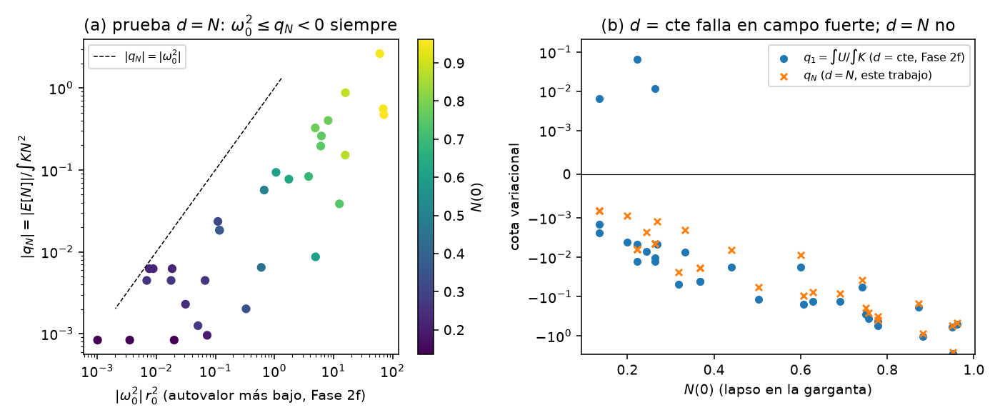
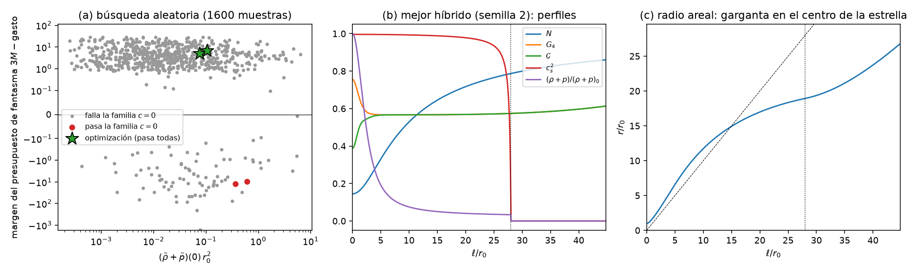
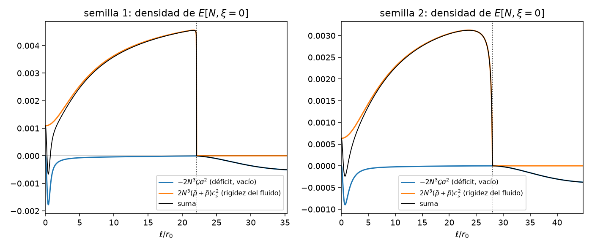

# Híbrido estrella–agujero de gusano — Fase 2g: el monopolo de la GLPV cuártica, con y sin la materia de la estrella

*Documento de trabajo v0.1 · 2026-10-26 · continúa [fase2f/fase2f_resultados.md](../fase2f/fase2f_resultados.md) (§9.1 "campo fuerte" y §9.4 "materia de la estrella")*

## Resumen

1. **La pregunta.** La Fase 2f dejó dos huecos. Por un lado, en campo fuerte ($M\gtrsim r_0$) no había teorema, solo numérica. Por otro, faltaba la pregunta original del proyecto: ¿puede la materia de la estrella estabilizar la garganta? Esta fase responde a la primera de forma completa y a la segunda en sus condiciones necesarias.

2. **Teorema del monopolo, en cualquier régimen** (§2). Usamos una función de prueba nueva: $\delta r=N\,\varepsilon$ (el lapso), sin tocar $g_{\ell\ell}$ ni el escalar.
   - Cumple la ligadura de momento porque $\alpha_0=-\Phi'\alpha_1$, una identidad exacta de la Fase 2f.
   - Su energía no contiene ninguna función libre de la teoría. Punto a punto y sin derivadas totales:
     $$-L_{\rm rest}(c=0,\,d=Nf)\big|_{\rm est}=-2N^3\mathcal G\,(f'-\sigma f)^2,\qquad \sigma\equiv\frac{r'}{r}-\Phi'=\Big(\ln\frac rN\Big)' .$$
   - Con $f=1$:
     $$\boxed{E[N]=\int\big(PN'^2+UN^2\big)\,d\ell=-2\int N^3\mathcal G\Big[\Big(\ln\frac rN\Big)'\Big]^2 d\ell<0}$$
     siempre que $\mathcal G>0$, que es justo la condición de que el sector impar no tenga fantasmas.
   - **Consecuencia.** Toda garganta estática de la GLPV cuártica, con cualesquiera $G_2,G_3,G_4,F_4$ y cualquier masa, que tenga el sector impar sin fantasmas y el monopolo bien planteado ($K,P>0$), tiene un taquión en el monopolo:
     $$\omega_0^2\le E[N]\Big/\!\int KN^2 .$$
     Esto cierra la GLPV cuártica de vacío para gargantas estáticas, también en campo fuerte.
   - **Comprobaciones.** Simbólica: identidad exacta fuera de la capa de masas. Numérica: 32 gargantas reconstruidas en la Fase 2f; la cota se cumple en todas, incluidas las 3 de campo fuerte superlumínicas donde la prueba $d=$ cte de la Fase 2f no detectaba nada.
   - Mironov–Volkova ([arXiv:2404.06297](https://arxiv.org/abs/2404.06297)) no analizan el monopolo: suponen que "no suele dar condiciones adicionales". Es justo el sector que lo prohíbe.

3. **Fluido perfecto en el sector $l=0$** (§3). Representamos el fluido como un campo con lagrangiana $P(Y)$, con $p=P/16\pi$ y $\rho=(2YP_Y-P)/16\pi$; el equilibrio hidrostático sale solo.
   - Comprobaciones: el límite de RG da las ecuaciones de Tolman–Oppenheimer–Volkoff, y los modos gauge son exactos.
   - **Estructura exacta en el gauge unitario y comóvil:**
     $$L_2=-(N^2a'+\dot\beta)W+\kappa_a a^2+aM-\kappa_\beta\beta^2+L_{\rm rest}(c,d),$$
     con $\kappa_\beta=r^2(\tilde\rho+\tilde p)/2N$, $\kappa_a=Nr^2(\tilde\rho+\tilde p)/2c_s^2$, $M=-N(\tilde\rho+\tilde p)(r^2c+2rd)$, y la misma $W$ que en el vacío.
   - La ligadura de momento pasa a ser $W=-(r^2/N)(\tilde\rho+\tilde p)\,\xi$, con $\xi$ el desplazamiento del fluido. El monopolo queda como un sistema de dos campos, $(\xi,d)$.

4. **El híbrido solar no se salva** (§4). La misma prueba, con el fluido quieto, da
   $$E[N,\xi=0]=-2\int N^3\big[\mathcal G\sigma^2-16\pi\,\Gamma_1p\big]\,d\ell .$$
   - En el Sol, $16\pi\Gamma_1p\,r_0^2\sim10^{-20}$ (si $r_0=1$ km) a $10^{-8}$ (si $r_0=R_\odot$).
   - Por tanto el taquión de la Fase 2f, con tiempo de crecimiento de milisegundos, sobrevive a la materia. **La GLPV cuártica no da un híbrido solar estable.**

5. **Condiciones necesarias para un híbrido denso, sin funciones libres** (§5). Moviendo el fluido para que $\delta g_{\ell\ell}=0$ ($c=0$) se obtiene una familia de pruebas cuya energía y energía cinética solo dependen de $N$, $r$, $\mathcal G$, $G_4$ y el fluido. Añadimos:
   - el **presupuesto de fantasma**: con fluido, $\int_0^\infty N^2K=6M-16\pi\!\int N r^2(\rho+p)\,d\ell$, y la ausencia de fantasmas exige una $K$ mínima dentro de la estrella (una ecuación de Riccati);
   - el **sector impar**: con fluido conserva la forma del vacío (los términos del fluido se cancelan exactamente con los de las ecuaciones del fondo).

6. **Criba y optimización** (§6).
   - **Búsqueda aleatoria:** de 1600 muestras (1099 fondos válidos), ninguna cumple todas las condiciones a la vez.
   - **Optimización** (evolución diferencial): encuentra configuraciones que cumplen **todas** las condiciones necesarias, con márgenes del 18–20 %, convergidos en la malla, y con el sector impar ($l=2,3$) estable y no superlumínico.
   - **Qué tienen en común:**
     - campo fuerte ($N(0)\approx0.15$–0.19, $M\approx4.6$–6.8 $r_0$);
     - una estrella grande y muy rígida ($c_s^2\simeq1$, $p\approx0.9\rho$ en el centro, radio areal 15–19 $r_0$);
     - el acoplo $G_4$ reducido a ~0.5–0.75 en el núcleo, posible gracias a una simetría de escala de T1 (§5.4).
   - **Escala física:** con $r_0=1$ km, $\rho_c\approx1\times10^{15}$ g/cm³, radio de 15–19 km y $M\approx3$–4.6 $M_\odot$. Es decir, una estrella de neutrones extremadamente rígida con una garganta de 1 km en el centro.
   - **Es la primera vía del proyecto que las condiciones necesarias no cierran.** Que sea estable de verdad requiere el análisis suficiente, que queda pendiente (§8).

7. **Carga eléctrica: "carga sin carga" de Wheeler** (§7). Un campo radial que atraviesa la garganta no añade grados de libertad en $l=0$, y la estructura del monopolo es exactamente la del vacío. Su presión entra con signo favorable:
   $$E[N]=\int\big[-2N^3\mathcal G\sigma^2+8Q^2N^3/r^4\big]\,d\ell .$$
   - **El problema.** En una garganta simétrica el coeficiente $e_0$ de la ecuación de $c$ vale $4q^2N_0/r_0^3\neq0$ en la garganta. Esa ecuación obliga entonces a $\delta r(0)=0$, y el problema reducido tiene una caída al centro, $U\simeq-C/\ell^2$ con $C/P(0)=7.5$–19.
   - Además, la carga que anularía el taquión ($q^2\approx1$) está al borde de la máxima que deja existir la garganta ($q^2\approx1.3$).
   - **Conclusión:** vía abierta, pero con una obstrucción local en la garganta.

8. **Correcciones a la Fase 2f** (§2.4).
   - En el vacío, el sector impar del monopolo **no tiene modos regulares**. La ligadura en la garganta da $W(0)=\alpha_1(0)\Psi'(0)=0$, y como la ecuación reducida es regular allí, eso fuerza $\Psi\equiv0$. El taquión impar lento ($-0.0087$) correspondía a $\delta g_{\ell\ell}\propto1/\ell$ en la garganta: no es físico. Los pares, incluido el rápido, no cambian.
   - 2 de las 19 configuraciones "válidas" de la búsqueda aleatoria eran casi singulares: con una malla más fina tienen $P<0$ o $K<0$.

---

## 1. Planteamiento

En la Fase 2f la acción reducida del monopolo en el gauge unitario ($\delta\phi=0$) quedó en la forma
$$L_2=-F\,W+L_{\rm rest}(c,d),\qquad F=N^2a'+\dot\beta,\qquad W=\gamma c+\alpha_1d'+\alpha_0d,\qquad \alpha_0=-\Phi'\alpha_1 ,$$
con $L_{\rm rest}=L_2(a=\beta=0)$, $d=\delta r$ y $c=\delta g_{\ell\ell}/2$. Al eliminar $c$ con $W=0$ se llega a $S_{\rm red}=\int[K\dot d^2-Pd'^2-Ud^2]$.
- La prueba $d=$ cte daba $\int U=-2\int N\mathcal Gr'^2/r^2+(\text{términos}\propto\Phi')$. En campo débil eso basta para un taquión, pero en campo fuerte los términos en $\Phi'$ pueden ganar.
- Aquí buscamos una prueba que no pase por esos términos y estudiamos qué cambia cuando la garganta está dentro de la estrella o la atraviesa un campo eléctrico.

## 2. Teorema del monopolo (vacío)

### 2.1 La prueba $d=N$

Como $\alpha_0=-\Phi'\alpha_1$, la ligadura se escribe $W=\gamma c+\alpha_1N(d/N)'$. Para $d=Nf$ con $f$ constante:
- se cumple con $c=0$, sin tocar $g_{\ell\ell}$ ni el escalar ($a$ y $\beta$ solo entran a través del multiplicador $F$);
- la energía estática de la prueba es la parte de $L_{\rm rest}$ que solo contiene $d$, cuyos coeficientes (T3 de la Fase 2f) dependen únicamente de $\mathcal G$:
  $$L_d=k_d\dot d^2-\tilde p\,d'^2-\tilde u\,d^2-\tilde m\,dd',\qquad \tilde p=-2N\mathcal G,\quad \tilde m=\frac{4Nr'\mathcal G}{r},\quad k_d=-\frac{2G_4}N .$$

**Identidad** (`familia_c0.py`, exacta fuera de la capa de masas):
$$-L_{\rm rest}(c=0,\,d=Nf)\big|_{\rm est}=-2N^3\mathcal G\,(f'-\sigma f)^2 .$$
Con $f=1$ la densidad de energía es $-2N^3\mathcal G\sigma^2$ punto a punto: la derivada total que aparecería en la forma de Sturm–Liouville ($\tilde mN^2/2-2N^3r'\mathcal G/r$) es idénticamente cero (`teorema_N.py`).

### 2.2 Enunciado

**Hipótesis:**
- fondo estático y esférico, con $\phi'\neq0$ (gauge unitario regular);
- coeficientes $K,P,U$ regulares;
- $r\to\infty$ en los dos extremos.

**Conclusión.** Si $\mathcal G>0$, $K>0$ y $P>0$, el monopolo tiene un autovalor negativo:
$$\omega_0^2\le\frac{-2\int N^3\mathcal G\,\sigma^2\,d\ell}{\int KN^2\,d\ell}<0 .$$
- **Por qué $\mathcal G>0$ no es una hipótesis extra.** En el sector impar $K_o\propto\mathcal G$ (T4 de la Fase 2f), así que $\mathcal G<0$ en algún punto es un fantasma impar. Por tanto:
  > **En la GLPV cuártica ninguna garganta estática con los dos sectores sin fantasmas ni inestabilidades de gradiente es estable.**
- **Normalización.** Si $KN^2$ no fuera integrable, una función de corte lejana $d=N\chi_R$ da la misma conclusión. Los términos cruzados que introduce el corte se anulan a primer orden lejos de la garganta: $-4/r+2/r+2/r=0$.
- **Interpretación.** $\sigma=(\ln r/N)'$ es el gradiente del radio óptico. La garganta baja su energía reescalando el radio areal proporcionalmente al lapso, y solo una región con $r/N$ constante no lo haría. Una garganta asintóticamente plana necesita que $r/N$ crezca, así que el déficit no se puede anular.

### 2.3 Comprobación numérica (`verificar_N.py`, `verificar_N_log.txt`)

Sobre las 32 gargantas de la Fase 2f bien planteadas: la de referencia, la sucesión de campo débil, las 9 vías de escape y 17 de las 19 de la búsqueda aleatoria (las otras dos, ver §2.4):

| | Resultado |
|---|---|
| $\int(PN'^2+UN^2)$ frente a $-2\int N^3\mathcal G\sigma^2$ (más el borde en $L=3000$) | $\le2.3\times10^{-4}$ |
| $q_N=E[N]/\int KN^2<0$ | 32 de 32 |
| $\omega_0^2\le q_N$ ($\omega_0^2$ de la Fase 2f) | 32 de 32 |
| $q_1=\int U/\int K>0$ (la prueba $d=$ cte no prueba nada) | 3: $M=3,4,8$ con $c^2=30$ ($q_1=+0.064,+0.012,+0.0065$; $q_N=-0.0062,-0.0045,-0.00084$) |

### 2.4 Dos correcciones a la Fase 2f

1. **Sector impar del monopolo en el vacío.**
   - En cualquier gauge, la ligadura de momento es $W=\gamma c+\alpha_1(d'-\Phi'd)+\kappa_1q'+\kappa_0q$. La invariancia gauge fija $\kappa_1=-(\gamma+\alpha_1r')/\phi'$ y $\kappa_0=-[\alpha_1(r''-\Phi'r')+\kappa_1\phi'']/\phi'$.
   - En la garganta ($\gamma=r'=\Phi'=\phi''=0$) queda $W(0)=\alpha_1(0)\big[d'(0)-r''(0)q(0)/\phi'(0)\big]=\alpha_1(0)\Psi'(0)$. Como las ecuaciones de $a$ y $\beta$ dan $W\equiv0$, toda perturbación regular tiene $\Psi'(0)=0$.
   - Si además es impar ($\Psi(0)=0$) y la ecuación reducida es regular en $\ell=0$ (lo es: $K,P,U$ finitos), entonces $\Psi\equiv0$.
   - Las soluciones impares con $\Psi'(0)\neq0$ de la Fase 2f tienen $c\simeq-\alpha_1\Psi'(0)/(\gamma'(0)\ell)$ en el gauge unitario (o $\delta\phi\propto\ln\ell$ en el gauge $c=0$). No son perturbaciones regulares, y el taquión impar lento ($-0.00866$ en la referencia) no es físico.
   - El sector par, que contiene el taquión rápido y el teorema de §2.2, no cambia. Con fluido el sector impar sí tiene modos regulares: el fluido que atraviesa la garganta lleva $W(0)$.
2. **Dos configuraciones mal clasificadas.** Las configuraciones 1 y 13 de la búsqueda aleatoria de la Fase 2f tienen coeficientes casi singulares (picos de $K\sim10^4$ y $P\sim10^8$). Con una malla más fina aparecen $P<0$ (en $\ell\approx0.43$) y $K<0$ (en $\ell\approx3.5$): no estaban bien planteadas.

## 3. El fluido perfecto en el sector $l=0$

**Representación** (`generar_fluido.py`). Un fluido barótropo e irrotacional (en $l=0$ lo es siempre) equivale a un campo $\chi$ con lagrangiana $P(Y)$, $Y=-\tfrac12(\partial\chi)^2$:
$$S=\frac1{16\pi}\int\sqrt{-g}\,\big[L_{\rm GLPV}+P(Y)\big],\qquad \tilde p=P=16\pi p,\quad \tilde\rho=2YP_Y-P=16\pi\rho,\quad c_s^2=\frac{P_Y}{P_Y+2YP_{YY}} .$$
- El fondo es $\chi=t$, con $Y_b=1/2N^2$: $p$ y $\rho$ son funciones del lapso, como en la relación de Tolman.
- La ecuación de $\chi$ se cumple sola, y con ella el equilibrio hidrostático $p'=-(\rho+p)\Phi'$.
- La parte GLPV (ecuaciones del fondo y acción cuadrática de la Fase 2f, válidas fuera de la capa de masas) se suma a la del fluido, que es algebraica en la métrica.

| Comprobación | Resultado |
|---|---|
| Identidad de Noether del fondo para el fluido solo | idénticamente nula (equilibrio hidrostático incluido) |
| Límite de RG: $E_B=-Nr^2\,[G^\ell{}_\ell-\tilde p/2]$, $E_A=-(r^2/N)[G^t{}_t+\tilde\rho/2]$ | Tolman–Oppenheimer–Volkoff |
| Modos gauge $\zeta$, $\tau$ con fluido ($x=\tau$), 6 ecuaciones lineales, 2 chorros en la capa de masas | exactos |

**Estructura** (`reduccion_fluido.py`; ecuaciones de Euler–Lagrange idénticas en 3 chorros exactos con fluido). Gauges unitario ($q=0$) y comóvil ($x=\delta\chi=0$):
$$L_2=-(N^2a'+\dot\beta)W+\kappa_aa^2+aM-\kappa_\beta\beta^2+L_{\rm rest}(c,d),$$
$$\kappa_\beta=\frac{r^2(\tilde\rho+\tilde p)}{2N},\qquad \kappa_a=\frac{Nr^2(\tilde\rho+\tilde p)}{2c_s^2},\qquad M=-N(\tilde\rho+\tilde p)(r^2c+2rd).$$
- $W$ es la misma combinación que en el vacío.
- La ecuación de $\beta$ da $\beta=\dot W/2\kappa_\beta$. Con $\dot\xi=-\beta$ (desplazamiento del fluido), $W=-(r^2/N)(\tilde\rho+\tilde p)\xi$.
- La de $a$ da $a=-[(N^2W)'+M]/2\kappa_a$.

Acción reducida en $(\xi,d)$:
$$L_{\rm red}=\kappa_\beta\dot\xi^2-\frac{Q^2}{4\kappa_a}+L_{\rm rest}(c_*,d),\qquad Q=(N^2W)'+M,\qquad c_*=\frac{W-\alpha_1d'-\alpha_0d}\gamma .$$
- La ecuación de $c$ en $L_{\rm rest}$ es $k_cc+e_0d+e_1d'+e_{tt}\ddot d$, sin derivadas de $c$ (`coeficientes_fluido.py`).
- El fluido añade $-\tilde pNr^2$ a $k_c$ y $2\tilde pNr$ a $e_0$.

## 4. La prueba $d=N$ con fluido y el híbrido solar

Con $\xi=0$ y $c=0$ ($W=0$) la prueba es la misma que en el vacío. El fluido no aporta términos en $d^2$, y $Q=M=-2N^2r(\tilde\rho+\tilde p)$ (comprobado simbólicamente):
$$E[N,\xi=0]=-2\int N^3\big[\mathcal G\sigma^2-(\tilde\rho+\tilde p)c_s^2\big]\,d\ell=-2\int N^3\big[\mathcal G\sigma^2-16\pi\Gamma_1p\big]\,d\ell .$$
- La energía cinética de esta prueba es la del vacío, $\int KN^2$, porque el fluido no se mueve.
- **Sol.** En el centro, $p\approx2.5\times10^{16}$ Pa ($Gp/c^4\approx2\times10^{-32}$ cm$^{-2}$), así que:
  - con $r_0=1$ km, $16\pi\Gamma_1p\,r_0^2\approx2\times10^{-20}$;
  - con $r_0=R_\odot$, $\approx9\times10^{-9}$.

  El déficit, $\sim1/r_0$, gana por muchos órdenes de magnitud. Sigue en pie el taquión de campo débil de la Fase 2f, con tiempo de crecimiento $\sim\sqrt{Mr_0}/c$ (milisegundos).

## 5. Condiciones necesarias sin funciones libres (híbridos densos)

### 5.1 La familia $c=0$

Para $d=Nh$ y $c=0$ basta mover el fluido con $\xi=4N\mathcal G h'/[r(\tilde\rho+\tilde p)]$, de modo que $W=\alpha_1Nh'=-4r\mathcal Gh'$. Entonces:
$$T[h]=\int\Big[\frac{8N\mathcal G^2\dot h'^2}{\tilde\rho+\tilde p}-2G_4N\dot h^2\Big],\qquad
E[h]=\int\Big[\frac{c_s^2Q_h^2}{2Nr^2(\tilde\rho+\tilde p)}-2N^3\mathcal G(h'-\sigma h)^2\Big],$$
$$Q_h=(4N^2r\mathcal Gh')'+2N^2r(\tilde\rho+\tilde p)h .$$
- Fuera de la estrella $h=$ cte, y la región exterior aporta $E_{\rm out}=-2\int_{\ell_s}^\infty N^3\mathcal G\sigma^2$.
- **Ninguna función libre** ($G_2$, $G_3$, $F_{4X}$, $G_{2XX}$...) aparece. Como es un subespacio de pruebas, $E[h]<0$ con $T>0$ implica un taquión, y $T<0$ implica un fantasma, sean cuales sean las funciones libres.
- Con $k_c$ ($G_{2XX}$) muy negativo dentro de la estrella, las direcciones $c\neq0$ se vuelven muy rígidas y el problema completo tiende al de la familia. Las condiciones son, por tanto, casi suficientes para la parte estática.

### 5.2 Presupuesto de fantasma

La energía cinética completa, en las velocidades $(\dot h,\dot y)$ con $y=\gamma c$, es
$$T=\int\Big[\frac{(\alpha_1N\dot h'+\dot y)^2}{4\kappa_\beta}-2G_4N\dot h^2-e_{tt}\frac N\gamma\,\dot y\dot h\Big].$$
- Minimizando punto a punto en $\dot y$: $T\ge0\iff N^2K\ge N(\tilde\rho+\tilde p)\,\xi^2/2\mathcal G^2$ dentro de la estrella (con $\xi=4r\mathcal G\mathcal H/\Gamma$), y $K\ge0$ fuera.
- Con $Z=N\xi$ y $N^2K=2[Z'-NG_4]$ (T2) la condición es
  $$Z'\ge NG_4+\frac{(\tilde\rho+\tilde p)Z^2}{4N\mathcal G^2},\qquad Z(0)=0 .$$
  Es la misma ecuación de Riccati que el problema de Sturm de $T[h]$, con $R=-2Z$.
- T1 con materia es $[Nr\mathcal G(r'-r\Phi')]'=NG_4-\tfrac12Nr^2(\tilde\rho+\tilde p)$, y da $N^2K/2=\mathcal W'-\tfrac12Nr^2(\tilde\rho+\tilde p)$. Como $\mathcal W(\infty)=3M$:
  $$\int_0^\infty N^2K\,d\ell=6M-\int_0^\infty Nr^2(\tilde\rho+\tilde p)\,d\ell,\qquad\boxed{3M>\int_0^{\ell_s}\Big[\frac{(\tilde\rho+\tilde p)Z_*^2}{4N\mathcal G^2}+\frac{Nr^2(\tilde\rho+\tilde p)}2\Big]d\ell}$$
  con $Z_*$ la solución de la igualdad. La materia consume presupuesto de $K$, y lo hace con el volumen propio: una estrella "profunda" ($r'\ll1$) lo agota.
- **Matiz.** Es necesaria pero no suficiente: la cola lejana natural de $K$ también consume presupuesto (§8).

### 5.3 Sector impar (`impar_fluido.py`)

El fluido irrotacional no tiene grados de libertad impares. Su acción en $(h_0,h_1)$ es exactamente $N_l[-\tilde\rho h_0^2/N-N\tilde ph_1^2]$, y cancela los términos $2E_A$ y $-2E_B$ de la parte gravitatoria (T4 en la capa de masas con fluido). El sector impar queda como en el vacío:
$$\alpha=\frac{N_l\mathcal G}N,\qquad\beta=\frac{N_l\lambda_lG_4}{Nr^2},\qquad\gamma=-\frac{N_l\lambda_lN\mathcal G}{r^2} .$$
Tampoco tiene funciones libres; contamos sus taquiones con la oscilación de Sturm (`criba.impar`).

### 5.4 Una simetría de escala

T1 con materia es homogénea en $(\mathcal G,G_4,\tilde\rho+\tilde p)$:
- multiplicar los tres por $\lambda$ en una región deja la geometría igual y conserva el signo de $E[h]$ y de $T[h]$;
- en cambio, el gasto del presupuesto de fantasma escala con $\lambda$.

Por eso reducir el acoplo $G_4$ (y $\mathcal G$) en el núcleo, $G_4=S(x)G_{4b}(x)$ con $S=\lambda$ cerca de la garganta y $\to1$ fuera, abre sitio. La forma de $S$ conserva el cero doble de $\mathcal H$ en la garganta, porque $S''(0)=0$.

## 6. Criba y optimización

**Familia de fondos** (`criba.py`):
- lapso $\Phi=-M/\sqrt{\ell^2+a^2}$;
- escalar con $x=[b^2/(\ell^2+b^2)]^2$;
- $G_4=S(x)[1+x^n/(2n-1)]$ y $\mathcal G=S(x)[1-x^n+d_0e^{-\ell^2/w_d^2}]$;
- fluido $P=A(Y-Y_s)^m$ (estrella donde $N<N_s$; $m=1$ es el fluido rígido $c_s=1$);
- $r$ de T1 con materia.

Condiciones (normalizadas a márgenes adimensionales, positivos si se cumplen):
- $E[1]\ge0$ (la prueba $d=N$);
- $E[h]\ge0$ y $T[h]\ge0$ en las dos paridades, con elementos finitos de Hermite cúbicos;
- presupuesto de fantasma positivo;
- sector impar $l=2,3$ sin taquiones.

**Búsqueda aleatoria** (`criba_busqueda.py`, 400 + 1200 muestras, 1099 fondos válidos): ninguna configuración cumple todo.
- $E[1]\ge0$ en 46 (4 %), la familia $c=0$ completa en 2 y el presupuesto de fantasma en 861 (78 %).
- **Nunca a la vez.** $E[1]\ge0$ y el presupuesto coinciden en 27 muestras, pero en ellas falla la familia $c=0$ (modos no uniformes). Las 2 que pasan la familia gastan más presupuesto del que hay: la materia que vuelve positiva la energía es la misma que lo consume.

**Optimización** (`criba_optimiza.py`, evolución diferencial, dos semillas, 60 generaciones; `criba_mejores.py`):

| | semilla 1 | semilla 2 |
|---|---|---|
| margen mínimo ($n=120/240/480$ elementos) | $+0.180/+0.180/+0.180$ | $+0.197/+0.197/+0.197$ |
| $E[1]$; $\min E$ (par, impar); $\min T$ (par, impar) | $+0.023$; $(+9\times10^{-4},+9\times10^{-4})$; $(+0.31,+0.63)$ | $+0.022$; $(+5\times10^{-4},+6\times10^{-4})$; $(+0.43,+0.84)$ |
| gasto de fantasma frente a $3M$ | $8.78$ frente a $13.75$ | $13.45$ frente a $20.26$ |
| sector impar $l=2,3$ | sin taquiones, $c^2\le1$ | sin taquiones, $c^2\le1$ |
| $M/r_0$, $N(0)$ | 4.58, 0.193 | 6.75, 0.145 |
| $G_4(0)$, $\mathcal G(0)$ | 0.53, 0.12 | 0.76, 0.39 |
| fluido: $c_s^2$, $p/\rho$ en el centro | 1.00, 0.89 | 1.00, 0.93 |
| $\rho_c\,r_0^2$ ($G=c=1$); radio areal de la estrella | $8.0\times10^{-4}$; $15.3\,r_0$ | $1.07\times10^{-3}$; $18.9\,r_0$ |
| masa de la materia frente a $M$ | 1.9 frente a 4.6 | 3.1 frente a 6.8 |
| con $r_0=1$ km | $\rho_c\approx1.1\times10^{15}$ g/cm³, $M\approx3.1\,M_\odot$ | $\rho_c\approx1.4\times10^{15}$ g/cm³, $M\approx4.6\,M_\odot$ |

- **Cómo se reparte la energía** (Fig. 3). El déficit $-2N^3\mathcal G\sigma^2$ se concentra cerca de la garganta ($\ell\lesssim2$). La rigidez $2N^3(\tilde\rho+\tilde p)c_s^2$ crece hacia fuera con $N^3$ y la aporta todo el volumen de la estrella: la estabilización es global.
- **El acoplo reducido** ($\lambda\approx0.45$–0.57) deja sitio en el presupuesto de fantasma.
- **La masa** de la materia es menor que la ADM: el resto lo aporta el sector escalar de la GLPV.

## 7. La garganta cargada ("carga sin carga")

**Acción** (`generar_em.py`). En simetría esférica el campo de Maxwell no tiene grados de libertad en $l=0$. Tras la ley de Gauss su acción es $L_{\rm em}=-q^2\sqrt{AB+b^2}/C$ ($q^2=2Q^2$; $\tilde\rho=-\tilde p_r=\tilde p_t=q^2/r^4$).
- La identidad de Noether y los modos gauge son exactos.
- En el monopolo (`estructura_em.py`), la ecuación de $a$ es **exactamente** $(N^2W)'$, sin términos algebraicos en $a$ ni en $\beta$. La estructura es la del vacío, con la misma ligadura $W=0$.
- La carga solo cambia $k_c\to k_c+q^2N/r^2$, $e_0\to e_0+2q^2N/r^3$ y $u_d\to u_d+4q^2N/r^4$.
- La prueba $d=N$ da
  $$E[N]=\int\Big[-2N^3\mathcal G\sigma^2+\frac{4q^2N^3}{r^4}\Big]d\ell :$$
  la presión eléctrica es estabilizadora.

**La obstrucción en la garganta** (`carga_garganta.py`, garganta de referencia de la Fase 2f).
- En una garganta simétrica, $\gamma(0)=\mathcal H(0)=0$, y $k_c(0)=0$ es necesario para que $P$ sea regular. Sin embargo
  $$e_0^{\rm tot}(0)=2N_0r_0S(0)+\frac{2q^2N_0}{r_0^3}=\frac{4q^2N_0}{r_0^3}\neq0 .$$
- La ecuación de $c$ en $\ell=0$ se reduce entonces a $e_0(0)\,d(0)=0$: el radio de la garganta no puede variar. El potencial reducido es singular, con caída al centro:

| $q^2$ | $e_0(0)$ (y $4q^2N_0/r_0^3$) | $\lim U\ell^2$ | $P(0)$ | $E[N]$ (fórmula) |
|---|---|---|---|---|
| 0 | 0 | 0 | 0.471 | $-0.215$ |
| 0.5 | 0.736 (0.736) | $-2.95$ | 0.394 | $-0.124$ |
| 1.0 | 1.472 (1.472) | $-5.29$ | 0.273 | $+0.029$ |
| 1.5, 2.0 | — | — | — | la garganta no existe ($r\to0$) |

- Quitar la singularidad de $U$ exige $k_c(0)=e_0(0)/A_0(0)$, con $A_0(0)=-\Phi''(0)a_1$. Eso da $P\simeq-k_c(0)a_1^2/2\ell^2$, que es positiva solo si $\Phi''(0)<0$, es decir, con un máximo del lapso en la garganta.
- El sector impar con carga acopla $h_0,h_1$ con $\delta A_\varphi$, como en Reissner–Nordström. Las formas se derivaron a mano y no se han calculado.

## 8. Lo que falta para afirmar estabilidad: el análisis suficiente

Las configuraciones de §6 cumplen **condiciones necesarias** que no dependen de las funciones libres. Para afirmar estabilidad lineal falta lo siguiente.
1. **Reconstruir la teoría completa con fluido.** $F_{4X}$ a partir de una $K$ de diseño que cumpla la ecuación de Riccati dentro de la estrella y empalme con la $K$ natural fuera de una ventana; si no, $F_{4X}\propto(Z-Z_{\rm nat})X^{-3}$ diverge en el infinito. Además, $G_{2XX}$ con $k_c\ll0$ dentro de la estrella.
   - **Primer intento** (`completo.py`, borrador): la cola natural de $K$, $\sim2y(\ln\ell)/\ell^2$ con $y\propto M^2\ln^2\ell$ por el lapso sin el término logarítmico de Schwarzschild, también consume presupuesto. Con una ventana moderada no basta.
   - Hace falta un lapso con la asintótica de Schwarzschild en distancia propia ($\Phi\simeq-M/\ell-M^2\ln\ell/\ell^2$) y ventanas grandes.
2. **Espectro completo de dos campos** $(h,c)$ con elementos finitos: dentro de la estrella dos campos, fuera uno ($W=0$). Hay que comprobar $T>0$ y la ausencia de autovalores negativos, y las velocidades de propagación dentro de la estrella.
3. **Sector par $l\ge2$**, que no se ha derivado en ninguna fase.

### Figuras

| | |
|---|---|
|  | **Fig. 1.** (a) La cota de la prueba $d=N$ frente al autovalor más bajo de la Fase 2f en las 32 gargantas: $\omega_0^2\le q_N<0$ siempre (color: lapso en la garganta). (b) La prueba $d=$ cte de la Fase 2f da una cota positiva, es decir, no prueba nada, en tres gargantas de campo fuerte superlumínicas; la prueba $d=N$ sigue siendo negativa. |
|  | **Fig. 2.** (a) Búsqueda aleatoria: presupuesto de fantasma frente a la densidad en la garganta. Las que pasan la familia $c=0$ (rojo) lo tienen negativo. La optimización (estrellas) encuentra configuraciones que cumplen todo. (b) Perfiles de la mejor (semilla 2): lapso, $G_4$ reducido en el núcleo, $\mathcal G$, $c_s^2\simeq1$ y densidad. (c) Radio areal: la garganta en el centro de una estrella de radio areal $\approx19\,r_0$. |
|  | **Fig. 3.** Densidad de energía de la prueba $d=N$ en las dos configuraciones: el déficit del vacío, concentrado cerca de la garganta, y la rigidez del fluido, extendida por toda la estrella. La suma integra a un valor positivo. |

## 9. Consecuencias para el proyecto

1. **La GLPV cuártica de vacío queda cerrada para gargantas estáticas**, en cualquier régimen, por el teorema de §2. Se acaba así la discusión de campo fuerte de la Fase 2f, con una función de prueba que no depende de ninguna función libre.
2. **El híbrido solar queda cerrado.** La materia del Sol es $10^{8}$–$10^{20}$ veces demasiado poco rígida para compensar el déficit de la garganta.
3. **El híbrido denso es la primera vía abierta del proyecto.**
   - Hace falta una estrella de densidad nuclear, con ecuación de estado en el límite causal ($c_s\to1$), campo fuerte y acoplo $G_4$ reducido en el núcleo.
   - En ese régimen se cumplen todas las condiciones necesarias que no dependen de las funciones libres.
   - Es coherente con la idea original del proyecto, una estrella que estabiliza la garganta, pero la estrella es de neutrones y no el Sol.
4. **La carga eléctrica estabiliza la energía de la prueba**, pero en una garganta simétrica choca con una singularidad del problema reducido. Haría falta un lapso con un máximo en la garganta.
5. **Siguiente paso:** el análisis suficiente de §8 sobre las configuraciones de §6.

## 10. Reproducibilidad

```
cd fase2g
python teorema_N.py              # teorema del vacio: identidades exactas (teorema_N_log.txt)
python verificar_N.py            # ~12 min con 8 nucleos: 32 gargantas de la Fase 2f (verificar_N_log.txt)
python familia_c0.py             # -L_rest(0, N f) = -2 N^3 Gcal (f' - sig f)^2
python generar_fluido.py         # fluido P(Y): fondo, accion cuadratica, TOV, modos gauge -> resultados/fluido_simbolico.pkl
python reduccion_fluido.py       # ~2 min: estructura exacta con fluido y prueba d = N
python coeficientes_fluido.py    # k_c, e0, e1, e_tt y ligaduras con fluido -> resultados/coeficientes_fluido.pkl
python impar_fluido.py           # sector impar con fluido: cancelacion exacta
python criba_busqueda.py 400 1   # criba aleatoria (y 1200 2)
python criba_optimiza.py 60 1    # ~20 min con 8 nucleos (y 60 2): optimizacion de los margenes
python criba_mejores.py          # mejores configuraciones: convergencia, sector impar, fisica
python generar_em.py             # campo electrico radial: accion, modos gauge -> resultados/em_simbolico.pkl
python estructura_em.py          # estructura del monopolo con carga
python carga_garganta.py         # la obstruccion en la garganta cargada
python figuras_fase2g.py         # figuras/
```
Módulos: `criba.py` (fondos con fluido, familia $c=0$, presupuesto de fantasma, sector impar), `reconstruccion_carga.py` (garganta cargada sobre la reconstrucción de la Fase 2f), `completo.py` (borrador del análisis suficiente, no validado).
