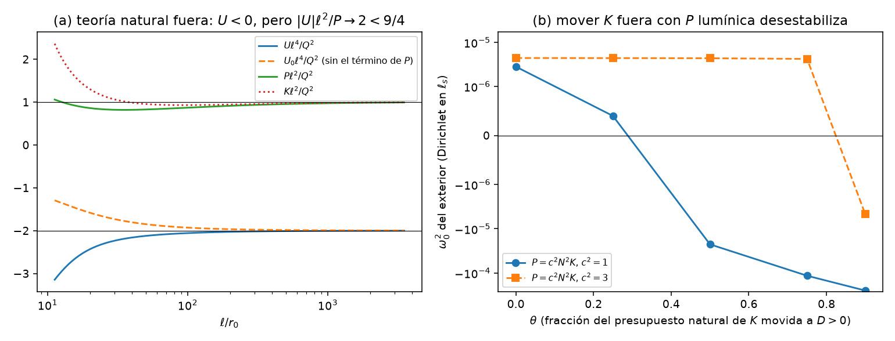
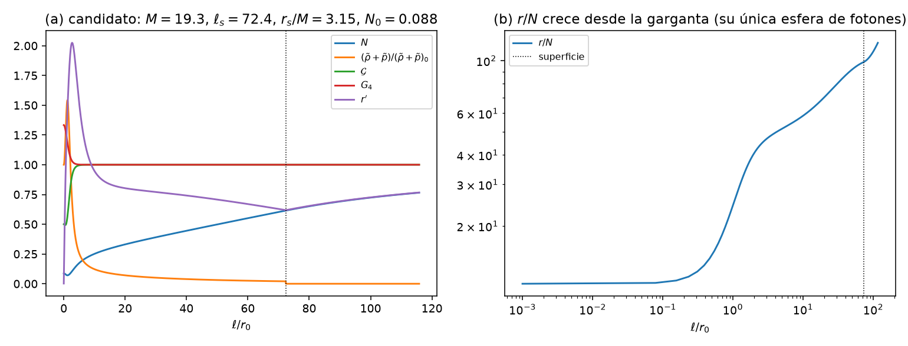
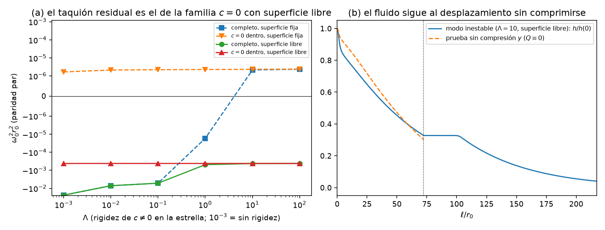
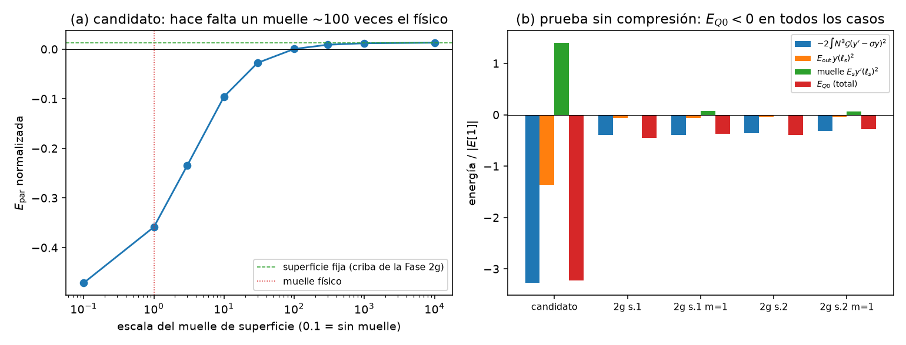
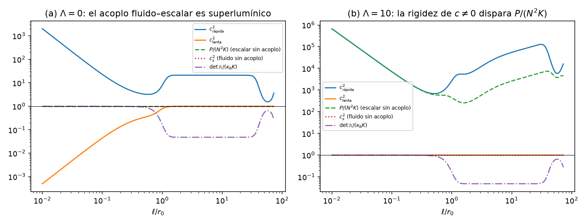

# Híbrido estrella–agujero de gusano — Fase 2h: análisis suficiente del híbrido denso

*Documento de trabajo v0.1 · 2026-10-26 · continúa [fase2g/fase2g_resultados.md](../fase2g/fase2g_resultados.md) (§8, "lo que falta para afirmar estabilidad")*

## Resumen

1. **La pregunta.** La Fase 2g encontró híbridos densos (una garganta en el centro de una estrella muy rígida) que cumplían todas las condiciones necesarias de estabilidad que no dependen de las funciones libres de la teoría. Faltaba el análisis suficiente: reconstruir la teoría completa, diseñar la parte libre ($K$ y $P$) y calcular el espectro completo del monopolo, con los dos campos acoplados (fluido y escalar–métrica). Esta fase lo hace y llega a una conclusión negativa por dos vías independientes.

2. **Herramientas** (§2), todas validadas:
   - zona lejana canónica (`fondo.py`), reconstrucción con fluido (`teoria.py`, `teoria_nu.py`), ecuaciones del fondo $\lesssim10^{-13}$ y $K$ de T2 igual a la de diseño a $10^{-11}$;
   - espectro completo de dos campos con elementos finitos de Hermite (`espectro2.py`), que reproduce los autovalores de Sturm–Liouville de la Fase 2f, con superficie del fluido fija o libre.

3. **El exterior de la estrella** (§3). En la región sin fluido,
   $$U=U_{\rm nat}(P)+\frac{2}{r^2}\big(2\sigma D-D'\big),\qquad K=K_{\rm nat}+\frac{2D'}{N^2},\qquad \sigma=\Big(\ln\frac rN\Big)' ,$$
   con $D=Z-Z_{\rm nat}$ la desviación de la $K$ de diseño respecto de la natural; $P$ solo entra como derivada total $(N\Phi'P)'/N$, que la transformación $d=Ng$ elimina.
   - **$U\ge0$ no es el criterio adecuado.** Lejos, la teoría natural es un escalar sin masa: $U\ell^4\to-2Q^2$ y $P\ell^2\to Q^2$. Es estable porque $2<9/4$ (Hardy), aunque $U<0$ en todo el exterior muestreado.
   - **El exterior natural es estable** (Dirichlet en la superficie).
   - **Mover presupuesto de $K$ fuera lo desestabiliza** si $P$ es lumínica: $D>0$ sube $U$, pero baja $K$ y con ella $P=N^2K$. Con $\theta=0.5$, $\omega_0^2=-2.3\times10^{-5}$; con $\theta=0.9$, $-2.5\times10^{-4}$.
   - **Conclusión:** el presupuesto de $K$ debe quedarse en el perfil natural, y el diseño dentro de la estrella debe aterrizar en $Z_{\rm nat}$ en la superficie.

4. **Fondos con la violación de la NEC confinada a la garganta** (§4). Con el lapso analítico de la Fase 2g, la superficie de la estrella tiene presión radial efectiva negativa y la planitud exige violar la NEC fuera; ahí $K_{\rm nat}$ tiene polos. La familia nueva (`fondo_nu.py`) prescribe $\nu=\Phi'r'-r''$: una joroba negativa en la garganta, la parte del fluido y una cola canónica $\kappa r\phi'^2/2$, cuya amplitud $\kappa$ se ajusta para eliminar el modo lineal del lapso.
   - Primer fondo de la familia que cumple la criba de la Fase 2g, con la superficie fuera de la esfera de fotones ($r_s/M=3.15$): una estrella de radio propio $\ell_s=72\,r_0$ en un pozo con $N_0=0.088$, $M=19.3\,r_0$.
   - Reconstrucción completa validada, $K>0$ y sin fantasmas con fluido.

5. **El espectro completo tiene taquiones** (§5).
   - Con $k_c$ natural dentro de la estrella: $\omega^2r_0^2\approx-0.024$ en las dos paridades (modos lejos de la garganta).
   - Una rigidez $\Lambda$ de las direcciones $c\neq0$ ($k_c\to k_c-\Lambda Nr^2$ en la estrella) quita los grandes, pero a costa de una propagación escalar enormemente superlumínica dentro de la estrella ($c_\phi^2\sim10^5$ con $\Lambda=10$).
   - Queda uno residual, $\omega^2r_0^2\approx-4\times10^{-4}$, que **no depende de $\Lambda$ ni del diseño exterior**.
   - Ese residual es la familia $c=0$ de la criba con la **superficie del fluido libre**. Con la superficie fija, el espectro es positivo, pero fijarla es una restricción artificial.
   - Con densidad finita en la superficie ($m=1$), $P_{YY}=A\,\delta(Y-Y_s)$ añade un término de superficie positivo (un "muelle"), que incluimos. El taquión persiste. Con una ecuación de estado de superficie suave (sin términos de superficie) aparece igual, $\omega^2r_0^2=-5.84\times10^{-4}$ convergido, para $\Lambda=0$, 10 y 1000.

6. **La criba de la Fase 2g era incompleta: corrección y prueba sin compresión** (§6).
   - La prueba $E$ de la Fase 2g imponía $h'(\ell_s)=0$, es decir, superficie fija.
   - Con la superficie libre, hay una función de prueba explícita: el desplazamiento **sin compresión** $y$, con $Q\equiv0$ en la estrella. Su energía no tiene término del fluido:
     $$E_{Q0}=-2\int_0^{\ell_s}N^3\mathcal G\,(y'-\sigma y)^2\,d\ell\;+\;E_{\rm out}\,y(\ell_s)^2\;+\;E_s\,y'(\ell_s)^2 ,$$
     y los dos primeros términos son negativos. Solo el muelle de superficie $E_s$ ($m=1$) es positivo.
   - **Resultado:** $E_{Q0}<0$ en el candidato y en las dos semillas de la Fase 2g, aunque $E[1]>0$ en todas. El fluido solo estabiliza mediante la compresión; con la superficie libre puede seguir el desplazamiento sin comprimirse.
   - **Optimización** (§6.3): en unos 3200 fondos, el mejor margen con la superficie libre es $-0.22$, y ese fondo falla también con la superficie fija ($E[1]<0$). Una estrella densa paga el déficit comprimiéndose, pero su muelle de superficie es débil; una diluida tiene el muelle fuerte, pero no compresión suficiente.
   - **Teorema (superficie blanda, $P=A(Y-Y_s)^m$ con $1<m<2$):** toda garganta estática de la GLPV cuártica con $\mathcal G>0$ en el centro de una estrella así tiene un taquión en el monopolo, con cualesquiera funciones libres sin fantasmas. Es la extensión del teorema del vacío de la Fase 2g a estrellas de fluido.
   - Como la familia $c=0$ no contiene funciones libres, esto vale para cualquier teoría sin fantasmas sobre esos fondos: **los híbridos de la Fase 2g son inestables.**

7. **Velocidades características** (§7). En el fluido, el acoplo entre el modo del fluido y el del escalar da dos velocidades. Por el cociente de Rayleigh, la rápida cumple
   $$c_+^2\ \ge\ \max\Big(c_s^2,\ c_\phi^2+c_s^2\,\frac{\mathcal G^2}{\mathcal H^2}\,\frac{K_{\rm min}}{K}\Big),$$
   con $c_\phi^2=P/(N^2K)$ la del escalar y $K_{\rm min}$ la cota de fantasmas.
   - Lejos de la garganta ($\mathcal H\simeq\mathcal G$), con $K$ cerca de la cota (que es donde cabe el presupuesto), el modo rápido es superlumínico: $c_+^2\ge1.5$ en toda la estrella del candidato con $c_\phi^2=1$, y $\ge1$ con cualquier diseño si el fluido es rígido ($c_s=1$).
   - En la garganta $\mathcal H$ tiene un cero doble y la cota diverge, $c_+^2\propto(\tilde\rho+\tilde p)/\ell^2$. Es el cruce de $\gamma$ de la Fase 2f, que el fluido no deja regularizar.
   - Si el lapso es mínimo en la garganta, la ley de Tolman pone ahí la máxima densidad de cualquier fluido barotrópico. En general, basta que haya fluido en la garganta.

8. **Conclusión** (§8). El híbrido denso con un fluido perfecto barotrópico queda descartado en esta clase de teorías, por dos obstrucciones independientes de las funciones libres:
   - el desplazamiento sin compresión: teorema para superficies blandas; con salto de densidad, en todos los fondos estudiados y en la optimización;
   - la velocidad no acotada en la garganta.
   
   Ambas dicen lo mismo: un fluido que puede fluir no se opone al taquión universal del vacío (Fase 2g §2). El siguiente paso es materia con **rigidez de cizalla** (un sólido elástico), en una **cáscara** que deje la garganta vacía.

---

## 1. Punto de partida

La Fase 2g dejó tres configuraciones (dos semillas de optimización y el candidato de su §6) que cumplían, con márgenes del 18–20 %:
- la familia $c=0$ (energía $E\ge0$ y energía cinética $T\ge0$ con la superficie de la estrella fija);
- el presupuesto de fantasma ($3M>$ gasto);
- el sector impar ($l=2,3$) estable y subluminal.

Para afirmar estabilidad faltaba diseñar las funciones libres ($F_{4X}$ vía $K$, $G_{2XX}$ vía $P$) y calcular el espectro completo. El primer intento de esta fase (nota de estado del 2026-10-26, sustituida por este informe) dio taquiones grandes fuera de la estrella. Este informe explica su origen, lo corrige, y encuentra la obstrucción de fondo.

## 2. Herramientas

| módulo | qué hace | validación |
|---|---|---|
| `fondo.py` | zona lejana canónica sobre el lapso de la Fase 2g ($\nu$ mezclado, disparo en $\beta_\nu$) | semilla 2: $M_{\rm ADM}=m_{MS}=5.357$, criba mantenida |
| `teoria.py`, `teoria_nu.py` | chorros del fondo, teoría a lo largo de $X_b(\phi)$, diseño de $Z$ y $k_c$ | ecuaciones del fondo $\lesssim10^{-13}$; $K$(T2)/$K$(diseño)$-1\lesssim10^{-11}$ |
| `espectro2.py` | elementos finitos de Hermite: $(h,c)$ en el fluido, $h$ fuera con $W=0$ | Fase 2f: $-0.1174968$, $-0.0048524$ frente a $-0.11750$, $-0.00485$ |
| `velocidades.py` | símbolo principal del sistema fluido–escalar | límite sin acoplo: $c_s^2$ y $P/(N^2K)$; $\det\mathbb K=0$ en la cota de fantasmas (exacto) |
| `fondo_nu.py` | fondos definidos por $\nu=\Phi'r'-r''$ (§4) | planitud, $M_K\simeq m_{MS}$, convergencia en $\kappa$ |

**Superficie libre** (`espectro2.ensamblar(libre=True)`). Si la densidad salta en la superficie ($m=1$), el desplazamiento del fluido allí, $\xi(\ell_s)$, no tiene por qué anularse.
- $W(\ell_s^-)=-2\kappa_\beta\xi(\ell_s)$ puede ser distinta de cero, mientras que fuera $W=0$; $c$ y $h'$ pueden saltar en $\ell_s$.
- La ecuación del lapso, $(N^2W)'+M=-2\kappa_aa$, lo permite porque $P_{YY}=A\,\delta(Y-Y_s)$ da a $\kappa_a$ un término $C_s\,\delta(\ell-\ell_s)$, con $C_s=Nr^2(\tilde\rho+\tilde p)/(2\Phi')$.
- Al eliminar el lapso queda una energía de superficie positiva, el **muelle**:
  $$E_{\rm sup}=\frac{N^4\,W(\ell_s^-)^2}{4C_s}=\frac{N^3\Phi'}{2r^2(\tilde\rho+\tilde p)}\,W(\ell_s^-)^2 .$$
- Con superficie fija se impone $W(\ell_s)=0$, como en la Fase 2g.
- **Comprobación independiente del muelle.** Con la ecuación de estado exponencial $P=Az\,e^{-k_s/z}$ no hay términos de superficie, y la envoltura blanda queda resuelta por la malla. Al reducir $k_s$, la envoltura ($c_s^2<0.5$) se estrecha y el autovalor de la familia $c=0$ del candidato ($\Lambda=10$) tiende al de $m=1$ con muelle, $-4.17\times10^{-4}$, no al de sin muelle, $-5.33\times10^{-4}$:

  | $k_s$ | anchura de la envoltura | $\omega_0^2r_0^2$ ($n_{\rm in}=400$ / 800) |
  |---|---|---|
  | 0.005 | ~50 | $-5.87\times10^{-4}$ |
  | 0.002 | 21 | $-4.939\times10^{-4}$ / $-4.939\times10^{-4}$ |
  | 0.0005 | 8.9 | $-4.391\times10^{-4}$ / $-4.391\times10^{-4}$ |
  | 0.0002 | 5.0 | $-4.260\times10^{-4}$ / $-4.263\times10^{-4}$ |

## 3. El exterior

### 3.1 Descomposición de $U$

En la región sin fluido ($\Gamma_2=0$, $G_3=0$), las identidades T3 de la Fase 2f dan $A_1e_1=4N\mathcal G(1+r\Phi'/r')$ y $A_1e_0=-4N\mathcal G(r'/r+\Phi')+4Z/r^2$, con $Z=N\xi$. De ahí
$$U=U_{\rm fondo}-\frac{2}{N^2}\Big(\frac{N^2Z}{r^2}\Big)'+\frac1N\big(N\Phi'P\big)' ,$$
donde $U_{\rm fondo}$ solo depende de $N$, $r$ y $\mathcal G$ (`diseno_U.py`; las dos identidades se cumplen a $10^{-15}$).

**Consecuencias.**
- Con $Z=Z_{\rm nat}+D$ (con $Z_{\rm nat}$, $F_{4X}=0$):
  $$U=U_{\rm nat}(P)+\frac2{r^2}\big(2\sigma D-D'\big),\qquad K=K_{\rm nat}+\frac{2D'}{N^2}.$$
- Con $d=Ng$:
  $$E[d]=\int\Big[PN^2g'^2+N^2\Big(U_0+\frac2{r^2}(2\sigma D-D')\Big)g^2\Big]d\ell ,\qquad U_0=U_{\rm fondo}-\frac2{N^2}\Big(\frac{N^2Z_{\rm nat}}{r^2}\Big)'.$$
  (salvo términos de borde). El potencial efectivo no contiene $P$: si $U_0+\frac2{r^2}(2\sigma D-D')\ge0$, el exterior es estable con cualquier $P>0$.
- **Esfera de fotones.** En un exterior de Schwarzschild ($\mathcal G=G_4=1$), $Z_{\rm nat}=r$ y $N^2U_{\rm fondo}=(2N^2Z_{\rm nat}/r^2)'$ exactamente: $U_0=0$ (en RG el monopolo es puro gauge). La combinación que decide el signo de $U$ con $K\ge0$ es
  $$2\sigma Z+\frac{r^2U_{\rm fondo}}2-NG_4=\frac{2(r-3M)(Z-r)}{r^2N} .$$
  Fuera de la esfera de fotones, una $D>0$ decreciente sube $U$. Por eso el margen $r\sigma(\ell_s)>0$ entra en la optimización (§6.3).

### 3.2 La teoría natural fuera de la estrella

En el fondo de prueba de `fondo_nu.py` ($\kappa\phi_1^2b^4\equiv Q^2=18.09$), la teoría natural (`analisis_final.py` §A):

| $\ell$ | $U\ell^4/Q^2$ | $P\ell^2/Q^2$ | $|U|\ell^2/P$ |
|---|---|---|---|
| 150 | $-2.04$ | 0.895 | 2.28 |
| 600 | $-2.01$ | 0.959 | 2.09 |
| 3500 | $-2.00$ | 0.990 | 2.02 |

Es la estructura de un escalar sin masa en la variable $d$. Con $\psi=\ell\,\delta\phi$ y $d=-\delta\phi/\phi'$:
$$\int\psi'^2=Q^2\!\int\Big(\frac{d'^2}{\ell^2}-\frac{2d^2}{\ell^4}\Big),$$
y la desigualdad de Hardy $\int d'^2/\ell^2\ge\frac94\int d^2/\ell^4$ da la estabilidad, porque $2<9/4$. $U<0$ en todo el exterior muestreado ($U_0<0$ también) **no indica inestabilidad**. Además, lejos, $P=N^2K$ a $10^{-5}$: la teoría natural es lumínica. El exterior natural con Dirichlet en la superficie es estable ($\omega_0^2=+2.8\times10^{-6}$, un modo de caja).

### 3.3 Mover el presupuesto de $K$ fuera

Diseño: $D(\ell)=\theta\int_\ell^{L_D}w\,N^2K_{\rm nat}/2$, que es $\ge0$ y decreciente, con $K=(1-\theta w)K_{\rm nat}$ y $P=c^2N^2K$ (`analisis_final.py` §A):

| $\theta$ | $\omega_0^2$ ($c^2=1$) | $\omega_0^2$ ($c^2=3$) |
|---|---|---|
| 0 | $+2.8\times10^{-6}$ | $+4.4\times10^{-6}$ |
| 0.25 | $+4.0\times10^{-7}$ | $+4.4\times10^{-6}$ |
| 0.5 | $-2.3\times10^{-5}$ | $+4.4\times10^{-6}$ |
| 0.75 | $-1.2\times10^{-4}$ | $+4.2\times10^{-6}$ |
| 0.9 | $-2.5\times10^{-4}$ | $-4.7\times10^{-6}$ |

$D>0$ sube $U$, pero con $P$ lumínica también baja $P$, y la estabilidad lejana es de tipo Hardy (depende de $P$). Solo con $P$ superlumínica ($c^2=3$) se puede mover parte del presupuesto. **Diseño adoptado ($\theta=0$):** dentro de la estrella, Riccati con $(1+\epsilon)$ y una gaussiana $Bq$ cerca de la superficie; en $[\ell_s,1.15\ell_s]$ se pasa a la teoría natural; $B$ se fija con $Z(\ell_2)=Z_{\rm nat}(\ell_2)$.

## 4. Fondos con la violación de la NEC confinada a la garganta

### 4.1 Por qué hacía falta

Con el lapso analítico de la Fase 2g (semilla 2), la presión radial efectiva en la superficie es negativa: $G^\ell{}_\ell=(r'^2-1)/r^2+2r'\Phi'/r\approx-2\times10^{-3}$. Para que el exterior sea plano, la NEC tiene que violarse fuera de la estrella ($y=\nu\ell^3\sim-10^3$). Allí $K_{\rm nat}<0$ o tiene polos ($\ell\approx89$), y el presupuesto de $K$ no alcanza para compensar $U<0$ en $\ell\approx90$–200 (haría falta $\sim13$ unidades y hay $\sim2.4$).

### 4.2 Construcción (`fondo_nu.py`)

$$\nu=-\nu_0e^{-(\ell/w_t)^2}+f_{\rm fl}\,\frac{r(\tilde\rho+\tilde p)}{4G_4}+\frac\kappa2\,r\phi'^2 ,$$
con $N$ y $r$ dados por T1 con materia:
$$N''=\frac{\mathcal GN(r'^2-r\nu)-NG_4+\frac12Nr^2(\tilde\rho+\tilde p)+\mathcal G'(Nrr'-r^2N')}{r^2\mathcal G},\qquad r''=\frac{r'N'}N-\nu ,$$
desde la garganta ($r=r_0$, $r'=N'=0$).
- El lapso crece lejos como $N\simeq A+B\ell$. El modo $B$ se elimina ajustando $\kappa$ por bisección hasta la resolución de la máquina (tolerancia relativa $10^{-15}$). La cola canónica cumple la NEC.
- **Clasificación robusta.** Una solución "explota" ($+1$) solo si $r'>0$ al final; $r'<0$ es colapso ($-1$). La solución ajustada se acepta solo si es asintóticamente plana: $0.9<r'(L)\le1$, $N'\ge0$ y $|M_K-m_{MS}|<0.05M$.
- **Masa.** Con un resto del modo lineal, $M_K=L^2N'/N$ sube en $(B/A)L^2$ y $m_{MS}$ baja en lo mismo. La media cancela el resto a primer orden.
- **Fluido.** El fluido lee $Y=1/(2N^2)$ con el lapso sin normalizar; la estrella es $N<N_s$ con $N_s>1$. La teoría reconstruida usa el lapso normalizado con el fluido reescrito (`fluido_normalizado`).

### 4.3 Primer candidato

Una rejilla de pozos profundos (72 fondos, `rejilla_pozo.py`; resultado en `resultados/rejilla_pozo.json`) da un fondo que cumple la criba de la Fase 2g con $\sigma(\ell_s)>0$, es decir, con la superficie fuera de la esfera de fotones (que es la propia garganta):

| parámetros | fondo | criba de la Fase 2g (superficie fija) |
|---|---|---|
| $w_t=2$, $\nu_0=2.5$, $b=3$, $n=2$, $d_0=0.5$, $\lambda=1$, $m=1$, $(\tilde\rho+\tilde p)_0=0.03$, $N_s=7$ | $\kappa=5.57$, $M=19.30$, $N_0=0.088$, $\ell_s=72.4$, $r_s=60.8$, $r_s/M=3.15$, $r\sigma(\ell_s)=0.113$ | $E_1$ +0.030, $E_{\rm par}$ +0.013, $E_{\rm impar}$ +0.034, $T_{\rm par}$ +0.48, $T_{\rm impar}$ +0.52, fantasma +0.24 |

- De los 72 puntos de la rejilla, 60 dan fondos válidos (asintóticamente planos y con la cola canónica). Solo este cumple la criba con la superficie fija, y ninguno la cumple con la superficie libre (§6: el mejor margen es $-0.34$).
- El lapso tiene un máximo local en la garganta ($N(0)=0.088$, porque $\mathcal G(0)\nu_0<G_4(0)$) y un mínimo, $N\approx0.07$, en $\ell\approx1.5$, donde el fluido es más denso ($1.5$ veces su valor en la garganta). $r/N$ crece desde la garganta, que es la única esfera de fotones (fig. 2).
- Sector impar ($l=2$): sin taquiones, $c^2\le1$.
- Reconstrucción con $\epsilon=0.05$ y una semilla $b_{\rm in}=0.05$ de $K$ en la garganta (sin ella, $K\propto\ell^2$ allí y la matriz cinética degenera):
  - ecuaciones del fondo $1.1\times10^{-13}$, $K$(T2) $2\times10^{-11}$;
  - $\min K=1.2\times10^{-5}>0$, y la cota de fantasmas con fluido se cumple;
  - el exterior natural es estable.
- **Lo que los distingue de la semilla 2.** La energía negativa de la garganta pesa con $N^3$. Con un pozo profundo ($N_0\approx0.09$–0.15) es pequeña, y la rigidez del fluido la aporta el volumen exterior de la estrella. En la semilla 2, $\int2N^3\mathcal G\sigma^2$ dentro de la estrella vale 0.002, frente a 0.065 de la rigidez del fluido.

## 5. El espectro completo del candidato

Diseño $\theta=0$, $\epsilon=0.05$, $c_\phi^2=1$, $b_{\rm in}=0.05$; malla $n_{\rm in}=240$, $L=1500$, $n_{\rm out}=250$ (con $n_{\rm in}=400$, $n_{\rm out}=400$ los autovalores negativos cambian $<0.1\,\%$ salvo el segundo par, que pasa de $-7.46\times10^{-3}$ a $-7.78\times10^{-3}$). La rigidez $\Lambda$ entra como $k_c\to k_c-\Lambda Nr^2e^{-(\ell/\ell_s)^8}$ (vía $G_{2XX}$). Autovalor más bajo $\omega_0^2r_0^2$, paridad par / impar (los positivos de ~$2\times10^{-6}$ son modos de caja):

| $\Lambda$ | fija, completo | fija, $c=0$ dentro | libre, completo | libre, $c=0$ dentro |
|---|---|---|---|---|
| 0 | $-2.37\times10^{-2}$ / $-2.36\times10^{-2}$ | $+1.7\times10^{-6}$ / $+2.1\times10^{-6}$ | $-2.37\times10^{-2}$ / $-2.36\times10^{-2}$ | $-4.18\times10^{-4}$ / $-2.70\times10^{-4}$ |
| 0.01 | $-7.12\times10^{-3}$ / $-1.39\times10^{-4}$ | $+2.1\times10^{-6}$ / $+2.5\times10^{-6}$ | $-7.12\times10^{-3}$ / $-4.40\times10^{-4}$ | $-4.17\times10^{-4}$ / $-2.70\times10^{-4}$ |
| 0.1 | $-5.16\times10^{-3}$ / $-7.5\times10^{-5}$ | $+2.2\times10^{-6}$ / $+2.6\times10^{-6}$ | $-5.16\times10^{-3}$ / $-3.07\times10^{-4}$ | $-4.17\times10^{-4}$ / $-2.70\times10^{-4}$ |
| 1 | $-1.7\times10^{-5}$ / $+2.5\times10^{-6}$ | $+2.3\times10^{-6}$ / $+2.6\times10^{-6}$ | $-4.86\times10^{-4}$ / $-2.76\times10^{-4}$ | $-4.17\times10^{-4}$ / $-2.70\times10^{-4}$ |
| 10 | $+2.2\times10^{-6}$ / $+2.7\times10^{-6}$ | $+2.3\times10^{-6}$ / $+2.7\times10^{-6}$ | $-4.21\times10^{-4}$ / $-2.70\times10^{-4}$ | $-4.17\times10^{-4}$ / $-2.70\times10^{-4}$ |
| 100 | $+2.4\times10^{-6}$ / $+2.7\times10^{-6}$ | $+2.4\times10^{-6}$ / $+2.7\times10^{-6}$ | $-4.17\times10^{-4}$ / $-2.70\times10^{-4}$ | $-4.17\times10^{-4}$ / $-2.69\times10^{-4}$ |

**Las direcciones $c\neq0$.**
- Los taquiones grandes ($\Lambda\lesssim1$) no están en la familia $c=0$: vienen de las direcciones $c\neq0$, que dependen de $k_c$ (función libre).
- La rigidez los quita, pero a un precio: dentro de la estrella $P=p_d+A_1e_1-\frac{k_c}2A_1^2$, así que hacer $k_c$ muy negativo dispara la velocidad del escalar. Con $\Lambda=10$, $c_\phi^2=P/(N^2K)$ llega a $7\times10^5$ (fig. 5b).
- Estabilizar las direcciones $c\neq0$ exige, en este candidato, propagación escalar enormemente superlumínica dentro de la estrella.

**Superficie.**
- Con superficie fija, el espectro es positivo en las dos paridades si $\Lambda\gtrsim10$.
- Con superficie libre (y el muelle de §2) queda el taquión residual, igual en el sistema completo y en la familia $c=0$. No depende de $\Lambda$, de $c^2$ en el exterior ni de $\theta$: en la familia $c=0$, $\omega_0^2=-5.33\times10^{-4}$ (sin muelle) para $c^2=1,2,4$ y $\theta=0,0.5$, con variaciones $<0.3\,\%$.
- Con ecuación de estado de superficie suave ($P=Az\,e^{-k_s/z}$, $z=Y-Y_s$, $k_s=0.005$): la envoltura blanda, de ~50 $r_0$, está resuelta por la malla y no hay términos de superficie. Familia $c=0$: $\omega_0^2=-5.867\times10^{-4}$ ($n_{\rm in}=240$ y 400 iguales); sistema completo con $\Lambda=10$ y 1000: $-5.911\times10^{-4}$ y $-5.846\times10^{-4}$.

**Convergencia** (`candidato_nu.py`, $\Lambda=10$, `resultados/candidato_rejilla_pozo.json`). Con superficie libre, $\omega_0^2r_0^2=-4.2130\times10^{-4}$ (par) y $-2.7028\times10^{-4}$ (impar), iguales a 5 cifras con $(n_{\rm in},n_{\rm out},L)=(240,250,1500)$, $(400,400,1500)$ y $(240,300,3000)$. Con superficie fija, todos los autovalores son modos de caja: el más bajo pasa de $2.16\times10^{-6}$ a $5.0\times10^{-7}$ al doblar $L$, como $1/L^2$.

**El modo.** Con $\omega^2r_0^2=-4.2\times10^{-4}$, el tiempo de crecimiento (en el tiempo del infinito) es $\approx49\,r_0/c$, unos $0.16$ ms si $r_0=1$ km. Con $\Lambda=10$ y superficie libre, $h$ se reparte por toda la estrella (18 % de $\int h^2$ en $[0,0.1\ell_s]$, 43 % en $[0.1,0.5]\ell_s$, 20 % en $[0.5,0.9]\ell_s$) y tiene una cola fuera. Tiene la forma de la prueba sin compresión de §6 (fig. 3b).

## 6. La criba corregida

### 6.1 La superficie libre

En la familia $c=0$ (la del §5 de la Fase 2g), dentro de la estrella $W=\alpha_1Nh'$, así que $\xi(\ell_s)=-\alpha_1Nh'(\ell_s)/(2\kappa_\beta)$. Imponer $h'(\ell_s)=0$ fija la superficie. Sin esa condición (`criba.criba_normalizada(libre=True)`, que incluye el muelle si $m=1$):

| configuración | $E_{\rm par}$ fija | $E_{\rm par}$ libre | $E_{\rm impar}$ fija | $E_{\rm impar}$ libre |
|---|---|---|---|---|
| candidato (§4.3) | +0.013 | $-0.359$ | +0.034 | $-0.339$ |
| Fase 2g, semilla 1 | +0.210 | $-0.513$ | +0.182 | $-0.474$ |
| Fase 2g, semilla 2 | +0.208 | $-0.472$ | +0.199 | $-0.463$ |
| semilla 1 con $m=1$ (con muelle) | +0.181 | $-0.430$ | | |
| semilla 2 con $m=1$ (con muelle) | +0.201 | $-0.387$ | | |

(Las semillas tienen $m$ ligeramente mayor que 1: su capa de superficie blanda no está resuelta por la malla de la criba y el muelle no se añade. Con $m=1$ exacto, el muelle se incluye y la criba sigue fallando. En la columna "fija" de esas dos filas se da el margen mínimo de la criba.)

En el candidato, la escala del muelle necesaria para que $E_{\rm par}\ge0$ es de ~100 veces la física (fig. 4a).

### 6.2 La prueba sin compresión

Sea $y$ la solución de
$$Q=\big(4N^2r\mathcal G\,y'\big)'+2N^2r(\tilde\rho+\tilde p)\,y=0,\qquad y(0)=1,\ y'(0)=0,$$
continuada con $y=y(\ell_s)$ fuera (`criba.prueba_sin_compresion`). Como $Q\equiv0$, el término de compresión $c_s^2Q^2/(2Nr^2(\tilde\rho+\tilde p))$ desaparece y
$$E_{Q0}=-2\int_0^{\ell_s}N^3\mathcal G\,(y'-\sigma y)^2\,d\ell+E_{\rm out}\,y(\ell_s)^2+E_s\,y'(\ell_s)^2,\qquad E_s=\frac{8N^3\mathcal G^2\Phi'}{\tilde\rho+\tilde p}\Big|_{\ell_s^-}\ (m=1).$$
Los dos primeros términos son negativos. Sin salto de densidad ($E_s=0$), $E_{Q0}<0$ estrictamente.

**Teorema (superficie blanda).** Sea un fondo estático de la GLPV cuártica (cualesquiera $G_2,G_3,G_4,F_4$) con $\mathcal G>0$ y una estrella de fluido $P=A(Y-Y_s)^m$ con $1<m<2$ alrededor de la garganta. Entonces el monopolo tiene un taquión, con cualesquiera funciones libres que dejen la energía cinética definida positiva.
- *Prueba.* La configuración ($h=y$ dentro con $c=0$; fuera $h\simeq y(\ell_s)$ decayendo lentamente con $c=\chi_1h'$) tiene energía $E_{Q0}+\delta$, con $\delta\to0$ al alargar el decaimiento.
- Su energía cinética es finita. Dentro, $\int W^2/(4\kappa_\beta)\propto\int y'^2d\ell/(\tilde\rho+\tilde p)$, y $\tilde\rho+\tilde p\propto(\ell_s-\ell)^{m-1}$ es integrable si $m<2$. Fuera, $\int KN^2h^2$ converge porque $K\sim Q^2/\ell^2$.
- Como $E_{Q0}<0$ y $T>0$, el cociente de Rayleigh es negativo. $\square$
- Es la extensión del teorema del vacío de la Fase 2g (§2) a estrellas con superficie blanda: el fluido no cambia el signo porque la prueba no lo comprime.
- Para $m\ge2$ o superficies exponenciales, $\int d\ell/(\tilde\rho+\tilde p)$ diverge y la prueba necesita una capa de regularización. La numérica (§5, $k_s=0.005$) dice que no cambia el signo.
- Para $m=1$ (salto de densidad) compite el muelle, y el resultado es numérico (tabla siguiente y §6.3).

| configuración | vacío | exterior | muelle | $E_{Q0}$ | $E[1]$ |
|---|---|---|---|---|---|
| candidato ($m=1$) | $-2.57\times10^{-3}$ | $-1.07\times10^{-3}$ | $+1.10\times10^{-3}$ | $-2.54\times10^{-3}$ | $+7.9\times10^{-4}$ |
| Fase 2g, semilla 1 ($m=1$) | $-9.09\times10^{-3}$ | $-1.33\times10^{-3}$ | $+1.79\times10^{-3}$ | $-8.63\times10^{-3}$ | $+2.30\times10^{-2}$ |
| Fase 2g, semilla 2 ($m=1$) | $-7.73\times10^{-3}$ | $-8.5\times10^{-4}$ | $+1.68\times10^{-3}$ | $-6.89\times10^{-3}$ | $+2.46\times10^{-2}$ |

Con superficie blanda (los parámetros del candidato con $m=1.3$ y $1.5$, mismo $(\tilde\rho+\tilde p)_0$): $E_{Q0}=-4.6\times10^{-3}$ y $-5.2\times10^{-3}$, sin muelle, como dice el teorema. Esos fondos fallan ya la criba fija.

**Lectura física.** En la familia $c=0$, la única energía positiva del fluido es la de compresión, $Q^2/(4\kappa_a)$. La prueba $h=1$ de la Fase 2g ($d=N$) comprime el fluido ($Q=2N^2r(\tilde\rho+\tilde p)$), y esa compresión pagaba el déficit $-2\int N^3\mathcal G\sigma^2$. Con la superficie libre existe un desplazamiento que no comprime nada. Se aparta poco de $d=N$ ($y$ decrece de 1 a 0.14–0.30 en la superficie), así que su energía está cerca de la del taquión del vacío. Solo el muelle de superficie se opone, y es pequeño frente a la compresión que se evita: en el candidato haría falta uno ~100 veces mayor (fig. 4a).

**Verificación independiente.** El espectro completo (§5) con superficie libre y muelle da $\omega^2<0$ en la familia $c=0$ ($-4.17\times10^{-4}$ par y $-2.70\times10^{-4}$ impar en el candidato). Con superficie suave, sin términos de superficie, también ($-5.87\times10^{-4}$).

### 6.3 Optimización con la criba corregida

Evolución diferencial (`optimiza_nu.py`, semilla 3) sobre los 13 parámetros de `FondoNu`, con $m=1$ y muelle. El margen es el mínimo de la criba con superficie libre y de $r\sigma(\ell_s)$. Se parte del candidato y la población es de 104 fondos por generación.

**Resultado.** Tras 30 generaciones (unos 3200 fondos), el mejor margen es $-0.223$; el candidato partía de $-0.359$. La mejora se detiene en la generación 19 ($-0.359\to-0.301\to-0.245\to-0.223$ en las generaciones 1, 7, 13 y 19). **Ningún fondo explorado cumple la criba con la superficie libre.**
- La optimización usa $n=80$. $E_{\rm par}$ no cambia con la malla ($-0.2232$ de $n=80$ a 320); $E_{\rm impar}$ sí, y converge a $-0.29$ ($-0.154$, $-0.249$, $-0.287$, $-0.293$ con $n=80$, 160, 240, 320). El mejor fondo es, por tanto, aún peor de lo que veía la optimización.

| | candidato (§4.3) | mejor de la optimización |
|---|---|---|
| parámetros | $w_t=2$, $\nu_0=2.5$, $\phi_1=0.5$, $b=3$, $n=2$, $d_0=0.5$, $w_d=1$, $\lambda=1$, $\ell_T=30$, $(\tilde\rho+\tilde p)_0=0.03$, $N_s=7$ | $w_t=2.54$, $\nu_0=1.13$, $\phi_1=0.66$, $b=1.50$, $n=3$, $d_0=1.62$, $w_d=4.73$, $\lambda=0.21$, $\ell_T=10.5$, $(\tilde\rho+\tilde p)_0=0.0042$, $N_s=2.37$ |
| fondo | $N_0=0.088$, $M=19.3$, $\ell_s=72.4$, $r_s/M=3.15$, $r\sigma(\ell_s)=0.113$ | $N_0=0.244$, $M=19.3$, $\ell_s=78.7$, $r_s/M=2.94$, $r\sigma(\ell_s)=0.003$ |
| criba fija: margen ($E[1]$ normalizada) | $+0.013$ ($+0.030$) | $-0.210$ ($-0.069$) |
| criba libre: $E_{\rm par}$ / $E_{\rm impar}$ | $-0.359$ / $-0.339$ | $-0.223$ / $-0.29$ |
| $E_{Q0}$ (vacío, exterior, muelle) | $-2.54\times10^{-3}$ ($-2.57$, $-1.07$, $+1.10$; $\times10^{-3}$) | $-4.72\times10^{-3}$ ($-4.96\times10^{-3}$, $-5.7\times10^{-5}$, $+3.0\times10^{-4}$) |
| muelle necesario para $E_{\rm par}\ge0$ | $\times97$ | ninguno (la superficie fija también falla) |
| familia $c=0$, $\omega_0^2r_0^2$ par / impar, superficie libre | $-4.17\times10^{-4}$ / $-2.70\times10^{-4}$ | $-3.71\times10^{-3}$ / $-2.38\times10^{-4}$ |
| familia $c=0$, $\omega_0^2r_0^2$ par / impar, superficie fija | $+2.3\times10^{-6}$ / $+2.7\times10^{-6}$ (caja) | $-2.72\times10^{-3}$ / $-7.7\times10^{-6}$ |

**Cómo mejora el margen.** El óptimo baja la densidad unas 7 veces y hace el pozo menos profundo. Con eso el muelle de superficie ($\propto1/(\tilde\rho+\tilde p)$) casi fija la superficie: la criba fija y la libre quedan casi iguales ($-0.210$ y $-0.223$). Pero la compresión, que es proporcional a la densidad, ya no paga el déficit ni con la superficie fija: $E[1]<0$.
- Los dos extremos muestran la tensión. Una estrella densa paga el déficit comprimiéndose, pero tiene un muelle débil y la superficie libre la desestabiliza. Una estrella diluida tiene un muelle fuerte, pero no compresión suficiente.
- **El margen normalizado no mide la rapidez.** La criba mide el cociente $E/D$, no $\omega^2$. El autovalor de la familia $c=0$ del óptimo es unas 9 veces más negativo que el del candidato, porque el pozo es menos profundo y la energía negativa de la garganta pesa con $N^3$ (§4.3). El taquión de la familia $c=0$ crece en $\approx16\,r_0/c$, unos 55 µs si $r_0=1$ km (el del candidato, en $49\,r_0/c$).

**Espectro completo del óptimo** (`candidato_nu.py` con $\Lambda=10$ y `espectro_optimo.py`; `resultados/candidato_optimiza_nu_3.json`, `resultados/optimo_nu_3_c0.json`).
- La reconstrucción existe: ecuaciones del fondo $1.1\times10^{-10}$, $K$(T2) $2.2\times10^{-10}$, $\min K>0$ y la cota de fantasmas con fluido se cumple. El exterior natural es estable (Dirichlet: $+2.1\times10^{-6}$, modo de caja).
- Superficie libre, $\Lambda=10$: $\omega_0^2r_0^2=-5.69\times10^{-3}$ (par) y $-2.50\times10^{-4}$ (impar), con un segundo taquión par de $-1.66\times10^{-5}$. Estos valores cambian $<0.3\,\%$ con las tres mallas y cajas de §5.
- Al subir la rigidez de las direcciones $c\neq0$, el autovalor tiende al de la familia $c=0$. Con superficie libre (par): $-5.69$, $-3.86$ y $-3.73\times10^{-3}$ para $\Lambda=10$, 100 y 1000, frente a $-3.71\times10^{-3}$ en la familia $c=0$. Con superficie fija, $-2.74\times10^{-3}$ con $\Lambda=1000$, frente a $-2.72\times10^{-3}$. Lo que queda no depende de las funciones libres.
- Velocidades con $\Lambda=10$: $c_+^2$ entre 133 y $1.3\times10^5$ dentro de la estrella. Sector impar ($l=2$): sin taquiones, pero con $c^2$ hasta 2.45 (en el candidato, $\le1$).

## 7. Velocidades características

En las variables $(\xi,d)$ de la reducción de la Fase 2g, el lagrangiano del fluido es de primer orden en los dos campos. Sus matrices principales son:
$$\mathbb K=\begin{pmatrix}\kappa_\beta & \kappa_\beta e_{tt}/\gamma\\ \kappa_\beta e_{tt}/\gamma & K\end{pmatrix},\qquad
\mathbb G=\begin{pmatrix}N^4\kappa_\beta^2/\kappa_a & -N^3\kappa_\beta(\tilde\rho+\tilde p)r^2A_1/(2\kappa_a)\\ \cdot & \big(N(\tilde\rho+\tilde p)r^2A_1\big)^2/(4\kappa_a)+P\end{pmatrix},\qquad A_1=\frac{\alpha_1}\gamma ,$$
y las velocidades propias son $c^2=v^2/N^2$, con $\det(\mathbb G-v^2\mathbb K)=0$ (`velocidades.py`).
- **Comprobaciones.**
  - Sin acoplo, las raíces son $c_s^2$ y $c_\phi^2=P/(N^2K)$.
  - $\det\mathbb K/(\kappa_\beta K)=1-K_{\rm min}/K$ coincide con la cota de fantasmas con fluido, $N^2K\ge N(\tilde\rho+\tilde p)\xi^2/(2\mathcal G^2)$, al redondeo.
- **Producto de raíces:** $c_+^2c_-^2=c_s^2c_\phi^2/(1-K_{\rm min}/K)$. Ser subluminal exige $1-K_{\rm min}/K\ge c_s^2c_\phi^2$: con $c_s=c_\phi=1$ es imposible, y con $(1+\epsilon)$ cerca de 1 hace falta $c_s^2c_\phi^2\lesssim\epsilon$.
- **Cota de Rayleigh.** Los vectores $(1,0)$ y $(0,1)$ en el cociente de Rayleigh dan
  $$c_+^2\ \ge\ \max\Big(c_s^2,\ c_\phi^2+\beta\Big),\qquad \beta=c_s^2\Big(\frac{\mathcal G}{\mathcal H}\Big)^2\frac{K_{\rm min}}K ,$$
  comprobado punto a punto con `velocidades.py`. Con un fluido rígido ($c_s=1$, $m=1$), el modo rápido es superlumínico en cuanto hay acoplo. Lejos de la garganta $\mathcal H\simeq\mathcal G$, y $\beta\simeq c_s^2K_{\rm min}/K$ es casi $c_s^2$ cuando el presupuesto obliga a quedarse cerca de la cota.
- **Candidato** ($\Lambda=0$). Intervalo de $c_+^2$ en $\ell>1$:

  | $\epsilon$ | $c_\phi^2=1$ | $c_\phi^2=0.5$ | $c_\phi^2=0.25$ |
  |---|---|---|---|
  | 0.05 | 1.55–21.0 | 1.00–10.5 | 1.00–5.4 |
  | 0.2 | 1.62–6.0 | 1.00–3.3 | 1.00–2.3 |
  | 0.5 | 1.85–3.2 | 1.00–2.0 | 1.00–1.6 |
  | 1 | sin diseño (el presupuesto se agota) | | |

  En todos los casos $c_+^2(\ell=0.1)\approx22$, y $c_-^2\le1$.
- **En la garganta.** $\mathcal H$ tiene un cero doble mientras $\mathcal G>0$, así que $(\mathcal G/\mathcal H)^2\propto\ell^{-4}$. Con $K(0)>0$ y $\xi\propto\ell$, $K_{\rm min}/K\propto(\tilde\rho+\tilde p)\ell^2$. Por tanto $\beta\propto(\tilde\rho+\tilde p)/\ell^2$: en el candidato, $c_+^2=2.0\times10^3$ en $\ell=0.01$.
  - Es la versión con fluido del cruce de $\gamma$ de la Fase 2f. Allí el cero doble de $\mathcal H$ regulariza $K$, pero el acoplo $M=-N(\tilde\rho+\tilde p)(r^2c+2rd)$ del fluido no tiene nada que lo cancele.
  - Evitarlo exige $\tilde\rho+\tilde p=O(\ell^2)$ en la garganta.
  - Con un fluido barotrópico es incompatible con un pozo de lapso en la garganta: por la ley de Tolman, la densidad es máxima donde $N$ es mínimo.

## 8. Conclusiones y siguiente paso

**Lo que queda establecido.**
1. **El exterior no es el problema.** Con la teoría natural fuera de la estrella (que exige que la violación de la NEC no salga de la garganta), el problema exterior es estable aunque $U<0$. "$U\ge0$" no es el criterio: lejos, la teoría es un escalar sin masa, estable por Hardy. Mover presupuesto de $K$ fuera solo empeora las cosas mientras $P$ sea lumínica.
2. **La reconstrucción completa existe** sobre fondos que cumplen las condiciones necesarias de la Fase 2g, con la superficie fuera de la esfera de fotones.
3. **La parte del espectro que dependía de las funciones libres se arregla.** Los taquiones grandes vienen de las direcciones $c\neq0$ y desaparecen con una rigidez $\Lambda$ (vía $G_{2XX}$) dentro de la estrella.
4. **La parte que no depende de ellas, no.** La familia $c=0$ con la superficie del fluido libre tiene energía negativa en todos los fondos estudiados (§6.2 y §6.3), incluidas las dos semillas de la Fase 2g. La afirmación de la Fase 2g ("la primera vía que las condiciones necesarias no cierran") se retira: la criba que la sostenía fijaba la superficie de la estrella.
5. **Causalidad.** Con los diseños que caben en el presupuesto de fantasma, el sistema fluido–escalar tiene un modo superlumínico en toda la estrella, y con un fluido rígido ($c_s=1$) lo tiene con cualquier diseño. Si hay fluido en la garganta, la velocidad diverge allí con cualquier diseño (cota de Rayleigh, §7). Además, la rigidez que estabiliza las direcciones $c\neq0$ con la superficie fija exige $c_\phi^2\gg1$.

**El mecanismo común.** El taquión del vacío (Fase 2g §2) es el desplazamiento $d\simeq N$ de toda la geometría. Un fluido estabiliza solo si ese desplazamiento lo comprime, y un fluido con la superficie libre encuentra un desplazamiento vecino, $y$, que no lo comprime. En la garganta, además, la degeneración $\gamma\propto r'\to0$ convierte el acoplo del fluido con la métrica en una rigidez infinita. Ninguna de las dos cosas depende de $G_2$, $G_3$, $F_{4X}$: son propiedades del fondo y del tipo de materia.

**Lo que no queda establecido.**
- No hay un teorema para densidad finita en la superficie ($m=1$): ahí el muelle de superficie compite con la energía negativa, y $E_{Q0}<0$ es un resultado sobre los fondos estudiados y la optimización de §6.3. Para $1<m<2$ sí hay teorema (§6.2).
- Para $m\ge2$ o superficies exponenciales, la prueba necesita una capa de regularización en la superficie para tener energía cinética finita. La comprobación numérica (superficie exponencial, $\omega_0^2=-5.87\times10^{-4}$ convergido) dice que esa capa no cambia el signo, pero no es una demostración.
- Las velocidades se analizaron con el símbolo principal en $(\xi,d)$, que es singular exactamente en $\ell=0$. La divergencia es un límite $\ell\to0$, no un valor en la garganta.

**Siguiente paso: materia con rigidez de cizalla, en una cáscara.**
- **Rigidez de cizalla.** Un sólido elástico se opone también a los desplazamientos sin compresión. En $l=0$, la deformación tiene una parte de volumen, $\xi'+2\xi/r$, y una de cizalla, $\xi'-\xi/r$. El desplazamiento que no cambia el volumen ($\xi\propto r^{-2}$) tiene cizalla $-3\xi/r\neq0$ y cuesta energía $\propto\mu$.
- **Cáscara.** La materia fuera de la garganta evita la divergencia de §7. Un sólido puede tener un perfil de densidad que no está atado al lapso por la ley de Tolman, porque soporta tensiones anisótropas.
- **Interpretación de la criba con superficie fija.** La Fase 2g calculó, en la práctica, una estrella fluida con una corteza infinitamente rígida. La pregunta cuantitativa es si una corteza elástica real da el "muelle" ~100 veces mayor que hace falta (fig. 4a), sin diluir la estrella, que necesita su densidad para pagar el déficit comprimiéndose (§6.3).
- **Hecho en la Fase 2i** ([fase2i/fase2i_resultados.md](../fase2i/fase2i_resultados.md)). La cizalla elimina el desplazamiento sin compresión y estabiliza el sector impar. El sector par sigue inestable, porque las capas de tipo RG se trasladan sin deformarse.
- **Herramientas.** La relatividad general elástica en el sector radial está desarrollada por Karlovini–Samuelsson ([gr-qc/0211026](https://arxiv.org/abs/gr-qc/0211026)) y Karlovini–Samuelsson–Zarroug ([gr-qc/0309056](https://arxiv.org/abs/gr-qc/0309056), perturbaciones radiales). Su acoplo a la GLPV en el gauge unitario sigue el mismo camino que el fluido de la Fase 2g.

## Archivos

| archivo | contenido |
|---|---|
| `fondo.py` | zona lejana canónica sobre el lapso de la Fase 2g |
| `teoria.py` | reconstrucción con fluido sobre `fondo.Fondo` |
| `fondo_nu.py` | fondos definidos por $\nu$ (NEC confinada a la garganta), ajuste de $\kappa$, planitud |
| `teoria_nu.py` | reconstrucción sobre `FondoNu` y diseño con exterior natural ($\theta$, $\Lambda$, $b_{\rm in}$) |
| `espectro2.py` | elementos finitos de Hermite de dos campos; superficie fija o libre con muelle |
| `diseno_U.py` | descomposición de $U$ fuera, $U_0$, $D$, problema exterior de Dirichlet |
| `velocidades.py` | velocidades características del sistema fluido–escalar |
| `optimiza_nu.py` | evolución diferencial sobre `FondoNu` (criba corregida + $r\sigma(\ell_s)$) |
| `candidato_nu.py` | análisis completo de un candidato (incluye el muelle necesario, `muelle_necesario`) |
| `espectro_optimo.py` | familia $c=0$ y sistema completo frente a $\Lambda$ para el mejor fondo de la optimización |
| `rejilla_pozo.py` | rejilla de pozos profundos que da el candidato |
| `analisis_final.py`, `figuras_fase2h.py` | datos y figuras de este informe |
| `validar_teoria.py`, `validar_teoria_nu.py`, `validar_espectro.py` | validaciones |
| `../fase2g/criba.py` | añadidos: `criba_normalizada(libre=True)`, `energia_superficie`, `prueba_sin_compresion` |

## Figuras

| | |
|---|---|
|  | **Fig. 1.** (a) La teoría natural fuera de la estrella: $U\ell^4\to-2Q^2$ y $P\ell^2\to Q^2$; estable por Hardy aunque $U<0$. (b) Autovalor del exterior (Dirichlet en $\ell_s$) frente a la fracción $\theta$ del presupuesto de $K$ movida fuera: con $P$ lumínica, moverlo desestabiliza. |
|  | **Fig. 2.** El candidato: perfiles del fondo (el lapso tiene un máximo local en la garganta y el fluido es más denso en $\ell\approx1.5$) y $r/N$, que crece desde la garganta: la única esfera de fotones es la garganta. |
|  | **Fig. 3.** (a) Autovalor más bajo frente a la rigidez $\Lambda$: con la superficie libre queda el taquión de la familia $c=0$. (b) Ese modo y la prueba sin compresión. |
|  | **Fig. 4.** (a) La criba con la superficie libre frente a la escala del muelle de superficie. (b) Partes de la energía de la prueba sin compresión: negativa en todos los casos. |
|  | **Fig. 5.** Velocidades características en la estrella: el modo rápido es superlumínico y diverge en la garganta. |
