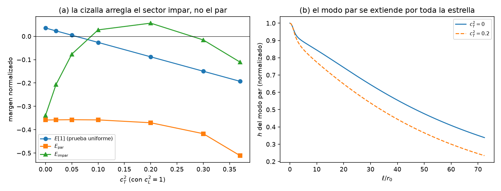
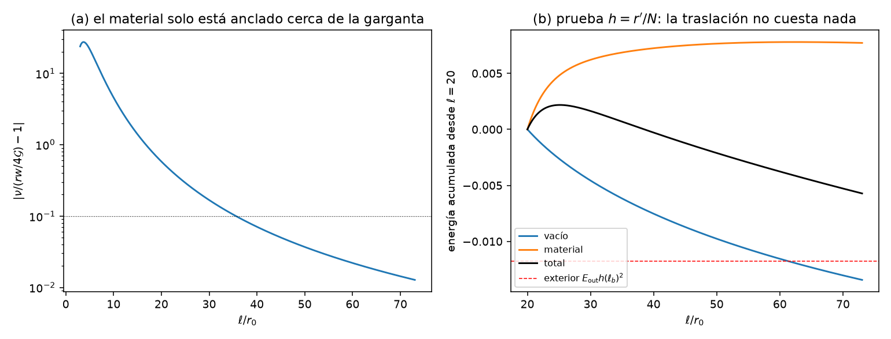
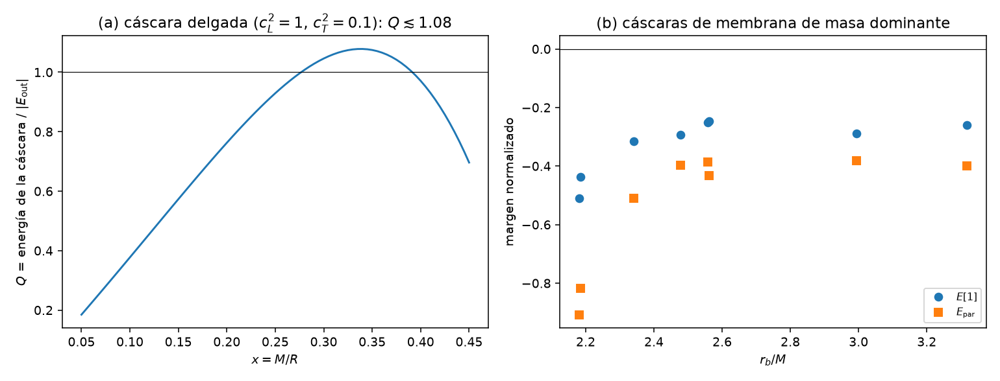
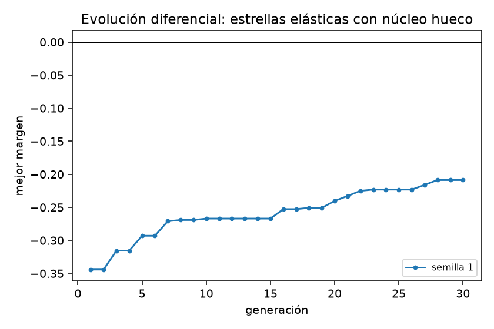

# Híbrido estrella–agujero de gusano — Fase 2i: materia elástica en el monopolo

*Documento de trabajo v0.1 · 2026-10-26 · continúa [fase2h/fase2h_resultados.md](../fase2h/fase2h_resultados.md) (§8, "siguiente paso: materia con rigidez de cizalla, en una cáscara")*

## Resumen

1. **La pregunta.** La Fase 2h mostró que un fluido no estabiliza la garganta. Con la superficie libre, el desplazamiento sin compresión tiene energía negativa con cualesquiera funciones libres, y la velocidad del modo rápido diverge si hay fluido en la garganta. Un sólido se opone también a la cizalla, y una cáscara deja la garganta vacía. Esta fase incorpora la materia elástica al monopolo de la GLPV cuártica y repite la criba sin funciones libres.

2. **El sólido en $l=0$** (§2). En simetría esférica, un sólido es un campo: su coordenada radial material $f(t,\ell)$, con lagrangiana $F(X_r,X_t,f)$, donde $X_r=g^{\mu\nu}\partial_\mu f\partial_\nu f$ y $X_t=f^2/r^2$ son los estiramientos radial y tangencial. La dependencia explícita en $f$ describe un material no homogéneo.
   - Comprobaciones exactas: las ecuaciones del fondo dan $\tilde\rho=-F$, $\tilde p_r=F-2X_rF_r$ y $\tilde p_t=F-X_tF_t$; la ecuación de $f$ es el equilibrio hidrostático anisótropo; se cumplen la identidad de Noether y el límite de RG; los modos gauge son exactos en chorros con el sólido.
   - **Estructura en el gauge unitario:**
     $$L_2=-(N^2a'+\dot\beta)\,(W+P_m)+L_{\rm rest}(c,d,y),\qquad P_m=\frac{r^2}{N}(\tilde\rho+\tilde p_r)\,\xi ,$$
     sin términos $a^2$, $\beta^2$ ni $a\beta$, porque el sólido no depende del lapso. La ligadura es $W=-(r^2/N)(\tilde\rho+\tilde p_r)\xi$, como la del fluido con $\tilde p\to\tilde p_r$, y $c$ sigue siendo auxiliar.
   - **Forma lagrangiana (comóvil).** La energía del material se escribe con el desplazamiento $\xi$ y las deformaciones logarítmicas. Integrada sobre el dominio material, no necesita términos de superficie: las superficies libres salen solas. Sus ecuaciones de Euler–Lagrange coinciden exactamente con las de la forma euleriana.

3. **Validación** (§3). Aplicada a la estrella fluida de la Fase 2h, la criba con la forma lagrangiana reproduce la criba euleriana con superficie libre a 5 cifras ($E_{\rm par}=-0.35864$, $E_{\rm impar}=-0.33842$, $E[1]=7.9\times10^{-4}$). El "muelle" de superficie que allí se añadió a mano sale aquí automáticamente.

4. **Lo que la cizalla arregla y lo que no** (§4).
   - **Arregla el sector impar.** En la estrella de la Fase 2h con módulo de cizalla, $E_{\rm impar}$ pasa de $-0.34$ a $+0.06$ con $c_T^2=0.2$.
   - **No arregla el sector par.** $E_{\rm par}$ no se mueve ($\approx-0.36$). Además, con la velocidad longitudinal acotada por la causalidad ($c_L\le1$), la cizalla resta módulo de compresión y la prueba uniforme $E[1]$ empeora.
   - **Cáscaras delgadas.** Fallan ya la prueba uniforme: toda su materia está donde $N^3$ es pequeño, y el balance con la energía negativa del exterior queda en $\lesssim1.08$ veces lo necesario en el mejor caso ($M/R\approx0.34$), antes de contar el hueco.
   - **Núcleo hueco.** Vaciar la garganta en estrellas gruesas no cambia $E_{\rm par}$.

5. **El mecanismo: la traslación casi gauge** (§5). En toda región donde el fondo cumple la relación de RG $\nu\equiv\Phi'r'-r''=r(\tilde\rho+\tilde p_r)/(4\mathcal G)$, la familia $c=0$ contiene la traslación uniforme del material,
   $$d=r'C,\qquad \xi=-C,$$
   que **no deforma el material** ($\varepsilon_r=\varepsilon_t=0$) y cumple la ligadura. Su energía en el material es
   $$E_m=C^2N\Big[\tilde p_t\,(r'^2+rr'')+\tilde\rho\,\frac{r^2N''}{2N}\Big],$$
   **sin ningún módulo elástico** (comprobado simbólicamente). Ningún material, por rígido que sea, se opone a ella. En la estrella de la Fase 2h, las capas exteriores ($\ell\gtrsim40$, de un radio propio de 73) cumplen esa relación a $\lesssim7\,\%$. La traslación transmite allí, sin coste elástico, la energía negativa del exterior ($E_{\rm out}\approx-0.012$) y la del vacío. Solo la "ancla" la zona donde la tensión del escalar es comparable a la de la materia, cerca de la garganta.

6. **Optimización** (§6). La evolución diferencial sobre las estrellas elásticas de núcleo hueco (16 parámetros, unos 2900 fondos) no encuentra ningún fondo que pase la criba. El mejor margen es $-0.209$ (desde $-0.344$), limitado por el sector par y por la prueba uniforme ($E[1]=-0.195$). El sector impar queda holgadamente estable ($+0.55$).

7. **Conclusión** (§7). La cizalla elimina la obstrucción de la Fase 2h (el desplazamiento sin compresión) y estabiliza el sector impar. Pero en el sector par la materia de las capas de tipo RG acompaña al taquión del vacío mediante una traslación que ningún módulo elástico puede impedir. Para anclarla haría falta que la materia "sintiera" el escalar en todo su volumen. **Siguiente paso:** materia acoplada al escalar, o salir de la GLPV cuártica (términos quínticos o DHOST), donde el déficit del vacío que comparten las Fases 2g–2i puede cambiar.

---

## 1. Planteamiento

La Fase 2h dejó dos obstrucciones para un fluido perfecto:
- el desplazamiento sin compresión con la superficie libre (teorema para superficies blandas, numérico con salto de densidad);
- la velocidad del modo rápido, que diverge en la garganta si hay fluido allí.

Propuso materia con rigidez de cizalla en una cáscara alrededor de una garganta vacía. Un sólido se resiste a los desplazamientos que no cambian el volumen ($\xi\propto r^{-2}$ tiene cizalla $-3\xi/r$), y una cáscara puede sostenerse con tensión tangencial sin atarse a la ley de Tolman. La relatividad elástica en simetría esférica está desarrollada por Karlovini–Samuelsson ([gr-qc/0211026](https://arxiv.org/abs/gr-qc/0211026); perturbaciones radiales con Zarroug en [gr-qc/0309056](https://arxiv.org/abs/gr-qc/0309056)). Aquí usamos una formulación de campo equivalente, más cómoda para acoplarla a la GLPV en el gauge unitario.

## 2. El sólido en el sector $l=0$

### 2.1 Formulación (`generar_solido.py`)

Las coordenadas del cuerpo son $\phi^I=f\,n^I$, con $f(t,\ell)$ la coordenada radial material. Para un sólido isótropo, la densidad de energía depende de los autovalores de $B^{IJ}=g^{\mu\nu}\partial_\mu\phi^I\partial_\nu\phi^J$, que en esta configuración son $X_r$ (una vez) y $X_t$ (dos veces):
$$S=\frac1{16\pi}\int\sqrt{-g}\,\big[L_{\rm GLPV}+F(X_r,X_t,f)\big],\qquad X_r=\frac{-B\dot f^2+2b\dot ff'+Af'^2}{AB+b^2},\quad X_t=\frac{f^2}{C},$$
con la métrica de la Fase 2f ($A=e^{2\Phi}(1+2a)$, $b=\beta$, $B=1+2c$, $C=r^2+2rd$).
- **Tensiones:** $\tilde\rho=-F$, $\tilde p_r=F-2X_rF_r$, $\tilde p_t=F-X_tF_t$ ($\tilde p=16\pi p$).
- **Fluido:** $F=F(n)$ con $n=\sqrt{X_r}\,X_t$; entonces $\tilde p_r=\tilde p_t$.
- **Fondo:** $f=f_0(\ell)$, con la normalización de las etiquetas libre. La perturbación es $f=f_0+y$, y el desplazamiento del material es $\xi=-y/f_0'$.
- **Símbolos:** las derivadas de $F$ en el fondo son símbolos $F_{ijk}$, con $D_\ell F_{ijk}$ por la regla de la cadena.

| Comprobación | Resultado |
|---|---|
| Ecuaciones del fondo de la materia | $E_A=-r^2\tilde\rho/2N$, $E_B=Nr^2\tilde p_r/2$, $E_C=N\tilde p_t$, $E_b=0$ |
| Ecuación de $f$ | $f_0'E_f=Nr^2\big[\tilde p_r'+(\tilde\rho+\tilde p_r)\Phi'+2(\tilde p_r-\tilde p_t)r'/r\big]$ (equilibrio anisótropo) |
| Identidad de Noether del fondo (materia sola) | idénticamente nula |
| Límite de RG | $E_B\propto G^\ell{}_\ell-\tilde p_r/2$, $E_A\propto G^t{}_t+\tilde\rho/2$ |
| Modos gauge $\zeta$, $\tau$ ($y=f_0'\zeta$), 6 ecuaciones, 2 chorros en la capa de masas con sólido | exactos |

**T1 con materia anisótropa.** De $-N^2E_A+\tfrac{r^2}2E_C$ (T1 de la Fase 2f):
$$\big[Nr\mathcal G(r'-r\Phi')\big]'=NG_4-\tfrac12Nr^2(\tilde\rho+\tilde p_t),$$
con la presión **tangencial**. En cambio, la relación de RG para $\nu=\Phi'r'-r''$ lleva la radial: $\nu=r(\tilde\rho+\tilde p_r)/4$.

### 2.2 Estructura en el gauge unitario (`reduccion_solido.py`)

El sólido estático no cambia con el tiempo, así que el gauge residual $\tau$ solo actúa sobre $(a,\beta)$. Con ecuaciones de Euler–Lagrange idénticas en 3 chorros exactos con el sólido:
$$L_2=-(N^2a'+\dot\beta)\,(W+P_m)+L_{\rm rest}(c,d,y),\qquad W=\gamma c+\alpha_1d'+\alpha_0d,\qquad P_m=\frac{r^2}{N}(\tilde\rho+\tilde p_r)\,\xi .$$
- **Diferencia con el fluido.** En el fluido había $\kappa_aa^2$ y $\kappa_\beta\beta^2$ (en el gauge comóvil). El sólido no depende del lapso, y las ecuaciones de $a$ y $\beta$ dan la misma ligadura, $W=-(r^2/N)(\tilde\rho+\tilde p_r)\xi$. El monopolo es un sistema de dos campos, $(\xi,d)$.
- **Ecuación de $c$:** $E_c=k_cc+e_0d+e_1d'+e_{tt}\ddot d+g_0y+g_1y'$, sin derivadas de $c$ ($c$ auxiliar). El sólido añade $-Nr^2(F_{000}-4f_0'^2F_{100}-4f_0'^4F_{200})$ a $k_c$.

### 2.3 Forma lagrangiana de la energía

El elemento de material que en el fondo está en $\ell$ pasa a $\ell+\xi$. Con las deformaciones logarítmicas
$$\varepsilon_r=\ln\big[(1+\xi')\sqrt{1+2c(\ell+\xi)}\big],\qquad \varepsilon_t=\tfrac12\ln\frac{C(\ell+\xi)}{r(\ell)^2},\qquad \nu_\Phi=\Phi(\ell+\xi)-\Phi(\ell),$$
la lagrangiana del material es $L_m=r^2N\,e^{\varepsilon_r+2\varepsilon_t+\nu_\Phi}\,G(\varepsilon_r,\varepsilon_t)$, con $G(e_r,e_t)=F(X_re^{-2e_r},X_te^{-2e_t},f)$. A segundo orden:
$$\frac{L_2^{\rm lag}}{r^2N}=G_0\Big(z_2+\frac{z_1^2}2\Big)+G_r\varepsilon_{r2}+G_t\varepsilon_{t2}+(G_r\varepsilon_{r1}+G_t\varepsilon_{t1})z_1+\tfrac12\big(G_{rr}\varepsilon_{r1}^2+2G_{rt}\varepsilon_{r1}\varepsilon_{t1}+G_{tt}\varepsilon_{t1}^2\big),$$
con $z=\varepsilon_r+2\varepsilon_t+\nu_\Phi$.
- **Coeficientes:** $G_0=-\tilde\rho$, $G_r=\tilde\rho+\tilde p_r$, $G_t=2(\tilde\rho+\tilde p_t)$, y los módulos $G_{rr},G_{rt},G_{tt}$.
- **Por qué no hay términos de superficie.** La integral es sobre el dominio material, que es fijo. No se integra por partes, así que las superficies libres no necesitan términos propios.
- **Equivalencia.** Las ecuaciones de Euler–Lagrange en $(\xi,c,d)$ coinciden con las de la forma euleriana ($y=-f_0'\xi$) en 3 chorros con el sólido en equilibrio (métrica arbitraria). La dependencia explícita en $f$ desaparece de esta forma.

**Módulos de un sólido isótropo** (`criba_solido.modulos`). La energía por elemento se separa en una parte de volumen y una de cizalla, $e=e_v(\varepsilon_r+2\varepsilon_t)+e_s(\varepsilon_r-\varepsilon_t)$:
$$S\equiv{\rm Hess}\,e=e_v''\begin{pmatrix}1&2\\2&4\end{pmatrix}+e_s''\begin{pmatrix}1&-1\\-1&1\end{pmatrix},\qquad e_v''=wc_L^2-\tilde p_r-\tfrac43wc_T^2,\quad e_s''=\tfrac43wc_T^2,$$
con $w=\tilde\rho+\tilde p_r$.
- $c_L^2=(S_{rr}+\tilde p_r)/w$ es la velocidad longitudinal radial (la del monopolo) y $c_T^2=\mu/w$ la de cizalla.
- Estabilidad del material: $e_v''\ge0$ y $e_s''\ge0$. Un fluido es $c_T=0$, con $S=(wc_s^2-\tilde p)\begin{pmatrix}1&2\\2&4\end{pmatrix}$.

## 3. La criba $c=0$ con materia elástica (`criba_solido.py`)

La familia $c=0$ de la Fase 2g se generaliza así: $d=Nh$, $\delta g_{\ell\ell}=0$, y el material se mueve para cumplir la ligadura, $\xi=4N\mathcal Gh'/(rw)$. En el vacío, $W=0$ obliga a $h'=0$. Entonces:
$$T[h]=\int\Big[\frac{8N\mathcal G^2\dot h'^2}{w}-2G_4N\dot h^2\Big],\qquad E[h]=\int\Big[-2N^3\mathcal G(h'-\sigma h)^2-L_2^{\rm lag}\big(\xi,\xi',Nh,(Nh)'\big)\Big].$$
- **Sin funciones libres.** Ninguna función libre de la teoría ($G_2$, $G_3$, $F_{4X}$, $G_{2XX}$) aparece; solo $\mathcal G$, $G_4$, el fondo y el material.
- **Dominios.** Hueco de vacío $[0,\ell_a]$ con $h$ constante (en paridad impar, nula); material $[\ell_a,\ell_b]$ con elementos de Hermite cúbicos y las dos superficies libres; exterior con $h=h(\ell_b)$ y energía $E_{\rm out}h(\ell_b)^2$.
- **Energía cinética.** Se prueba con soporte compacto. En el hueco aporta $-2\dot h_0^2\int_0^{\ell_a}G_4N$, que es negativo: la cáscara debe compensarlo con la energía cinética del material.

**Validación con la estrella fluida de la Fase 2h** (candidato `rejilla_pozo`, visto como sólido con $c_T=0$):

| | criba euleriana de la Fase 2h (libre, con muelle) | forma lagrangiana (esta fase) |
|---|---|---|
| $E_{\rm par}$ ($n=160$) | $-0.35864$ | $-0.35864$ |
| $E_{\rm impar}$ ($n=160$) | $-0.33842$ | $-0.33842$ |
| $E[1]$ | $7.86\times10^{-4}$ | $7.9\times10^{-4}$ |
| $T_{\rm par}$, $T_{\rm impar}$ | $0.4838$, $0.5154$ | $0.4836$, $0.5152$ |

El muelle de superficie, que en la Fase 2h hubo que derivar a partir de $P_{YY}=A\,\delta(Y-Y_s)$, sale aquí sin hacer nada: es un término de volumen de la forma lagrangiana. Esto valida a la vez la forma lagrangiana, el tratamiento de las superficies libres y el código.

## 4. Lo que la cizalla arregla y lo que no

### 4.1 La estrella de la Fase 2h con módulo de cizalla

Mismo fondo y mismas tensiones (isótropas), con $c_L^2=1$ y $c_T^2$ variable:

| $c_T^2$ | 0 | 0.02 | 0.05 | 0.1 | 0.2 | 0.3 | 0.37 |
|---|---|---|---|---|---|---|---|
| $E[1]$ normalizada | $+0.035$ | $+0.023$ | $+0.005$ | $-0.026$ | $-0.088$ | $-0.150$ | $-0.193$ |
| $E_{\rm par}$ | $-0.359$ | $-0.358$ | $-0.357$ | $-0.358$ | $-0.370$ | $-0.417$ | $-0.511$ |
| $E_{\rm impar}$ | $-0.338$ | $-0.207$ | $-0.076$ | $+0.028$ | $+0.056$ | $-0.016$ | $-0.111$ |

- **El sector impar se arregla.** La cizalla se opone al desplazamiento sin compresión. Con $0.1\lesssim c_T^2\lesssim0.25$, $E_{\rm impar}>0$. Con más cizalla vuelve a bajar: con $c_L\le1$, el módulo de volumen cae ($e_v''=w c_L^2-\tilde p_r-\tfrac43wc_T^2$).
- **El sector par no.** El modo par se reparte por toda la estrella ($h$ baja de 1 a 0.23–0.34 en la superficie). El material casi no se le opone: $+6.5\times10^{-4}$, frente a $-2.2\times10^{-3}$ del vacío y $-6.4\times10^{-4}$ del exterior con $c_T^2=0.2$.
- **La prueba uniforme empeora con la cizalla.** Su energía en el material es $2N^3[w(c_L^2-c_T^2)+\tilde p_t-\tilde p_r]$. Con $c_L\le1$ fijado por la causalidad, la cizalla quita módulo de compresión.

### 4.2 Cáscaras

**Construcción** (`fondo_cascara.py`). Sobre los fondos de la Fase 2h (violación de la NEC en la garganta y cola canónica ajustada para la planitud) se pone materia en $[\ell_a,\ell_b]$:
- densidad $w=\tilde\rho+\tilde p_r$ prescrita;
- presión radial $\tilde p_r$ que se anula en las dos superficies;
- tensión tangencial dada por el equilibrio anisótropo, $\tilde p_t=\tilde p_r+\frac{r}{2r'}(\tilde p_r'+w\Phi')$.

Resultados:
- **La presión radial debe ser casi hidrostática.** El factor $r/(2r')$ amplifica cualquier desajuste. Con perfiles genéricos, $|\tilde p_t|/\tilde\rho$ llega a 2–6, lo que viola la condición de energía dominante.
- **Cáscara de membrana.** La elección natural es $\tilde p_r=0$, sostenida solo por tensión tangencial de compresión (una cúpula), con $\tilde p_t/\tilde\rho=r\Phi'/(2r')$. Cumple la condición dominante si $r\gtrsim2.5M$.
- **Las cáscaras delgadas fallan $E[1]$.** En una cáscara delgada de masa $M$ y radio $R$ alrededor de una garganta ligera, con exterior de Schwarzschild, el cociente entre la energía de la cáscara en la prueba uniforme y $|E_{\rm out}|=2(1-3x+3x^2)/R$ ($x=M/R$) es
  $$Q(x)=\frac{4x\,\big(0.9N^3+Nx/2\big)}{1-3x+3x^2},\qquad N=\sqrt{1-2x}\qquad(c_L^2=1,\ c_T^2=0.1).$$
  Su máximo es $Q\approx1.08$ en $x\approx0.34$, antes de restar la energía negativa del hueco y la del propio vacío en la cáscara. Toda la materia está donde $N^3$ es pequeño.
- **Numérica.** Cáscaras de membrana de masa dominante ($r_b/M=2.2$–2.6) dan $E[1]$ normalizada entre $-0.25$ y $-0.51$ y $E_{\rm par}$ entre $-0.39$ y $-0.91$.
- **Garganta débil.** Con $\nu_0\lesssim1$ la garganta ni siquiera se abre ($r'$ vuelve a anularse en $\ell\approx1.4$). La cola escalar de las gargantas de la Fase 2h lleva una masa de $\approx4.5\,r_0$.

### 4.3 Estrellas gruesas con núcleo hueco (`fondo_solido.py`)

El perfil de Tolman de la Fase 2h ($m=1$) en el volumen, con la materia empezando en $\ell_a$:
$$\tilde p_r=A(Y-Y_s)\,\chi,\qquad \chi=1-e^{-(\ell-\ell_a)/\ell_\chi},$$
- **Superficie interior libre.** Las capas interiores se sostienen con tensión tangencial, $\tilde p_t-\tilde p_r=\frac r{2r'}[w\Phi'(1-\chi)+A(Y-Y_s)\chi']\ge0$.
- **Límite fluido.** Con $\chi=1$ es la estrella de la Fase 2h.
- **Resultados** (fondo del candidato de la Fase 2h):
  - Con $\ell_a=0.5$–5, $E_{\rm par}$ queda entre $-0.34$ y $-0.37$, igual que sin hueco.
  - Un hueco demasiado pequeño ($\ell_a=0.05$) dispara la tensión tangencial cerca de la garganta ($\tilde p_t/\tilde\rho\approx137$, porque $r'\to0$) y la criba ($E_{\rm par}\approx-2500$).
  - Con $\ell_a\gtrsim0.5$ la superficie interior queda en el límite de la condición dominante ($\tilde p_t\approx\tilde\rho$).

## 5. El mecanismo: la traslación casi gauge

**Proposición.** Supongamos que en una región con materia (cualquiera: fluido, sólido, anisótropa) el fondo cumple
$$\nu\equiv\Phi'r'-r''=\frac{r\,(\tilde\rho+\tilde p_r)}{4\mathcal G}$$
(la relación de RG, con $\mathcal G$ en lugar de $G_4$). Entonces la traslación uniforme
$$c=0,\qquad d=r'C,\qquad \xi=-C$$
está en la familia $c=0$, no deforma el material y su energía no depende de los módulos.
- *Ligadura:* $W+P_m=-\alpha_1C\nu-\frac{r^2}Nw\,C=\frac{Cr}N\big(4\mathcal G\nu-rw\big)=0$.
- *Deformaciones:* $\varepsilon_r=\xi'=0$ y $\varepsilon_t=(r'\xi+d)/r=0$.
- *Energía en el material* (simbólica, sin ningún módulo):
  $$E_m=C^2N\Big[\tilde p_t\,(r'^2+rr'')+\tilde\rho\,\frac{r^2N''}{2N}\Big] .$$

**Interpretación.** Es la traslación rígida del material. Donde el escalar no tensiona (RG), sería un modo gauge de la teoría completa salvo por la perturbación del escalar que el gauge unitario no permite. Ningún material, por rígido que sea, se opone a ella.

**En la estrella de la Fase 2h** (con núcleo hueco $\ell_a=3$ y $c_T^2=0.3$):
- **Cuánto se aparta el fondo de RG.** La desviación $\nu/(rw/4\mathcal G)-1$ la produce la cola escalar $\kappa r\phi'^2/2$ ($\mathcal G/G_4-1<10^{-4}$ más allá de $\ell=10$):

  | $\ell$ | 3 | 5 | 10 | 20 | 40 | 60 | 72 |
  |---|---|---|---|---|---|---|---|
  | $\nu/(rw/4\mathcal G)-1$ | 23.7 | 21.7 | 4.6 | 0.58 | 0.071 | 0.022 | 0.013 |

- **Energía de la prueba $h=r'/N$ por regiones** (con $\xi=qh'$):

  | región | $\xi$ medio | vacío | material | suma |
  |---|---|---|---|---|
  | $[3,10]$ | $-16.0$ | $-0.381$ | $+15.9$ | $+15.5$ |
  | $[10,20]$ | $-2.75$ | $-0.0162$ | $+0.349$ | $+0.333$ |
  | $[20,40]$ | $-1.21$ | $-0.0075$ | $+0.0072$ | $-0.0003$ |
  | $[40,60]$ | $-1.04$ | $-0.0040$ | $+0.0005$ | $-0.0035$ |
  | $[60,73]$ | $-1.02$ | $-0.0019$ | $-0.0001$ | $-0.0020$ |

  En las capas exteriores la prueba es la traslación ($\xi\to-1$). El material no se le opone, el vacío aporta energía negativa, y el exterior suma $E_{\rm out}h(\ell_b)^2=-0.0118$. Solo cerca de la garganta, donde la tensión del escalar domina, el material "ancla" la prueba.

- **El autovector lo confirma.** Modo par de la misma estrella con $c_T^2=0.2$ (criba con $n=200$, $E_{\rm par}=-0.341$), normalizado al máximo de $|\xi|$:

  | $\ell$ | 3 | 10 | 20 | 30 | 40 | 50 | 60 | 73 |
  |---|---|---|---|---|---|---|---|---|
  | $\xi$ | 0.48 | 0.68 | 0.91 | 0.98 | 1.00 | 0.99 | 0.97 | 0.94 |
  | $\varepsilon_t$ | 0.12 | 0.004 | 0.004 | 0.004 | 0.004 | 0.003 | 0.003 | 0.002 |

  Más allá de $\ell\approx20$ el material se desplaza casi uniformemente y apenas se deforma ($|\varepsilon_t|\lesssim0.004$, frente a $|h|N/r\sim0.02$–0.1).
- **Lectura.** El modo par inestable es la prueba $d=N$ del exterior (el taquión del vacío) más la traslación de las capas exteriores, que lo siguen sin coste elástico. Lo frena una transición en la zona anclada. Fijar la superficie (la criba de la Fase 2g) prohibía justo la traslación; por eso aquella criba pasaba.
- **Consecuencia.** Para estabilizar el sector par, el material tiene que estar anclado en todas partes: el fondo debe apartarse de la relación de RG en todo el material. Hay tres maneras: tensión del escalar comparable a la de la materia, $f_m\neq1$ en $\nu$, o $\mathcal G\neq G_4$.
- **Anclar con $f_m$.** Con $f_m=1.3$, 1.6 y 2 (desviación 0.3–1 en todo el material), $E_{\rm impar}$ mejora (+0.19, +0.29, +0.42). En cambio $E_{\rm par}$ empeora ($-0.38$, $-0.41$, $-0.44$): con los demás parámetros fijos, la estrella se encoge ($\ell_s$ de 73 a 54) y $E[1]$ baja ($-0.14$, $-0.18$, $-0.23$). Con $f_m<1$ empeoran las dos ($f_m=0.4$: $E_{\rm par}=-0.54$).
- **Anclar con el escalar.** Separamos la anchura $b_\phi$ del perfil del escalar en la cola de $\nu$ de la de los perfiles de $G_4$ y $\mathcal G$. Con $b_\phi\ge10$ (escalar tensionando toda la estrella), la construcción por ajuste de $\kappa$ deja de dar estrellas asintóticamente planas: o $N(\ell_a)\ge N_s$, o la solución no llega a $L_{\max}$. Probar esta vía exige otra construcción del fondo.

## 6. Optimización

Evolución diferencial (`optimiza_solido.py`, semilla 1, 30 generaciones, población de 96: unos 2900 fondos) sobre `FondoSolido`, con 16 parámetros:
- **Garganta y escalar:** $w_t$, $\nu_0$, $f_m$, $\phi_1$, $b$, $n$, $d_0$, $w_d$, $\lambda$, $\ell_T$.
- **Materia:** $A$, $N_s$, $\ell_a$, $\ell_\chi$, $c_L^2$, $c_T^2/c_L^2$.
- **Margen:** el mínimo de la criba $c=0$ con las dos superficies libres ($E[1]$, $E_{\rm par}$, $E_{\rm impar}$, $T_{\rm par}$, $T_{\rm impar}$), la condición dominante tangencial y la estabilidad del material ($e_v''\ge0$).
- **Semilla:** el candidato de la Fase 2h con núcleo hueco ($\ell_a=3$) y sin cizalla.

**Resultado.** El mejor margen pasa de $-0.344$ a $-0.209$ ($-0.316$, $-0.271$, $-0.267$, $-0.240$, $-0.223$, $-0.209$ en las generaciones 3, 7, 10, 20, 25 y 28). **Ningún fondo explorado pasa la criba.**

| | mejor fondo |
|---|---|
| parámetros | $w_t=1.78$, $\nu_0=1.00$, $f_m=0.75$, $\phi_1=0.71$, $b=1.21$, $n=2$, $d_0=1.86$, $w_d=4.65$, $\lambda=0.66$, $\ell_T=229$, $A=0.0035$, $N_s=1.48$, $\ell_a=2.43$, $\ell_\chi=5.61$, $c_L^2=0.70$, $c_T^2=0.33$ |
| fondo | $\kappa=3.10$, $M=26.6$, $N_0=0.46$, superficies en $\ell_a=2.43$ ($r=1.93$) y $\ell_b=42.2$ ($r=35.4$); masa propia del material 8.3 |
| criba ($n=100$, 200 y 300, iguales a 4 cifras) | $E[1]=-0.195$, $E_{\rm par}=-0.209$, $E_{\rm impar}=+0.547$, $T_{\rm par}=+0.357$, $T_{\rm impar}=+0.811$ |
| material | condición dominante con margen 0.76; $\min e_v''/w=0.13$ |
| partes de $E[1]$ (sin normalizar) | hueco $-0.057$, exterior $-0.016$; total $-0.133$ |

**Qué hace el optimizador.**
- Busca cizalla ($c_T^2/c_L^2=0.47$), que deja el sector impar con mucho margen.
- No consigue que la prueba uniforme sea positiva. Con $c_L^2=0.70$ y $c_T^2=0.33$, el material solo aporta $2N^3w(c_L^2-c_T^2)=0.74N^3w$ en la prueba uniforme.
- El pozo es poco profundo ($N_0=0.46$), y el hueco aporta una energía negativa grande ($-0.057$).
- Con $c_L\le1$, la cizalla que necesita el sector impar compite con el módulo de compresión que necesita $E[1]$, y el sector par sigue limitado por la traslación de §5.

## 7. Conclusiones y siguiente paso

**Lo que queda establecido.**
1. **La materia elástica en el monopolo de la GLPV cuártica**, con una formulación de campo verificada de forma exacta y una criba sin funciones libres que trata las superficies libres sin términos de superficie. Aplicada a un fluido, reproduce la criba corregida de la Fase 2h a 5 cifras.
2. **La cizalla elimina el desplazamiento sin compresión** de la Fase 2h y estabiliza el sector impar de la familia $c=0$.
3. **El sector par no se arregla con rigidez.** Donde el fondo cumple la relación de RG, la traslación uniforme del material está en la familia $c=0$, no deforma el material y su energía no contiene ningún módulo elástico (§5). Las capas exteriores de una estrella siguen así, sin coste elástico, la prueba $d=N$ del exterior.
4. **Las cáscaras delgadas fallan la prueba uniforme** (cota analítica §4.2), y vaciar el centro de las estrellas gruesas no cambia el sector par.
5. **La optimización** sobre estrellas elásticas de núcleo hueco no encuentra ningún fondo que pase (mejor margen $-0.209$).

**El mecanismo común de las Fases 2g–2i.** En la familia $c=0$, la energía del vacío, $-2N^3\mathcal G(h'-\sigma h)^2$, es definida negativa, y no depende de las funciones libres de la teoría. La materia solo se opone si la deformación la tensa:
- un fluido escapa con la superficie libre (el desplazamiento sin compresión, Fase 2h);
- un sólido escapa con la traslación en las zonas de tipo RG (esta fase).

En los dos casos el material acompaña al taquión del vacío.

**Lo que no queda establecido.**
- No es un teorema para toda la materia. Un fondo que se aparte de la relación de RG en todo el material (tensión del escalar comparable a la de la materia, o $f_m$ lejos de 1 sin perder $E[1]$) podría anclar la traslación. Con la construcción actual no hemos podido fabricarlo: $b_\phi$ grande rompe el ajuste de $\kappa$, y $f_m\neq1$ empeora $E[1]$.
- El sólido tiene grados de libertad impares propios (modos de torsión, $l\ge2$), que no se han analizado. El sector par $l\ge2$ sigue sin derivar.
- No se ha reconstruido la teoría completa ni calculado el espectro de dos campos con el sólido. No hacía falta, porque falla ya la criba de condiciones necesarias.

**Siguiente paso.** Dos caminos atacan el mecanismo:
1. **Materia acoplada al escalar.** Si la lagrangiana del material depende de $\phi$ (acoplo no mínimo, como en el marco de Jordan), en el gauge unitario el elemento desplazado ve $\phi(\ell+\xi)$ y la traslación cuesta energía: un muelle de anclaje $\propto\tfrac12\partial_\phi^2\tilde\rho\,\phi'^2$.
   - La forma lagrangiana de esta fase lo incorpora directamente.
   - El precio: para anclar las capas exteriores, donde $\phi'$ es pequeño, las propiedades del material tienen que variar en orden uno a lo largo de la estrella (acoplo fuerte), y el escalar ejerce una fuerza sobre la materia en el fondo.
2. **Salir de la GLPV cuártica.** El déficit $-2N^3\mathcal G(h'-\sigma h)^2$ y el carácter auxiliar de $c$ son propiedades de la teoría cuártica (identidades T1–T3 de la Fase 2f). Con términos quínticos ($G_5$, $F_5$) o en DHOST con dinámica radial del lapso, la estructura del monopolo cambia y el teorema del vacío de la Fase 2g podría dejar de valer, quizá sin necesitar materia.
   - Candidatos naturales: las gargantas exactas de vacío de Bakopoulos–Charmousis–Kanti ([arXiv:2111.09857](https://arxiv.org/abs/2111.09857)), que usan el término quíntico. No hemos encontrado ningún estudio de su monopolo.
   - Bronnikov et al. ([arXiv:2507.17045](https://arxiv.org/abs/2507.17045)) dan agujeros de gusano de Brans–Dicke con $\omega=0$, por continuación conforme, estables frente a perturbaciones radiales si están cargados. Es otra clase de teoría, con una superficie donde el factor conforme degenera.

Recomendamos el segundo camino. Ataca la raíz común (el déficit del vacío) y no requiere materia con propiedades exóticas.

## Archivos

| archivo | contenido |
|---|---|
| `simbolos_solido.py` | símbolos del sólido sobre los chorros de la Fase 2f ($f_0^{(k)}$, $F_{ijk}$, $D_\ell$, chorros en la capa de masas) |
| `generar_solido.py` | lagrangiana del sólido en $l=0$: fondo, Noether, límite de RG, acción cuadrática, modos gauge |
| `reduccion_solido.py` | estructura en el gauge unitario, ecuación de $c$, forma lagrangiana (equivalencia con la euleriana) |
| `criba_solido.py` | criba $c=0$ con materia elástica (Hermite, superficies libres, hueco); módulos de un sólido isótropo; adaptador para las estrellas fluidas de la Fase 2h |
| `fondo_cascara.py` | cáscaras elásticas alrededor de una garganta de vacío (densidad y presión radial prescritas, $\tilde p_t$ del equilibrio) |
| `fondo_solido.py` | estrellas elásticas con núcleo hueco (perfil de Tolman en el volumen, superficie interior sostenida por tensión tangencial) |
| `optimiza_solido.py` | evolución diferencial sobre `FondoSolido` |
| `analisis_fase2i.py`, `figuras_fase2i.py` | datos y figuras de este informe |

## Figuras

| | |
|---|---|
|  | **Fig. 1.** (a) Márgenes de la criba $c=0$ en la estrella de la Fase 2h hecha sólido, frente a $c_T^2$ ($c_L^2=1$): la cizalla arregla el sector impar, no el par, y empeora $E[1]$. (b) El modo par, extendido por toda la estrella. |
|  | **Fig. 2.** (a) Desviación de la relación de RG en el material: solo cerca de la garganta la tensión del escalar ancla el material. (b) Energía acumulada de la prueba $h=r'/N$ desde $\ell=20$: en las capas exteriores la traslación no cuesta nada al material, y el vacío y el exterior aportan energía negativa. |
|  | **Fig. 3.** (a) Cociente $Q(x)$ de la cáscara delgada: la energía de la prueba uniforme apenas alcanza $|E_{\rm out}|$ en el mejor caso. (b) Márgenes de cáscaras de membrana de masa dominante. |
|  | **Fig. 4.** Evolución diferencial sobre las estrellas elásticas de núcleo hueco: el mejor margen sigue negativo. |

## Reproducibilidad

```
cd fase2i
python generar_solido.py          # ~1 min: solido en l = 0, comprobaciones exactas -> resultados/solido_simbolico.pkl
python reduccion_solido.py        # ~5 min: estructura en el gauge unitario y forma lagrangiana -> reduccion_solido.pkl
python analisis_fase2i.py         # ~3 min: validacion, cizalla, traslacion, cascaras, f_m -> analisis_fase2i.json
python optimiza_solido.py 30 1    # ~45 min con 8 nucleos: evolucion diferencial -> optimiza_solido_1.json
python figuras_fase2i.py          # figuras/
```
