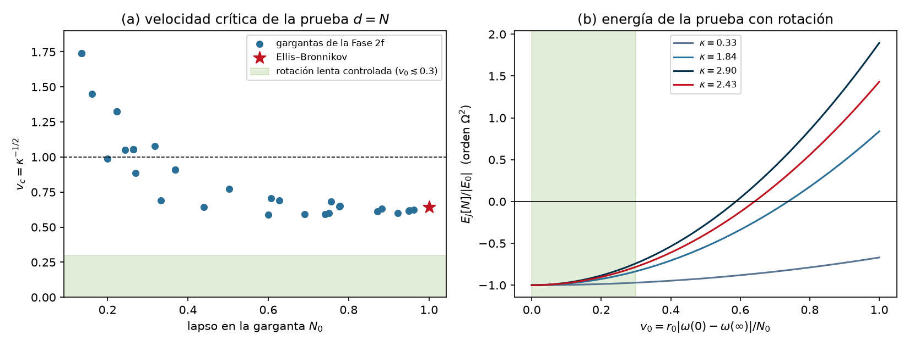

# Híbrido estrella–agujero de gusano — Fase 2l: gargantas en rotación lenta

*Documento de trabajo v0.1 · 2026-10-27 · continúa [fase2j/fase2j_resultados.md](../fase2j/fase2j_resultados.md) (§6, "lo que el teorema no cubre", salida 2)*

## Resumen

1. **La pregunta.** El teorema del monopolo de las Fases 2g–2j ($E[N]=-2\int N^3\mathcal G\sigma^2<0$ en toda garganta estática con el sector impar sano) supone un fondo estático. ¿Puede la rotación, que añade momento angular y mezcla el sector $l=0$ con el impar $l=1$, eliminar o reducir el taquión?

2. **Reducción de Kaluza–Klein exacta** (§2). Con la métrica estacionaria a primer orden en $\Omega$, $ds^2=-A\,dt^2+2b\,dt\,d\ell+B\,d\ell^2+C\,[d\theta^2+\sin^2\theta\,(d\varphi-\omega\,dt)^2]$, la parte de la acción de la GLPV cuártica que contiene el arrastre es, **exactamente** y salvo derivadas totales,
   $$L_\omega=\tfrac12\,\mathcal J\,\omega'^2,\qquad \mathcal J=\frac23\,\frac{C^2\,\mathcal G(\phi,X)}{\sqrt{AB+b^2}},\qquad \mathcal G=G_4-2XG_{4X}-4X^2F_4 ,$$
   con funciones $(A,b,B,C,\phi)$ arbitrarias de $(t,\ell)$. Es el mismo $\mathcal G$ que controla el déficit de la prueba $d=N$ y el sector impar. La ecuación del arrastre es $(\mathcal J\omega')'=0$; en RG se reduce a la de Hartle.

3. **El sector $l=0$ a $O(\Omega^2)$ es un problema de Routh** (§3). $\omega$ es cíclica y su momento $\pi=\mathcal J\omega'$ es el momento angular conservado ($\pi=-4J$ en un exterior de Kerr lento). A $\pi$ fijo, el sector $l=0$ es la teoría estática con un término más,
   $$L_{\rm eff}=L_{l=0}-\frac{\pi^2}{2\mathcal J}=L_{l=0}-\frac{3\pi^2}{4}\,\frac{\sqrt{AB+b^2}}{C^2\,\mathcal G(\phi,X)} ,$$
   exacto a $O(\Omega^2)$: las deformaciones $l=2$ de Hartle–Thorne no entran en el sector $l=0$ a este orden. El efecto es par en $\Omega$; no hay corrección $O(\Omega)$.
   - Comprobaciones: el exterior $l=0$ de Hartle–Thorne cumple las ecuaciones a $O(J^2)$; en la capa de masas con rotación se mantiene la estructura del monopolo ($a$ y $\beta$ solo a través de $F$, $c$ auxiliar), la ligadura $W$ no cambia y $\alpha_0=-\Phi'\alpha_1$ es una identidad fuera de la capa de masas.

4. **La energía de la prueba con rotación** (§4), exacta y punto a punto:
   $$E_J[Nf]=\int\Big[-2N^3\mathcal G\,(f'-\sigma f)^2+\frac{9\pi^2N^3}{\mathcal G\,r^6}\,f^2\Big]d\ell .$$
   La rotación a $J$ fijo es estabilizadora: es la curvatura de la energía de rotación $J^2/2I$, con $I\propto r^4$. Es el análogo de la presión eléctrica de la Fase 2g §7, con $r^{-6}$ en lugar de $r^{-4}$. La energía cinética de la prueba no cambia ($\delta K=0$).

5. **¿Cuánta rotación hace falta?** (§6). Medimos la rotación con $v_0$, la velocidad del observador de momento angular nulo de la garganta respecto del sistema estático de un infinito. Entonces $E_J[N]/|E_0|=-1+\kappa v_0^2$:
   - Ellis–Bronnikov: $\kappa=24/\pi^2$ (analítico), $v_c=\pi/\sqrt{24}=0.641$;
   - 27 gargantas distintas de la Fase 2f: $\kappa=0.33$–$2.90$, $v_c=0.59$–$1.74$ (mediana 0.68).
   - En el régimen lento controlado ($v_0\le0.3$) la rotación reduce $|E[N]|$ como mucho un 26 %. El taquión sobrevive en todas.
   - El signo solo cambiaría con $v_0\gtrsim0.6$, fuera del dominio de la expansión. En 6 de los 27 fondos (campo fuerte) ni siquiera ocurre por debajo de la velocidad de la luz.

6. **La garganta vuelve a obstruir** (§5). Como la carga en la Fase 2g, la rotación hace no nulo el coeficiente $e_0$ de la ecuación de $c$ en una garganta simétrica:
   $$e_0^{\rm tot}(0)=\frac{9\pi^2N_0}{2\mathcal G^2r_0^5}\,\big(\mathcal G-\phi'^2\mathcal G_X\big)\Big|_0 .$$
   - Si no se anula, las perturbaciones regulares tienen $\delta r(0)=0$ y la prueba $d=N$ deja de ser admisible.
   - A diferencia de la carga, la obstrucción se puede evitar con una condición sobre la teoría, independiente de $J$: $(\mathcal G-\phi'^2\mathcal G_X)(0)=0$. Solo en esa subclase vale el punto 5 sin reservas.

7. **Horndeski quíntico** (§7). Las diferencias con la cuártica:
   - La reducción da $L_\omega=\tfrac12\mathcal J\omega'^2$ con $\mathcal J=\tfrac23r^4\tilde{\mathcal G}/N$ en el fondo estático, donde $\tilde{\mathcal G}$ lleva $r'/r$ (el coeficiente de $\alpha_1$), no $\Phi'$.
   - El término de Routh añade a la ligadura $\kappa_J d$, con $\kappa_J\propto\pi^2X\phi'G_{5X}$. La prueba $d=N$ se deforma a $d=Nf$ con $f'/f=O(\pi^2)$.
   - La corrección a $E[N]$ sigue siendo $O(\Omega^2)$, ahora sin signo definido.

8. **Conclusión.** La rotación no es una salida viable:
   - en rotación lenta no cambia el signo de $E[N]$;
   - en teorías genéricas reintroduce la obstrucción en la garganta de la carga;
   - la única ventana, rotación relativista ($v_0\gtrsim0.6$) en una subclase ajustada, queda fuera de la teoría de perturbaciones y solo pasaría una condición necesaria.

---

## 1. Planteamiento

**La hipótesis que se rompe.** La prueba $d=Nf$, $c=0$, $\delta\phi=0$ de las Fases 2g–2j necesita:
- un escalar estático (gauge unitario sin tiempo);
- un **fondo estático**;
- que $c=\delta g_{\ell\ell}/2$ sea auxiliar.

Aquí rompemos la segunda con la configuración estacionaria más sencilla: una garganta en rotación lenta, con el escalar estático.

**Orden en $\Omega$.** A primer orden la rotación es el arrastre $g_{t\varphi}=-\omega(\ell)\,C\sin^2\theta$. Es una perturbación axial $l=1$.
- **$O(\Omega)$.** La paridad prohíbe que una perturbación polar $l=0$ se acople con el fondo axial salvo a través del sector axial $l=1$. El espectro del monopolo es par en $\Omega$ ($t\to-t$, $\varphi\to-\varphi$), así que no hay corrección a este orden.
- **$O(\Omega^2)$.** Hay tres efectos: (i) el acoplo $l=0$–axial $l=1$ a través de $\delta\omega$; (ii) la deformación esférica del fondo (Hartle–Thorne $h_0$, $m_0$); (iii) la deformación $l=2$.
  - El tercero no entra en el sector $l=0$ a este orden: el término lineal en una deformación $l=2$ con dos campos $l=0$ se anula al integrar en los ángulos ($\int Y_{20}Y_{00}Y_{00}=0$), y los demás son $O(\Omega^4)$.
  - Los acoplos $l=0$–$l=2$ de $O(\Omega^2)$ solo mueven los autovalores a $O(\Omega^4)$.
- Por tanto, a $O(\Omega^2)$ basta con la acción de las funciones $l=0$ y $\omega(t,\ell)$. Eso es lo que calcula §2.

## 2. Reducción de Kaluza–Klein (`kk_rotacion.py`)

**Métrica.** Con $(A,b,B,C,\phi,\omega)$ funciones de $(t,\ell)$ y un parámetro $\epsilon$ que cuenta los órdenes de la rotación:
$$ds^2=-A\,dt^2+2b\,dt\,d\ell+B\,d\ell^2+C\big[d\theta^2+\sin^2\theta\,(d\varphi-\epsilon\,\omega\,dt)^2\big].$$
$g_{\ell\varphi}=0$ fija el gauge de la componente axial $l=1$.
- La inversa es la de Kaluza–Klein: el bloque $(t,\ell)$ es la inversa bidimensional. Por eso $X=-\tfrac12g^{\mu\nu}\phi_\mu\phi_\nu$ no depende de $\omega$, y las funciones $G_i(\phi,X)$ salen de la parte $O(\epsilon^2)$.
- Se calculan los Christoffel, el Ricci y los invariantes del escalar, truncados a $O(\epsilon^2)$.
- Se define
  $$L_\omega=\tfrac12\int_0^\pi d\theta\,\big[\sqrt{-g}\,L\big]_{\epsilon^2},$$
  con la normalización de la lagrangiana $l=0$ de la Fase 2f. Se comprueba que la parte $\epsilon^0$ reproduce exactamente la lagrangiana de la Fase 2f con $G_4=1$.

| Comprobación | Resultado |
|---|---|
| Potencias negativas de $\sin\theta$ tras usar $\cos^2=1-\sin^2$ | se cancelan |
| Chorros de $\omega$ presentes | solo $\omega_\ell$ (sin $\omega$, $\omega_t$, $\omega_{tt}$: invariancia $\varphi\to\varphi+f(t)$) |
| Ecuación de Euler–Lagrange de $\omega$ | $E_\omega=-D_\ell(\mathcal J\omega_\ell)$ **idénticamente** (funciones de la teoría generales) |
| $\mathcal J$ | $\tfrac23C^2\mathcal G(\phi,X)/\sqrt{AB+b^2}$ exacta, con $\mathcal G=G_4-2XG_{4X}-4X^2F_4$ |
| Límite de RG | $\mathcal J=\tfrac23C^2/\sqrt{AB+b^2}$ |
| Fondo estático | $\mathcal J=\tfrac23r^4\mathcal G/N$ |

Como $E_\omega=-D_\ell(\mathcal J\omega_\ell)$ con la lagrangiana como función arbitraria de los demás campos, $L_\omega-\tfrac12\mathcal J\omega_\ell^2$ es una divergencia total. No contribuye a ninguna ecuación.

**Ecuación del arrastre y límite de Hartle.** En el fondo estático,
$$\Big(\frac{r^4\mathcal G}{N}\,\omega'\Big)'=0 .$$
- En RG, con $d\ell=e^{\Lambda}dr$, es $(r^4e^{-(\Phi+\Lambda)}\bar\omega_{,r})_{,r}=0$, la ecuación de Hartle.
- En Schwarzschild, $\omega=2J/r^3$ da $\pi=\mathcal J\omega'=\tfrac23(r^4/N)(-6J/r^4)\,N=-4J$, constante.
- **Por qué es el $\mathcal G$ del sector impar.** El $l=1$ estacionario es el $h_0$ del sector impar de Kobayashi–Motohashi–Suyama. Su término $(\dot h_1-h_0'+2h_0/r)^2$ lleva el coeficiente cinético impar, que es $\mathcal G$.

## 3. El sector $l=0$ a $O(\Omega^2)$ (`monopolo_rotacion.py`)

### 3.1 Reducción de Routh

$\omega$ solo entra a través de $\omega'$, así que su ecuación es $D_\ell(\mathcal J\omega')=0$. La ecuación de la componente $g_{\ell\varphi}$, que el gauge $g_{\ell\varphi}=0$ elimina, da la ley de Gauss temporal $\partial_t(\mathcal J\omega')=0$. Por tanto
$$\pi\equiv\mathcal J\,\omega'=\text{cte}$$
es el momento angular conservado.
- Las perturbaciones del monopolo no lo cambian (las que lo cambian, $\delta J\ne0$, son un desplazamiento a otro fondo de la familia).
- Eliminamos $\omega$ a $\pi$ fijo. Las ecuaciones de los demás campos son las de
  $$L_{\rm eff}=L_{l=0}+L_J,\qquad L_J=-\frac{\pi^2}{2\mathcal J}=-\frac{3\pi^2}{4}\frac{\sqrt{AB+b^2}}{C^2\mathcal G(\phi,X)}$$
  ($\delta L_{\rm eff}=\delta L_{l=0}+\tfrac12\omega'^2\delta\mathcal J$ con $\omega'=\pi/\mathcal J$).
- Es el mismo mecanismo que la "carga sin carga" de la Fase 2g §7, donde $L_{\rm em}=-q^2\sqrt{AB+b^2}/C$.
- La reducción es algebraica en $\omega'$. Vale con dependencia temporal arbitraria de los demás campos: describe también la dinámica de las perturbaciones, con $\delta\omega'$ determinada por la conservación de $J$.

### 3.2 Comprobaciones

**Límite de RG: Hartle–Thorne.** El exterior $l=0$ de Kerr lento en las coordenadas de Hartle–Thorne,
$$e^{2\Phi}=\Big(1-\frac{2M}r\Big)\Big(1+\frac{2J^2}{r^3(r-2M)}\Big),\qquad g_{rr}^{-1}=1-\frac{2}{r}\Big(M-\frac{J^2}{r^3}\Big),$$
pasado a longitud propia, cumple $E_A=E_B=E_C=0$ de $L_{\rm RG}+L_J$ a $O(J^2)$ con $\pi^2=16J^2$, exactamente. Esto comprueba a la vez la normalización de $\mathcal J$, la relación $\pi=-4J$ y el signo de $L_J$.

**Estructura del monopolo.** Se suman a la acción cuadrática de la Fase 2f (fuera de la capa de masas) el hessiano de $L_J$ en el fondo estático y sus ecuaciones del fondo.
- En el gauge unitario, $L_J$ contribuye a $E_\beta$ solo con un término $\propto\beta$, porque $L_J$ es par en $b$. **La ligadura $W=\gamma c+\alpha_1d'+\alpha_0d$ no cambia.**
- $\alpha_0+\Phi'\alpha_1=0$ es una **identidad fuera de la capa de masas**, así que vale en el fondo deformado por la rotación.
- En 3 chorros exactos de la capa de masas de $L_{l=0}+L_J$ ($\pi^2=3/7$):
  - $k_\beta=0$;
  - el coeficiente de $a$ en $E_a$ y $E_c$ es nulo;
  - $E_c$ depende de $(a',\beta)$ solo a través de $F=N^2a'+\dot\beta$.

  Control: en los mismos chorros, sin $L_J$, $k_\beta\ne0$. Las cancelaciones necesitan exactamente el término de rotación.
- $L_J$ no contiene derivadas: $c$ sigue siendo auxiliar.

## 4. La energía de la prueba con rotación

Con $a=\beta=\delta\phi=0$, la parte de $L_J$ que entra en $L_{\rm rest}$ es el segundo orden de
$$L_J(c,d)=-\frac{3\pi^2N}4\,\frac{\sqrt{1+2c}}{(r^2+2rd)^2\,\mathcal G\big(\phi,X_b/(1+2c)\big)}$$
(comprobado simbólicamente), es decir, $k_{cc}c^2+k_{cd}\,cd+k_{dd}\,d^2$ con
$$k_{dd}=-\frac{9\pi^2N}{\mathcal G\,r^6} .$$
$k_{cc}$ y $k_{cd}$ dependen de $\mathcal G_X$ y $\mathcal G_{XX}$.

**Identidad de la familia $c=0$** (exacta, punto a punto, fuera de la capa de masas):
$$-L_{\rm rest}^{\rm tot}(c=0,\,d=Nf)\big|_{\rm est}=-2N^3\mathcal G\,(f'-\sigma f)^2+\frac{9\pi^2N^3}{\mathcal G\,r^6}\,f^2 .$$

Por tanto, para la prueba $d=N$ (que cumple $W=0$ con $c=0$, como en la Fase 2g):
$$\boxed{E_J[N]=\int\Big[-2N^3\mathcal G\sigma^2+\frac{9\pi^2N^3}{\mathcal G\,r^6}\Big]d\ell}$$
evaluada sobre el fondo con rotación.
- La deformación $O(\pi^2)$ del fondo solo cambia cada término en una fracción $O(\pi^2)$ de sí mismo. No altera el criterio de cambio de signo al orden de trabajo.
- **Interpretación:** a $J$ fijo la energía de rotación es $J^2/2I$ con $I\propto r^4/N$. Reescalar el radio areal la sube cuadráticamente: el término es estabilizador, como la presión eléctrica ($+4q^2N^3/r^4$ en la Fase 2g).

**Coeficientes del monopolo.**
- $\delta K=0$: $L_J$ no tiene derivadas temporales.
- Con $c_*=-(\alpha_1/\gamma)N(d/N)'$:
  $$\delta P=-k_{cc}\,\frac{\alpha_1^2}{\gamma^2},\qquad \delta U=-\Big[k_{dd}+k_{cc}x^2\Phi'^2-k_{cd}x\Phi'\Big]-\tfrac12\big(k_{cd}x-2k_{cc}x^2\Phi'\big)',\qquad x=\frac{\alpha_1}\gamma .$$
- A estas correcciones directas se suma el cambio de $K,P,U$ de la Fase 2f evaluados en el fondo deformado, que depende de la teoría.

## 5. La garganta: la obstrucción de la carga vuelve (`garganta_rotacion.py`)

**El mecanismo.** La ecuación de $c$ es $E_c=k_cc+e_0d+e_1d'+e_{tt}\ddot d-\gamma F=0$, con $\gamma(0)=0$ en una garganta simétrica.
- La regularidad de $K$ ya exige $\mathcal H(0)=0$ (cero doble) y $k_c(0)=0$ (Fase 2f §5). Si además $e_0(0)\ne0$, una perturbación con $d(0)\ne0$ tiene $F\sim e_0(0)d(0)/\gamma'(0)\ell$: el lapso perturbado diverge logarítmicamente en la garganta.
- En la Fase 2g §7 esto obligaba, con carga, a $\delta r(0)=0$, y el problema reducido tenía $U\simeq\mp C/\ell^2$.

**Cálculo.** En chorros de una garganta simétrica:
- se imponen $r'=\Phi'=\phi''=0$, $\phi(0)=0$, la paridad de la teoría ($G_2,G_4,F_4$ pares y $G_3$ impar en $\phi$), $\mathcal H(0)=0$ y $k_c(0)=0$;
- se resuelven las ecuaciones del fondo con $L_J$ para $(G_{2},G_{2XX},\Phi'',r'')$.

| caso | $e_0^{\rm tot}(0)$ |
|---|---|
| carga (control, 3 chorros) | $4q^2N_0/r_0^3$, **igual que la Fase 2g** |
| rotación (3 chorros; forma cerrada comprobada simbólicamente) | $\dfrac{9\pi^2N_0}{2\mathcal G^2r_0^5}\big(\mathcal G-\phi'^2\mathcal G_X\big)$ |

- La parte de vacío es $e_0=2N_0r_0S(0)$, y la ligadura $\ell\ell$ con $\mathcal H(0)=0$ fija $S(0)=-2E_B^J/(N_0r_0^2)$. Se le suma la contribución directa $k_{cd}(0)$.
- Con $\mathcal G$ independiente de $X$ la rotación da $e_0>0$, del mismo signo que la carga.
- **Diferencia con la carga.** $\mathcal G_X(0)$ es libre: no lo fija el perfil del fondo, porque $X'(0)=0$. La condición $(\mathcal G-\phi'^2\mathcal G_X)(0)=0$, equivalente a $\partial_X(\sqrt{-X}\,\mathcal G)=0$ en la garganta, anula la obstrucción para todo $J$.

**Consecuencias.**
- **Teorías genéricas.** Las perturbaciones regulares del monopolo tienen $\delta r(0)=0$ en cuanto $J\ne0$, y la prueba $d=N$ deja de ser admisible. El problema reducido adquiere un término singular $\propto\pi^2/\ell^2$ en la garganta, como con carga. Que el límite $J\to0$ cambie la condición en la garganta indica que la rotación lenta no es una deformación regular de estas gargantas: no las estabiliza, las saca del dominio del análisis lineal regular.
- **Subclase ajustada** ($\partial_X(\sqrt{-X}\mathcal G)|_0=0$). La prueba es admisible y vale §4.

## 6. ¿Cuánta rotación haría falta? (`estimacion_rotacion.py`)

**Medida de la rotación.** En una garganta simétrica $\omega(\ell)-\omega(0)=\pi\int_0^\ell d\ell/\mathcal J$ es impar. Los dos infinitos giran a $\pm\pi I$ respecto de la garganta, con
$$I=\int_0^\infty\frac{d\ell}{\mathcal J}=\frac32\int_0^\infty\frac{N}{r^4\mathcal G}\,d\ell .$$
- La velocidad del observador de momento angular nulo (ZAMO) de la garganta respecto del sistema estático de cualquiera de los dos infinitos (prolongado rígidamente hasta la garganta) es
  $$v_0=\frac{r_0\,|\pi|\,I}{N_0} .$$
- $v_0<1$ es la ausencia de ergorregión alrededor de la garganta. La rotación lenta exige $v_0\ll1$.
- Sobre las perturbaciones axisimétricas la elección del sistema no importa: su momento angular canónico es nulo.

**Criterio.**
$$\frac{E_J[N]}{|E_0|}=-1+\kappa v_0^2,\qquad \kappa=\frac{C_1N_0^2}{r_0^2I^2|E_0|},\qquad C_1=9\!\int\!\frac{N^3}{\mathcal Gr^6},\qquad v_c=\kappa^{-1/2}.$$

**Ellis–Bronnikov** (RG + escalar fantasma: $N=1$, $\mathcal G=1$, $r^2=\ell^2+r_0^2$). Analíticamente:
- $E_0=-\pi/r_0$, $C_1=27\pi/(8r_0^5)$, $I=3\pi/(8r_0^3)$;
- $\kappa=24/\pi^2=2.432$ (la integración numérica y la cuadratura lo reproducen a $10^{-12}$);
- $v_c=\pi/\sqrt{24}=0.641$.

**Las gargantas de la Fase 2f** (las 34 de la Fase 2g, que son 27 fondos distintos):

| | resultado |
|---|---|
| $\kappa$ | 0.331–2.896 (mediana 2.156) |
| $v_c$ | 0.588–1.739 (mediana 0.681) |
| $v_c<1$ | 21 de 27 |
| reducción de $\lvert E_0\rvert$ a $v_0=0.1$ / $0.3$ | como mucho 2.9 % / 26 % |
| $\chi_c=J_c/M^2$ | 0.003–16 (no hay cota de Kerr para gargantas) |

- **Campo débil** ($N_0\to1$): $v_c\to0.60$–$0.65$, como en Ellis.
- **Campo fuerte** ($N_0\lesssim0.3$): $v_c$ crece por encima de 1, porque el lapso pequeño hace pequeño $I$. En 6 fondos la prueba $d=N$ detecta el taquión para toda rotación subluminal.
- Ninguna garganta llega a $v_c<0.58$. En el régimen donde la expansión es fiable (los términos $O(v_0^4)$ que faltan son pequeños frente a los $O(v_0^2)$ calculados), **la rotación reduce el déficit pero no lo cambia de signo**. El taquión sobrevive con $\omega_0^2(J)\le E_J[N]/\int KN^2<0$.



**Fig. 1.** (a) Velocidad crítica $v_c$ de la prueba $d=N$ frente al lapso en la garganta, para los 27 fondos de la Fase 2f y Ellis–Bronnikov. La franja verde es el régimen lento controlado. (b) $E_J[N]/|E_0|$ a $O(\Omega^2)$ para los $\kappa$ extremo, mediano y de Ellis.

## 7. Horndeski quíntico

### 7.1 La reducción (`kk_rotacion.py quintico`)

La reducción con $G_5$ (y $F_4$) da 153 términos en $L_\omega$.
- Solo aparecen los monomios $\omega_\ell^2$, $\omega_\ell\omega_{\ell\ell}$ y $\omega_\ell\omega_{t\ell}$. Por tanto
  $$L_\omega=\tfrac12\mathcal J\omega_\ell^2+\tfrac12D_\ell(b\,\omega_\ell^2)+\tfrac12D_t(c\,\omega_\ell^2)$$
  es una identidad algebraica (comprobada en 4 chorros aleatorios con 50 cifras; la expresión de $\mathcal J$ tiene unos $1.3\times10^5$ caracteres).
- Límite de RG: el mismo $\mathcal J$ de Hartle.
- **En el fondo estático** (comprobado en 5 puntos con 50 cifras, con $C$ y $C'$ libres):
  $$\mathcal J=\frac23\,\frac{C^2\,\tilde{\mathcal G}}{N},\qquad \tilde{\mathcal G}=G_4-2XG_{4X}-4X^2F_4+X\Big(\phi'\frac{C'}{2C}G_{5X}+G_{5\phi}\Big).$$
  Es el $\tilde{\mathcal G}$ de $\alpha_1=-4r\tilde{\mathcal G}/N$ de la Fase 2j, con $r'/r$, y **no** el $\mathcal G$ del teorema, con $\Phi'$. Los dos coinciden si $G_{5X}=0$.

### 7.2 El término de Routh (`quintico_rotacion.py`)

**Energía centrífuga.** $\mathcal J$ depende ahora de $C'$, así que la energía centrífuga de la prueba tiene un término en $d'$. Con $Q=C^2\hat{\mathcal G}+g_5CC'$, $\hat{\mathcal G}=G_4-2XG_{4X}-4X^2F_4+XG_{5\phi}$ y $g_5=\tfrac12X\phi'G_{5X}$:
$$-L_2^J=\frac{3\pi^2N}{4}\Big[\frac{(\delta Q)_1^2}{Q^3}-\frac{(\delta Q)_2}{Q^2}\Big],\qquad (\delta Q)_1=2C\hat{\mathcal G}\,\delta C+g_5(C'\delta C+C\,\delta C'),\quad (\delta Q)_2=\hat{\mathcal G}\,\delta C^2+g_5\,\delta C\,\delta C' .$$
- Con $\delta C=2rd$ y $G_5=0$ se reduce exactamente al $9\pi^2N^3f^2/(\mathcal Gr^6)$ de §4.
- Con $G_{5X}\ne0$ no tiene signo definido.

**La ligadura cambia.** En 3 fondos racionales al azar, $L_2^J$ contiene, además de los términos algebraicos en $a$ (que en la cuártica se compensan con los restos fuera de la capa de masas), los acoplos $\beta\dot d$ y $a\,d'$ con cociente exacto $N^2$:
$$L_2^J\supset\kappa_J\big(\beta\dot d+N^2a\,d'\big)\simeq-F\,\kappa_J\,d,\qquad \kappa_J=\frac{3\pi^2X\phi'G_{5X}}{4Nr^5\tilde{\mathcal G}^2}$$
(forma cerrada comprobada en los 3 fondos). Su origen es que $\tilde{\mathcal G}$ contiene $\phi^\mu\partial_\mu C$, que con $b\neq0$ incluye $g^{t\ell}\dot C$.
- En el vacío quíntico $\alpha_0+\Phi'\alpha_1=0$ es una identidad fuera de la capa de masas (Fase 2j). Por tanto, sobre el fondo en rotación,
  $$W_{\rm tot}=\gamma c+\alpha_1N\Big(\frac dN\Big)'+\kappa_J\,d .$$
- **La prueba $d=N$, $c=0$ ya no cumple la ligadura.** La familia $c=0$ sobrevive deformada: $d=Nf$ con
  $$\frac{f'}f=-\frac{\kappa_J}{\alpha_1}=\frac{3\pi^2X\phi'G_{5X}}{16\,r^6\tilde{\mathcal G}^3}=O(\pi^2).$$
- Su energía es la de la Fase 2j más la centrífuga, con $f=1+\pi^2g$:
  $$E_J[Nf]=E_0+\pi^2\Big[\int\!\big(-4N^3\mathcal G\,\sigma(\sigma g-g')\big)+\text{centrífuga}\Big]+O(\pi^4),$$
  y la corrección de $O(\pi^2)$ **no tiene signo definido**.

**Conclusión para Horndeski quíntico.**
- El efecto de la rotación sigue siendo $O(\Omega^2)$ y no puede cambiar el signo de $E[N]=O(1)$ en rotación lenta.
- La garganta: con $\gamma(0)=0$, la ligadura deformada se cumple con $c=0$, así que no aparece una singularidad nueva por esta vía. La obstrucción de §5 (la $e_0(0)$ de la ecuación de $c$) no se ha evaluado con $G_5$.
- Las únicas gargantas quínticas concretas del proyecto (BCK, Fase 2j, con $K\equiv0$) no se han tratado con rotación.

## 8. Conclusiones y siguiente paso

**Lo que queda establecido.**
1. **Rotación lenta en la GLPV cuártica, exacta a $O(\Omega^2)$.**
   - La parte de la acción con el arrastre es $\tfrac12\mathcal J\omega'^2$ con $\mathcal J=\tfrac23C^2\mathcal G/\sqrt{AB+b^2}$.
   - El sector $l=0$ es el estático más el término de Routh $-\pi^2/2\mathcal J$.
   - Validación: Hartle (arrastre) y Hartle–Thorne ($l=0$) en RG, más la estructura del monopolo en chorros exactos.
2. **La prueba $d=N$ sigue cumpliendo la ligadura**, y su energía gana un término positivo exacto, $9\pi^2\!\int N^3/(\mathcal Gr^6)$.
3. **En rotación lenta el taquión sobrevive.** Hace falta $v_0\ge v_c\in[0.59,1.74]$ para que la prueba deje de detectarlo; en el régimen controlado la reducción es como mucho del 26 %.
4. **En teorías genéricas la rotación reintroduce la obstrucción en la garganta de la carga eléctrica**, con $e_0(0)\propto\pi^2(\mathcal G-\phi'^2\mathcal G_X)/\mathcal G^2$. Solo una subclase con una condición sobre $\mathcal G_X(0)$ la evita.
5. **Horndeski quíntico.** $\mathcal J$ lleva $\tilde{\mathcal G}$ (con $r'/r$). La rotación añade $\kappa_J d$ a la ligadura y deforma la prueba a $d=Nf$, $f'/f=O(\pi^2)$. La corrección a $E[N]$ sigue siendo $O(\Omega^2)$, sin signo definido.

**Lectura.** El mecanismo del déficit (reescalar el radio areal con el lapso) no depende de que el fondo sea estático. La rotación añade una rigidez centrífuga $\propto J^2/r^6$ que compite con él, pero:
- es de segundo orden en la rotación;
- se concentra en la garganta igual que el déficit, así que no gana por geometría;
- solo gana con rotaciones relativistas.

Es la misma historia que la carga en la Fase 2g: una presión que entra con el signo bueno, con un coste en la garganta.

**Lo que no queda establecido.**
- La rotación rápida ($v_0\sim0.6$–1) requiere soluciones estacionarias completas, no perturbativas. En ese régimen la prueba $d=N$ es solo una condición necesaria, y aparecen cuestiones nuevas: no hay ningún vector de Killing temporal en los dos infinitos a la vez, y los modos no axisimétricos (superradiancia) quedan sin tratar.
- El signo del término singular $\propto\pi^2/\ell^2$ en las teorías genéricas, y el espectro resultante, no se han calculado sobre una garganta concreta. Se ha mostrado que la condición en la garganta cambia, igual que con carga.
- Horndeski quíntico: la obstrucción en la garganta ($e_0(0)$ con $G_5$) y una estimación numérica de $\kappa$ sobre gargantas quínticas concretas.

**Siguiente paso.** Recomendamos no seguir por la rotación. Para cambiar el signo hace falta un régimen relativista que la maquinaria perturbativa no alcanza, y en teorías genéricas la rotación añade una obstrucción en lugar de quitarla. Las otras dos salidas de la Fase 2j §6 siguen abiertas (en curso en paralelo):
- el escalar dependiente del tiempo (Fase 2k), que ataca la hipótesis del escalar estático;
- los campos vectoriales (Fase 2m).

## Archivos

| archivo | contenido |
|---|---|
| `kk_rotacion.py` | reducción de Kaluza–Klein de la GLPV cuártica (y `quintico`): $L_\omega=\tfrac12\mathcal J\omega'^2$, identidad de Euler–Lagrange, $\mathcal J$ covariante, límite de RG |
| `monopolo_rotacion.py` | término de Routh $L_J$: ecuaciones del fondo, hessiano, Hartle–Thorne, estructura del monopolo en la capa de masas, identidad de la familia $c=0$, $k_{cc},k_{cd},k_{dd}$, $\delta P$ |
| `garganta_rotacion.py` | $k_c$ y $e_0$ en una garganta simétrica con carga (control) y con rotación; forma cerrada de $e_0^{\rm tot}(0)$ |
| `quintico_rotacion.py` | Horndeski quíntico: forma estática de $\mathcal J$, energía centrífuga de la prueba, término $\kappa_J d$ de la ligadura |
| `estimacion_rotacion.py` | $\kappa$ y $v_c$ en Ellis–Bronnikov (analítico) y en las gargantas de la Fase 2f |
| `figuras_fase2l.py` | Fig. 1 |
| `*_log.txt`, `resultados/` | salidas |

## Reproducibilidad

```
cd fase2l
python kk_rotacion.py             # ~2 min: J de la GLPV cuartica -> resultados/kk_cuartico.pkl
python kk_rotacion.py quintico    # Horndeski quintico -> resultados/kk_quintico.pkl
python monopolo_rotacion.py       # ~3 min: Routh, Hartle-Thorne, estructura, identidad c = 0
python garganta_rotacion.py       # e0 en la garganta (control con carga)
python quintico_rotacion.py       # ~20 min: Horndeski quintico (J estatico, centrifuga, kappa_J)
python estimacion_rotacion.py     # ~1 min con 8 nucleos: kappa, v_c
python figuras_fase2l.py
```
